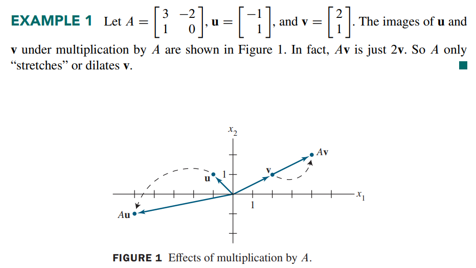

# Ch5 Eigenvalues and Eigenvectors

## 5.1 Eigenvectors and Eigenvalues

先来看一个例子：

神奇的就在于， $A\mathbf{v}$ 这个乘积的结果并没有改变方向

再来看看 eigenvector 和 eigenvalue 的定义：

eigenvector
: An *eigenvector* of an $n\times n$ matrix $A$ is a nonzero vector $\mathbf{x}$ such that:
$$
A\mathbf{x}=\lambda \mathbf{x}
$$
for some scalar $\lambda$

eigenvalue
: A scalar $\lambda$ is called an *eigenvalue* of $A$ if there is a nontrivial solution $\mathbf{x}$ of $A\mathbf{x}=\lambda \mathbf{x}$

: such an $\mathbf{x}$ is called an **eigenvector corresponding** to $\lambda$

## 5.2 The Characteristic Equation

首先啥是特征方程呢？

characteristic equation
: The scalar equation $$\det (A-\lambda I)=0$$ is called the *characteristic equation* of $A$

那他有啥用呢？==这个方程的解就是对应了 eigenvalue 的值==

