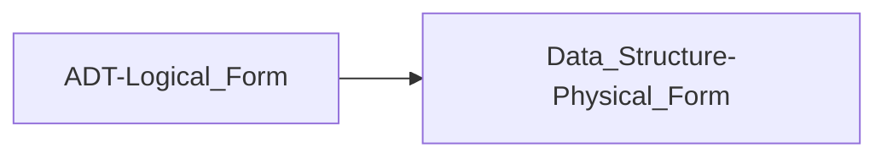
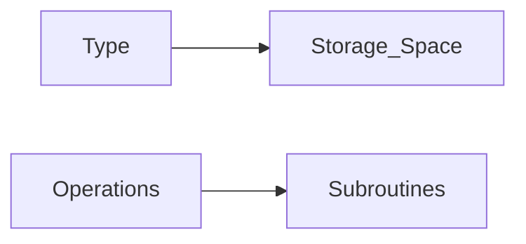

# 1.Introduction

## a.Philosophy of Data Structure

* Data Structure: any **data representation** and its associated **operations**

比如整数与加法；字符串与置换

### b.Abstract Data Types and Data Structures

* Data Type: 总觉得和Data Structure 差不多
* Data Item: Data Type 的一部分，比如true是boolean type 的一部分

* Atomic Data Type: 没有subparts，如整数和布尔
* Structure Data Type: 包括多个部分的信息，比如Array, String

* File Structure: 硬件上的数据组织形式

Data Type的区分：

其中的对应关系为：

### c.Problems, Algorithms and Programs

* 程序是算法的实现(instance)

# 2.Algorithm Analysis

### a.Best, Worst and Average Cases

* Running Time T(n). n是用户输入的大小！

### b.Fast Computer or Fast Algorithm?

### c.Asymptotic(渐进) Analysis

三种方法：

* Big-Oh(O)
    * 算法的growth rate上限
    * 具体咋用你懂的
    * **这类表示方法其实有一个核心思想，就是通过一个sample的f(x)来代表一类，关注的是整体的趋势特征**
* Big-Omega($\Omega$)
    * 下限
* Big-Theta($\Theta$)
    * 当$\Omega$和O一样的时候，这种情况就是$\Theta$，平均情况
    * 我们学的都是这种特殊情况

### d.Multiple Parameters

### e.Space Bounds