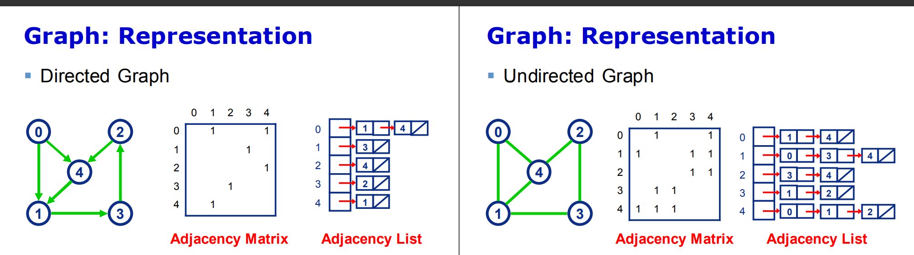
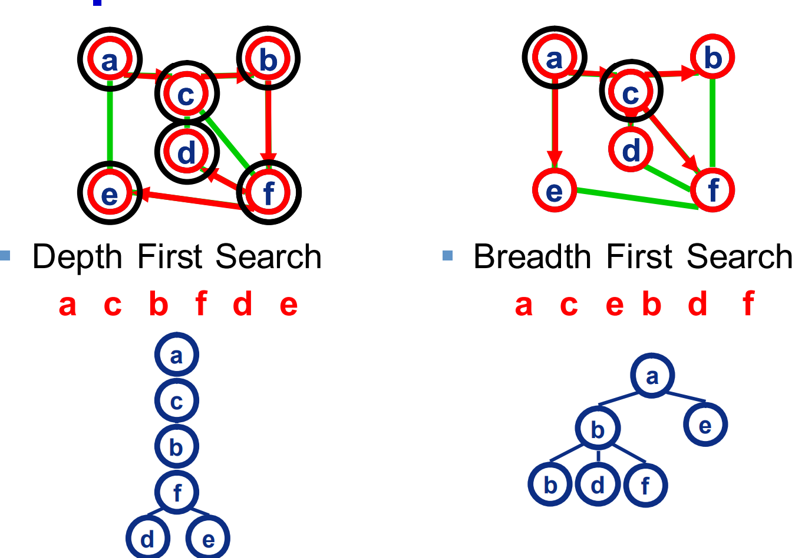

### 1. Terminology
很多都在离散里学了
- acyclic[ˌeɪˈsaɪklɪk]: a graph without cycles
    - Directed Acyclic Graph(DAG): a directed graph without cycles
- subgraph: 每条边的两个顶点都必须在子图里
- connectivity: 
    - strongly connected: **有向图**的每一个顶点都可以到达**任意**另一个顶点
    - weakly connected: **有向图**，虽然考虑方向的话到不了每个顶点，但是不考虑方向的话是连起来的
### 2. Representations
- Adjacency Matrix
    - 2D array
    - space: $\Theta (|V|^2)$
        - 如果边的数量很少，会浪费很多空间（空白的地方很多）
    - 能快速找到边是否存在
- Adjacency List
    - 1D array
    - space: $\Theta (|V|+|E|)$
        - 如果边比较少的话会比matrix节省空间
    - 需要花费大量时间来验证边是否存在

对于matrix来说，有向图一般都不对称，无向肯定对称
### 3. Graph Traversal
- DFS(深度优先): 需要注意的是==DFS并不是唯一的==，比如a->b, a->c, b->c这样的图，DFS就有两种，分别是a, b, c和a, c, b，两者虽然看起来路径长度不同，但都是符合一条路捅到底的要求的。
- BFS(广度优先): 先把同一深度级别的搜完了再搜更深的

- Topological Sort(拓扑排序)
    - directed acyclic graph(DAG)的算法
    - DAG中顶点的一种**线性**排序，满足如下要求：如果在图中存在一个A指向B的箭头，那么在拓扑排序中A一定比B先出现
    - eg. 如果A、B工作之间存在相互依赖关系，只有先做了A才有可能做B(A->B)，那么在拓扑排序中必须A比B先出现
    - 实现：反向思考，从最后一个Task开始，挨个访问**没有后续工作**的节点
    - ==拓扑排序的一种实现方法就是DFS==，需要注意的是节点值要在循环访问过所有子节点之后才能输出

### 4. Shortest-Paths Problem
##### 4.1 Single Source: Dijkstra's Algorithm
寻找特定两个点之间的最短距离
数模课上有说过，大概就是局部最优得到全局最优，==计算到所有其它点的最短距离==并最终得到目标的最短距离。每次选择的是未找到最短路径的点里面==离起点==距离最近的点(并不是每次都找最小权重的边走，那样目光太短浅了)
- Linear Approach: 
    - scan through the table of current distances
    - space:
        - total cost: $\Theta (|V|^2+|E|)=\Theta (|V|^2)$
        - 无论图的边是多是少都是这么多，所以适用于密的图
- Min Heap Approach
    - Store unprocessed vertices using a min-heap to implement a ==priority queue== ordered by distance
    - space: 
        - total cost: $\Theta((|V|+|E|)\times log_2|E|)$
        - 稀疏的图适合，为$\Theta(|V|\times log_2|V|)$
##### 4.2 All Pairs: Floyd's Algorithm
目标是找到任意两点之间的最短距离
思想是先用邻接矩阵初始化最短路径矩阵，然后把每个点都遍历一遍，每个循环中把该点视为中间点，看看如果经过该点会不会使得最短路程变小，是则更新。（每次循环都要检查所有的最短路径是不是最优的）(d(i, k) VS d(i, j)+d(j, k))
> K-path: 中间结点的index都小于K
### 5. Minimum-Cost Spanning Trees
数模里面有讲过
两种实现方式：
- Prim's Algorithm:
    - 这个算法找的是==已经存在的树==的下一个最近节点(也就是说已经在树里的任意一个节点都可以作为当前节点)
- Kruskal's Algorithm:
    - 一开始每个节点都视为minimum spanning tree，算法工作就是每次找两个相距最近的MST把他们合并到一起
    - Implementation
        - use a priority queue to order the unprocessed edges
        - grab next one at each step
        - uses the UNION/FIND algorithm with parent-pointer representation
    - Total Cost
        - worst: $\Theta (|E|log|E|)$
        - average: close to $\Theta (|V|log|E|)$