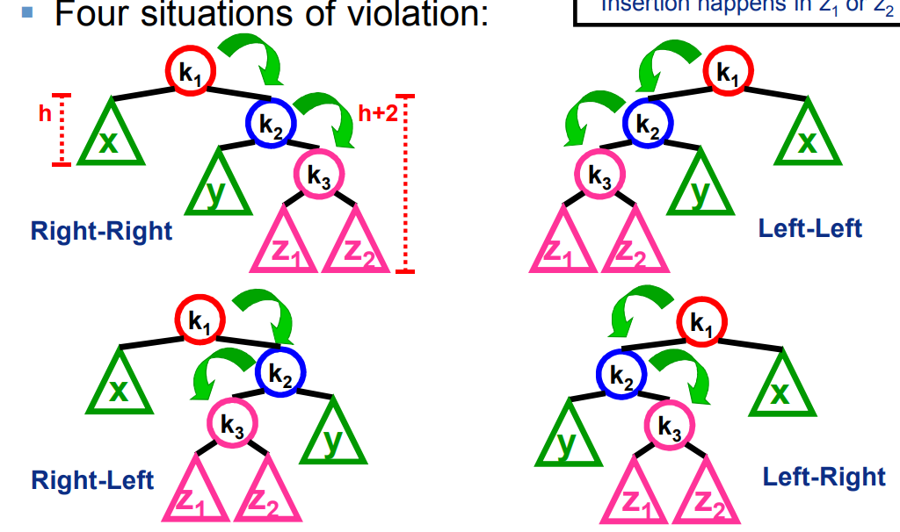
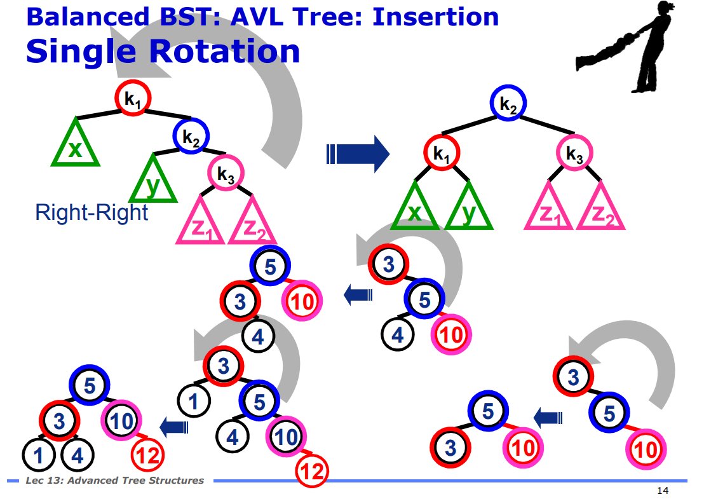
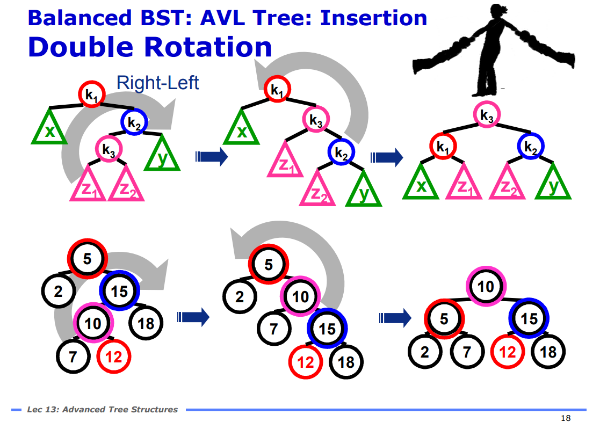

### 1. AVL Tree
一种平衡二叉树，满足以下性质：
> 对于每个节点而言，其左子树和右子树的高度差顶多为1

有个比较tricky的事情，它只要求了每个节点的左右子树之间的关系，也就是说，整棵树看起来有可能并不是高度顶多相差1的

#### Insertion
如果不balance了就难一点，要用到Rotation，可以看看课件。旋转针对的只是包括插入节点往上数的三个节点。
旋转的四种情况：

- Single Rotation(应对left-left和right-right)

- Double Rotation(应对left-right和right-left)

- Complexity:
    - step 1: insert: $O(logn)$（和普通的搜索树看起来一样）
    - step 2: trace the path from the new leaf towards the root to see if they need rotation: $O(logn)$
#### Deletion
同样和搜索树一样很复杂，反正可能需要旋转不止一次
### 2. Internal Heap
同时定位最大和最小值，结合了Max-heap和Min-heap，是一种Complete binary tree
每个节点满足：
- 必须有两个元素(除了最后一个节点)，左边的a属于Min-heap，右边的b属于Max-heap
- [a, b]是一个区间，$a\le b$
- 这个区间被包含于父节点的区间之中（也就是说小的值相对更大，大的值相对更小）

#### Insertion
- 将要插入的值放到最后一个节点里（如果满了就创建一个新的节点），并保证节点里左边的值小于右边的值
- 更新Max-heap: 如果新的右值比parent的右值大，则一直交换
- 更新Min-heap: 如果新的左值比parent的左值小，则一直交换
#### Remove
操作和两种heap一致
#### Time Complexity
|Time Complexity|Heap|Interval Heap|
| --- | --- | --- |
|Insert|$O(log(n))$|$O(log(n))$|
|Remove|$O(log(n))$|$O(log(n))$|