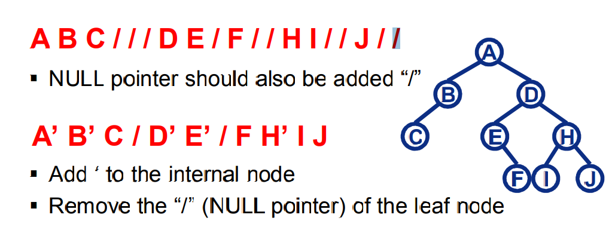
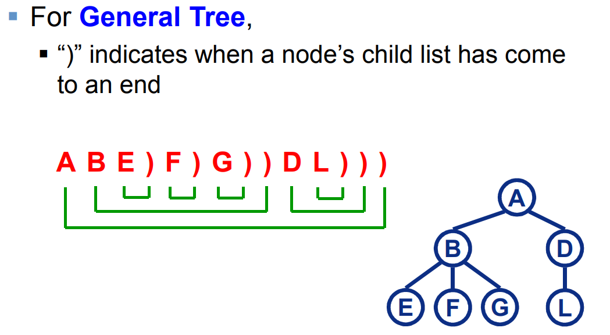

### Parent Pointer Implementation(array based)

- Only storing pointer to its parent. 
- 容易确定两个节点是否在同一个树内
- Equivalence Class
    - UNION/FIND implementation(很奇特，看看课件)
    - Reduce the cost: 降低树的高度
        - Weighted Union Rule: 合并两个树时，把高度更低的树接到高度更高的树的底下，而不是反过来
        - Path Compression: 难以描述，见课件（垂直线变为水平线）

### List of Children Implementation(array based)

- 特点：
    - 能很容易找到孩子
    - 向右搜寻比较困难
    - 结合两个不同的树比较困难

### Left-Child/Right-Sibing Implementation(LCRS)(array based)

- list of children的改进版本
- 每个节点只存储自己的值，自己的儿子里排在最左边的那个，自己的右边的元素

### Dynamic Left-Chlid/Right-Sibling Implementation(linked list)

- 用链表实现的LCRS，每个节点看起来就跟二叉树很像了
- 找不到爸爸是谁

### Dynamic Node Implementation(两种实现都有)

- Allocate variable space for each node
- 两种实现方式：
    - Array: 假定孩子的数量在节点创建时是已知的。
    - 链表：不知道孩子数量也可以，只不过需要花费更多的空间

### K-ary Trees

- 每个节点最多有k个孩子，比如二叉树就最多有俩

### Sequential Tree Implementation

- 和之前的方法全都不同。
- 几种示例：
    - 
    - 
- Space/Time Tradeoff
    - Space saving: 不用存指针
    - 失去了树的高效性：
        - Tree: Efficient access $O(log_2n)$
        - Sequential Tree: Sequential access $O(n)$