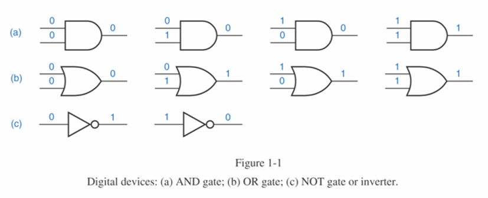
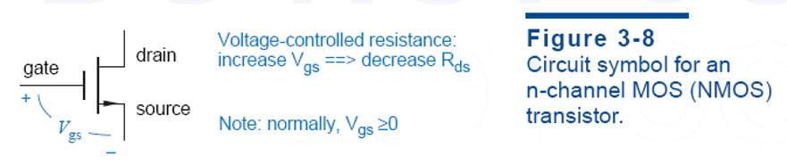
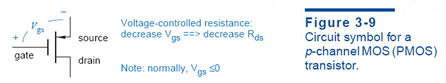
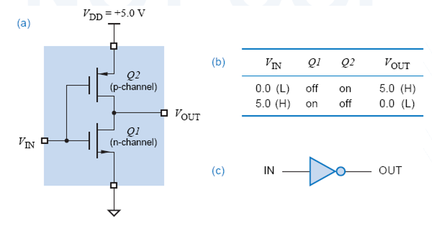
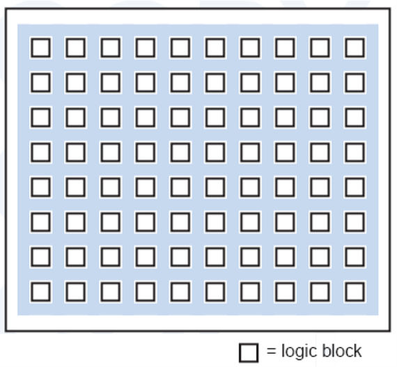

### Types of logic circuits

- combinational
    - 只取决于**current inputs**
- sequential
    - 不仅**current inputs**, 还有**past sequence of inputs**

### Gates

- 三种门: NOT AND OR（闹太套~）

- Flip-flop: a device that stores either a 0 or 1. The state can be changed only at certain state times determined by a “clock” input 

### Integrated Circuits(IC)

- SSI: Small-Scale Integration
- MSI: Medium-Scale Integration
- LSI: Large-Scale Integration
- VLSI: Very Large-Scale Integration

### CMOS(Complementary Metal Oxide Semiconductor) Logic Circuits: 将一定范围内的电信号转换为逻辑布尔

- NMOS(negative): 一般而言source的电位比drain低。$V_{gs}\ge 0$，越小则$R_{gs}$越大（负反馈）
- PMOS(positive): 注意source的位置变了，一般而言source电位比drain高。$V_{gs}\le 0$，越小则$R_{gs}$越小（正反馈）
- 一个使用的例子：Inverter Circuit: 
    - 当$V_{IN}$电位低（=0）时，Q1电阻贼大，而Q2电阻贼小，所以$V_{OUT}$就是5V
    - 当$V_{IN}$电位高（=5）时，Q1电阻贼小，而Q2电阻贼大，所以$V_{OUT}$就是0V
    - 总体上看起来就和NOT没有什么区别
    - Q2可以画上NOT gate的符号

### Programmable Devices

- PLAs: : programmable logic arrays 
- PAL: programmable array logic
- CPLD: complex PLD
- FPGA: field-programmable gate arrays
