### 0. 前情提要

Sequential circuit = Combinational logic + Memory Elements

时序电路

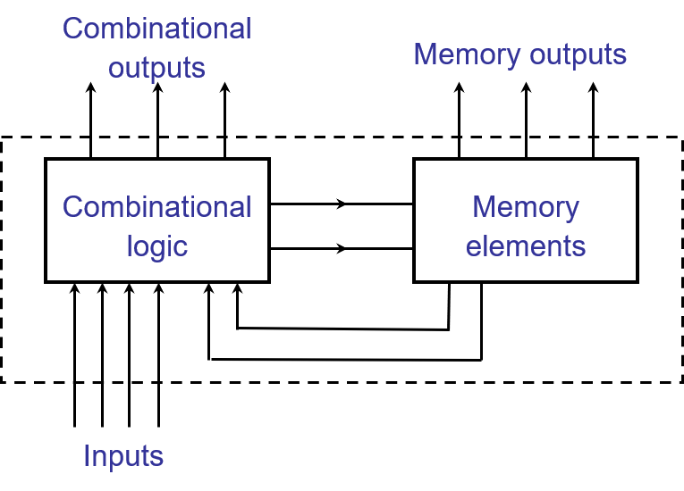

> 输出不仅取决于当前输入，还取决于==过往的==输入输出 

### 1. Bistable Elements
##### 1.1 Digital Analysis
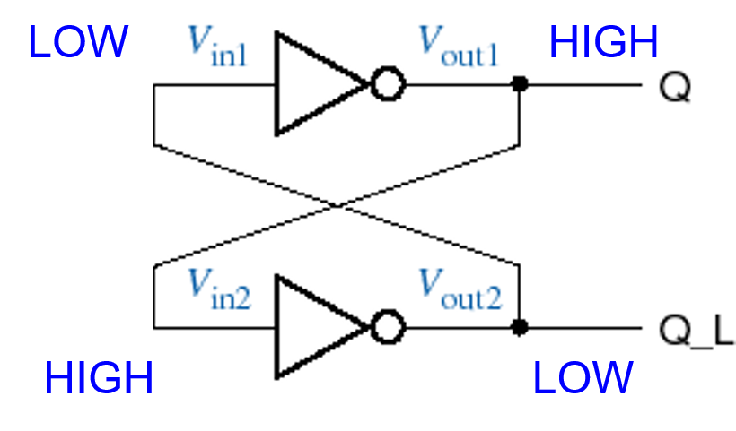

这就是个最简单的sequential circuit。可以看到输出结果正常情况下必定是==相反==的

##### 1.2 Analog Analysis
- invertor的输入输出特性： 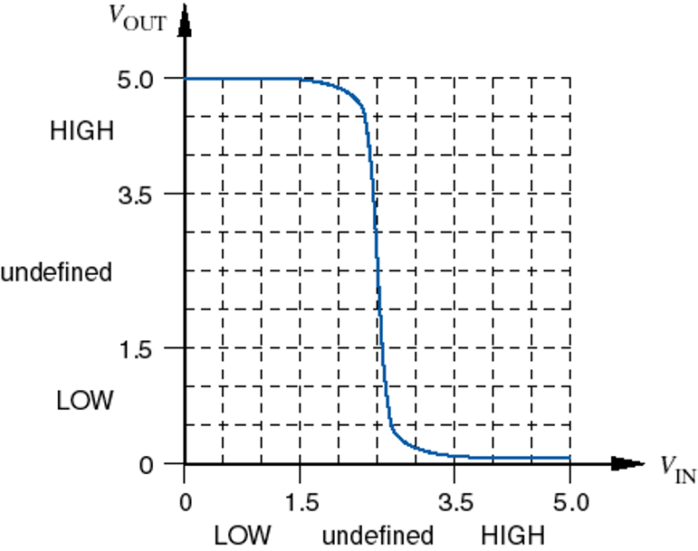

- **metastable** 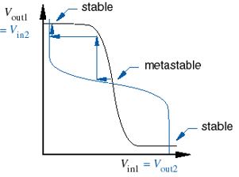 图中两条曲线分别是两个invertor的输入输出特性，三个交点是理论上的平衡点。其中中间的点metastable最为特殊，因为此时其实既不是0也不是1，两个输出端口也并不能满足相反的特性

另一种看待三个平衡点的方式：

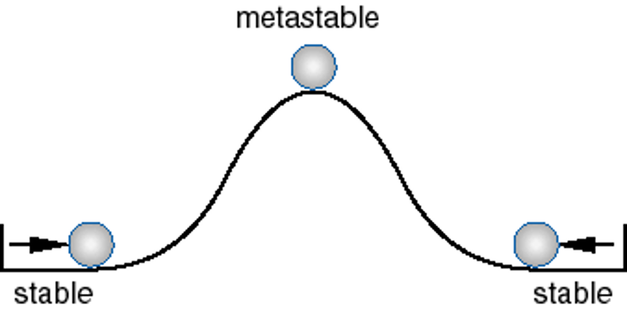

### 2. Latches and Flip-Flops
组成sequential circuit 的最基本成分

#### 2.1 Latches
The output of a latch depends on its current inputs and on its previous inputs and its change of state can happen at ==any time== when its inputs change. 

##### 2.1.1 S-R Latches(Set-Reset)
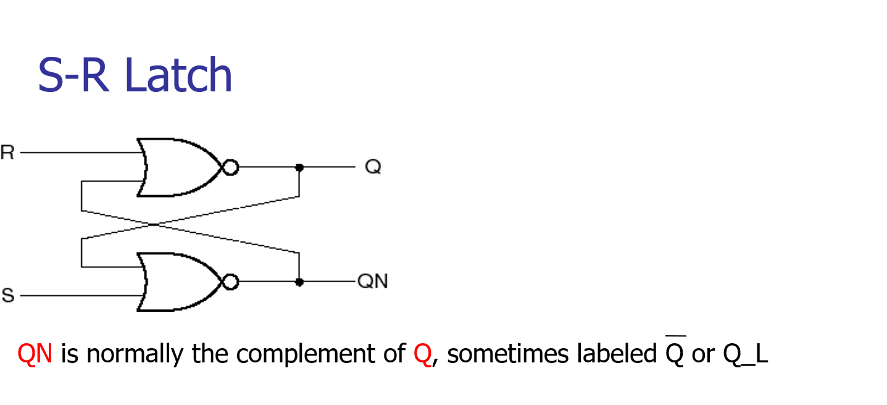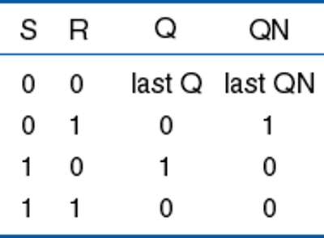 原本bistable是没有输入的，==为了控制而加入了S和R两个输入==

可以看到Set=1时Q=1，而Reset=1时Q=0，也难怪叫这两个名字了

> ps: S=1且R=1通常是不允许发生的。因为这个时候Q和QN就不是互补的关系了

关于符号规范:

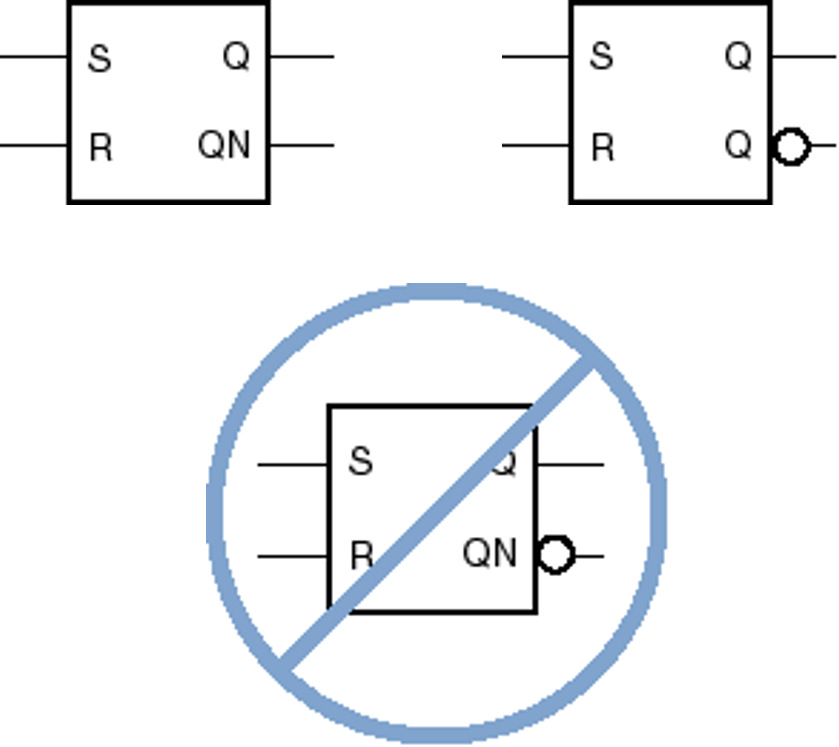

##### 2.1.2 $\bar{S}-\bar{R}$ Latch
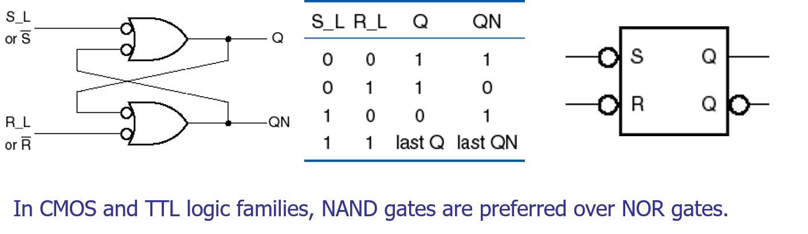

可以看到现在变成了R=1时Q=1
##### 2.1.3 D Latch
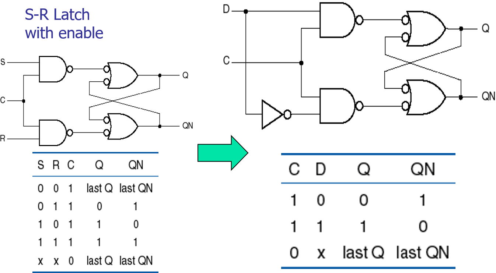

C是enable，D和Q的值一样

#### 2.2 Flip-Flop
只有当clock triggered的时候，D输入端的信号才会传给Q输出端

- **Edge-triggered D flip-flop**

    俩D Latch放一起组成了D flip-flop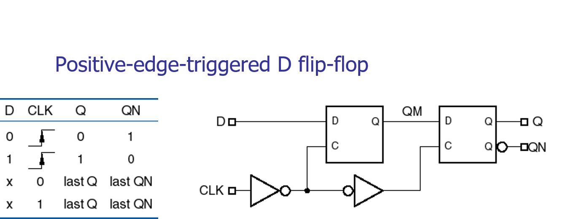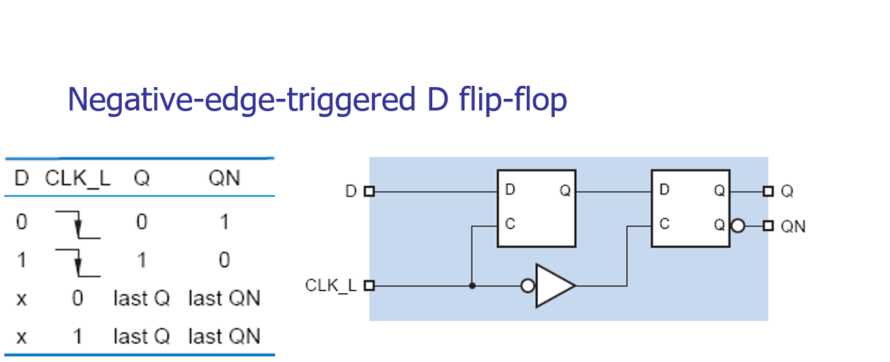
- **Edge-triggered D flip-flop with Enable**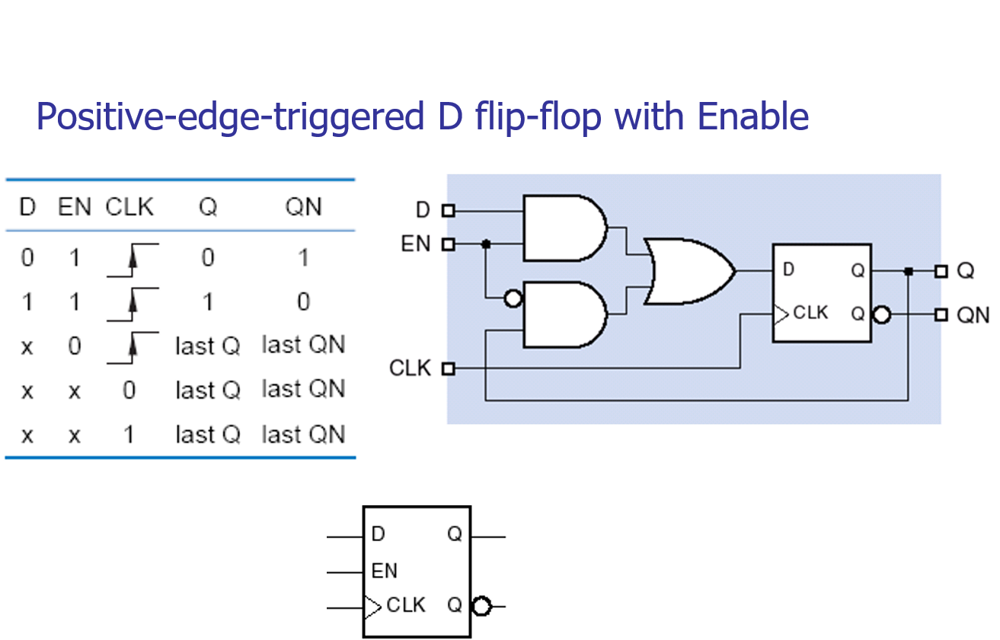
- **T flip-flop(toggle)**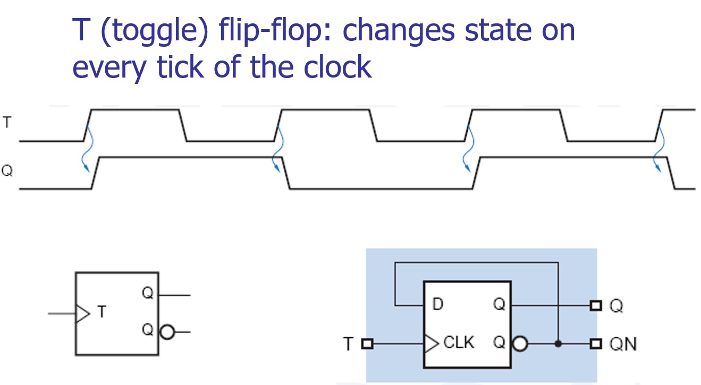

    可以看到实际上就是把D flip-flop的QN端接到了输入端D，而clock输入端就是唯一的T输入口

    作用是在每一次clock值改变的时候，改变输出的值

### 3. Multibit Registers and Latches

#### 3.1 Registers寄存器
A collection of two or more D flip-flops with a common clock inputs

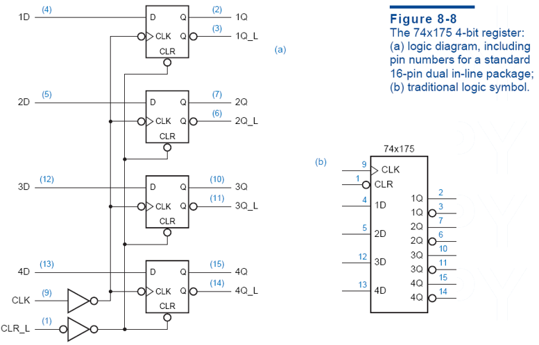

作用就是临时存一下值

#### 3.2 Latches锁存器
A collection of two or more D latches.

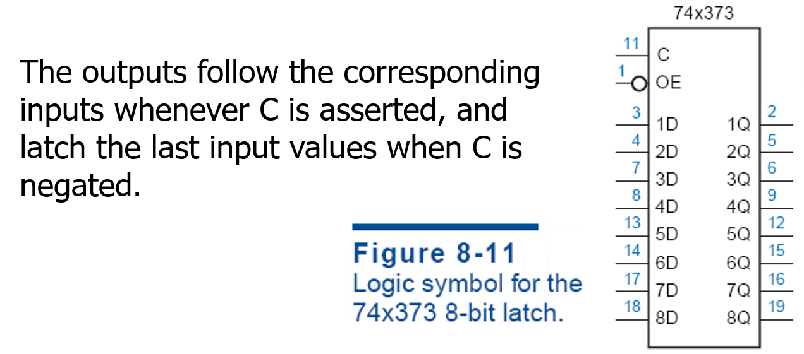

C就是enable。C=1时输入等于输出

至于为什么叫锁存器：因为C=0时输出值不随着输入值而改变。但是C=1时它就好像不存在一样

### 4. Sequential PLDs
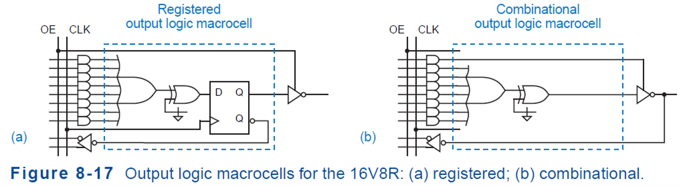
好像就是加了个D flip-flop来寄存结果