### 1. Counter
Counter is generally used for any clocked sequential circuit whose state diagram contains a ==single cycle==

- modulus: number of states in a cycle
    - modulo-m counter/divide-by-m counter: A counter with m states
    - A counter with a non-power-of-2 modulus has ==extra states== that are not used in normal operation
- Ripple counter: the carry information ripples from the less significant bits(LSB) to the more significant bits(MSB), one bit at a time.（我也没搞懂它具体想表达一个什么样的具体电路）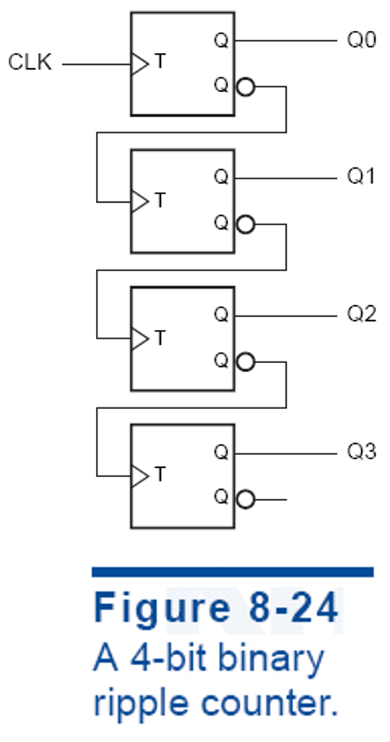
- Synchronous counter: connects all of its flip-flop clock inputs to the same common CLK signal, so that all of the flip-flop outputs change at the same time.(接受同一个clock信号)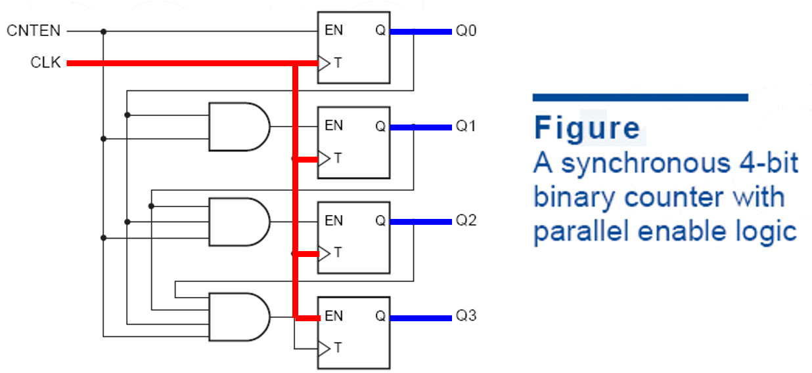
##### 1.1 MSI Counters and Applications
最常用的MSI: a synchronous 4-bit binary counter with active-low load and clear inputs

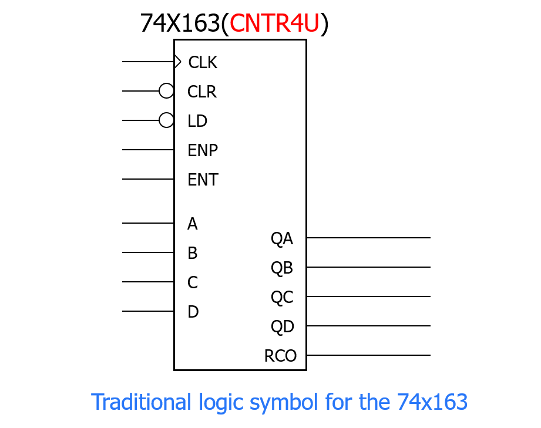

> ==QA是低位，QD是高位！==

这玩意有两个关键的port:
- CLR: 就是clear，收到CLR_L的信号时，最终的输出就会是0000
- LD: load，收到LD_L的信号时就会输出ABCD
- free running mode: 虽然说大多数MSI都有enable input的port，但是大多数时候还是会选择让他们连续不断地运行，接线如下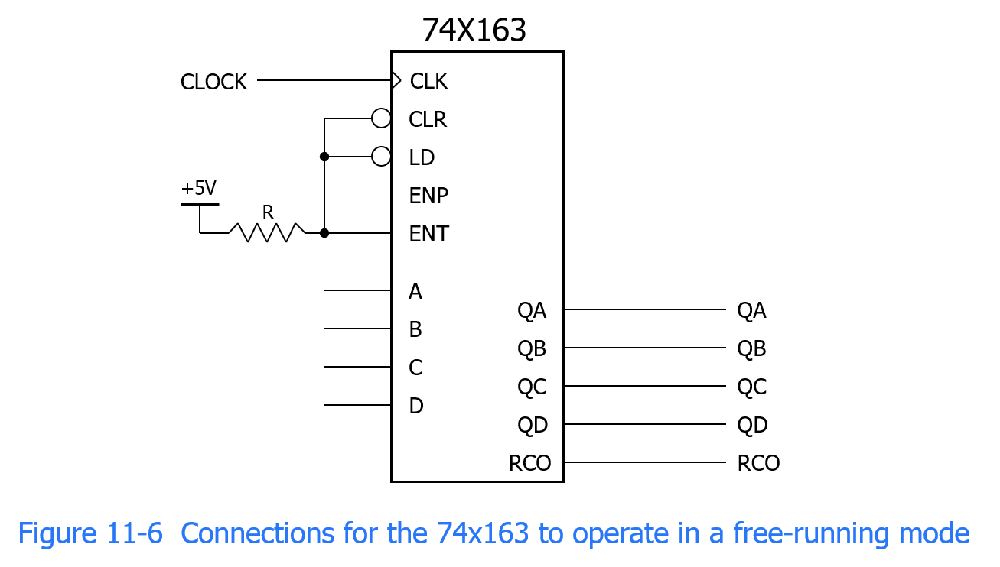这玩意有个神奇的特性，就是从QA一直到RCO，每个port的频率是前一个的一半，所以这就可以用来制作除2、除4、……除16。
- **Module-x counter**
    - 74x163 can be made to count in a modulus ==less than 16==: using ==CLR_L== or ==LD_L== input to shorten the normal counting sequence.
    - using CLR_L: 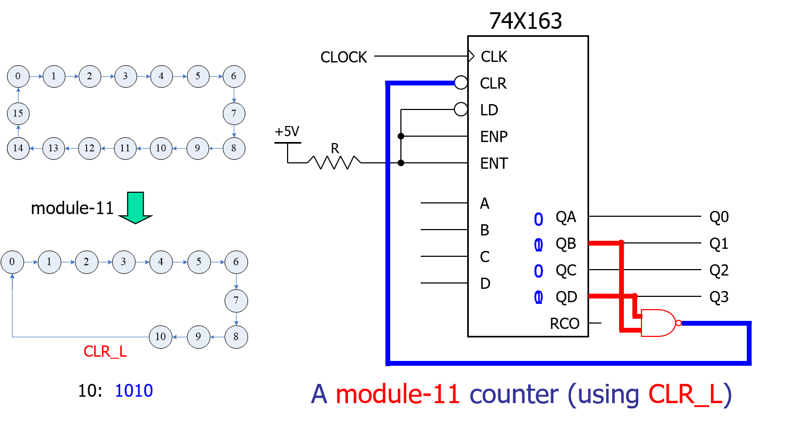可以看到模11的机器是输出为1010(即十进制的10)时会发送清0的信号(因为计数是从0000开始的)
    - using LD_L: 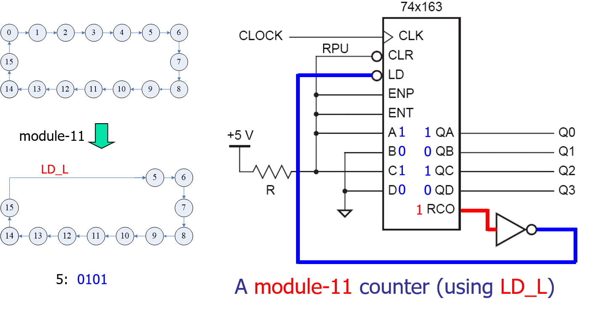这货是直接从5开始计数的。控制ABCD门的输入为0101
### 2. Shift Registers
A shift register is an n-bit register with a provision for shifting its stored data by one bit position at each tick of the clock.
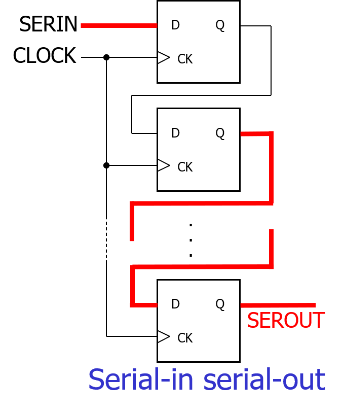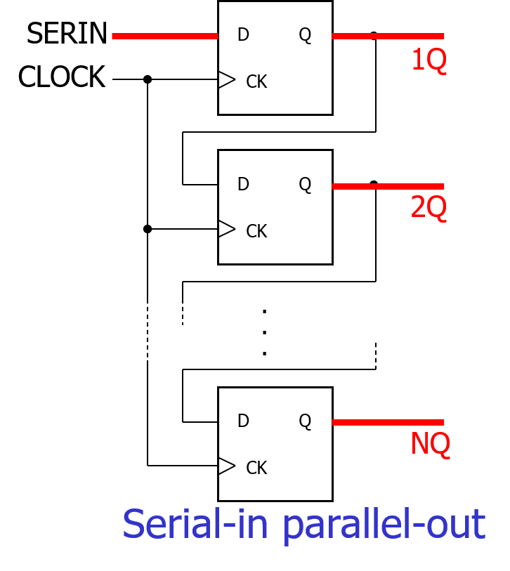
一个n-bit serial-in, serial-out shift register可以用来延迟信号至n clock ticks以后。

而serial-in, parallel-out shift register则是可以输出它所存储的所有bit。可以用来做serial-to-parallel conversion
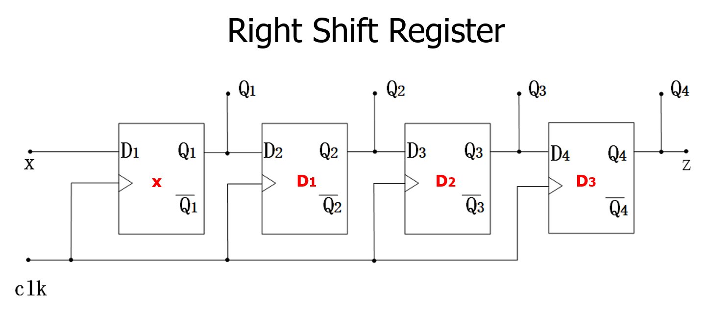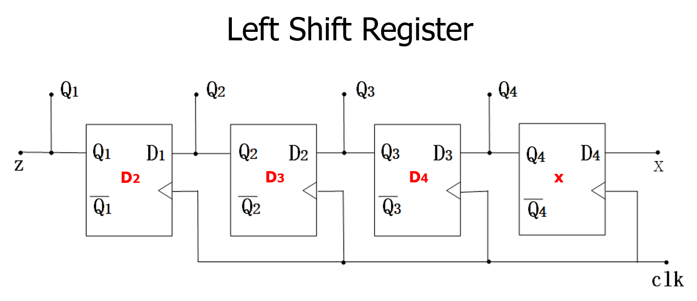

- MSI shift register: 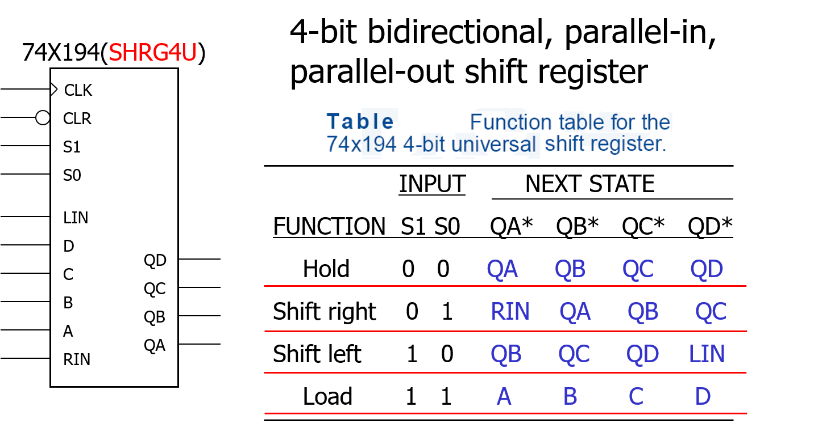
- Shift register counter: 
    - A shift register can be combined with combinational logic to form a state machine whose state diagram is ==cyclic==
    - Unlike a binary counter, a shift-register counter does not count in an ascending or descending bianry sequence.（压根不是按二进制顺序来的）
    - Ring counter: 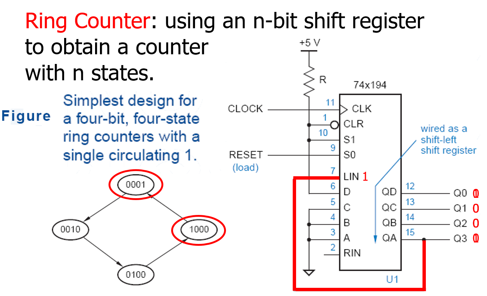 感觉这个==LIN==就是把QA的输出结果缓存一下，这样下一次shift输入的时候QD就可以吃到QA上一次输出的结果了，以此实现循环的效果
        - 然而这个连线有问题，不够robust，因为碰见0000或者1111就会陷入死循环
        - 这个就robust一点：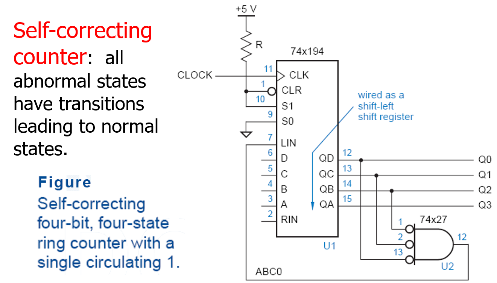（确保不会出现0000或者1111陷入死循环） state diagram如下：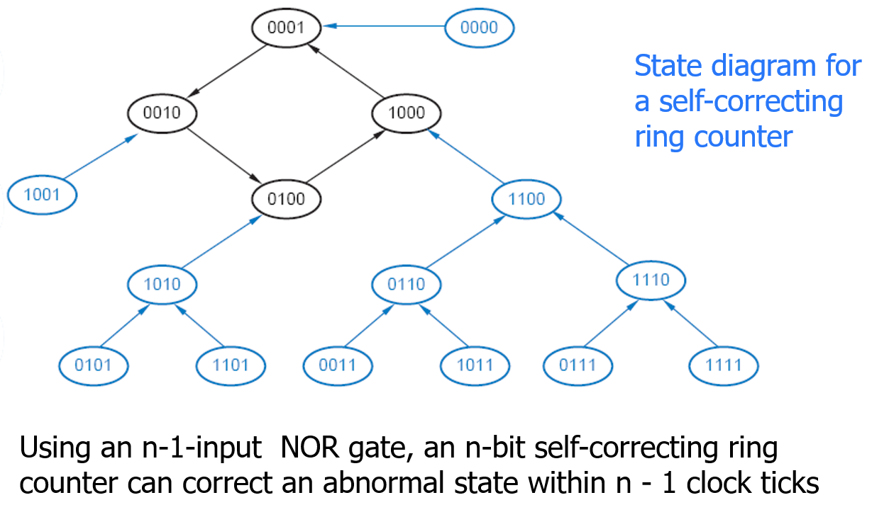
### 3. Supplementary example of counter and register
要实现的效果就是红色的灯左右横跳
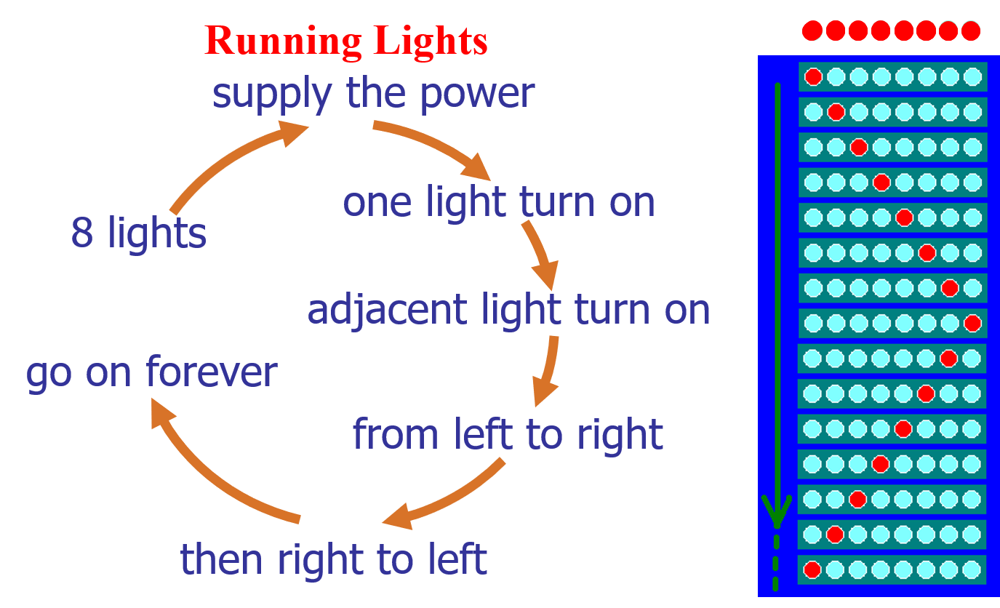

- Analysis: 
    - 一共有14个state
    - 74LS161作为module 14的计数器
    - 74LS194作为shift right/left的控制器 
    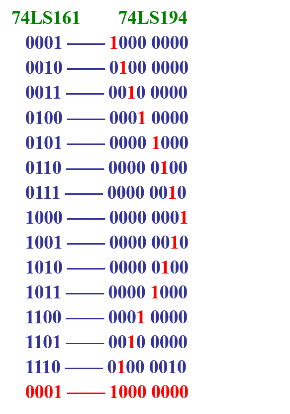 Observe the first bit of 74LS161:
        - case 0: 74LS194 shift right
        - case 1: 74LS194 shift left
        - To implement shift right and shift left, use MSB(most significant byte最高有效位) of 74LS161 connected to S0 and S1 of  74LS194.
    - The state of 0000 only appears when 74LS161’s power is supplied because the device will clear itself at this time.
    - If we connect the input pin of shift right Rin with the output of an AND gate whose input are complement of four outputs of 74LS161, the device only input 1 at the state of 0000 which will never appear in the future because the module is 14. Finally, there is only one light turned on and it moves from left side to right and so on.（通过机器自己的0000初始化来使得序列之中只出现一个红灯）

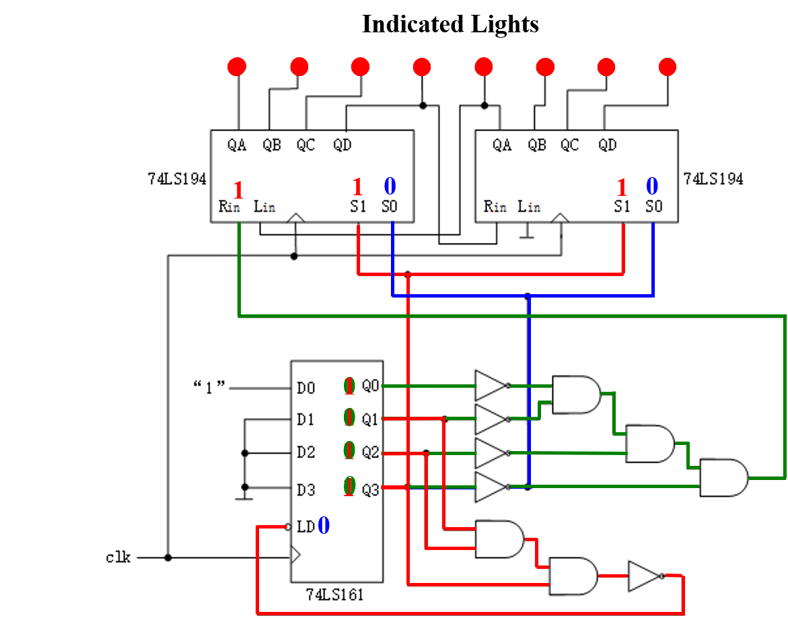

注：关于shift register，这家伙的S0和S1两个输入端，==01表示右移，10表示左移==