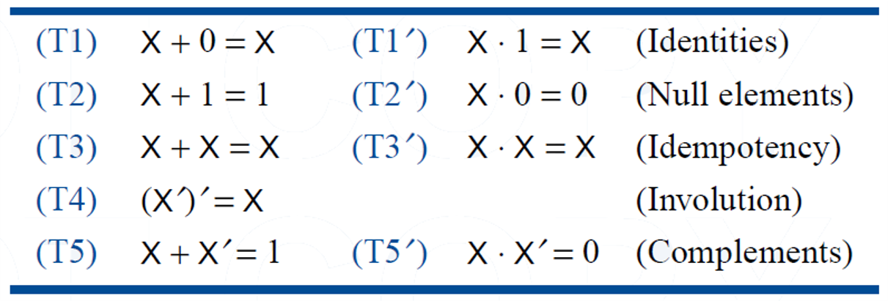
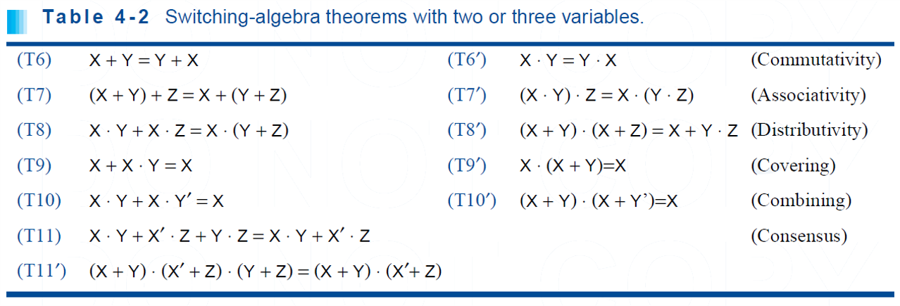
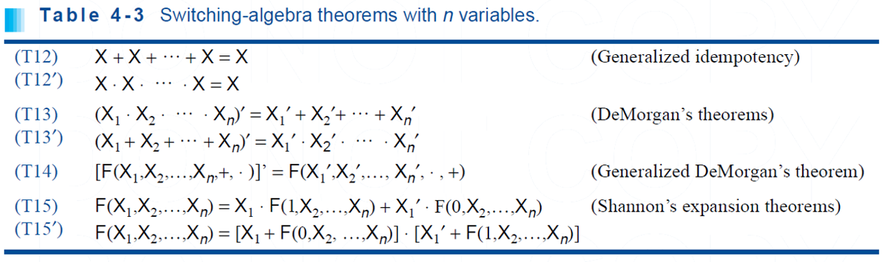
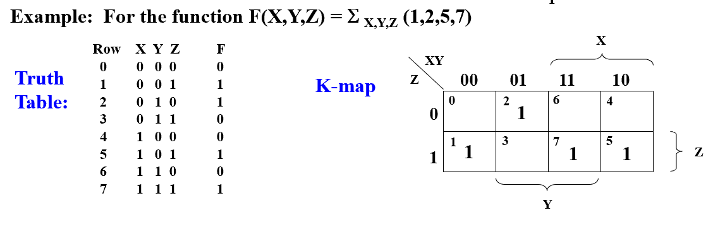

### 1. Switching Algebra Axioms and Theorems

- Laws of complements: 
    - X+X′= 1
    - X·X′ = 0
    - 虽然看着是废话，但是在化简表达式的时候善加利用有意想不到的结果
- One variable: 
- Multi variable: 
- n variable: 注：T13是DeMorgan's theorems
- 其他一些小结论：
    - (X + Y’)Y = XY
    - XY’ + Y = X + Y

- Duality
    - Any theorem or identity in switching algebra remains true if 0 and 1 are swapped and • and + are also swapped throughout.
    - 注：We must keep the operator precedence of the original expression:
        -  X + X • Y = X
        -  X • (X + Y) = X (duality)

### 2. Standard Representations of Logic Functions

- Logic Function Representation Definitions
    - Minterm: 形如$W\cdot X'\cdot Y'\cdot Z'$的==乘积==形式
    - Maxterm: 形如$W'+X'+Y'+Z'$的==和==形式

- Canonical Sum Representation
    - 定义：The canonical  sum of a logic function is a sum of the **minterms** corresponding to the truth table rows for which the function produces a 1 output.
    - short-hand representation: $F=\sum_{X,Y,Z}(0,3,4,6,7)$
> 注意卡诺和对应的列表是从000开始的，也就是$x', y', z'$

### 3. Circuit manipulations

- AND-OR to NAND-NAND: **negating the expression two times**
    - eg:         F =   AB’ + BC’ + CD’+ DA’    
        F = (F’)’= ((AB’ + BC’ + CD’+ DA’ )’)’
                      =  ((AB’)’·(BC’)’·(CD’)’·(DA’)’)’     
- AND-OR to NOR-NOR: **using the Principle of Duality two times**
    - eg: 
        - F =   AB’ + BC’ + CA’
        - G = (A+B’)· (B+C’)· (C+A’) 
                                    = ABC+A’B’C’=((ABC)’·(A’B’C’)’)’
            - 这个第二步是最有学问的。用完duality之后，先是==展开==了一下，再是进行了一次==negation==
        - :   F = ((A+B+C)’+(A’+B’+C’)’)’

### 4. Karnaugh Maps

这个图有个需要注意的地方是，==01的下一个应该填11==，反正数字上顶多只能相差一位，为了方便后续化简。

可以把相邻的cell合并到一起，达到化简的效果。如果有一些don't care的元素，则看成1或者0都可以，用来辅助化简。似乎我见过的合并都是把2的倍数个cell进行合并的