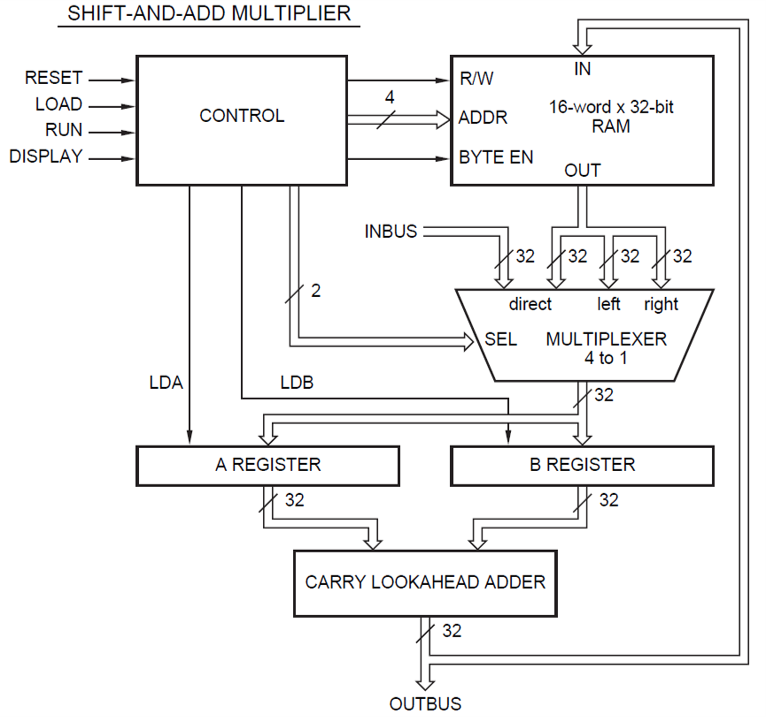
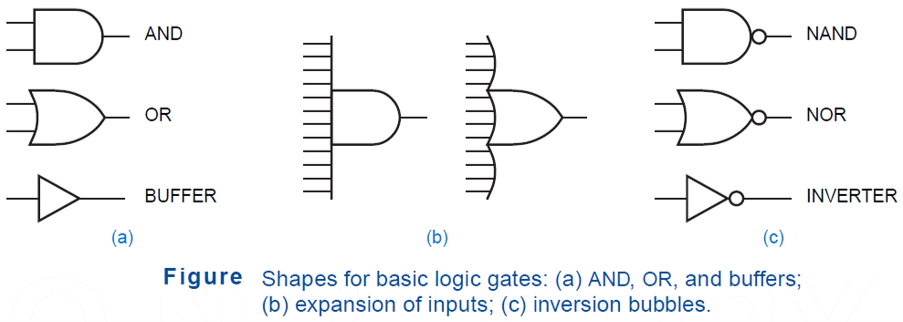
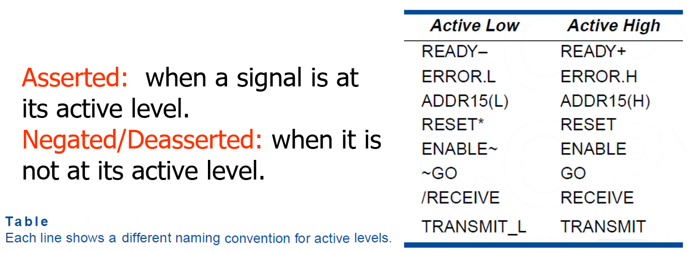
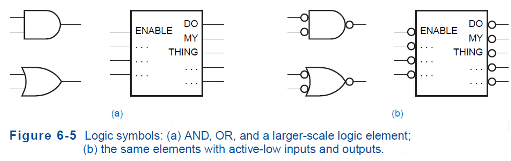
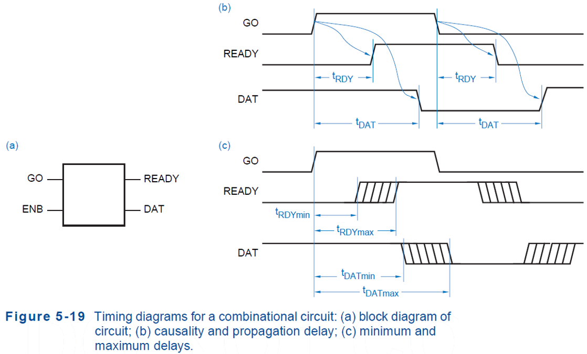

### Documentation Standards

- Block Diagrams: 
- Gate Symbols: 
- Active Levels: 
    - Active Levels for Pins: We use an inversion bubble to indicate an active-low pin and the absence of a bubble to indicate an active-high pin.

### Circuit Timing

- Timing Diagrams: Delay in a real circuit is measured between the centerpoints of transitions.

### HDL-based Digital Design

