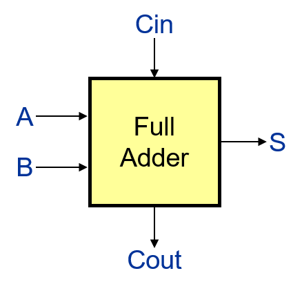
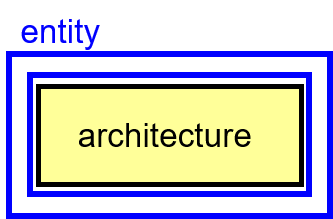
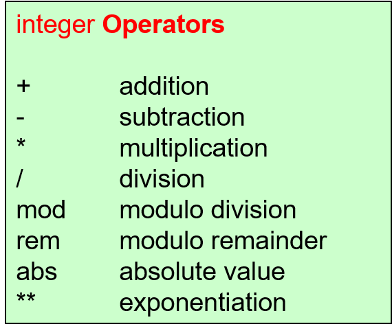
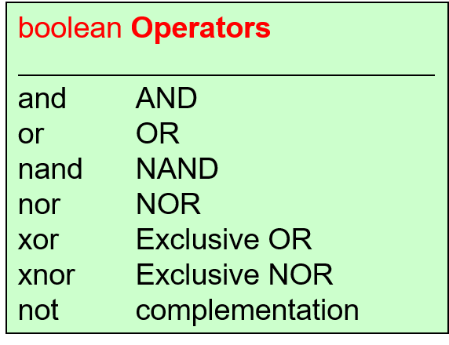
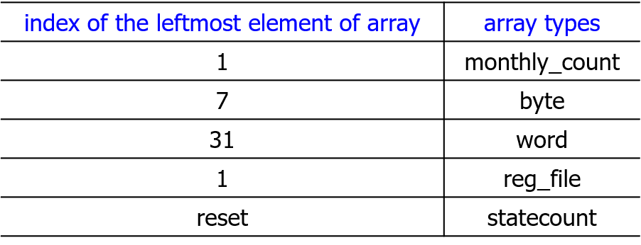
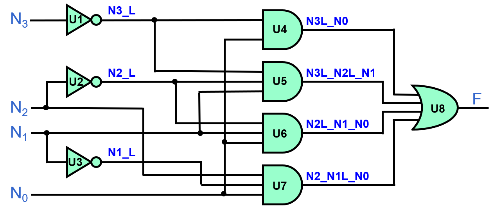

注意区分：
- := 右边的值立刻赋值给左边
- <= 右边的值可以在特定时间赋值给左边（比如clock变化时）

### Example: Full Adder


以下是entity declaration:
```vhdl
library IEEE;
use IEEE.std_logic_1164.all;

entity full_adder is -- a one-bit full adder
    port (
        A, B, Cin: in BIT; -- Three binary inputs
        S, Cout: out BIT); -- Two binary outputs	
end full_adder;
```
以下是architecture definition:
```vhdl
architecture full_adder_arch of full_adder is
begin
  S        <=  A xor B xor Cin;
  Cout  <=  (B and Cin) or (A and Cin) or (A and B);
end full_adder_arch;
```

### Program Structure


和类很像，隐藏内部实现只保留接口

### Syntax
- entity declaration:
```vhdl
entity entity-name is
    port (
        signal-names : mode signal-type;
        signal-names : mode signal-type;
        signal-names : mode signal-type;
        • • •
        signal-names : mode signal-type);
end entity-name;
```
其中mode可以是：in, out, buffer, inout
- Architecture definition
```vhdl
architecture architecture-name of entity-name is
    type declarations
    signal declarations
    constant declarations
    function definitions
    procedure definitions
    component declarations
begin
    concurrent-statement
    • • •
    concurrent-statement
end architecture-name;
```
### Types, Constants and Arrays

- Types: 
    - predefined types: 
        - bit
        - character
        - severity_level: 表示测试的结果，包括note, warning, error, failure
        - bit_vector
        - integer
        - string
        - boolean
        - real
        - time
    - predefined operators:<br>
- Syntax for type and constant declarations:
这里以用户自定义类型的enumerated type为例：
```vhdl
type	type-name	is (value-list);
subtype	subtype-name	is type-name start to end;
subtype	subtype-name	is type-name start downto end;
constant constant-name: type-name := value;
```
示例：
```vhdl
type traffic_light_state is (reset, stop, wait, go);

type STD_ULOGIC is (	‘U’,  	-- Uninitialized
			‘X’,   	-- Forcing Unknown
			‘0’,   	-- Forcing 0
			‘1’,	-- Forcing 1
			‘Z’,	-- High Impedance
			‘W’,	-- Weak	Unknown
			‘L’,	-- Weak	0
			‘H’,	-- Weak	1
			‘-’	  -- Don’t Care
			);


subtype STD_LOGIC is resolved STD_ULOGIC;

subtype twoval_logic is std_logic range ‘0’ to ‘1’;
subtype fourval_logic is std_logic range ‘X’ to ‘Z’;
subtype negint is integer range -2147483647 to -1;
subtype bitnum is integer range 31 downto 0;

subtype natural is integer range 0 to highest-integer;
subtype positive is integer range 1 to highest-integer;


constant BUS_SIZE: integer := 32;		-- width of component
constant MSB: integer := BUS_SIZE-1;	-- bit number of MSB
constant Z: character := 'Z';			-- synonym for Hi-Z value

```

也许你已经发现了，==range...to...是从小到大==！range...downto...才是从大到小！

- Array:
    - declarations:
```vhdl
type type-name is array (start to end) of element-type;
type type-name is array (start downto end) of element-type;
type type-name is array (range-type) of element-type;
type type-name is array (range-type range start to end) of element-type;
type type-name is array (range-type range start downto end) of element-type;
```
示例：
```vhdl
type monthly_count is array (1 to 12) of integer;
type byte is array (7 downto 0) of STD_LOGIC;

constant WORD_LEN: integer := 32;
type word is array (WORD_LEN-1 downto 0) of STD_LOGIC;

constant NUM_REGS: integer := 8;
type reg_file is array (1 to NUM_REGS) of word;

type statecount is array (traffic_light_state) of integer;
```
- 
    - array的顺序: Array elements are considered to be ordered from left to right, in the same direction as index range.(==下标从0开始==)

    - array初始化：<br>`B:=( ‘1’, ‘1’, ‘1’, ‘1’, ‘1’, ‘1’, ‘1’, ‘1’ )`<br>`W:=(0=> ‘0’, 8=> ‘0’, 16=> ‘0’, 24=> ‘0’, others=> ‘1’ )`<br>`B :=( “11111111” )`
    - 可以用&来连接不同的array

### Function and Procedure

syntax:
```vhdl
function function-name (
	signal-names : signal-type;
	signal-names : signal-type;
	• • •
	signal-names : signal-type
) return return-type is
	type declarations
	constant declarations
	variable declarations
	function definitions
	procedure definitions
begin
	sequential-statement
	• • •
	sequential-statement
end function-name;
```
example:
```vhdl
architecture Inhibit_archf of Inhibit is

function ButNot (A, B: bit) return bit is
begin
	if B = '0' then return A;
	else return '0';
	end if;
end ButNot;

begin
	Z <= ButNot(X,Y);
end Inhibit_archf;
```
你会发现==if语句成立的时候需要跟一个then==

Another example: converting *STD_LOGIC_VECTOR* to *INTEGER*
```vhdl
function CONV_INTEGER (X: STD_LOGIC_VECTOR) return INTEGER is
  variable RESULT: INTEGER;
begin
  RESULT := 0;
  for i in X'range loop --X'range相当于是获取X的index
    RESULT := RESULT * 2;
    case X(i) is
      when '0' | 'L' => null;
      when '1' | 'H' => RESULT := RESULT + 1;
      when others    => null;
    end case;
  end loop;
  return RESULT;
end CONV_INTEGER;
```    
converting *INTEGER* to *STD_LOGIC_VECTOR*
```vhdl
function CONV_STD_LOGIC_VECTOR (ARG:INTEGER; SIZE: INTEGER)
      return STD_LOGIC_VECTOR is
  variable result : STD_LOGIC_VECTOR(SIZE-1 downto 0);
  variable temp: integer
begin
  temp := ARG;
  for i in 0 to SIZE-1 loop
    if (temp mod 2) = 1 then result(i) := '1' ;
    else result(i) := '0' ;
    end if;
    temp :=temp / 2;
  end loop;
  return result;
end;
```
- Procedure
    - A VHDL procedure is similar to a function, except it **does not return a result**.
    - A function call can be used in the place of an **expression**.A procedure call can be used in the place of a **statement**.
    - VHDL procedure allow their arguments to be specified with type **out** or **inout**.
- Libraries
    - eg. `library IEEE`
- Packages
    - including: signal, type, constant, function, procedure, and component declarations.
    - eg. `use IEEE.std_logic_1164.all;`
    - definition:
```vhdl
package package-name is
	type declarations
	signal declarations
	constant declarations
	component declarations
	function declarations
	procedure declarations
end package-name;
package body package-name is
	type declarations
	constant declarations
	function definitions
	procedure definitions
end package-name;
```

### Structural Design


拿这个图来说一下entity, component和architecture是什么关系：

- entity就是整个元件的接口部分，也就是N和F
- component是其中的逻辑门，但是每个component指代的是一类门，只是说明了几个入的信号几个出的信号。比如U1到U3就是一类，U5到U7是一类，U4是一类，U8是一类。
- architecture里要把每个具体的门的信号都写明
代码：
```vhdl
library IEEE;
use IEEE.std_logic_1164.all;

library UNISIM;
use UNISIM.VComponents.all;

entity prime is
    port (
        N: in STD_LOGIC_VECTOR (3 downto 0);
        F: out STD_LOGIC);
end prime;

architecture prime1_arch of prime is
signal N3_L, N2_L, N1_L: STD_LOGIC;
signal N3L_N0, N3L_N2L_N1, N2L_N1_N0, N2_N1L_N0: STD_LOGIC;
component INV port (I: in STD_LOGIC; O: out STD_LOGIC); end component;
component AND2 port (I0,I1: in STD_LOGIC; O: out STD_LOGIC); end component;
component AND3 port (I0,I1,I2: in STD_LOGIC; O: out STD_LOGIC); end component;
component OR4 port (I0,I1,I2,I3: in STD_LOGIC; O: out STD_LOGIC); end component;
begin
  U1: INV port map (N(3), N3_L);
  U2: INV port map (N(2), N2_L);
  U3: INV port map (N(1), N1_L);
  U4: AND2 port map (N3_L, N(0), N3L_N0);
  U5: AND3 port map (N3_L, N2_L, N(1), N3L_N2L_N1);
  U6: AND3 port map (N2_L, N(1), N(0), N2L_N1_N0);
  U7: AND3 port map (N(2), N1_L, N(0), N2_N1L_N0);
  U8: OR4 port map (N3L_N0, N3L_N2L_N1, N2L_N1_N0, N2_N1L_N0, F);
end prime1_arch;
```
- Generate Statement:
    - 可以一下子创建一大堆concurrent statement的实例，就不需要component来实例化entity了
```vhdl
label: for identifier in range generate 
               concurrent-statement
end generate; 
```
eg.
```vhdl
library IEEE;
use IEEE.std_logic_1164.all;

entity inv8 is
    port (
        X: in STD_LOGIC_VECTOR (1 to 8);
        Y: out STD_LOGIC_VECTOR (1 to 8)
    );
end inv8;

architecture inv8_arch of inv8 is
component INV port (I: in STD_LOGIC; O: out STD_LOGIC); end component;
begin
	g1: for b in 1 to 8 generate
		U1: INV port map (X(b), Y(b));
	end generate;
end inv8_arch;
```

### Generic Constants
待定参数
- syntax:
```vhdl
entity entity-name is 
    generic (constant-names : constant-type;
             constant-names : constant-type;
             …
             constant-names : constant-type);
    port (signal-names : mode signal-type; 
          signal-names : mode signal-type;
          signal-names : mode signal-type);
end entity-name
```
- eg:
```vhdl
library IEEE;
use IEEE.std_logic_1164.all;

entity businv is
    generic (WIDTH: positive);
    port (
        X: in STD_LOGIC_VECTOR (WIDTH-1 downto 0);
        Y: out STD_LOGIC_VECTOR (WIDTH-1 downto 0)
    );
end businv;

architecture businv_arch of businv is
component INV port (I: in STD_LOGIC;O: out STD_LOGIC);
end component;
begin
	g1: for b in WIDTH-1 downto 0 generate
		U1: INV port map (X(b), Y(b));
	    end generate;
end businv_arch
```

### Data Flow Design

concurrent signal-assignment statement is the most often use
- syntax:
```vhdl
signal-name <= expression; 

signal-name <= expression when boolean-expression else
               expression when boolean-expression else
              …
               expression when boolean-expression else
               expression;
```

- eg: prime number detector
```vhdl
architecture prime2_arch of prime is
signal N3L_N0, N3L_N2L_N1, N2L_N1_N0, N2_N1L_N0: STD_LOGIC;
begin
  N3L_N0	<= not N(3)                           and N(0);
  N3L_N2L_N1<= not N(3) and not N(2) and	 N(1)         ;
  N2L_N1_N0	<=	            not N(2) and	 N(1) and N(0);
  N2_N1L_N0	<=                  N(2) and not N(1) and N(0);
  F <= N3L_N0 or N3L_N2L_N1 or N2L_N1_N0 or N2_N1L_N0;
end prime2_arch;
```
selected signal assignment statement:

- syntax:
```vhdl
with expression select
    signal-name <= signal-value when choices,
                   signal-value when choices,
                   . . . 
                   signal-value when choices;
```
- eg: prime number detector
```vhdl
architecture prime4_arch of prime is
begin
  with N select
    F <= '1' when "0001” ,
         '1' when "0010” ,
         '1' when "0011" | "0101" | "0111” ,
         '1' when "1011" | "1101” ,
         '0' when others;
end prime4_arch;

architecture prime5_arch of prime is
begin
  with CONV_INTEGER(N) select
    F <= '1' when 1 | 2 | 3 | 5 | 7 | 11 | 13 ,
         '0' when others;
end prime5_arch;
```
### Behavioral Design Element

涉及process: A process is a collection of sequential statements 

A process cannot declare signals. It can only declare ==variables(在其他的design method里是叫做signal的==). A variable is not visible outside of the process. 

- syntax:
```vhdl
process (signal-name, signal-name, • • •, signal-name)
	type declarations
	variable declarations
	constant declarations
	function definitions
	procedure definitions
begin 
	sequential-statement
	. . .
	sequential-statement
end process;
```
process 永远是suspended或者running

process sensitivity list(第一行那句话)。这些signal决定process是否运行

- eg:
```vhdl
architecture prime6_arch of prime is
begin
  process(N)
    variable  N3L_N0, N3L_N2L_N1, N2L_N1_N0, N2_N1L_N0: STD_LOGIC;
    begin
      N3L_N0	:= not N(3)                           and N(0);
      N3L_N2L_N1:= not N(3) and not N(2) and	 N(1)         ;
      N2L_N1_N0	:=	            not N(2) and	 N(1) and N(0);
      N2_N1L_N0	:=                  N(2) and not N(1) and N(0);
      F <= N3L_N0 or N3L_N2L_N1 or  N2L_N1_N0 or N2_N1L_N0;
    end process;
end prime6_arch;
```
等号的使用似乎有些讲究，输出的时候用的<=而中间的variable用的则是:= 我也不知道啥原因

### if statement

```vhdl
if boolean-expression then sequential-statement
elseif boolean-expression then sequential-statement
. . .
elseif boolean-expression then sequential-statement 
else sequential-statement
end if;
```

### case statement

- syntax:
```vhdl
case expression is
    when choices => sequential-statements
    . . .
    when choices => sequential-statements 
end case;
```
- eg:
```vhdl
architecture prime8_arch of prime is
begin
  process(N)
    variable  NI:  INTEGER;
  begin
    case CONV_INTEGER(N) is
        when 1 => F <= '1';
        when 2 => F <= '1';
        when 3 | 5 | 7 | 11 | 13 => F <= '1';
        when others => F <= ‘0';
    end case;
  end process;
end prime8_arch;
```
=>和<=的意义完全不一样！一个是衔接条件与动作，一个是赋值！

### loop statement
- syntax:
```vhdl
loop
   sequential-statement
   . . .
   sequential-statement
end loop;

for identifier in range loop
   sequential-statement
   . . .
   sequential-statement
end loop;

While boolean-expression loop
   sequential-statement
   . . .
   sequential-statement
end loop;
```

### Time Dimension

- after
```vhdl
Z <= ‘1’ after 4 ns when X=‘1’ and Y=‘0’ else ‘0’ after 3 ns;
```
- wait
```vhdl
architecture InhibitTB_arch of InhibitTestBench is
component Inhibit port (X,Y: in BIT; Z: out BIT); end component;
signal XT,YT,ZT: BIT;
begin
  U1: Inhibit port map (XT,YT,ZT) 
  process
  begin
    XT <= '0'; YT <= ‘0'; 
    wait for 10 ns;
    XT <= '0'; YT <= ‘1'; 
    wait for 10 ns;
    XT <= ‘1'; YT <= ‘0'; 
    wait for 10 ns;    
    XT <= ‘1'; YT <= ‘1'; 
    wait ; -- this suspends the process indefinitely
end process;
end InhibitTB_arch;
```
### Test Benches
好复杂，见资料

unit under test(UUT): the entity being tested

基本的几个组成部分：
- Entity declaration with ==no inputs or outputs==
- Architecture definition with a ==component declaration== for the UUT, which is instantiated using local signals for its inputs and outputs.
- A process with ==no sensitivity list== starts at time 0, and applies new input combinations to the UUT at specified times

```vhdl
architecture InhibitTB_arch of InhibitTestBench is
component Inhibit port (X,Y: in BIT; Z: out BIT); end component;
signal XT,YT,ZT: BIT;
begin
  U1: Inhibit port map (XT,YT,ZT) 
  process
  begin
    XT <= '0'; YT <= ‘0'; 
    wait for 10 ns;
    XT <= '0'; YT <= ‘1'; 
    wait for 10 ns;
    XT <= ‘1'; YT <= ‘0'; 
    wait for 10 ns;    
    XT <= ‘1'; YT <= ‘1'; 
    wait ; -- this suspends the process indefinitely
end process;
end InhibitTB_arch;
```
