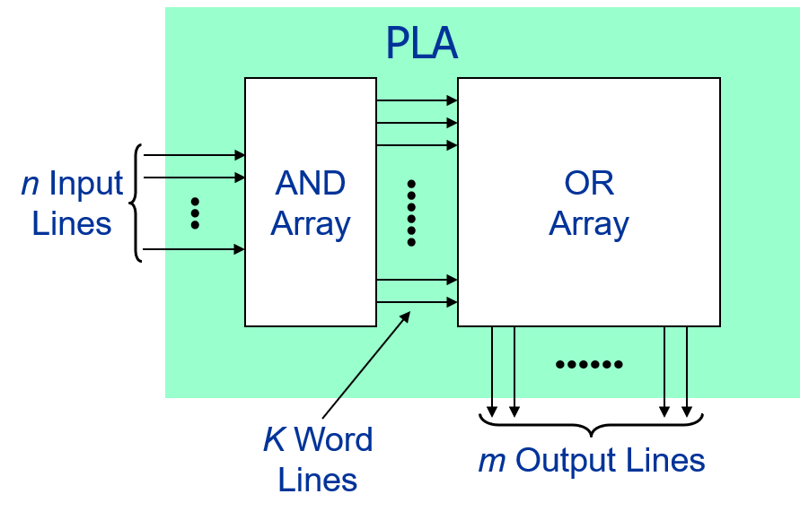
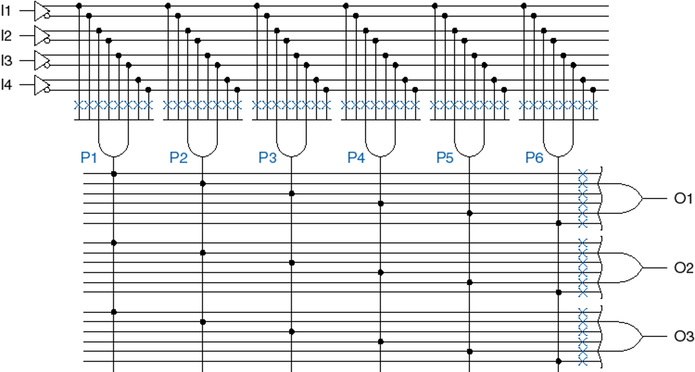
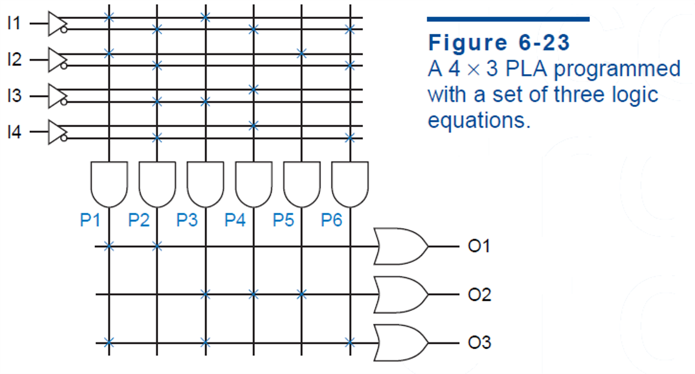
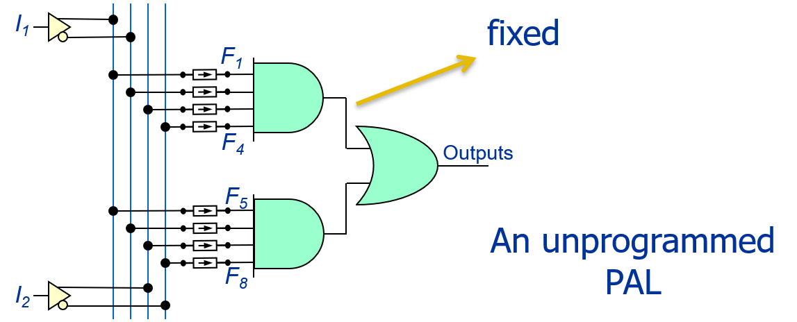
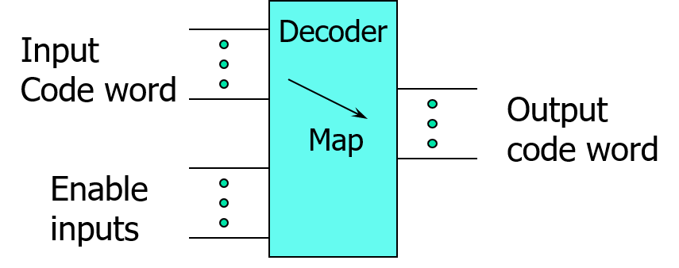
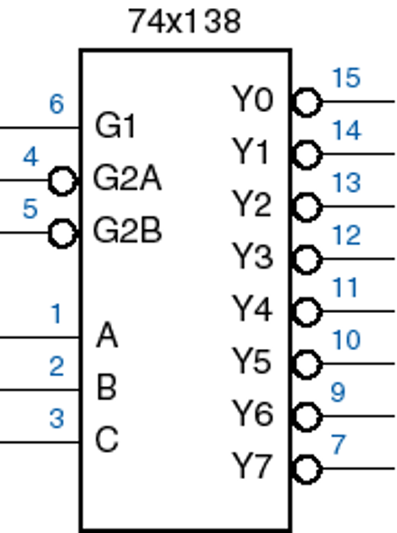
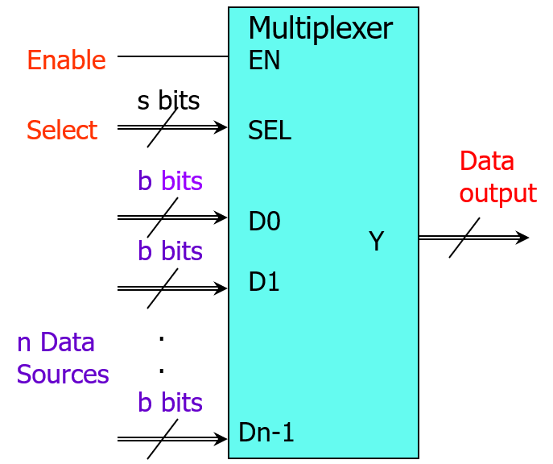
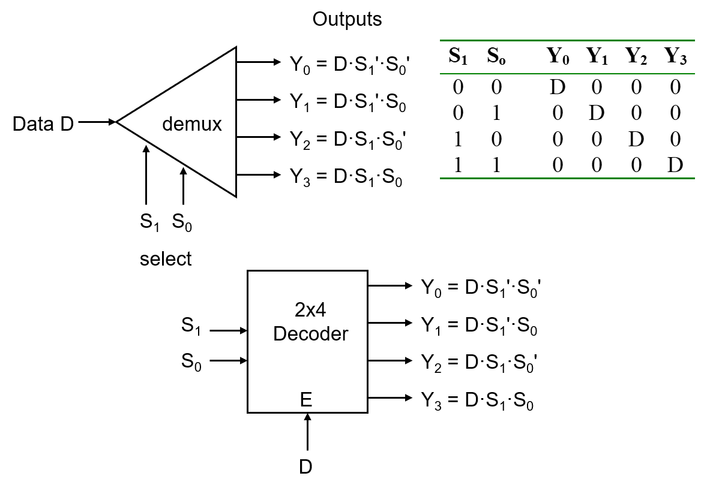
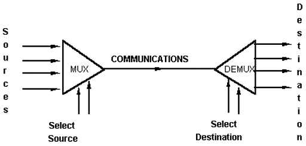

### 1. Combinational PLDs
##### 1.1 Programmable Logic Arrays(PLA)

eg:

compact representation:

##### 1.2 Programmable Array Logic Devices(PAL)
A PAL is a special case of a PLA in which the AND array is programmable but the OR array is fixed.

那些箭头是可以被拿掉的

### 2. Decoding and Selecting
##### 2.1 Decoders
enable inputs只有被启用时decoder才能够工作

###### 2.1.1 Binary Decoders

左边输入的是二进制之下的数字的每一位，右边输出的是所有可能的index为对应10进制数字的门

###### 2.1.2 Logic Symbols

##### 2.2 Supplementary Examples
挺重要的，要看看作业题和ppt6b的第5页，有关如何用decoder来表示函数

##### 2.3 Binary Encoders
一个样，反向操作。
### 3. Multiplexing
##### 3.1 Multiplexers
A multiplexer (MUX)  is a digital switch which connects data from ==one== of n sources to the output.（==选择一个进行输入==）

上面的图还不算直观，下面的对应可能直观一点：

可以看到随着S端的不断变化，这家伙依次输出了D0到D7。也就是说，S其实就是二进制数，因为这是一个8-to-1 MUX，$2^3=8$，所以需要3个S门来控制是D的哪个门能够输入

##### 3.2 Demultiplexers
反过来，==选择一个进行输出==。

和decoder有点联系，把输入的Data接到decoder的enable端，反正就恰好可以了

##### 3.3 两者联系

任意时刻，只有一个输入端和一个输出端能通信

##### 3.4 Supplementary Examples
同样很重要，看作业和ppt6b第19页，有关如何用multiplexer实现函数

其中包含了一种特殊情况，就是需要的输入端口的数量比给定仪器所拥有的输入端口数量还要多，这时候就把几个输入端口直接接到data端

