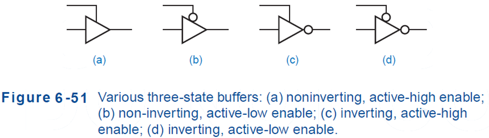
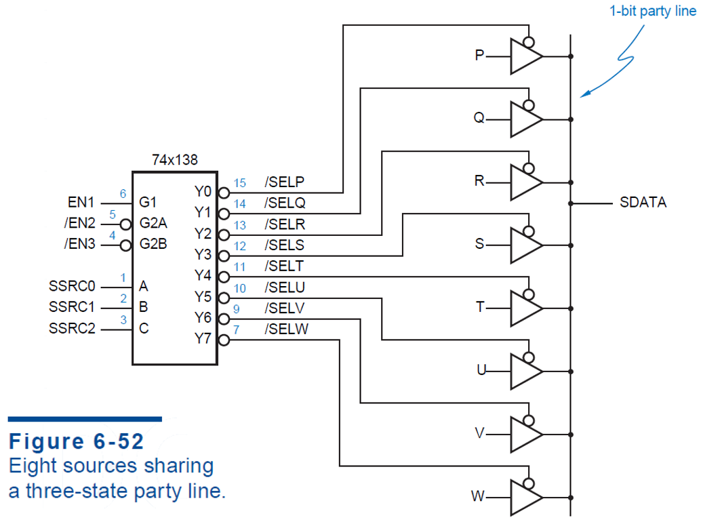
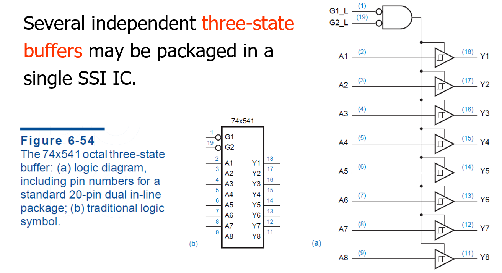
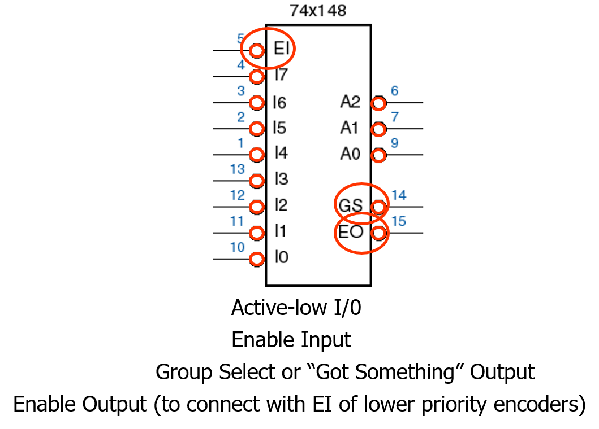
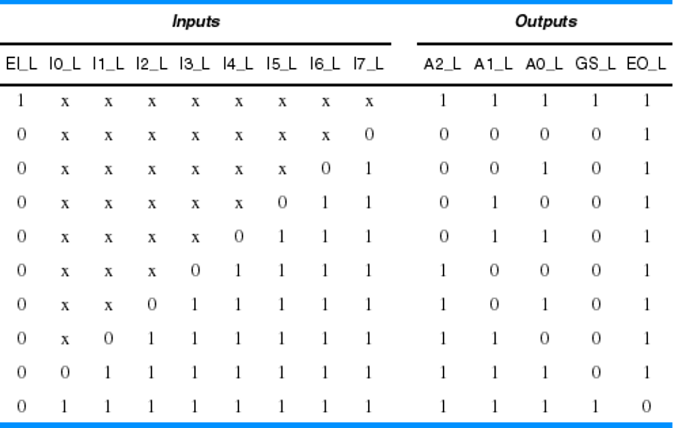
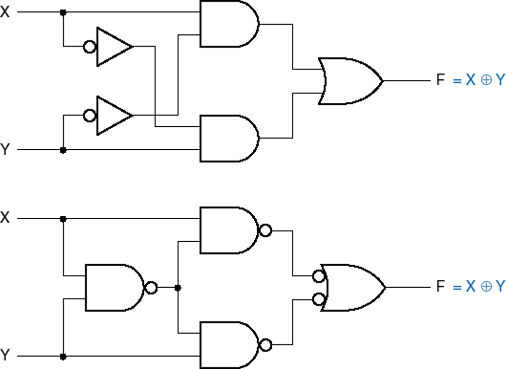
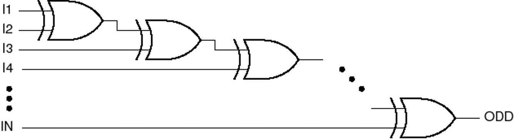
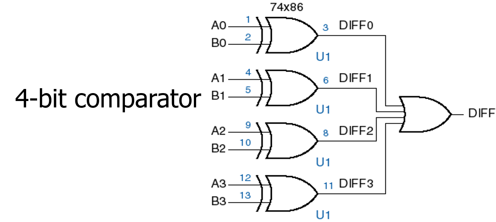
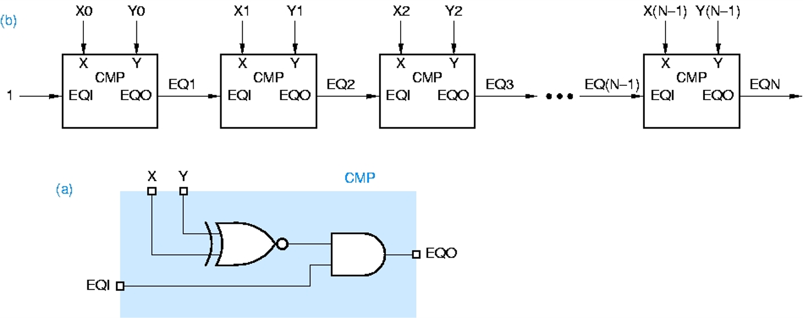
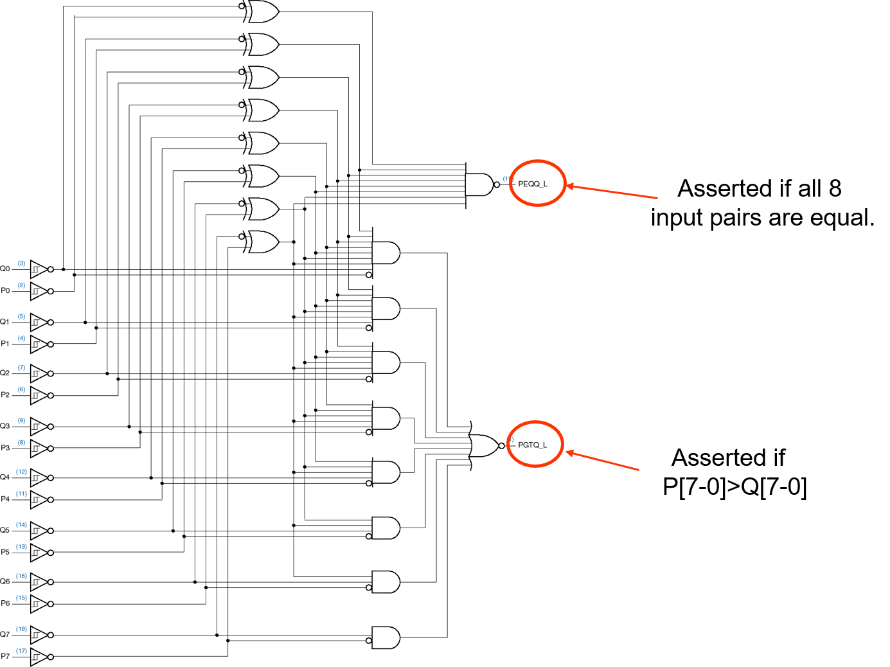

### 1. Three-State Devices
##### 1.1 Three-State Buffers

这玩意和decoder的使用相结合，使得decoder能够控制只有一个device使用party line:

##### 1.2 Standard MSI Three-state Buffers

### 2. Priority Encoding
利用普通的encoder实现priority encoder：

大概意思就是说，I7是最高位，这个encoder的目的就是输出8个门里面位最高的那一个的二进制。于是能得到下面的符号和真值表

这个真值表的表头都是low，是反转过的，不用太纠结

ppt上还给了四个8-input priority encoder叠在一起组成的32-input priority encoder

### 3. Exclusive-OR Gates and Parity Functions
##### 3.1 XOR and XNOR Gates
XNOR就是XOR的complement

符号：(后面几种变形居然不是很直观)
- XOR: 
- XNOR: 

XOR的两种实现电路：

##### 3.2 Parity Circuits

一个神奇的电路结构：只有input里有==奇数个1==的时候，整个电路的输出才为1
> 可以借助==平衡树结构==实现更快的处理

### 4. Comparing
##### 4.1 Comparator Structure
最小单位就是一个XOR门

堆叠一下就可以比较多位：

##### 4.2 Iterative Circuits迭代电路
比较两个同样长度的值。如果当前位不相同就可以直接输出0了

##### 4.3 Magnitude Comparator

可以比较大小的东东，其实也能看出是如何比较大小的，先比较高位，高位相同的情况下比较低位。
