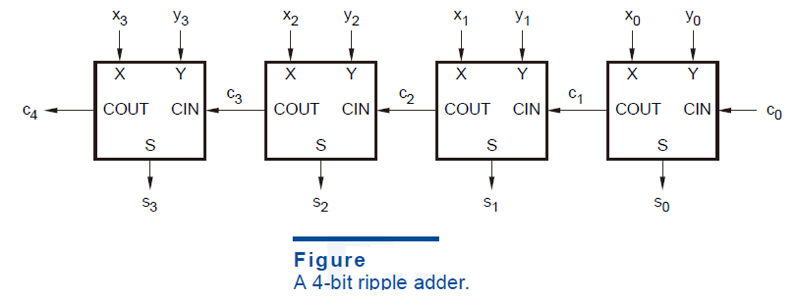
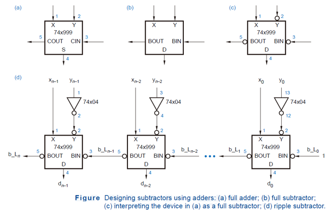

### 1. Half Adders and Full Adders
#### 1.1 Half Adders
作用是把两个一位的二进制数相加：

可以看出来S是个位的输出结果，C-out是十位的输出结果(就是进一位)。

这个真值表对应的就是异或门：

#### 1.2 Full Adders
多了一个C-in输入，其实就是上一层运算的进位

真值表可以表示成：
$$S=X\oplus Y\oplus(C-in)\\或者\\S=X'Y'(C-in)+X'Y(C-in)'+XY'(C-in)'+XY(C-in)\\~\\C-out=XY+X(C-in)+Y(C-in)$$

于是实现电路就有两种做法：
- XOR:  
- AND-OR:  

### 2. Ripple Adders
用来相加两个长度为n的二进制数，实现方法是一堆full adder串联在一起：

### 3. Subtractors

1位的二进制数减法。B-in是低位向高位（当前位）借的数，B-out是当前位向高位借的数

真值表可以表示成：
$$D =  X  \oplus Y  \oplus  (B-in) 
   =  X  \oplus  Y’ \oplus  (B-in)’\\B-out =  X’Y + X’(B-in) + Y(B-in)$$

至于实际怎么实现：

- 图(c)的理解：对比全减器与全加器的表达式，可看出全减器的Y'对应全加器的Y’、全减器的Bin’对应全加器的Cin 、全减器的Bout’对应全加器的Cout，因此把全加器的这三项取反，便得到全减器。(图C)

- 在图(d)串行借位减法器中，由于原始的数据是两个n位高有效的操作数，因此在减数上先用反相器使其变为低有效，这样才与全减器的Y输入端（低有效）相对应。

