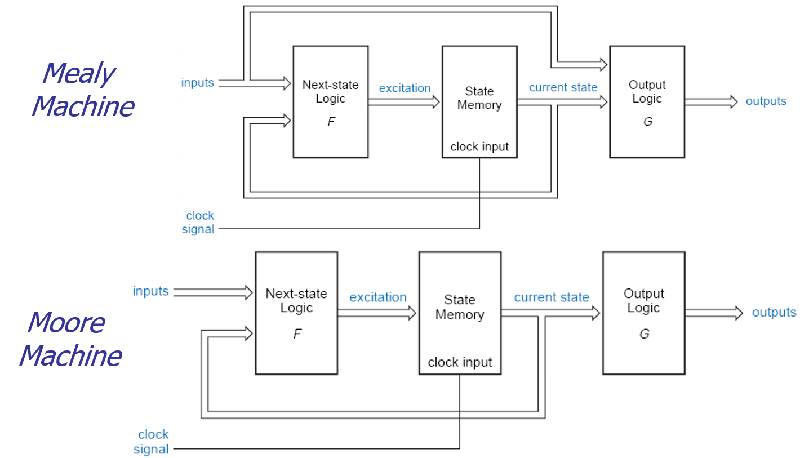
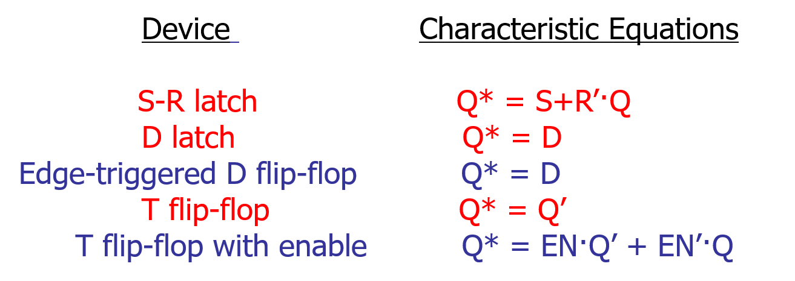
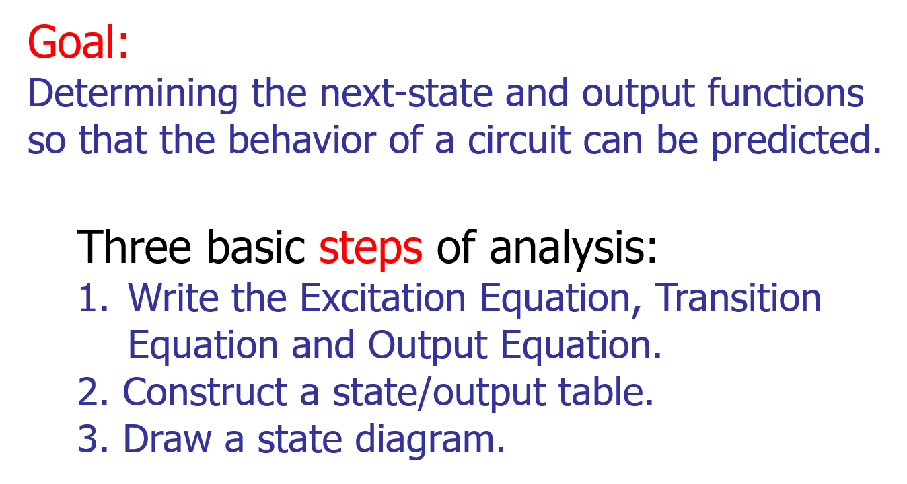
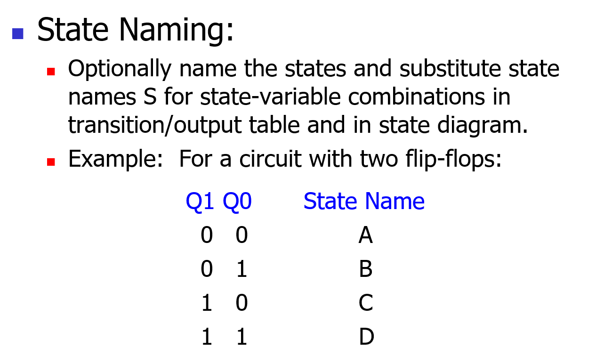
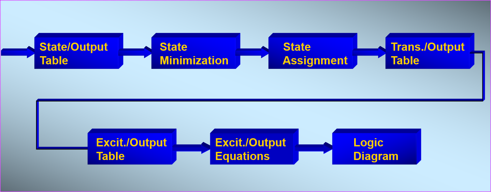
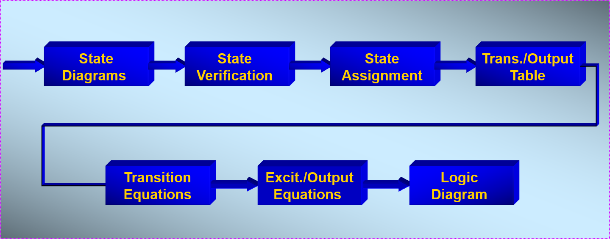

注：应该先看第十章的内容，再看这个第九章
### 1. State-Machine Basics
##### 1.1 State Machine
就是sequential circuit的一种叫法

##### 1.2 State
定义好长，你懂啥意思的
##### 1.3 Clocked
一般来说时序电路的==状态改变一般由clock决定==
##### 1.4 Synchronous(同步性)
所有flip-flop都接到同一个闹钟上，这样就同步了

### 2. State-Machine Structure and Analysis

##### 2.1 Describe Sequential Circuit
- **State/Output table**
    - For each current-state, specify next-states as function of inputs Next State = F ( Current state , Input )
    - For each current-state, specify outputs as function of inputs Output = G ( Current state  [, Input] )
    - 所以就是包含了==下一个state、输出两个信息==
- **State Diagram**
    - graphical version of state table

##### 2.2 Characteristic Equations
Characteristic equation specifies the flip-flop’s next state as a function of its current state and inputs:  
$$Q^* = f (Q , inputs)$$
其中$Q^*$是Q的下一个state

下面是常见的特征方程：

##### 2.3 Analysis of State Machines with D flip-flops

非常重要，建议回看作业和ppt9a的13页

> 记得state diagram要写==图例说明==!

##### 2.4 Clocked State-machine Analysis

就是换了个名字而已

- **Timing diagram**

    

    就是这种玩意，展示了任意输入情况下的输出

Transition Table和State Table的区别在于前者使用==状态变量==的组合来表示状态的（如00、01等） ，而后者是用==状态名==来表示状态的（如A、B等）。

### 3. State-Machine Design with State Tables

详细的过程在chapter9的ppt

### 4. State-Machine Design with State Diagrams

同样很复杂，详细过程同样在chapter9的ppt里蓝鸟尾灯的例子

还有另一个110检测器的例子，挺有意思的，在chapter9c的ppt。注意state table的叶节点，如果没有检测到110则会取最后两位，继续检测

> 我感觉大概明白了这两种方法的核心在哪里了。要关注的东西始终是：1: 输入；2：输出有多少种状态；3：需要几个寄存器；4：每个寄存器的输入和输出之间的关系是什么等。做题的第一步就是找被控制的东西有==几种状态==；接着看在不同的状态之下，不同的输入会发生怎样的状态转移；接着看需要多少个寄存器，并以此给所有状态赋予对应的所有寄存器输出状态；接着就是寻找寄存器的D输入和Q输出之间的等式关系，利用的是之前写出来的真值表；最后就大功告成了
