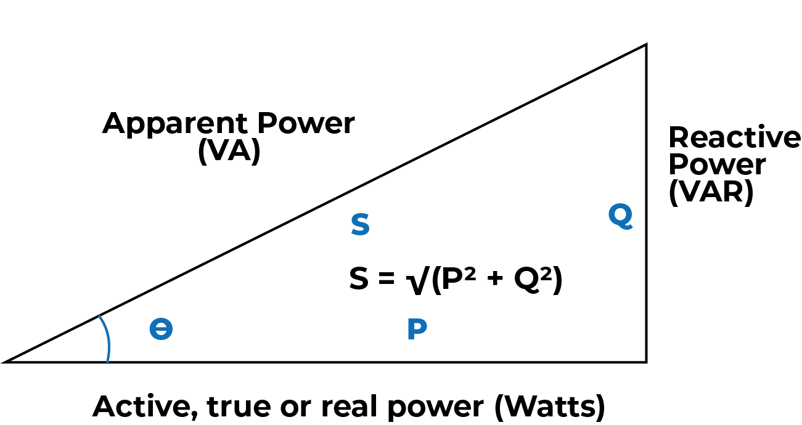

## 1. 正弦电流和电压
这本书里面统一表示成余弦函数的样子：
$$v(t)=V_mcos(\omega t+\theta)$$
如果遇到正弦的话就转化成余弦

## 2. 相量法

就是利用==复数来表示复杂的余弦函数==
### 2.1 复数

复数有三种表达形式：
- 代数形式：一般用于加减运算之中$$z_1+z_2=(x_1+x_2)+j(y_1+y_2)$$
- 极坐标形式：一般用于乘除运算之中$$z_1z_2=r_1r_2\angle{(\theta_1+\theta_2)}\\ ~\\ \frac{z_1}{z_2}=\frac{r_1}{r_2} \angle{(\theta_1-\theta_2)}$$
- 指数形式：跟据欧拉公式：$$z=r(cos\theta+jsin\theta)=re^{j\theta}$$

### 2.2 相量表示
对于正弦电压：
$$v(t)=V_mcos(\omega t+\theta)$$
其相量表示为：
$$\vec{V_1}=V_1\angle{\theta_1}$$

当电压是正弦函数时，应该先转换为余弦函数，再转化为相量

### 2.3 阻抗和导纳
- 电感inductor：
    - 电压相位超前电流相位90°$$Z=j\omega L$$
- 电容capacitor：
    - 电压相位落后电流相位90°$$Z=-\frac{j}{\omega C}$$
- 阻抗impedance
    $$Z=R+jX$$
    - 其中R为纯电阻resistance，X为电抗reactance(也就是电容和电感)
    - $X>0$说明负载时感性的（电感主宰），$X<0$说明负载是容性的（电容主宰）
    - 上面代数形式的阻抗同样可以写成极坐标形式：$$Z=|Z|\angle{\theta}$$
- 导纳admittance
    - $$Y=\frac{1}{Z}\\ ~\\ Y=G+jB=\frac{1}{R+jX}=\frac{R-jX}{R^2+X^2}$$
    - 单位是S(西门子)。G为电导，B为电纳。跟据等式左右的对应关系不难看出：$$G=\frac{R}{R^2+X^2}\\ ~\\ B=-\frac{X}{R^2+X^2}$$

## 3. 交流电路功率

### 3.1 瞬时功率
跟据伟大的积化和差公式：
$$p(t)=V_mI_mcos(\omega t+\theta_v)cos(\omega t+\theta_i)\\ ~\\ =\frac{1}{2}V_mI_mcos(\theta_v-\theta_i)+\frac{1}{2}V_mI_mcos(2\omega t+\theta_v+\theta_i)$$

其中第一项是常数，对于电阻而言是正数，所以电阻的瞬时功耗一定是正的。

而对于电容和电感来说，第一项是0，而第二项又是时正时负的，所以瞬时功耗时正时负。

### 3.2 有功功率Active Power、无功功率Reactive Power、视在功率Apparent Power；功率因数
我们来把瞬时功率的表达式改变一下形式，把第二项的角度拆为$(2\omega t+2\theta_v)-(\theta_v-\theta_i)$:
$$p(t)=\frac{1}{2}V_mI_mcos(\theta_v-\theta_i)[1+cos(2\omega t+2\theta_v)]+\frac{1}{2}V_mI_msin(\theta_v-\theta_i)sin(2\omega t+2\theta_v)$$

其中第一项对于任何元件来说都始终大于等于0，而第二项对于电容和电感来说，则是正负交替的一项。令电压相位和电流相位的夹角$\theta=\theta_v-\theta_i$，则我们定义：
- 无功功率Reactive Power：$$Q=V_{rms}V_{rms}sin\theta$$单位是VAR（volt-amperes reactive）
> rms是root mean square，在这里就是有效值，还记得吗？$V_{rms}=\frac{V_m}{\sqrt{2} }$
> 关于无功功率的理解：无功功率只和电容和电感有关系。而对于电容和电感来说，他们最终做的总功率必定为0。那么无功功率的意义何在呢？它描述的是电容和电感吸能和放能功率的==绝对值==
- 有功功率Active Power（恰好等于平均功率）:$$P=V_{rms}V_{rms}cos\theta$$单位就是普通的瓦
> 无功功率实际结算为总功的时候有正有负，平均功率里就没有无功功率的事，所以平均功率恰好就等于有功功率
- 视在功率Apparent Power: $$|S|=V_{rms}I_{rms}$$单位是VA(volt-amperes)(跟据wiki，还有个概念叫complex power，是$S=P+jQ$，一般用不到就是了)
> 你可能会好奇无功功率既然不影响总功，那么视在功率这样结算的意义何在呢？虽然总体上来看无功功率啥也没干，但是设计电源的时候就是要把无功功率也考虑进去，不然压根没有多余的能量留给电容和电感吸收或者释放

显然这三个概念可以放到一个功率三角形里面：

还有个概念：
- 功率因数PF：$cos\theta=\theta_v-\theta_i$

这一章在计算的时候，要注意$\omega=2\pi f$