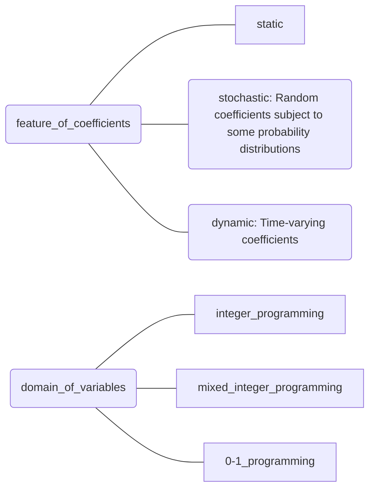

# Classifications

* 最左为分类依据

注意区分概念

* 对optimization（最佳解）作出分类很重要，因为不同的问题会有不同的解法
    * Linear Programming: can be solved by the [simplex method](https://people.richland.edu/james/ictcm/2006/simplex.html) efficiently（**单纯形方法**的实现见超链接，主要思想是把不等式先变为等式，然后向着最终函数增大的方向不断逼近）
    * Many Integer/Nonlinear/Stochastic Program: NP-hard (cannot find a polynomial-time complexity algorithm)
    Approximated Approaches
    Some solvers like CPLEX can be used to solve the model.
    Evolutionary Computation (Section 8) becomes a common approach
    （都不知道）

* 关于Integer Programming:
和Linear很像，但是解必须是整数。和Linear求出的最优解最接近的那个整数点，并非一定是最优解！很多时候相差甚远
解法如下：
    * Branch and Bound
    * Evolutionary Computation, etc

* Nonlinear programs:
    * Dichotomous Search Method for Unimodal Problems(单峰曲线的二分法查找)

* Dynamic programs（动态规划）:
    * 包含以下概念：
        * Stages
        * Status
        * ...(不知道这么多概念啥意思)
    * 我觉得课件讲得不够清楚，具体可以参考[这个斐波那契数列的例子](https://blog.csdn.net/u013309870/article/details/75193592)
        * 核心是记住子问题的解
        * 经常用递归来实现
        * 自上而下（算父问题的过程中得到子问题的解并存起来）或是自下而上（直接找子问题的解）

* Multiobjective problems（多目标优化问题）
    * 转换为单目标优化问题
        * 把部分目标转换为限制条件
        * 线性加权法
    * 真男人硬刚
        * Pareto Dominance（帕累托支配）
        * Pareto Front
        * 多目标演化算法
    

