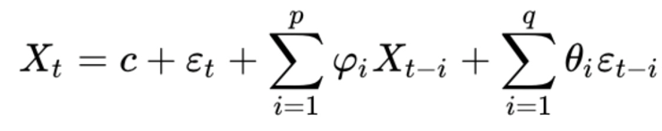
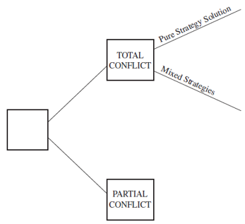

### 1.Introduction

都是废话

### 2.Simulation of Probability Models

* Monte Carlo Simulation
    * 就是用无数次随机投掷来计算圆周率（暴力模拟来算概率）
* Queueing Systems
    * 很奇怪 感觉啥都没讲

### 3.Probability and Stochastic Systems

* The Markov Process
    * A Markov chain is a stochastic（随机） model describing a sequence of possible events in which the probability of each event depends only on the state attained in the previous event.
    * ppt难得做了回人，有关steady stage等的有关事情可以看
* System Reliability

### 4.Probability Decision Making

* White Noise白噪音: the observations at different time are **uncorrelated** and have **zero mean** and **same variance**
    * 所以白噪音无法预测
* 时间序列的平稳性：
    * strictly stationary: 任意取时间序列中的t个连续的数，他们都服从同样的联合分布
    * weakly stationary: 时间序列（任意一段）的均值与时间t无关，方差与t无关，协方差只与时间间隔有关。
* Auto Regressive(AR): 自回归、线性，用自己预测未来的自己； Moving Average(MA): 根据时间序列资料、逐项推移，依次计算包含一定项数的序时平均值，以反映长期趋势的方法。因此，当时间序列的数值由于受周期变动和随机波动的影响，起伏较大，不易显示出事件的发展趋势时，使用移动平均法可以消除这些因素的影响，显示出事件的发展方向与趋势（即趋势线），然后依趋势线分析预测序列的**长期趋势**。
* ARMA: 集大成者
* Phase Space Embedding: 不知道ppt在干啥
* Decision Trees: 就是把可能性给可视化了而已
* Game Theory: 
    * 当参与的玩家不是一个，而是多个时，就需要用Game Theory来决策
    * 分类：
    * Total Conflict: 回报的总数是个常数
        * Pure Strategy
            * 大概就是，一个决策必定会比另一个决策要好
            * Nash Equilibrium: 每个人都选择对自己而言最优的选择
        * Mixed Strategy
            * 不存在绝对更好的决策
            * 可以算出胜率（可以用一些小学奥数方法）
    * Partial Conflict: 回报的总数不是常数
* Fuzzy Systems
    * Fuzzy sets(模糊集): 每个元素都有自己对应的 出现在该集合中的概率。用(U, m)表示，U为集合，m为表达式，m(x)即可计算出x元素在集合之中的概率
        * 不同概率的情况(根据m(x)的值，即概率来判断)：
            * =0: not included
            * =1: fully included
            * else: partially included
        * 一些子集的定义(crisp set):
            * $A^{\ge\alpha}$: $\alpha$-cut, 概率大于$\alpha$的集合
            * $A^{\gt\alpha}$: strong $\alpha$-cut
            * $Supp$(A)=$A^{>0}$: support
            * $Core$(A)=$A^{=1}$: core