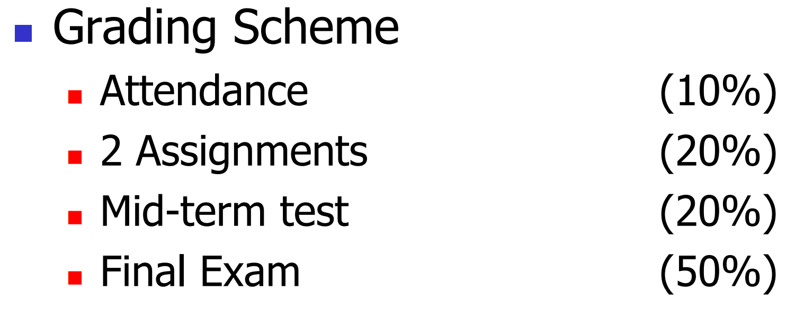
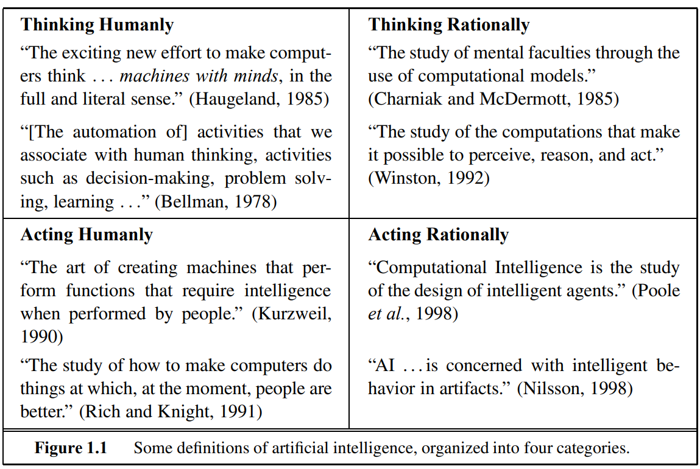

## 1.1 What is AI?

反正就是没有准确定义，可以弄出以下四种不同的想法:

上面的四种分类在两个维度上有分歧:

- **Human-centered**
  
    empirical science, involving hypothesis and experimental confirmation

- **Rationality**
  
    combination of mathematics and engineering

### 1.1.1 Acting humanly: The Turing Test approach

> A computer passes the test if a human interrogator, after posing some written questions, cannot tell whether the written responses come from a person or from a computer.

为了通过图灵测试，计算机得具备如下能力:

- **natural language processing**
  
    to enable it to communicate successfully in English

- **knowledge representation**
  
     to store what it knows or hears

- **automated reasoning**
  
    to use the stored information to answer questions and to draw new conclusions

- **machine learning**
  
    to adapt to new circumstances and to detect and extrapolate patterns

与此相对应的，还有更加严格的**total Turing test**，要求计算机能够和人进行物理上的互动。这时候又要求有额外的能力:

- **computer vision**
  
    to perceive objects

- **robotics**
  
    to manipulate objects and move about

### 1.1.2 Thinking humanly: The cognitive modeling approach

其实我们自己都不了解自己是如何思考的

有两种方法了解：

- Introspection
  
    内省

- Psychological experiments

> A program behave humanly If a program’s input/output and timing behaviors match corresponding human behaviors

### 1.1.3 Thinking rationally: The "laws of thought" approach

### 1.1.4 Acting rationally: The rational Agent

- **Agent**
  
    something that acts

- **Rational Agent**
  
    acts so as to achieve the best outcome or, when there is uncertainty, the best expected outcome

## 1.2 The Foundations of AI

AI是跨学科领域:

- Psychology
- Philosophy
- Neuroscience
- Mathematics
- Linguistics
- Operations research
- Control theory
- Cybernetics
- Economics
- Computer Engineering

## 1.3 The History of AI

都是废话

