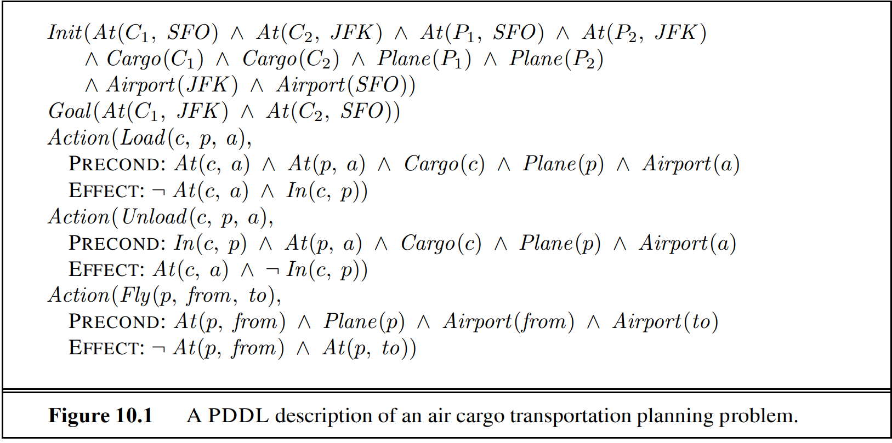
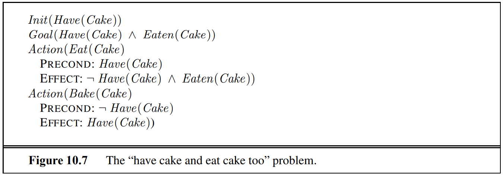
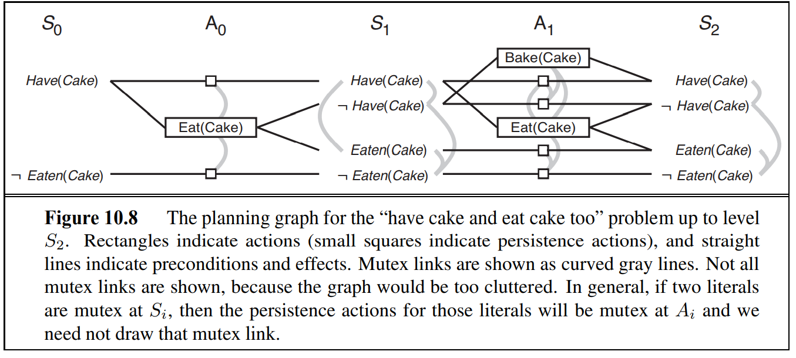
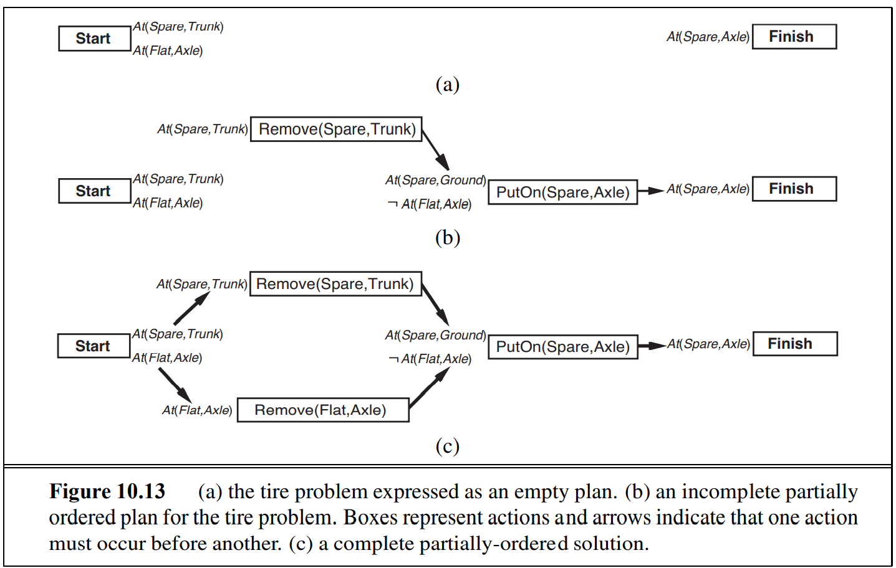

## 10.1 Definition of Classical Planning
为了用变量来描述世界的状态，我们需要**P**lanning **D**omain **D**efinition **L**anguage (**PDDL**)

懒得记概念，不如直接看题

### 10.1.1 Example: Air cargo transport

我觉得不解释也能看懂这图啥意思

## 10.3 Planning Graphs
比如对于这么一个问题：

我们可以有如下的planning graph:

具体还是看书好了

## 10.4 Other Classical Planning Approaches
### 10.4.4 Planning as refinement of partially ordered plans

在此之前，我们学过的plan都是totally ordered plans，说白了就是==不存在并行的action==。这其实不是很合理，因为实际上很多subproblem是各自独立的，也就是可以并发。

所以有了partially ordered plan:

至于我们是如何构建这样的plan的：我们从只包含起点和终点的情况开始(图a)，每一步找一个图中未能满足的precondition，然后用尽可能少的commitment来满足它。

比如说，图a里面$At(\text{Spare},\text{Axle})$没有被满足，我们就找个能够产生这个effect的action来填上去，所以填了$\text{PutOn}(\text{Spare,Axle})$

