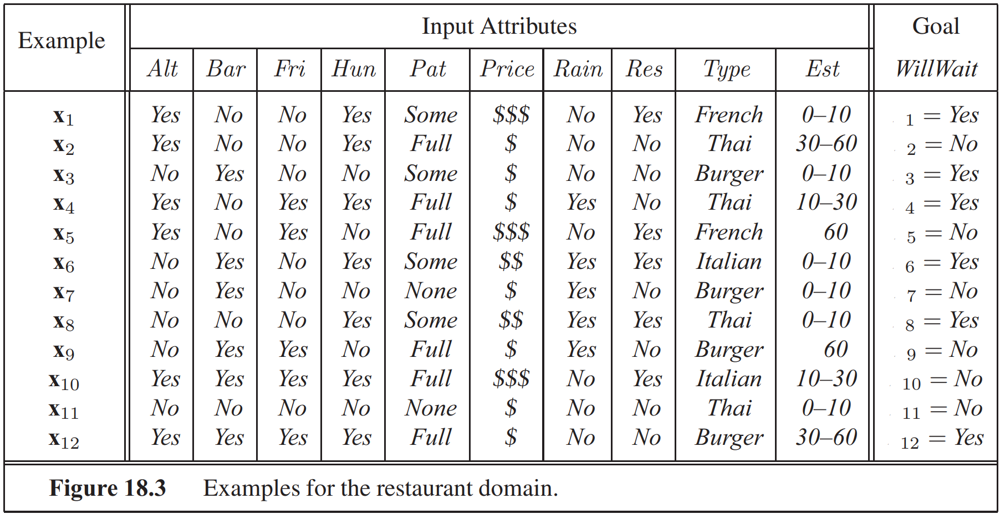
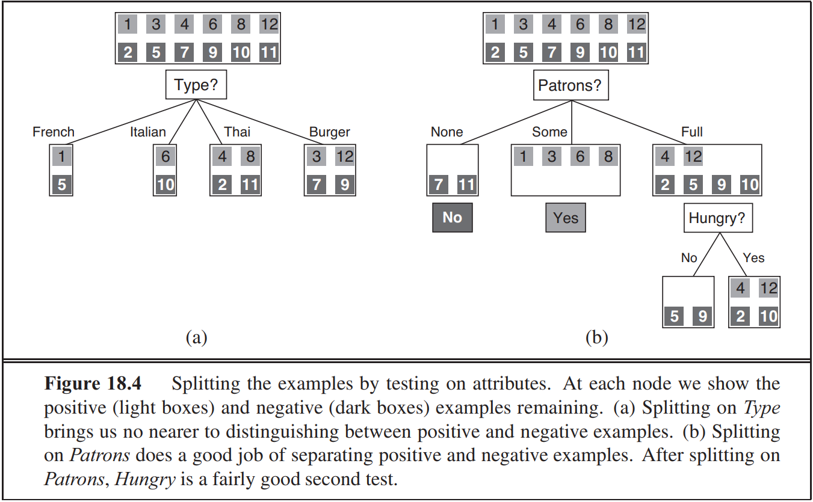

## 18.3 Learning Decision Trees
### 18.3.1 The decision tree representation
这里的决策树主要是依靠不同的变量，来进行分支
### 18.3.3 Inducing decision trees from examples

这是是否在这家餐厅吃饭的决策样例

我们想要从一堆训练集之中，构建出一个尽可能小的决策树。这就需要我们用**decision-tree-learning algorithm**:
> **decision-tree-learning algorithm** adopts a ==greedy divide-and-conquer== strategy: always test the ==most important attribute first==

通过对不同的attribute进行test，我们就可以把问题拆分成子问题，递归地解决

显然我们希望用来test的attribute要==尽可能有区分能力==，比如：

上图中，Type虽然有四种可能的取值，然而不管是哪种取值，结果为true和false的个数依然是持平的，压根没有区分开真集和假集。反观Patron，三种可能的取值里，有两个直接就成了叶节点(都是true或都是false)，这就是相对较好的

需要注意的是，学习得到的决策树肯定和人脑中真正的标准答案的决策树是不同的

### 18.3.4 Choosing attribute tests
从上一小节我们可以看到，选择一个好的attribute作为区分是非常关键的。那么问题就来了，到底怎么样衡量这样的好坏呢？**information gain**将是这个衡量标准，不过在此之前要有许多概念作为铺垫：

- **entropy**

    熵是我们定义information gain的基础

    > **entropy** is a measure of the ==uncertainty== of a random variable

听着是个比较逆天的名字，和变量各个取值的概率有着密切联系

先举几个例子说明：

e.g.

有一个魔法硬币，它总是正面朝上。那么这个家伙就没有不确定性，entropy就是0

一个正常的硬币，有两种等可能的结果，那么这对应了"1 bit" of entropy (没错，entropy这里的==单位都将用bit==来衡量)

类似地，一个4个面等概率的骰子就需要"2 bits" of entropy

然而假如有个作弊的硬币，它两个面的概率不相等呢？比如一个面99%，另一个面1%，显然我们假如压99%的那个面的话，不确定性就会非常小。这对应多少bit呢？

于是这里引出我们的通用公式：
$$
I(P(v_i),...P(v_n))=\Sigma_{i=1}^n-P(v_i)\log_2P(v_i)
$$
其中，$v_i$对应的是该attribute的第$i$个可能的取值 (其实$v_i$的实际值是多少完全不重要)，$P(v_i)$是该attribute取值为$v_i$的概率，$I$就是entropy (单位为bit)

比方说我们可以验证一下，一个正常的骰子的熵是：
$$
I(\frac{1}{2},\frac{1}{2})=-\frac{1}{2}\log_2\frac{1}{2}-\frac{1}{2}\log_2\frac{1}{2}=1\ bit
$$

然而实际上我们只有训练集作为数据，并不知道各个attribute实际的概率，所以上面的公式就要转变成：
$$
I(\frac{p}{p+n},\frac{n}{p+n})\\=-\frac{p}{p+n}\log_2\frac{p}{p+n}-\frac{n}{p+n}\log_2\frac{n}{p+n}
$$
其中$p$为positive examples个数，$n$为negative examples个数。显然小学生都会这种替换

至此，我们已经可以量化当前状态下的不确定性大小了。显然为了衡量一个attribute是好是坏，就可以看看它对于分裂前后的熵的改变量有多大。

test过attribute $A$之后，我们的熵就变成了：
$$
\textit{Remainder}(A)=\Sigma_{i=1}^v\frac{p_i+n_i}{p+n}I(\frac{p_i}{p_i+n_i},\frac{n_i}{p_i+n_i})
$$
不难看出$\frac{p_i+n_i}{p+n}$是$A$选择第$i$个取值的概率，而$I(\frac{p_i}{p_i+n_i},\frac{n_i}{p_i+n_i})$则是第$i$个取值这条分支下的熵的大小。很合理

我们终于可以来定义一下**information gain**了！
$$
\textit{Gain}(A)=I(\frac{p}{p+n},\frac{n}{p+n})-\textit{Remainder}(A)
$$
显然就是前后熵相减。注意是==之前减去之后==，别弄反了，毕竟我们期望新的值越小越好，也就是information gain==越大越好==

