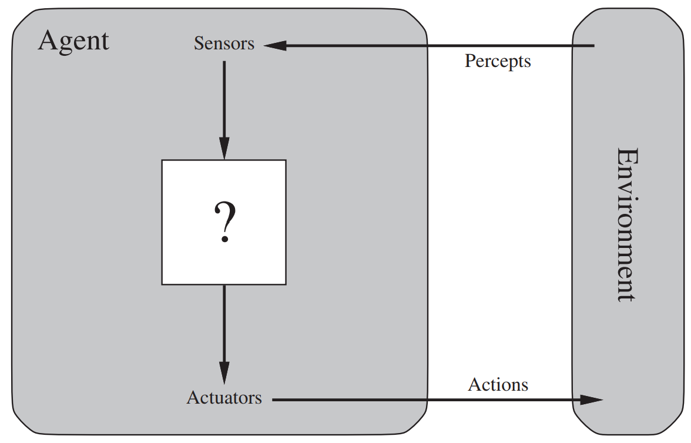
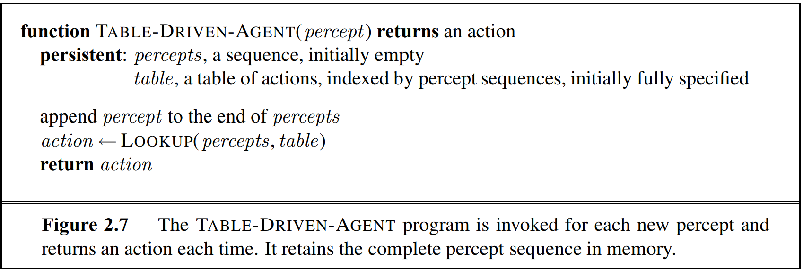
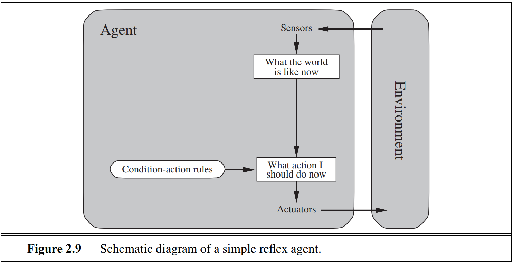
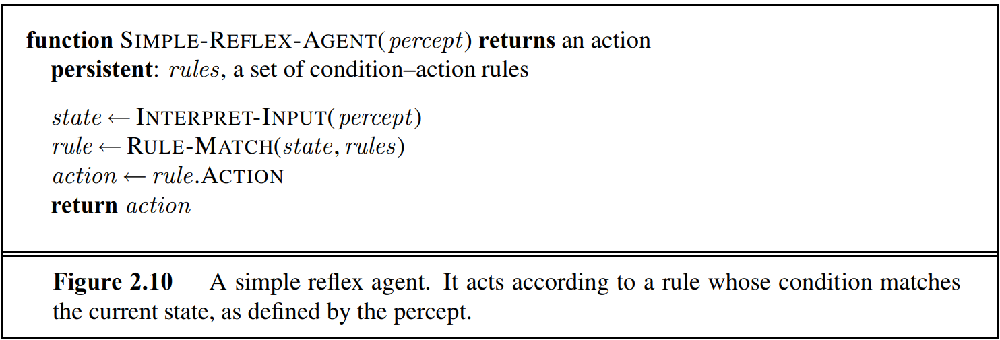
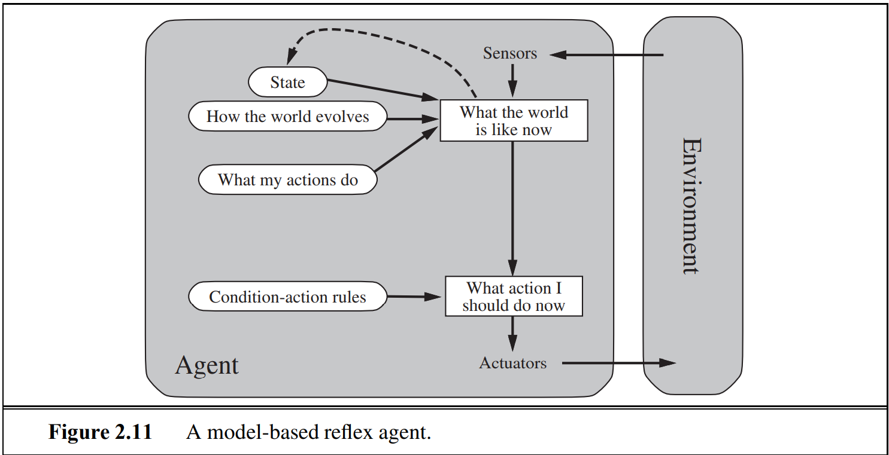
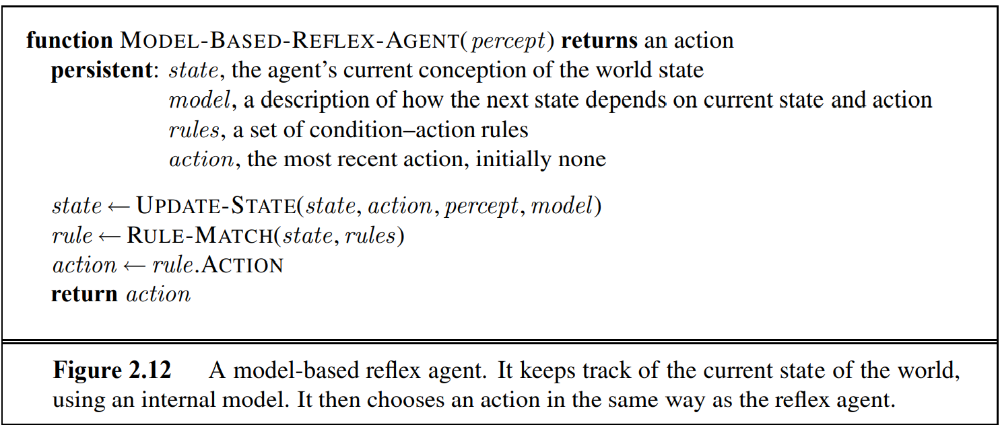
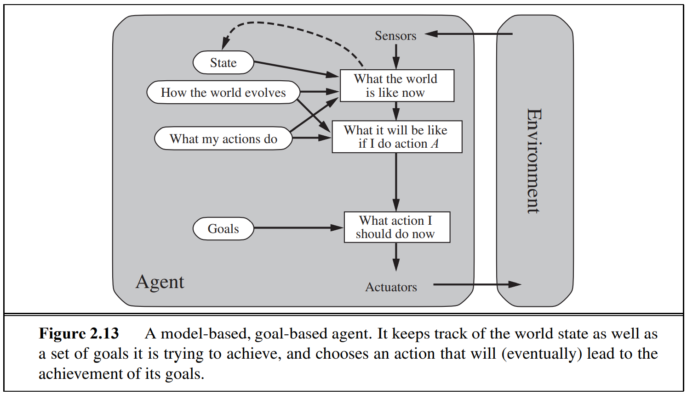
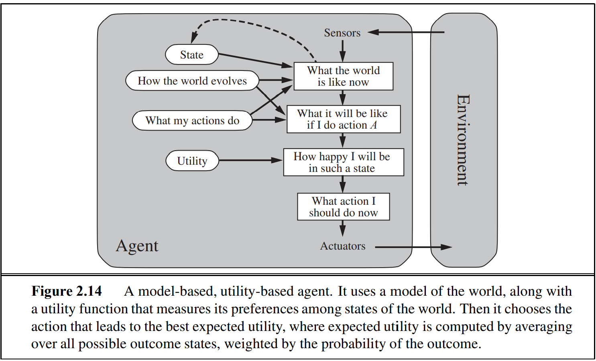
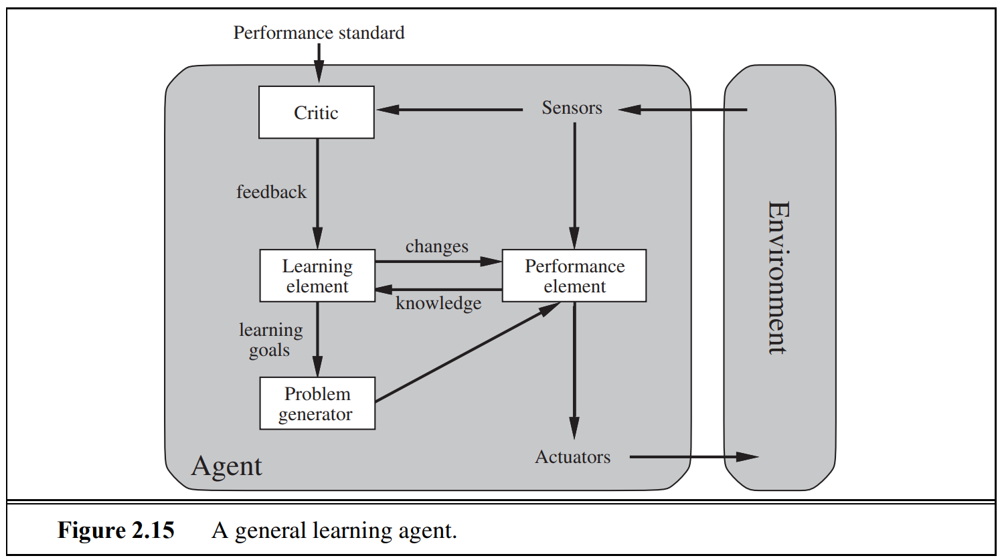

第一章的学习说明了**rational agents**才是我们应该关注的方式
## 2.1 Agents and Environments
- **agent**

    - perceiving its environment through ==sensors==
    - acting upon the environments through ==actuators==

    如下图这样子：

    

- **percept**

    > the agent’s perceptual inputs at any given instant
    - **percept sequence**

        > the complete history of everything the agent has ever perceived
        
- **agent function**

    > maps any given percept sequence to an action
- **agent program**

    就是*agent function*的具体实现

## 2.2 Good Behavior: The Concept of Rationality
- **performance measure**

    根据agent造成的environment的state变化来衡量这个agent是否是rational的
    > 注意我们这里选择了==environment states==而并不是agent states，因为一个agent总可以骗自己，觉得自己做的非常好，这样就没有参考意义了

> As a general rule, it is better to design performance measures according to ==what one actually wants== in the environment, rather than according to ==how one thinks the agent should behave==.

### 2.2.1 Rationality
关于rational的定义，一直都取决于:
- The performance measure that defines the criterion of success
- The agent's prior knowledge of the environment
- The actions that the agent can perform
- The agent's percept sequence to date

这可以导出*rational agent*的定义:
> For each possible percept sequence, a rational agent should select an action that is expected to ==maximize its performance measure==, given the evidence provided by the percept sequence and whatever built-in knowledge the agent has

### 2.2.2 Omniscience, learning, and autonomy
\[ɒm'nɪsɪəns]: 无所不知

我们需要区分perfection和rationality:
- **perfection**

    假设omniscience，则可以最大化==actual performance==，但显然实际生活中并不可能
- **rationality**

    最大化==expected performance==

**Information gathering** is important part of rationality

- **Learning**

    - A rational agent also need to learn as much as possible from what it perceives
    - The initial configuration of the agent may reflect some prior knowledge of the environment
    - After gaining experience, this may be modified or augmented
    - No learning is needed if we completely know the environment in prior…but this is the not case in reality

- **autonomy**

    An agent lacks of autonomy if it ignore its own percepts and relies on the prior knowledge of its designer

## 2.3 The Nature of Environments
- **task environment**

    假如说这是problem的话，agent就是solution

### 2.3.1 Specifying the task environment
*task environment*可以用*PEAS*来描述:
- **P**erformance
- **E**nvironment
- **A**ctuators
- **S**ensors
> In designing an agent, the first step must always be ==specifying the task environment== as fully as possible

环境可能是存在于现实环境之中，也可能是虚拟幻境之中的（网上）

### 2.3.2 Properties of task environments
环境可以有超多种分类方式:
- Fully / Partially observable

    partial的意思是:
    - Noisy and inaccurate sensors
    - Parts of the state are missing from the sensor data
- Deterministic / Stochastic

    字面意思
- Episodic / Sequential

    current decision是否会影响未来的决策。是的话为sequential，否的话为episodic(比如分类问题)
- Static / Dynamic
- Discrete / Continuous
- Single / multi agent

    参与者有一个人还是多个人

OK我们已经分类完了，补充一点别的概念:
- environment class

    可以从类中诞生出许多不同的environment
    - environment generator

        产生相似但不完全相同的环境

## 2.4 The Structure of Agents
$$
agent = architecture + program
$$
architecture是硬件，program是软件

> program和function的区别是: function吃的是entire percept history，而program吃的是current percept

### 2.4.1 Agent programs
伪代码如下：

然而table-driven-agent有很大的问题:
- 数据量可能会非常离谱

The key challenge for AI is to find out how to write programs that produce rational behavior from a ==smallish program== rather than from a vast table

反正就得到了四种不同的agent program:
- Simple reflex agents
- Model-based reflex agents
- Goal-based agents
- Utility-based agents

### 2.4.2 Simple reflex agents
只考虑current percept，不考虑percept history

- **condition-action rule**

    就是if-then结构

对应结构图和伪代码如下:

鉴于这种agent只能对当前的情况做出决定，也就等于必须要fully observed，所以实用性就等于几乎没有

这种玩意还经常会陷入无限循环，而**randomize**可以帮助摆脱这种循环

### 2.4.3 Model-based reflex agents
面对partially observe，agent应该维护一些**internal state**，这些state是基于percept history的，也就可以反应一部分当前状态下未被观测到的部分

想要更新*internal state*就需要知道:
- Information about how the world evolves independently of the agent
- Information about how the agent's own actions affect the world

**model**用来描述"how the world works"，而使用这种模型的就是*model-based agent*

结构图和伪代码如下：

### 2.4.4 Goal-based agents
在日常生活中，仅仅知道当前状况往往是不够的。就像的士司机需要知道车最终的目的地在哪里一样，agent也需要**goal**来确定什么样的情况是想要的

结构图如下:

### 2.4.5 Utility-based agents
我们可以在goal-based的基础上更进一步，来考虑一下同样到达目的地，到底哪种方式更让乘客觉得happy。显然这样子描述太抽象了，我们用*utility*来描述这种"the quality of being useful"

- **utility function**

    用来根据一系列状态算出乘客有多happy

它应该选择**expected utility**最大的action

### 2.4.6 Learning agents

从图中可以看到，有四个主要的组件：
- **Learning element**

    用来改进行为。一般来说这东西的设计非常依赖于*performance element*是如何设计的
- **Performance element**

    我们先前以为这东西就是整个agent。

    用来选择external actions
- **Critic**

    一个监督者，制订了对于*learning element*来说==不可更改的标准==。当然，sensors的数据还是会影响它的想法的
- **Problem generator**

    跟人类做实验一样，它就是用来进行一些冒险的举动

## 2.5 Summary
Learning in intelligent agents can be summarized as a process of ==modification== of each component of the agent
- To bring the components into closer agreement with the available feedback information
- Improving the overall performance of the agent

