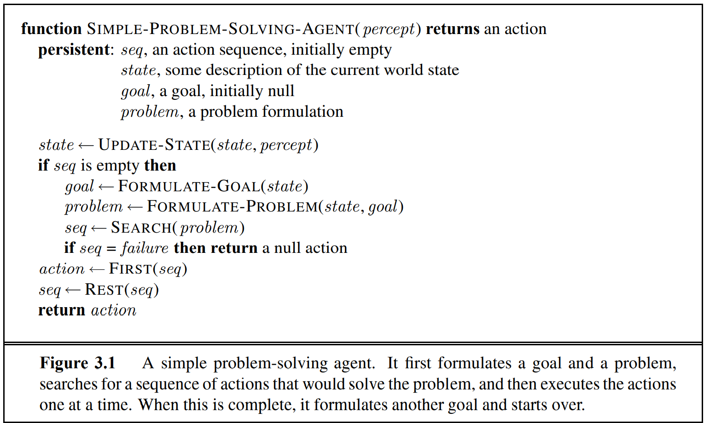
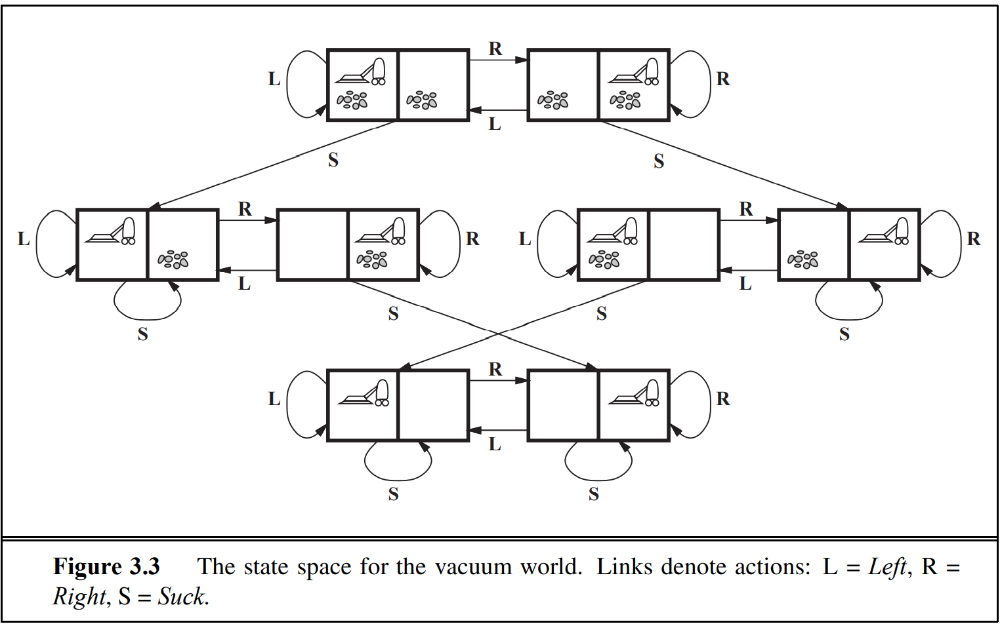
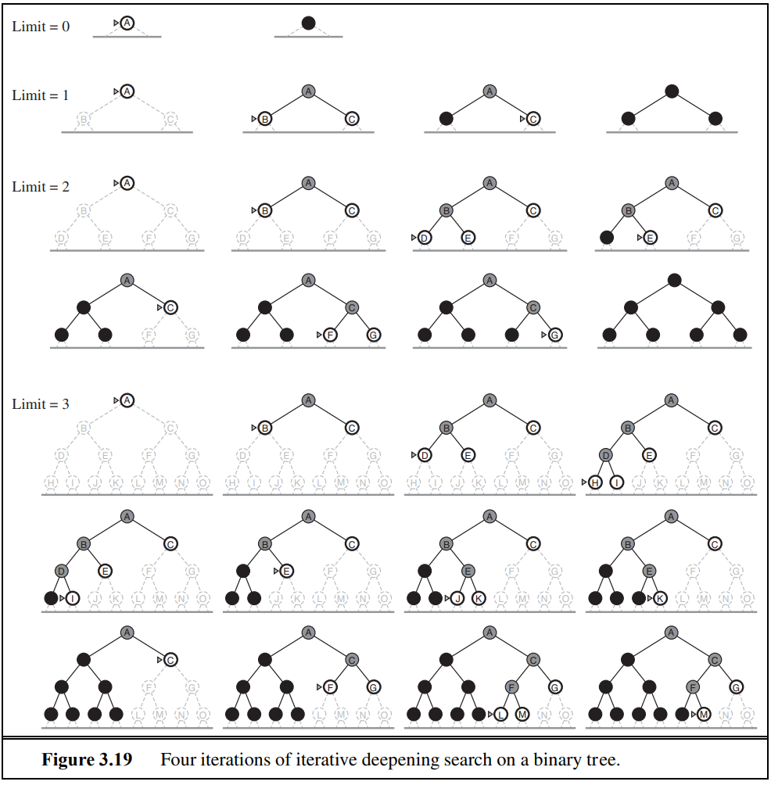
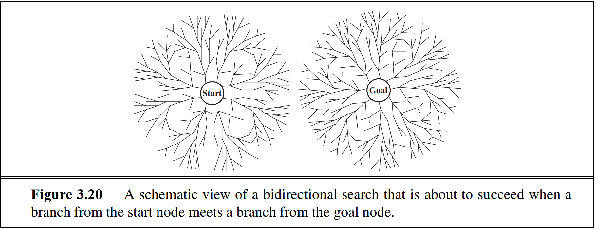
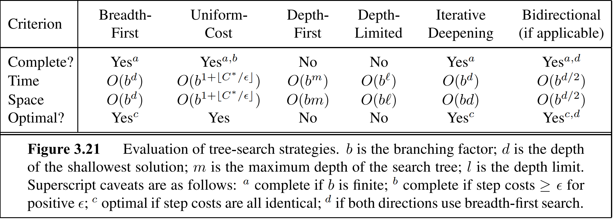
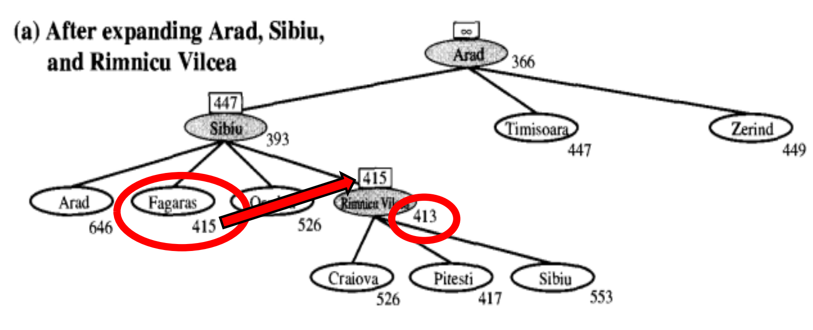
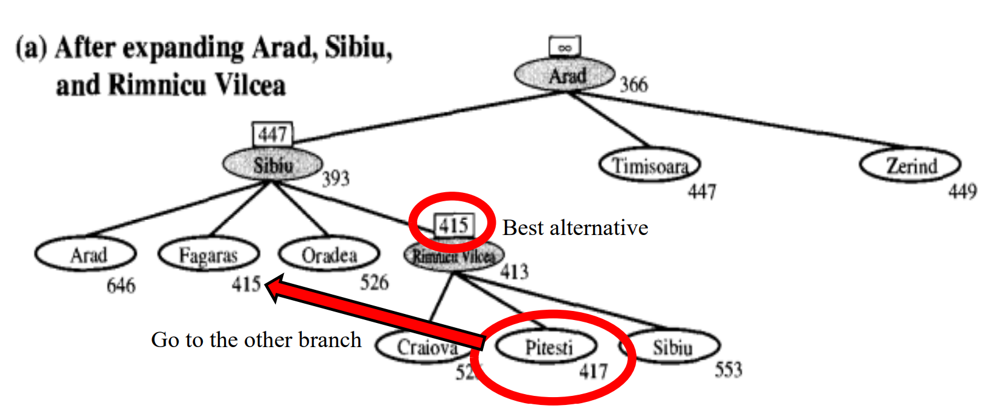
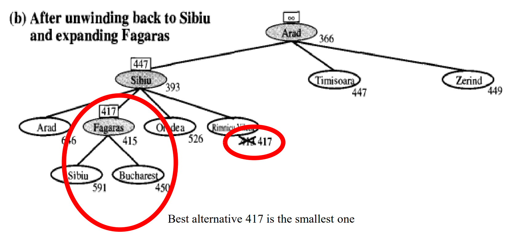
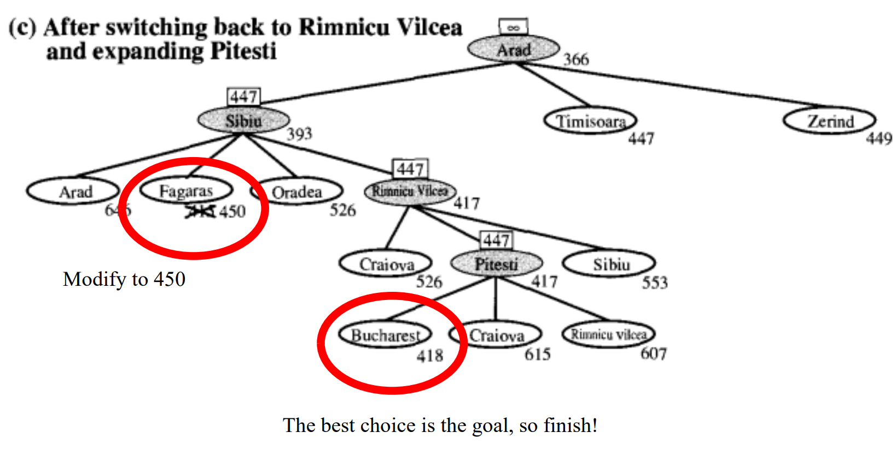

这一节我们要介绍一种*goal-based agent*，叫做**problem-solving agent**

## 3.1 Problem-Solving Agents
- **goal formulation**

    based on the ==current situation== and agents ==performance measure==

    the ==first== step in problem solving
- **goal**

    > a set of world ==states==

    the agent's task is to find the ==action sequence== which leads to a goal state
- **problem formulation**

    > the process of deciding what ==actions== and ==states== to consider, given a goal.

    正因为现实世界中存在的action和state太多了，才需要决定一下到底只考虑哪些
- **search**

    在了解定义之前，我们需要一些assumptions on the environment:
    - **static**

        不然执行过程中还得改action
    - **observable**

        know the initial state
    - **discrete**

        只有有限个actions
    - **deterministic**

        每一个action只有唯一的outcome。不然没法预测结果

    an agent with several immediate options of unknown value can decide what to do by:
    - first examining different possible sequences of actions that lead to ==states of known value==
    - the choosing the best sequence

    > the process of looking for ==a sequence of actions== that reaches the goal is called **search**
- **execution**

    take the first action in the recommended sequence, remove it from the sequence.

    repeat the steps until no more action is in the sequence

    once the solution has been executed, the agent will formulate a ==new goal==

所以综上，我们就有了简单的"**formulate, search, execute**"design for the agent

非要用伪代码表示一下就是这样子的流程:

- **open-loop system**

    while the agent is executing the solution sequence, it ==ignores its percepts== when choosing an action because it knows in advance what they will be. 

    an agent that carries out its plans with its ==eyes closed== must be quite certain of what is going on

### 3.1.1 Well-defined problems and solutions
A **problem** can be defined formally by five components:
- **initial state**

    比如记作$\text{\it In(Arad)}$
- **successor function**

    > a description of the ==possible actions available== to the agent

    given a state $x$, $\textit{SUCCESSOR-FN}(x)$ returns a set of $<action, successor>$ ordered pair

    - *action*

        > one of the legal actions in state $x$
    - *successor*

        > a ==state== that can be reached from $x$ by applying the action
- **state space**

    the *initial state* and the *successor function* implicitly define the state space of the problem

    it forms a **graph**:
    - nodes are *states*
    - edges are *actions*
- **goal test**

    > determines whether a given state is a goal state

- **path cost**

    就是每个边的权重
    - **step cost**

        > the cost of taking action $A$ to go from state $x$ to state $y$

        两个state不一定相邻
- **solution**

    > a path from the initial state to the goal state
    - **optimal solution**

        > a path from the initial state to a goal state with the ==lowest path cost== among all solutions
### 3.1.2 Formulating problems
- **abstraction**

    > the process of ==removing detail== from a representation

    - **abstraction of state**

        > we ignore details and small problems in a state that are ==irrelevant== to the problem
    - **abstraction of action**

        也是忽略action里面无关的东西

        比如how to drive并不影响旅游的计划
- **level of abstraction**

    显然，抽象也是需要一个合适的度的，比如看地图的时候的缩放等级

    - the abstraction is **valid** if we can expand any abstract solution into a solution in the more detailed world

    - the abstraction is **useful** if carrying out each of the actions in the solution is ==easier== than the original problem

    一个好的抽象就是移除尽可能多的细节的同时，保留validity，且保证abstract action is easy to carry out

## 3.2 Example Problems
problem可以分成:
- **toy problem**

    can be given a ==concise, exact description==
- **real-world problem**

    tend not to have a single agreed-upon description, but we can give the ==general flavor== of their formulations

    人们关心的当然是现实世界的问题
### 3.2.1 Toy problems
我们举的例子是vacuum world(就是一个吸尘器，以及两个房间的世界)

这家伙的problem可以如下定义：
- **States**

    两个房间各自可能是脏的/干净的，然后吸尘器也可能出现在每一个房间里面。所以所有的状态有$2\times 2^2=8$ 个不同的state(假设有$n$个房间的话那就有$n\cdot 2^n$)
- **Initial state**

    任何state都可能是
- **Successor function**

    generates the legal states that result from trying the three actions: $\textit{Left, Right,Suck}$
- **Goal test**

    checks whether all the squares are clean
- **Path cost**

    each step costs 1, so the path cost is the number of steps in the path

其他的例子还有:
- **8-puzzle**
- **8-queens**

### 3.2.2 Real-world problems
- **route-finding problem**
- **touring problems**
- **traveling salesperson problem**(TSP)
- **VLSI Layout problem**
- **robot navigation**
- **automatic assembly sequencing of complex object**
- **protein design**

## 3.3 Searching for Solutions
> algorithms that forget their history are doomed to repeat it

意思就是说，是花费一点空间来存储history(**closed list**)，还是多花费一点时间来重复搜索
### 3.3.2 Measuring Problem-solving Performance
- **Completeness**

    > is the algorithm ==guaranteed to find a solution== when there is one?
- **Optimally**
- **Time complexity**
- **Space complexity**

## 3.4 Uniformed Search Strategies
### 3.4.1 BFS
### 3.4.2 Uniform-cost Search
就是Dijkstra
### 3.4.3 DFS
### 3.4.4 Depth-limited Search
给最大的搜索深度做了一个限制，就很离谱
### 3.4.5 Iterative deepening depth-first search(IDS)
有一个可以==不断变大的深度限制==

每次把当前深度限制下的节点搜索完之后再增大深度限制，进行下一轮搜索

结合了DFS和BFS的优点。

缺点是每次改变limit之后还得重新展开一次顶上的节点（最底层深度为$d$的节点需要展开1次，深度为$d-1$的节点需要展开2次，以此类推），听着就很浪费

时间复杂度是$O(b^d)$，空间复杂度是$O(bd)$（$b$是branching factor）

一般来说，当深度未知或者搜索空间很大的时候，会用到IDS

### 3.4.6 Bidirectional Search
大概意思是起点往前搜索的同时终点往后搜索，当两者相遇的那天就赢了:

优点是相比于单纯从单点出发，这样复杂度更低：
$$
b^{d/2}+b^{d/2}<b^d
$$
缺点是有时候从终点的反向搜索不是那么容易实现，这时候这算法就寄了

### 3.4.7 Comparing Uniformed Search Strategies

## 3.5 Informed (Heuristic) Search Strategies
Best-first search: 略，[算法讲过](../algorithms/ch5-tree-searching-strategy.md#54-best-first-search-strategy)

### 3.5.1 Greedy best-first search
就是我们学过的最简单的best-first，每次都贪
$$
f(n)=h(n)
$$

### 3.5.2 $A^*$ search: Minimizing the total estimated solution cost
你懂的，[算法也学过](../algorithms/ch5-tree-searching-strategy.md#510-a-algorithm)

虽然它看起来挺好的，但也有些缺点：
- It keeps all generated nodes in the memory
- usually runs out of space long before it runs out of time
- is not practical for large scale problems

下面提到的方法就可以缓解这些问题
### 3.5.3 Memory-bounded heuristic search
- **iterative-deepening $A^*$ algorithm** (IDA*):

    [3.4.5](#345-iterative-deepening-depth-first-searchids)的时候，我们介绍过常规的iterative-deepening depth first search

    这里不同的是，我们选择的限制并不是深度了，而是$f$-cost ($g+h$)。

    > at each iteration, the cutoff value is the smallest $f$-cost of any node that exceeded the cutoff on the previous iteration 

    (听起来就是选择==最保守==的cutoff value增长方式)

    可以有效解决爆内存的问题
- **Recursive best-first search**

    很诡异的方法，试图在线性的空间里模拟出$A^*$

    > It keeps track of the $f$-value of the best alternative path available from any ==ancestor== of the current node
    >
    > Replace the $f$-value of the best leaf in the forgotten subtree and can therefore decide whether it is worth ==re-expanding==

    可能看完你也没懂啥意思。大概就是它为了节省空间，只要不是当前展开节点的祖先，那么其它节点全部都不会展开(即便以前展开过)，但是会记录那个分支当时展开后children的最优cost是多少。

    哪天发现这个分支成了当前最优之后，那么就会==重新展开==这个节点(没错，重新展开，这复杂度直接翻了好几倍吧)

    e.g.

    

    

    

    

    这个设计过于复杂，甚至连复杂度都难以估计

- **Simplified $\text{MA}^*$** (SMA*)

    大部分时候都和A*行为一模一样，除了当memory要满的时候，它就会开始==删除拥有最大$f$-value的节点==，但是还是会和RBFS一样保留该节点的信息，方便日后发现其它路径太拉跨的时候回来展开

    然而这种做法显然是有弊端的，比如面对所有$f$-value都是一样大小的时候，我们需要展开最新的节点，删掉最旧的节点。

    还有更极端的情况，假设只有一条路，而且不巧的是这条路还塞满了memory，那么这种方法甚至会不断地删除又展开同样的节点，就会变成达不到终点的现实

    

### 3.5.4 Learning to search better
agent可以学习如何更好地搜索，依赖于一个重要的概念**metalevel state space**:
> Each state in a metalevel state space captures the internal state of a problem that is searching in an objective-level state space

说白了就是每个state存储一个例子中地图那样的东西，object就是不同的城市

在此之上提出**metalevel learning algorithm**，它会总结之前走过的弯路，并且之后不会展开某些看起来不是很像是最优路的节点

总之，learning的目的是最小化cost，这是一个computational expense和path cost的trade off

## 3.6 Heuristic Functions

