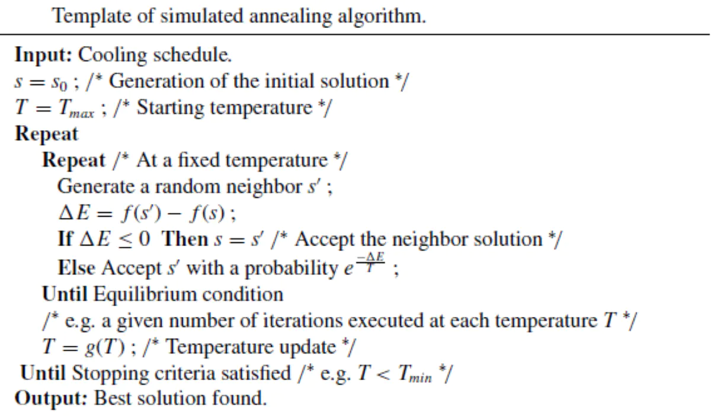
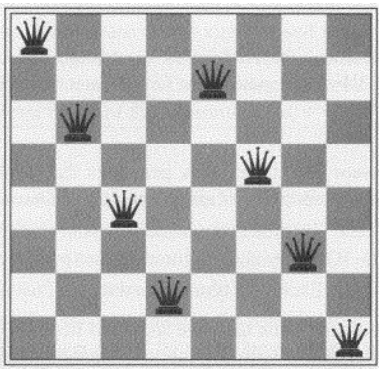
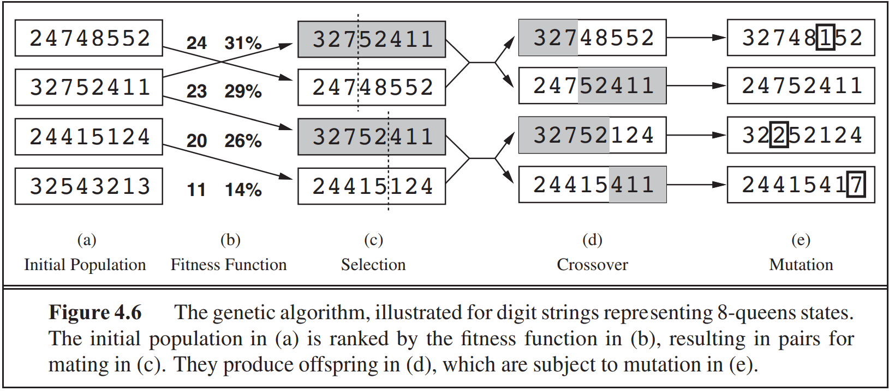
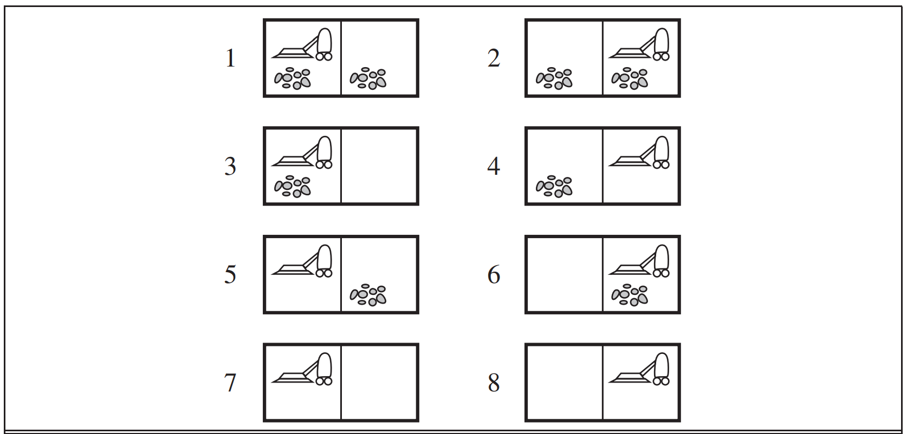
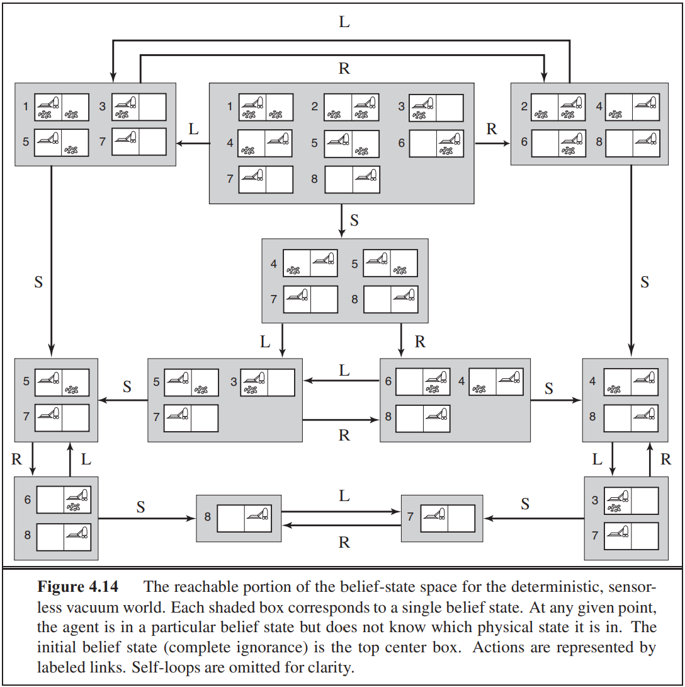
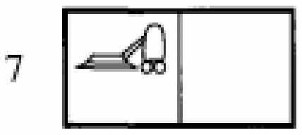

假设环境是fully observable，我们就可以使用**sequential solution**，也就没有下面这些讨论了
## 4.1 Local Search Algorithms and Optimization Problems
### 4.1.2 Simulated annealing
没错，大名鼎鼎的模拟退火

关于为什么这个算法叫做模拟退火：
- 物理退火：

    材料中的原子原来会停留在使内能有局部最小值的位置，加热使能量变大，原子会离开原来位置，而随机在其他位置中移动。退火冷却时速度较慢，使得原子有较多可能可以找到内能比原先更低的位置。
- 模拟退火：

    模拟退火算法从某一较高初温出发，伴随温度参数的不断下降,结合概率突跳特性在解空间中随机寻找目标函数的全局最优解，即在局部最优解能概率性地跳出并最终趋于全局最优。

总算是搞懂啥关联了

伪代码如下：

其实就是有点像hill climbing，只不过它不会非要找到局部最优，而是在邻居里面随便找一个：
- 假如这个邻居更好，那么我们果断接受，并更新温度
- ==假如更差，我们还是有$e^{-\Delta E/T}$的概率接受==

随便乱跳的概率会随着温度的降低而不断减小

### 4.1.4 Genetic algorithms
想不到MathorCup的时候[学的东西](https://www.geeksforgeeks.org/genetic-algorithms/)这里又用到了

书上给的例子是用来解决8皇后问题：

对应过程如下：

可以看到我们只用8位，每一位8个数，就表示了一个state。按理来说一个queen可能出现在64个位置，这里为啥只有8个位置嘞？因为我们首先规定了==每个queen必须出现在不同的列==这个条件，也就是说染色体上的每个位置不仅表示第几个染色体，更表示第几个列

对于每个染色体，我们都需要一个**objective function** (或者叫**fitness function**) 来衡量这个染色体离目标状态到底多接近。

这里我们选择the number of nonattacking pairs of queens来作为这个函数。不难得到我们的最终目标的函数值为$C_8^2=28$

函数值后面的百分数便是根据函数值算出的在selection阶段被选择概率

## 4.3 Searching with Nondeterministic Actions
这时候agent的future actions会取决于future percept。这个时候问题的解决方法就不是一个sequence，而是**contingency plan**(也就是**strategy**)that specifies what to do depending on what percepts are received.

比如说，我们可爱的吸尘器的世界:

我们可以用嵌套的if-then-else语句来说明解决方法:

[$Suck$, **if** $State=5$ **then** [$Right,Suck$] **else** []]

## 4.4 Searching with Partial Observations
这时候agent的percept也没法决定下一个状态是什么

- **belief state**是解决这类问题的关键:

    > representing the agent's current belief about the ==set of possible physical states== it might be in, given the sequence of actions and percepts up to that point

显然在fully observable的世界里面，就只剩唯一的state了

- **belief state space**

    

    每一个灰色的块就是一个belief state

    A solution is now a path that leads to a belief state which all members are goal states

    假如我们有$S$个physical states，那我们就有$2^S$个belief states

### 4.4.1 Searching with no observation
就是agent自己没有任何的sensor，这种问题也叫**sensorless problem**或者**conformant problem**

听着似乎非常狗，但是正因为没有sensor的成本，而使得agent格外稳定

比如我们可爱的吸尘器，在不知道任何信息的情况下，也能够通过
$$
Right\rightarrow Suck\rightarrow Left \rightarrow Suck
$$
来保证进入的世界状态

## 4.5 Online Search Agents and Unknown Environments
之前我们讨论过的全部都是**offline search**:
> compute a ==complete== solution ==before== setting foot in the real world and the execute the solution

也就是说，已经做好了万全的准备，和实际执行结果也没啥关联

假如我们需要更加dynamic的做法，就需要**online search**:
> an **online search** agent interleaves computation and action: first it takes action, then it observes the environment and computes the next action

先执行action，看看是啥效果，再继续决定下一步怎么做

