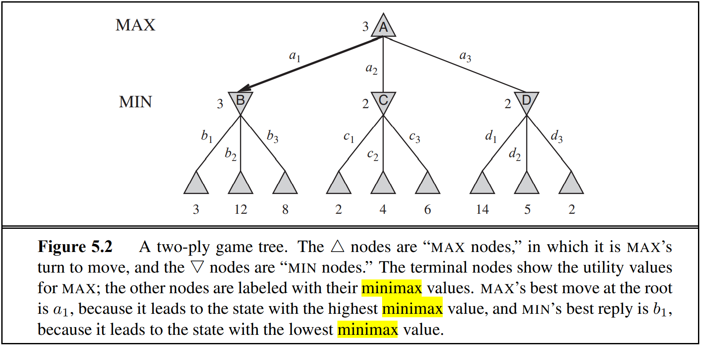
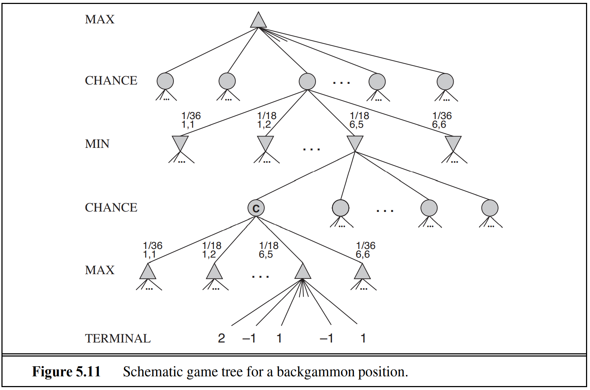

## 5.2 Optimal Decisions in Games

这是一个完全虚构的游戏，因为真正的井字棋的决策树实在是太复杂了，我们就拿这个丐版来研究一下，双方都只各下一步棋

至于最底下的代表utility value的数字，我觉得纯粹是随便赋值的。$\text{MIN}$玩家希望它小，$\text{MAX}$玩家希望大

至于其它节点也有的数字，他们叫做minimax value，如下定义：
$$
\text{MINIMAX}(s)=\\
\begin{cases}
    \text{UTILITY}(s)&\text{if\ terminal}\\
    \text{max}_{a\in \text{Actions}(s)}\text{MINIMAX}(\text{RESULT}(s,a))&\text{if PLAYER(s)=MAX}\\
    \text{min}_{a\in \text{Actions}(s)}\text{MINIMAX}(\text{RESULT}(s,a))&\text{if PLAYER(s)=MIN}
\end{cases}
$$
比如对于左下角来说，MIN节点B的值从3,12,8里面选出最小值，那就是3。而MAX节点A的值从3,2,2里面选出最大值，所以是3

## 5.5 Stochastic Games
之前的游戏之中，是不存在类似于骰子这种夹杂着不确定性的东西的，而这一节将开始考虑这种情况

我们引入一个新的节点类型**chance nodes**:

可以看到就是圆形的节点。它代表的意思是骰子扔出不同的结果的时候，每个chance node就对应一种结果

鉴于这种节点和概率挂钩，对于chance node我们只能够计算**expectiminimax value**了：
$$
\text{EXPECTIMINIMAX}(s)=\\
\begin{cases}
    \text{UTILITY}(s)&\text{if\ terminal}\\
    \text{max}_{a\in \text{Actions}(s)}\text{EXPECTIMINIMAX}(\text{RESULT}(s,a))&\text{if PLAYER(s)=MAX}\\
    \text{min}_{a\in \text{Actions}(s)}\text{EXPECTIMINIMAX}(\text{RESULT}(s,a))&\text{if PLAYER(s)=MIN}\\
    \Sigma_rP(r)\text{EXPECTIMINIMAX}(\text{RESULT}(s,r))&\text{if PLAYER(s)=CHANCE}
\end{cases}
$$
其实其他节点的计算规则和以往一样，而chance node只是对结果进行了概率上的加权而已

