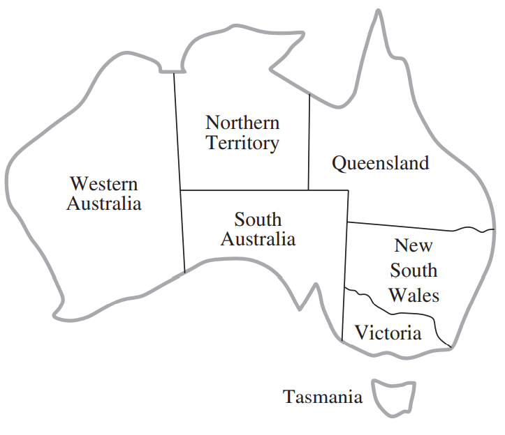
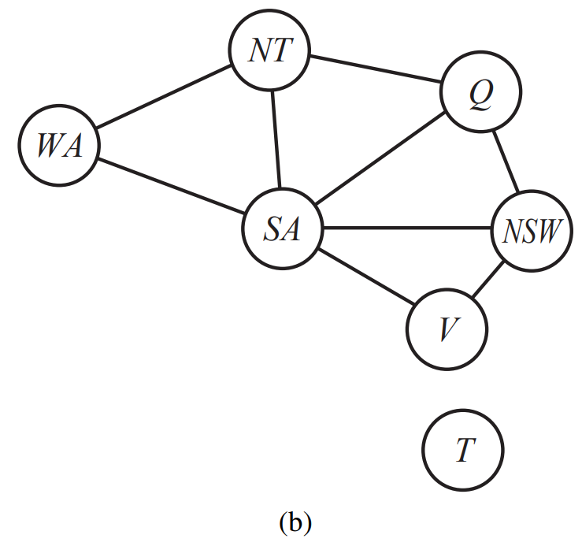
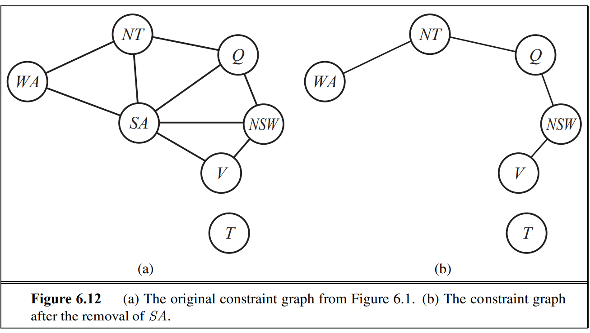
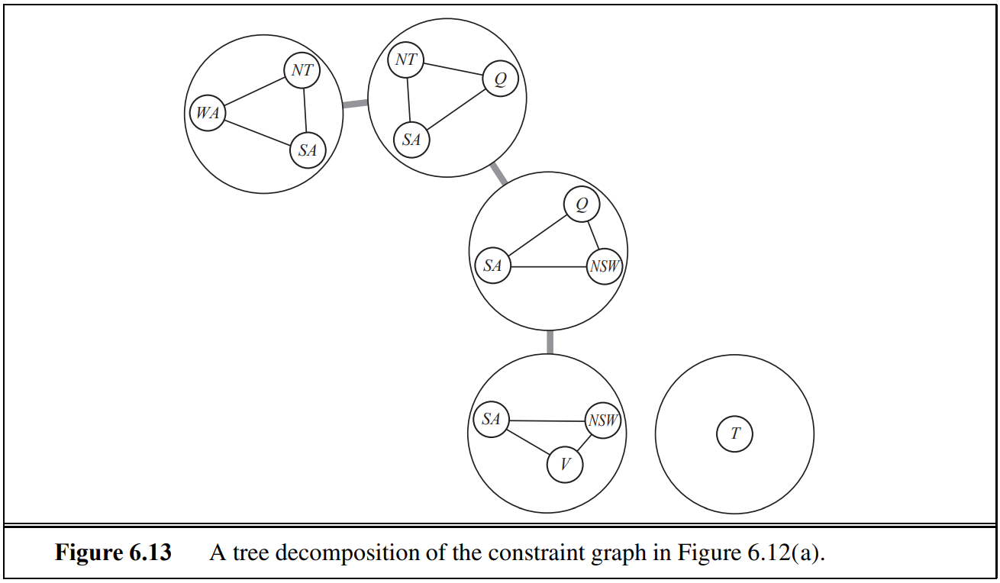

## 6.0 Preface
**C**onstraint **S**atisfaction **P**roblems (CSP)
## 6.1 Defining Constraint Satisfaction Problems
### 6.1.1 Example problem: Map coloring
经典的三色问题：

我们来转换一下问题：
- Define the variables to be the regions

    $$
    X=\{WA,NT,Q,NSW,V,SA,T\}
    $$

    每个地区是个节点
- Domain of each variable:

    $$
    D_i=\{red,green,blue\}
    $$
- Nine constraints:

    $$
    C=\{SA\neq WA,SA\neq NT,SA\neq Q,SA\neq NSW,\\SA\neq V,WA\neq NT,NT\neq Q,Q\neq NSW,\\NSW\neq V\}
    $$
    当然实际上具体到颜色的限制都可以枚举出来

这里我们介绍一个新的概念**constraint graph**来帮助我们解题：

可以看到节点就是问题的==variable==，边就是问题的两个变量之间的==constraint==

## 6.3 Backtracking Search For CSPs
> The term **backtracking search** is used for a ==depth-first search== that chooses values for one variable at a time and backtracks when a variable has no legal values left to assign

其实光看名字都能看出来啥意思
### 6.3.1 Variable and value ordering
有很多种不同的heuristic
- **Minimum remaining values (MRV) heuristic**

    > choosing variable with the fewest legal values

    选择填==可行值最少==的那个变量

    比如说WA=red,NT=green,那么SA收到的限制就是最多的，只能填入blue

    至于为什么要怎么选择，因为这样最有可能进入失败的世界线分支，从而prune掉这个分支 (早知道以后要失败的话，不如早点寄)

然而上面的这种heuristic并不能够帮助我们找到问题最开始的时候从哪里开始，因为所有变量的可行解的数量全部都一样。这就需要我们使用：
- **degree heuristic**

    > it attempts to reduce the branching factor on future choices by selecting the variable that is ==involved in the largest number of constraints== on other unassigned variables

    牵扯关系最多的未选择变量，比如图中的SA有5条边连着

    虽然说听起来挺有道理的，但是大部分时候MRV还是更强的，这个方法只是帮助我们走出最开始的困境而已
- **least-constraining-value heuristic**

    展开到某个节点以后，我们需要决定一下以怎么样的顺序来尝试这个节点所有可能的取值

    > the **least-constraining-value** heuristic prefers the value that ==rules out the fewest choices for the neighboring variables== in the constraint graph

    就是要尽量减少选择该值之后，对周围节点的可行解的数量的影响，留给接下来的变量赋值更多的空间

    e.g.

    $WA=red,NT=green$，这时候我们要决定一下Q到底填啥颜色。假如填了blue的话，SA就没有任何颜色可以填了，所以这是个非常不好的选择。我们因此倾向于red

## 6.5 The Structure of Problems
假如我们能够把constraint graphs转换成tree，那么性质就会大大滴好

有两种方法可以做到:
- Assigning values to some variables

    给特定节点指定一个值，之后就可以把它从constraint graph里面去掉了，剩下的图和它相邻的节点记得删掉对应的值

    

- Tree decomposition

    

    其实就和你平时心里使用的算法是一样的

