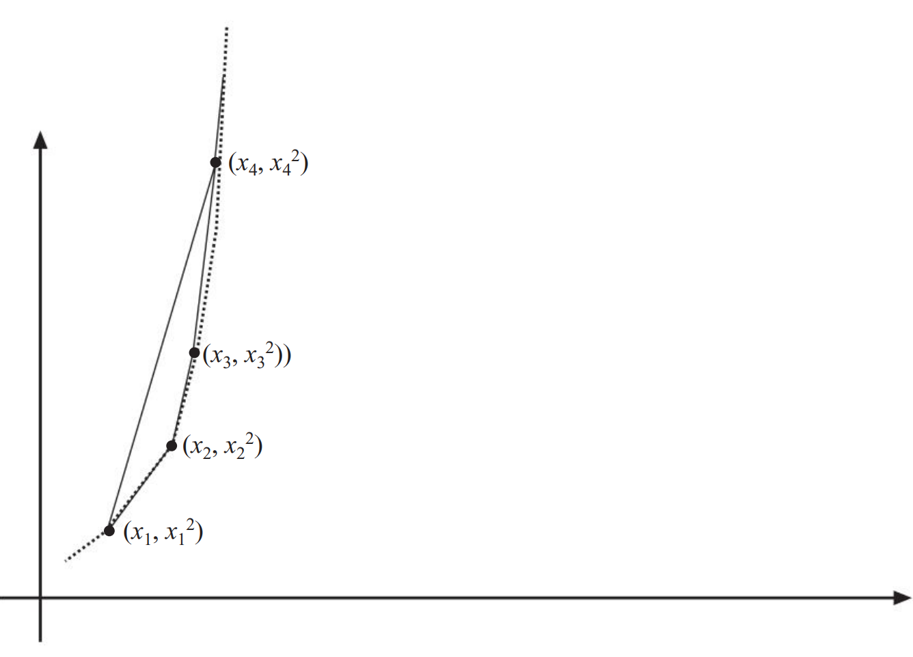

## 2.1 The Time Complexity of an Algorithm
Goodness of an algorithm:
- Time complexity
- Space complexity
- For a parallel algorithm: time-processor product
- For a VLSI circuit: area-time (AT, $\text{AT}^2$)

用来进行比较的因素可能有：
- the **comparison** of data
- the **movement** of data

    一般排序算法都是用这种方式比较

有一个经典误区:

假设算法A的复杂度是$O(n^3)$，B的复杂度是$O(n)$，那么A一定会比B跑的更慢吗?

> 答案是不一定。因为A只是需要循环的次数一定比B多，然而单个循环需要消耗的时间也许非常少。这也证明其实复杂度前面的==常数==其实是很重要的。然而随着$n$不断变大，常数的影响越来越小，所以$n$==特别大==的时候A就一定比B慢了

算法也可以分成两种:
- **Polynomial Algorithms**

    比较阳间的，可用多项式表达。
- **Exponential Algorithms**

    很多问题的解法只能通过指数级的算法来解决。这样的问题就在于，数据量一旦大起来，想要得到结果就基本不可能了。

## 2.2 The Best, Average and Worst Case Analysis of Algorithms(时间复杂度)
||Best|Average|Worst|
|:--:|:--:|:--:|:--:|
|Straight Insertion Sort|$O(n)$|$O(n^2)$|$O(n^2)$|
|Binary Search|$O(1)$|$O(\log n)$|$O(\log n)$|
|Straight Selection Sort|$O(1)$|$O(n\log n)$|$O(n^2)$|
|Quick Sort|$O(n\log n)$|$O(n\log n)$|$O(n^2)$|

### 2.2.1 The Problem of Finding Ranks
就是一个例子，见书P62

## 2.3 The Lower Bound of a Problem
之前的学习都是在考虑==算法==的复杂度，这次我们考虑一下==问题==的复杂度

定义：
> A lower bound of a problem is the ==least time complexity== required for any algorithm(==in the worst case==) which can be used to solve this problem.

lower bound用$\Omega$表示

提及lower bound的时候，我们一般指的是*worst-case lower bound*。

> 比如，sorting的lower bound就是$\Omega(n\log n)$，指的是，==在最坏的情况下，任何排序算法都至少需要做$\Omega(n\log n)$次比较==(因为heap sort的最坏情况就是$\Omega(n\log n)$)。

关于*optimal algorithm*:
> An algorithm is **optimal** if its time complexity is ==equal== to a lower bound of this problem. Neither the lower bound nor the algorithm can be improved further. 

## 2.4 The Worst-Case Lower Bound of Sorting
> Any sorting algorithm whose basic operation is a ==compare and exchange== operation can be described bt a ==binary decision tree==

比如三个元素的*插入排序*可以表示成:

*冒泡排序*则是：

可以看到每个叶子对应于一个可能的初始情况。树的深度则是代表了算法的*worst-case time complexity*。也就是说，寻找问题的*lower bound*，也就是寻找哪个算法对应树的深度最浅。

关于树有几个要点:
- 每个算法对应的树都有$n!$个叶子，因为有这么多种排列组合方式
- 假设树是平衡的，那么树的深度就是能达到的最小
- 对于平衡树来说，深度就是$\lceil \log n \rceil$

根据上面三条规则, 我们可以知道, 排序问题的*lower bound*就是$\lceil \log n!\rceil$，经过证明可得就等于$\Omega(n\log n)$

> $\lceil \log n!\rceil$很重要，因为这是个确切值。以及，排序时，是否考虑已经排好的数，是有很大区别的。考虑的话，排序下界就是$\lceil \log n!\rceil$；不考虑的话，每两个数必须比较一遍，所以是$C^2_n$

## 2.5 Heap Sort: A Sorting ALgorithm Which is Optimal in Worst Cases
仔细想想的话，heap中的每个节点其实都有性质：
> $A(h)$的子节点是$A(2h)$和$A(2h+1)$

这样的话，我们就压根不需要真的建立一个树的结构，只需要一个线性的array就可以搞定

## 2.6 The Average-Case Lower Bound of Sorting
假如还是用二叉树来定义的话, 首先定义*external path length*
> the **external path length** of a tree is the ==sum== of the lengths of paths from the root to each of the leaf nodes 

接着就可以定义*average time complexity*:
> the average time complexity of a sorting algorithm based on comparisons is equal to the external path length of the binary decision tree corresponding to this algorithm divided by the number of leaf nodes, which is $n!$ 

说人话就是树的==平均高度==

> 当树==平衡==的时候，其*external path length*最短

经过同样一番运算，我们可以得到:
> the average-case lower bound of the sorting problem is $\Omega(n\log n)$

## 2.7 Improving a Lower Bound Through Oracles
**Oracle**: 一组特定的输入数据，使得对应算法需要花最多的时间来运行

课本描述了*merge sort*的*lower bound*通过*oracle*的折磨，是$2n-1$而不是理论上最理想的$\log_n^{2n}$

## 2.8 Finding the Lower Bound by Problem Transformation
用一个例子来说明: **Convex Hull Problem**

> 给出一些二维平面上的点，目标是找到一个面积最小的==凸==多边形，使得平面上的所有点要么在多边形内部，要么在边界上。

接下来我们要证明，这问题的下界和排序问题的下界同样为$\Omega(n\log n)$:

先是排序问题这边，接收到了一堆需要排序的点$x_1,x_2,...,x_n$。这时候我们不着急用排序算法来解决这个排序问题，毕竟我们三思而后行:
$$
\text{能不能不做}\\
\text{能不能明天做}\\
\text{能不能交给别人做}
$$
显然这问题应该交给别人做，于是我们把这些数做一下转换，每个数对应一个点$(x_i,x_i^2)$，这样我们就把数列映射到了二维平面之中。

这个时候，我们发现，假如我们求解这些点对应的*convex hull*问题，那么这个时候多边形边上的点   其实就是按照顺序排列的了。也就是说，我们在==求解*convex hull*问题的时候，顺带解决了排序问题==。

这也就是说，*convex hull*问题的*lower bound*必定要大于等于$\Omega(n\log n)$。鉴于两个问题之间的转换的复杂度是$\Omega(n)$，这点转换的复杂度就忽略不计了

> 假设*convex hull*这样的未知的为$f_1(n)$，排序问题这样已知的为$f_2(n)$，$O(g(n))$表示从$P_2$转换为$P_1$需要的时间:
$$
\Omega(f_1(n))+O(g(n))\ge \Omega(f_2(n))
$$

**Minimum Spanning Tree Problem**同样可以用排序问题来转换:

把同样的数列映射到二维点$(x_i,0)$上。显然，只要把相邻的点连在一起，*minimum spanning tree*就出来了，顺带也解决了排序问题

