这个思路的大概意思是，把原问题分成两个==除了输入数据量之外都与原问题相同==的子问题，这样在解决了子问题之后，就可以重新合并来解决原问题。

这个方法妙在，子问题和原问题其实是相同的，所以子问题还可以继续拆分，也就是一种==递归的拆分==了

比如，我想要找到一堆数字里面最大的数字是哪一个，就可以不断地拆分数据量。。。

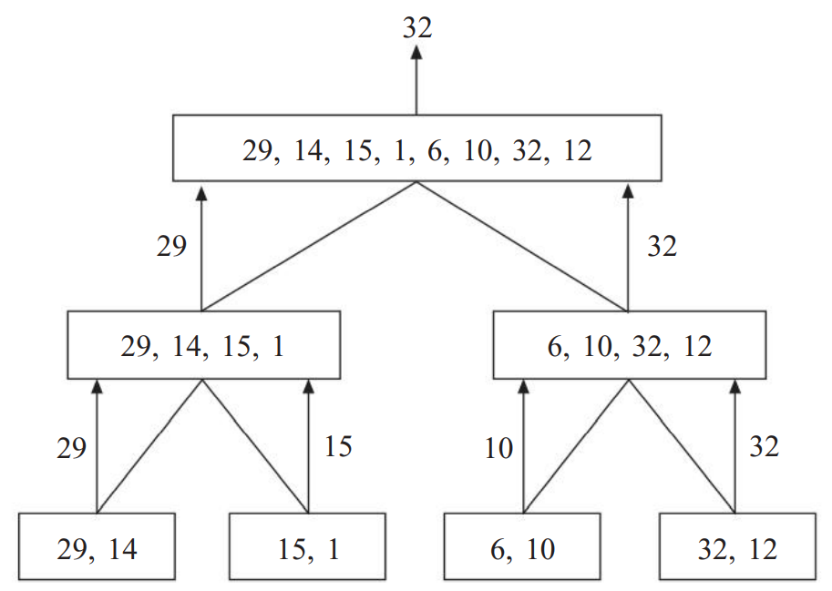

时间复杂度如下:
$$
T(n)=\begin{equation*}
    \begin{cases}
        2T(n/2)+S(n)+M(n)   &n\ge c\\
        b                   &n<c
    \end{cases}
\end{equation*}
$$

## 4.1 The 2-Dimensional Maxima Finding Problem
- **dominate**

    假如一个点的x, y坐标比另一个点的都大，那么我们称更大的那个点*dominates*另一个点
- **maxima**

    假设没有点能够*dominate*当前的点，这时候我们称当前点为*maximal point*

直观一点来说，就是没有点能够在*maxima*的右上角存在

应用算法后，我们可以把所有的点不断拆分成左右两部分，找到每一部分的*maxima*之后进行合并。因为左边部分的点x坐标始终小于右边部分的点，所以左边部分的点想要继续保持*maxima*的话，就必须y坐标大于右边的所有*maximal points*

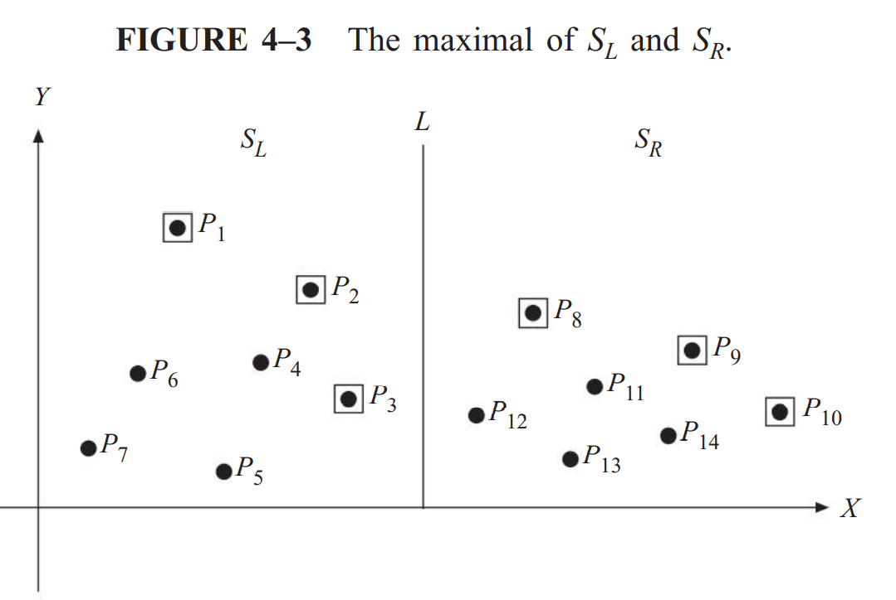

反正一顿分析之后，可以得到这个解法的时间复杂度是$O(n\log n)$

## 4.2 The Closest Pair Problem
这次你要干的事情是找二维空间里哪两个点最近

和上面干的事情一样，我们照样是递归地平分掉点到左右两边。但是我们需要考虑的事情多了一件，就是不光要考虑两边各自的最近点对，还要考虑一下有没有可能一个点在左边一个点在右边

我们这时候需要考虑的事情就是怎么样减少需要检验的一左一右这种情况的点。假设我们考虑一个算在左边但恰好和平分线离的很近的点（最坏情况）:

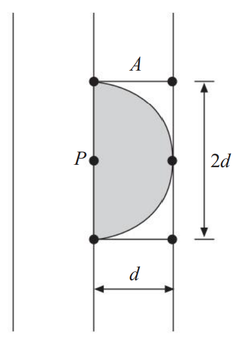

在比较了左右两边的最近距离之后，我们得到了新的最近距离$d$。这时候假如真的存在一左一右的情况，那么右边的点起码得落在这个矩形里面。而又因为我们知道==同一边点之间的最近距离是$d$==，那么这个矩形里面顶多只会存在6个点。这样子看来比较的工作就非常轻松了

一顿计算之后发现时间复杂度是$O(n\log n)$

## 4.3 The Convex Hull Problem
在2.8节时候就已经出现过这个问题，当时用的是排序问题证明了问题的下界

这次我们用divide and conquer来解决:
- 假设点压根不足5个，就枚举法看一看到底怎么搞是最小凸多边形
- 点太多的时候就把点用垂直线分成左右两半$S_L$和$S_R$
- 反正这样递归下去我们就找到了左右两边各自的convex hull。接下来我们就要考虑怎么样把左右进行合并。

    - 先在$Hull(S_L)$所包含的图形之中找一个幸运的点，作为参考点
    - 接着将$Hull(S_R)$的所有顶点和这个幸运的点进行连接，这样可以通过连线和水平线之间的夹角，确定$Hull(S_R)$的顶点们各自的==角度==

        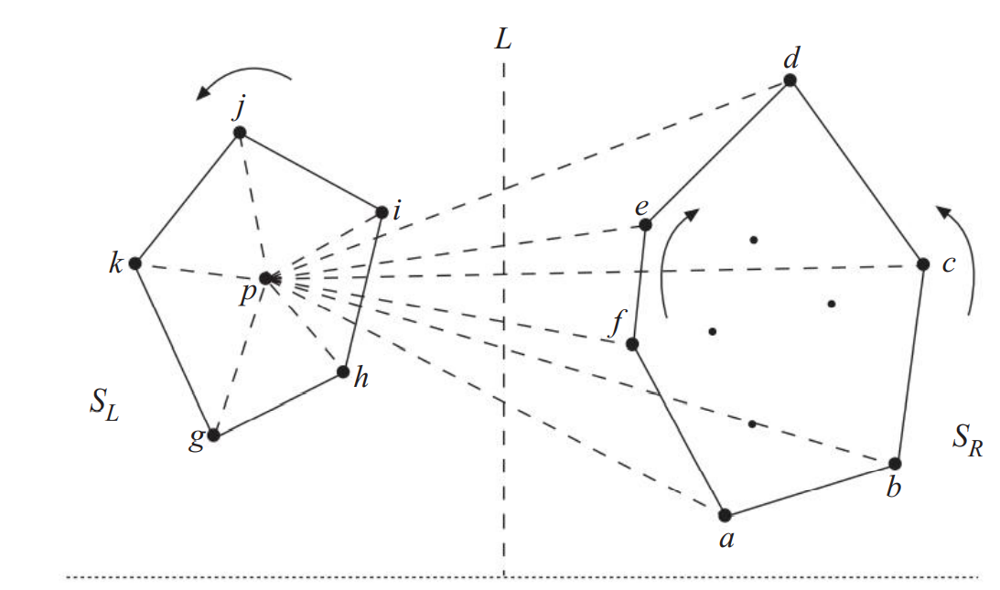
    - 这个时候需要根据这些角度来进行排序。反正我们排出的顺序是$g,h,a,b,f,c,e,d,i,j,k$，于是就连起来:

        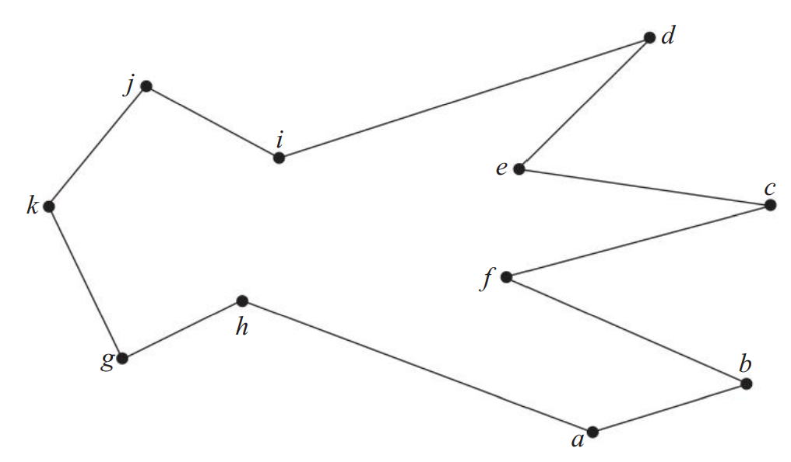
    - 显然这个时候是不符合凸多边形这个要求的。于是我们需要把那些优角对应的顶点去掉，即$i,h,e,f$。于是我们最终得到:

        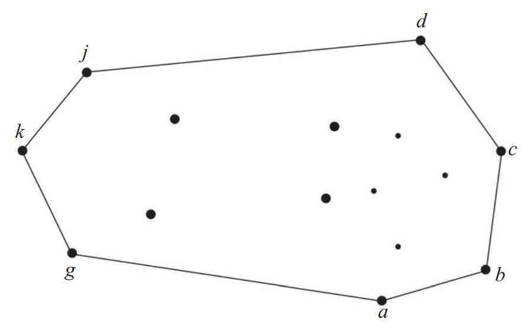

书上非要把所有顶点分成三个序列，真是搞不懂有啥必要。最后不都是要合并成一个序列吗

## 4.4 The Voronoi Diagrams Constructed by the Divide-and-Conquer Strategy
### 4.4.1 Voronoi Polygon, Voronoi Diagram, Delaunay Triangulation
关于**Voronoi polygon**和**Voronoi diagram**的定义有点难解释，干脆看图:

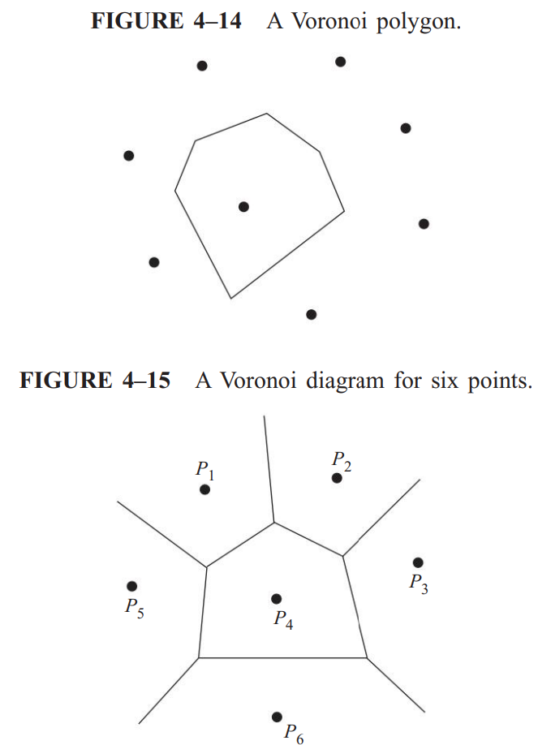

可以看到，*Voronoi polygon*的边是由参考点和其他点连线的中垂线相交而成的。而*Voronoi diagram*则是由所有点的*Voronoi polygon*组成的。

这样搞的话，我们就可以轻易确定对于任意的第七个点来说，这六个点里哪个点离这个点最近

至于另一个概念**Delaunay triangulation**则是在这些概念之上出现的:

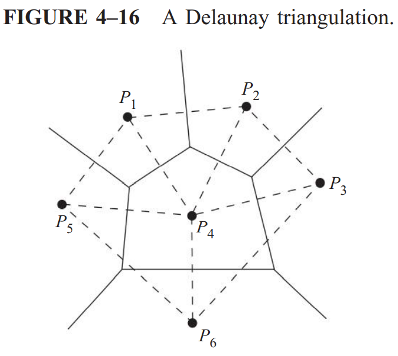

就是图中的虚线部分

### 4.4.2 Algorithm
于是我们可以用==divide-and-conquer==来解决一下如何找到*voronoi diagram*的问题了。大概意思仍然是把点均匀分成左右两边，问题主要是出在如何合并左右两边各自的*vornoi diagram*$VD(S_L)$和$VD(S_R)$。假设情况如下:

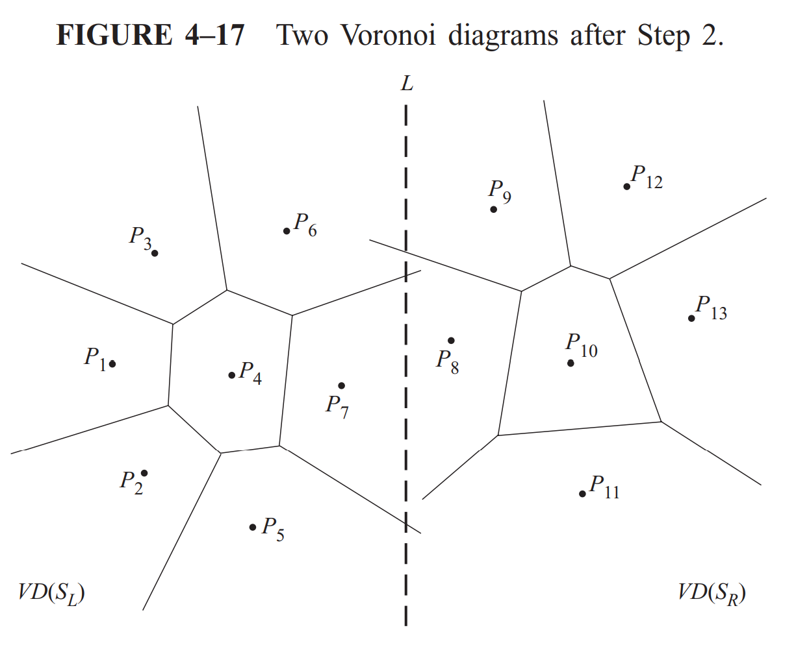

显然，只有靠近平分线的点会受到影响，远离的点不会有事。我们通过瞪眼法可以看出来一个新的边界线(==hyperplane==(HP))应该是:

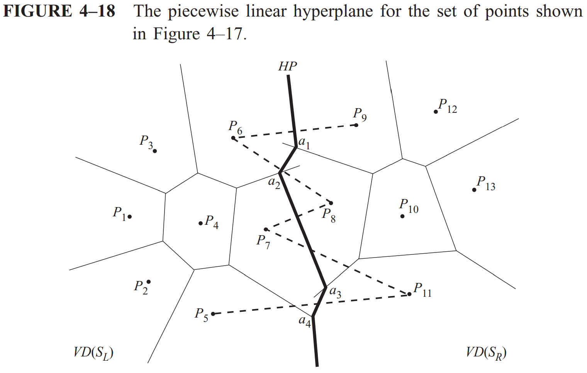

接着把多余的越界的线头给去掉，我们就得到了新的*voronoi diagram*:

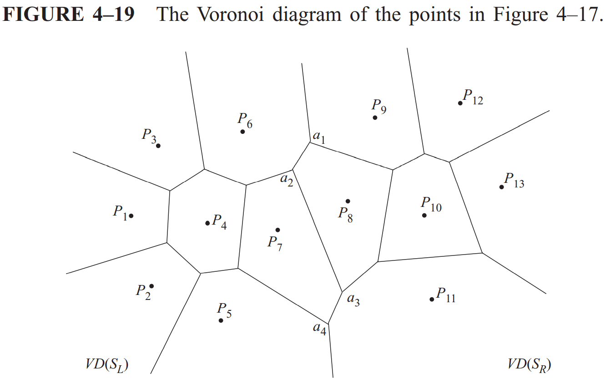

真是太简单啦 接下来就该研究一下如何==高效的寻找出这条分界线==了(总不能天天瞪眼法吧)

首先我们需要确定分界线的最顶上那条线。为此，我们想象一下假如此时我们要干的事情是合并左右两边的convex hull，我们需要连接的上面的线段是哪个。没错就是$P_6P_9$。于是我们找到这俩点的中垂线，也就是我们要找的第一条边界线。

接着我们从上到下看看如何找到其它边界线。可以看到第一条边界线会有第一个交点$a_1$，这意味着啥呢？意味着交点以下的部分，即使有一个点位于分界线的右侧，它也不再是和$P_9$最近了，而是$P_8$！所以我们转而使用$P_6P_8$的中垂线作为分界线。

遇到交点时就重复上述的步骤，找到相交线对应的是哪两个点的分界线，将这两个点的地位交换一下。
> 关于怎么样找到一个*voronoi diagram*对应的*convex hull*，其实只需要把那些==无限长的边界线==相关的点连起来就成了: 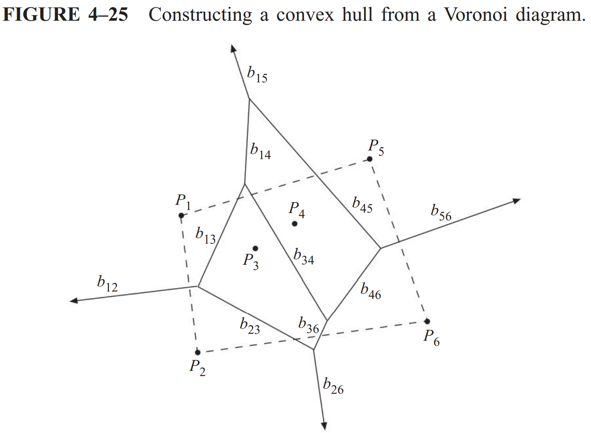 这样找的时间复杂度只有$O(n)$，很大程度上节省了时间（不需要$O(n\log n)$）

至此，整个算法就描述完毕了

### 4.4.3 The Properties of Hyperplane(HP)
> 先定义一下一个==点和点集之间的距离==，其实就是点集之中离那单个点==最近的点==的距离

于是性质有：
- HP之上的点，离左右两个点集的==距离是相同==的
- HP在y方向上是==单调递增==的，即和任意一条水平线的交点有且仅有一个
- The number of edges of a Voronoi diagram is at most $3n-6$, where $n$ is the number of points
- The number of Voronoi vertices is at most $2n-4$

### 4.4.4 Time Complexity
有了4.4.3的铺垫，我们计算一通就可以得到，算法的时间复杂度是:
$$
O(n\log n)
$$

## 4.6 The Fast Fourier Transform Problem
问题就是计算下列公式:
$$
A_j=\sum^{n-1}_{k=0}a_ke^{\frac{2\pi i j k}{n} },0\le j \le n-1,i=\sqrt{-1}
$$

不用任何算法的话，我们需要$O(n^2)$步，而用divide-and-conquer的话，步骤就缩短到了$O(n\log n)$

证明过程完全没看懂

算法如下：
- if $n=2$, then $A_0=a_0+a_1$, $A_1=a_0-a_1$, return.
- recursively find the coefficients of the Fourier Transform of $a_0,a_2,...,a_{n-2}(a_1,...,a_{n-1})$. Let the coefficients be denoted as $B_0,B_1,...,B_{n/2}(C_0,C_1,...,C_{n/2})$
- For $j=0$ to $j=\frac{n}{2}-1$, $A_j=B_j+w_n^jC_j$, $A_{j+n/2}=B_j+w_n^{j+n/2}C_j$

说了和没说差不多，反正我也看不懂

inverse Fourier Transform如下：
$$
a_j=\frac{1}{n}\sum_{k=0}^{n-1}A_ke^{\frac{-2\pi ijk}{n} }
$$

## 4.? Matrix Multiplication Using Strassen's Algorithm
又是书上没有的，链接在[这里](https://www.geeksforgeeks.org/strassens-matrix-multiplication/)

到底怎么个divide法呢？

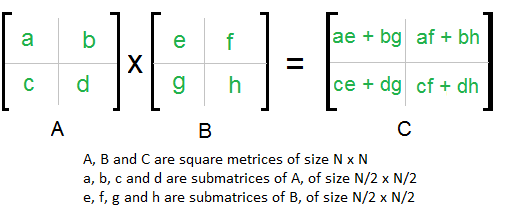

把一个$n\times n$的矩阵分割成四个$\frac{n}{2}\times \frac{n}{2}$的子矩阵。那么计算的递推公式就是：

$$
T(n)=8\times T(\frac{n}{2})+\Theta (n^2)
$$

然而，我们这样需要计算8次乘法。根据master's theorem时间复杂度就是$O(N^{\log_28})=O(N^3)$，和直接算没啥区别

这时候Strassen提出了让这东西变成只需要计算7次乘法的魔法：

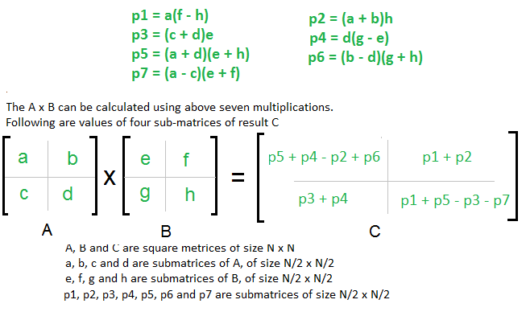

用非常奇怪的方法让时间复杂度变成了$O(N^{\log_27})=O(N^{2.8074})$

