## 5.0 Problems
有很多问题都可以通过tree searching来解决
### 5.0.1 8-puzzle problem
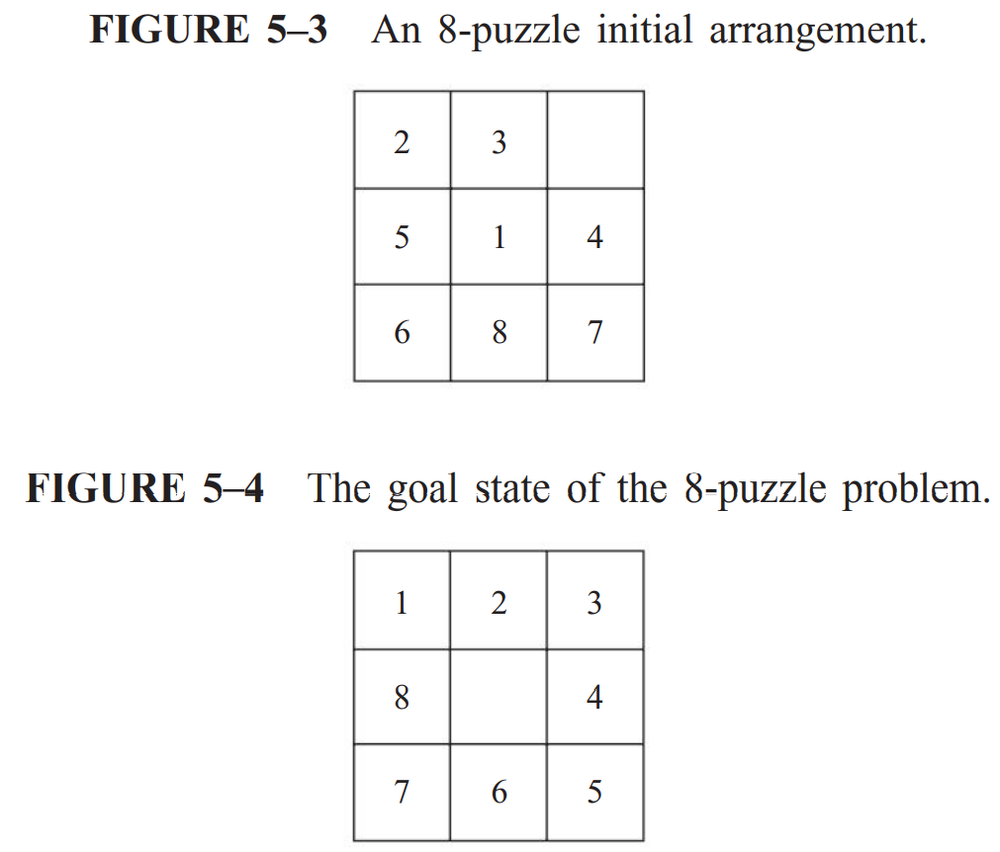

想必看图就明白要干啥了
### 5.0.2 Hamiltonian cycle problem
> a Hamiltonian cycle is a round trip path along $n$ edges of $G$ which visits every vertex once and returns to its starting position

e.g.

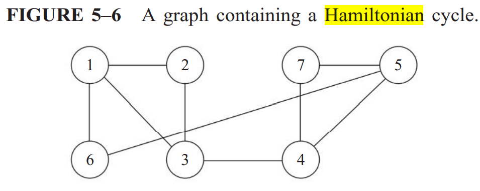

这个图中的Hamiltonian cycle就是1,2,3,4,7,5,6,1

Hamiltonian cycle problem的目标就是确定一个图形里面存不存在Hamiltonian cycle

可以被转换成树搜索问题，比如上面的图就代表了下列的树：

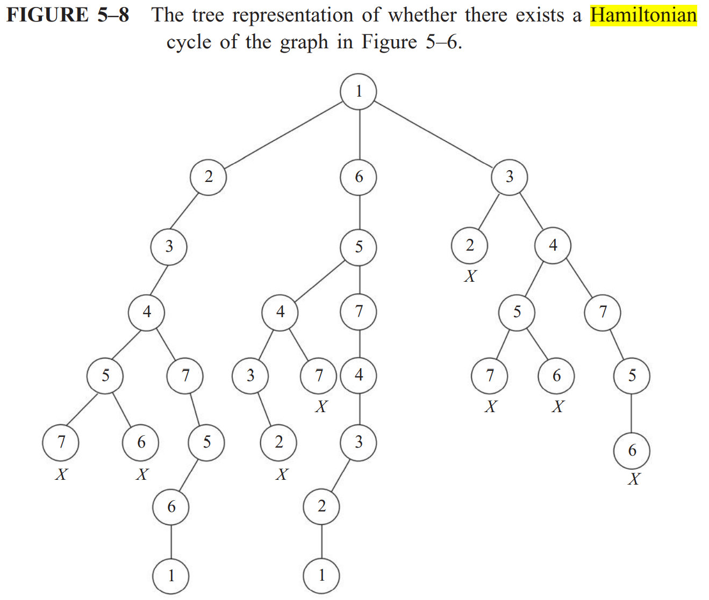

## 5.1 BFS
BFS解决8-puzzle如下：

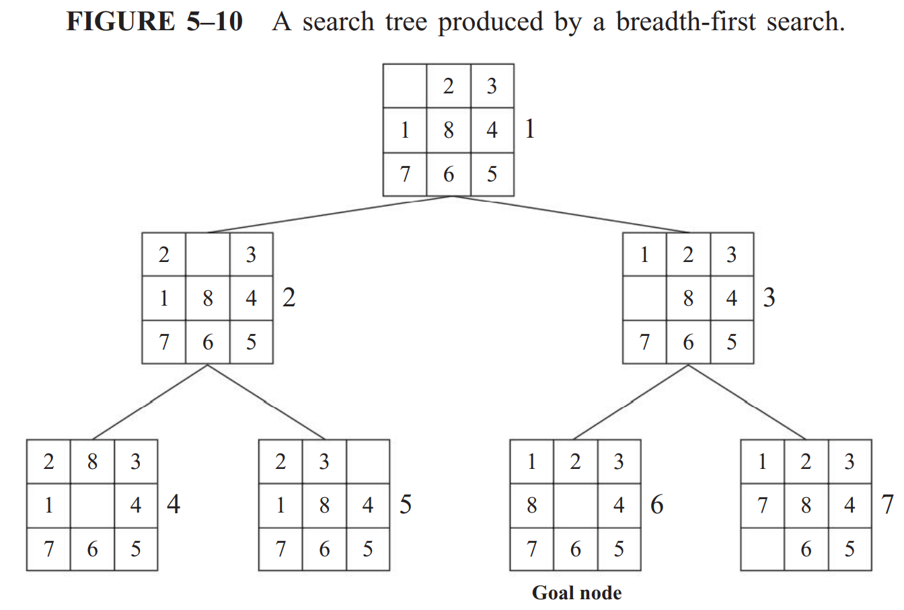

## 5.2 DFS

## 5.3 Hill Climbing
==DFS==的一种变种，结合了Greedy的想法（取==局部最优==）

我们在需要展开某一个子节点的时候，需要一个标准来抉择选哪个子节点来展开。这时候就需要一个**evaluation function**来决定一下。这个function需要体现局部最优

e.g.

面对8-puzzle，我们假设将*evaluation function*选择为$f(n)=w(n)$，说人话就是错位的方块的数量（所以这个数字越小越靠近目标）。对应过程如下：

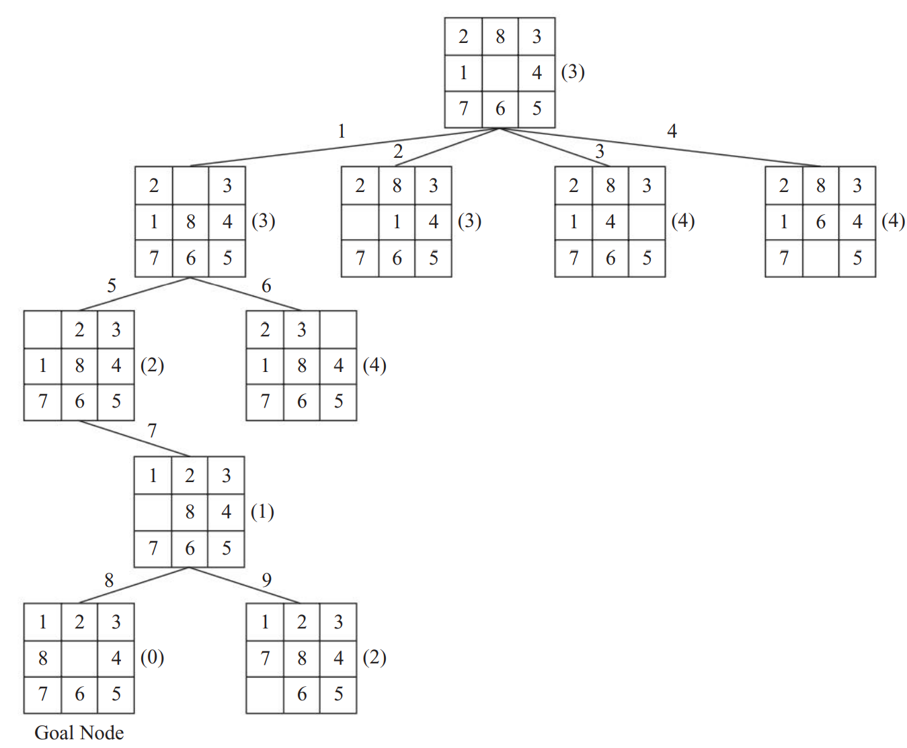

可以看到程序每次都选择了圆括号里数字小的来走

## 5.4 Best-First Search Strategy
据说是结合了BFS和DFS的优点

we select the node with ==the least cost== among ==all nodes== which we have generated so far.

it as a ==global view==

> 注意这里的cost指的是==距离终点==的距离；作为对比，Dijkstra里面的cost指的是==距离起点==的距离；而$A^*$里的cost指的是==离起点的距离加上估测到终点的距离之和==；有个有趣的小知识是，假如图中边的权重都是相同的，那么Dijkstra其实就是按照breadth-first search的顺序遍历的

算法过程:
- construct a ==min-heap== by using the evaluation function. First, form a 1-element heap consisting of the root node
- Test to see if the root element in the heap is a goal node. If it is, stop; otherwise, go to Step 3
- Remove the root element from the heap and expand the element. Add the descendants of the element into the heap
- If the heap is empty, then failure. Otherwise, go to Step 2.

大概行为就是每次选择frontier里面最好的情况来走

e.g.

用来解决8-puzzle:

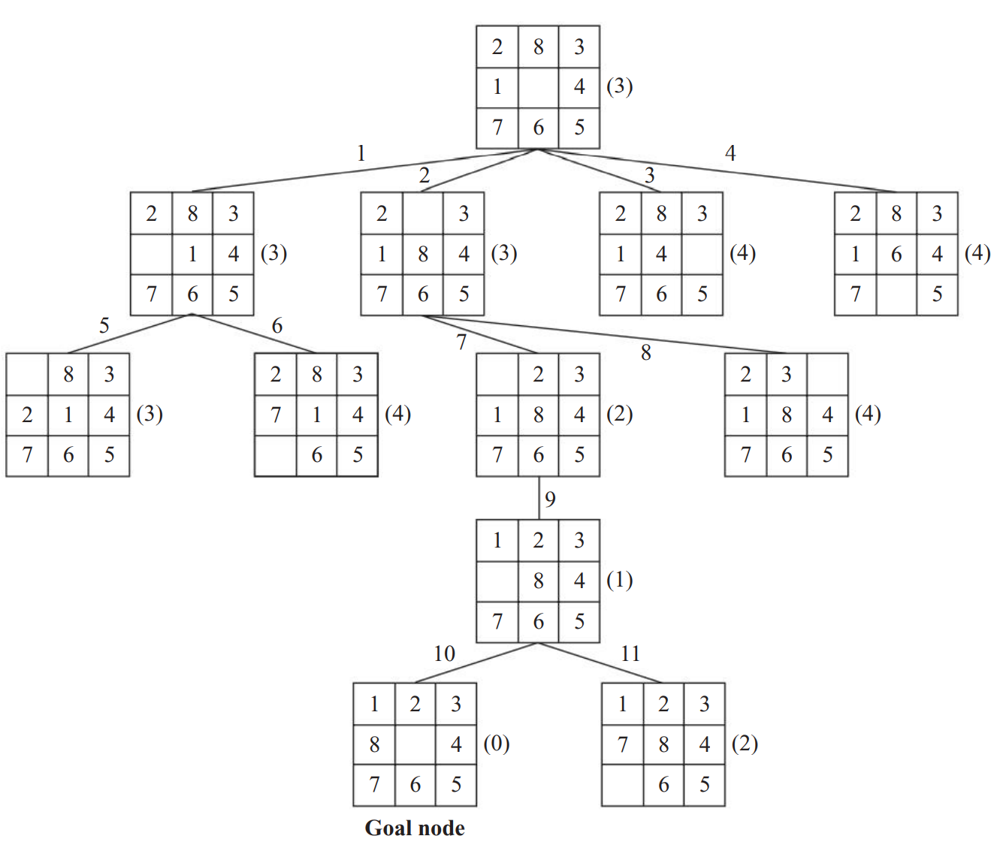

可以看到hill climbing只是局部最优，best-first是全局最优

## 5.5 Branch and Bound Strategy
之前我们介绍的问题，其实都不是*optimization problem*。而且，上述算法都解决不了优化问题。

这节介绍的就是试图找到最优解的算法

顾名思义，我们的算法应该包含两部分:
- **branch**

    意思是找到问题的其中一个可行的方法。至于这个过程要使用啥算法，这看心情，之前学过的算法应该都行
- **bound**

    之前的*branch*步骤得到的一个可行解，让我们得到了一个==upper bound==。也就是说，任何最终cost大于这个upper bound的解，都应该被抛弃。这样子可以减少需要测试的分支

## 5.6 A Personnel Assignment Problem(Branch-and-Bound) 
这是个NP-hard的优化问题。

问题定义如下：
> Let there be a ==linearly ordered== set of persons $$P=\{P_1,P_2,...,P_n\}$$where $P_1<P_2<...<P_n$. 
>
> Let there also be a set of jobs $$J=\{J_1,J_2,...,J_n\}$$ and we assume that these jobs are ==partially ordered==
>
> Each person can be assigned to a job. we also require that if $i\neq j$, then $f(P_i)\neq f(P_j)$
>
> If $C_{ij}$ is equal to the cost of assigning $P_i$ to $J_j$, our problem is to find an optimal feasible assignment which ==minimizes== the following quantity:$$\sum_{i,j}C_{ij}X_{ij}$$

鉴于jobs是partially ordered的，这优化问题显然就和**topological sort**有着很大的联系

e.g.

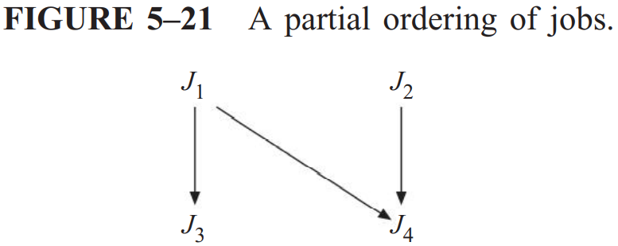

对于上图的partial order关系来说，以下的就都是可行的topologically sorted sequences:

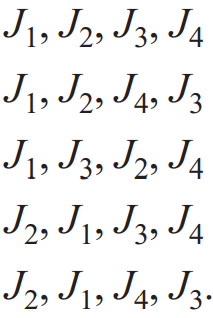

每一个sequence其实就是一种可行的assignment。比如第一个序列就对应了：

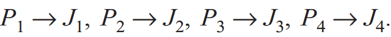

既然都写成sequence了，那也可以写成树的形状：

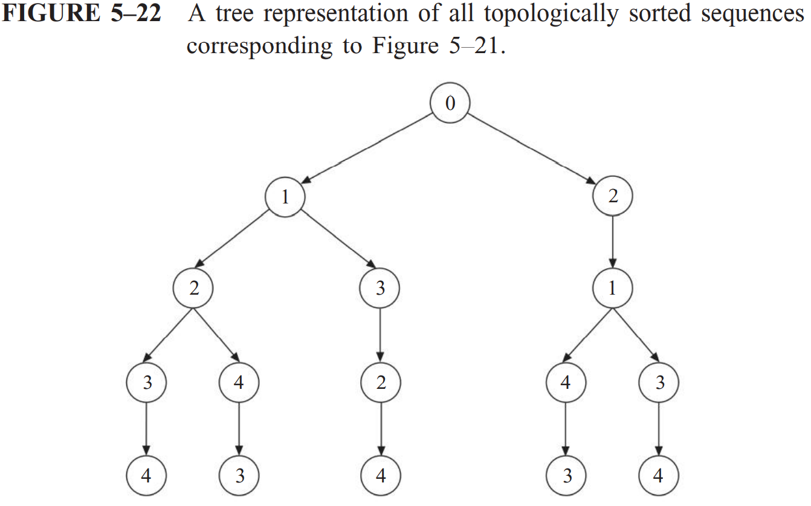

树的生成遵循以下的步骤：
- Take an element which is ==not preceded== by any other element in the partial ordering(就是陈百基说的从后往前找的思维)
- Select this element as an element in a topologically sorted sequence
- Remove this element just selected from the partial ordering set. The resulting set is still partially ordered

我们已经能够找到所有可行解了，现在是时候考虑下怎么使用branch-and-bound来解决这个优化问题了

我们用**cost matrix**来计算一个lower bound出来：
> This lower bound is obtained by reducing the cost matrix in such a way that it will not affect the solutions and there will be ==at least one zero in every row and every column== and all remaining entries of the cost matrix are ==non-negative==

听着就很抽象，我们来看一个例子：

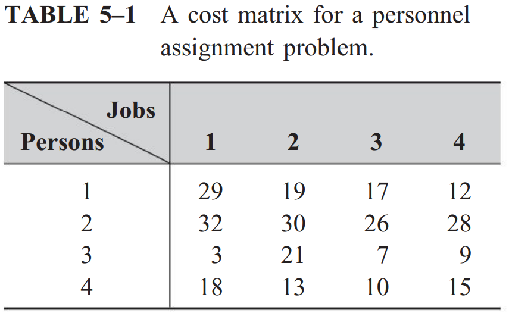

我们从第1,2,3,4行中分别减去12,26,3,10（不难看出来是每一行的最小值），再把第二列中减去3（是该列的最小值）。然后matrix就变成了：

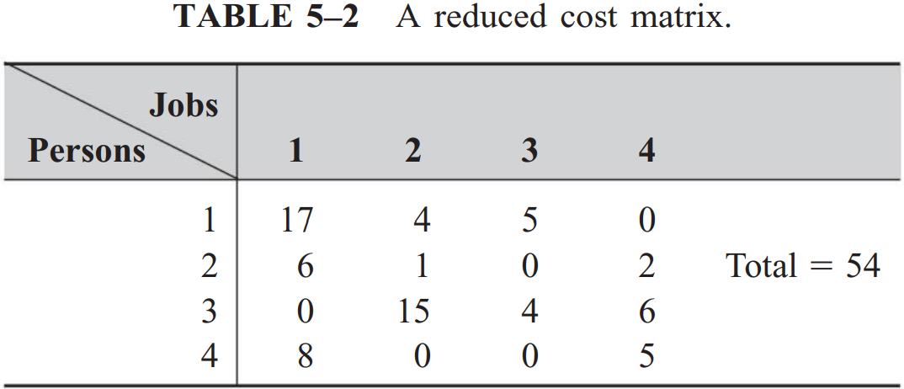

然后我们可以得到total cost的一个lower bound是：
$$
12+26+3+10+3=54
$$
至于为啥这么减一下就能得到一个最优的lower bound：被减掉的本来就是最小值，也就是说即便不考虑partial order的限制，我们也最少需要这些被剪掉的数字之和，来得到最终结果

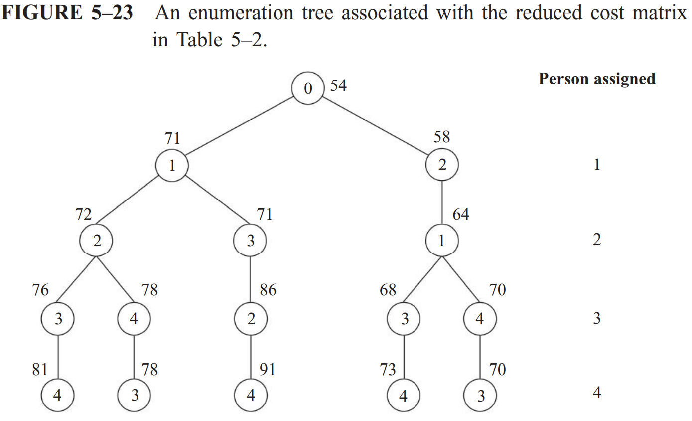

这是约完的matrix对应的树。可以看到我们起点的时候就已经有54的cost了。比如我们算出70的总长度之后，就完全可以不用考虑第二层的左节点了，因为那个节点最少也要71的cost，显然被排除掉了:

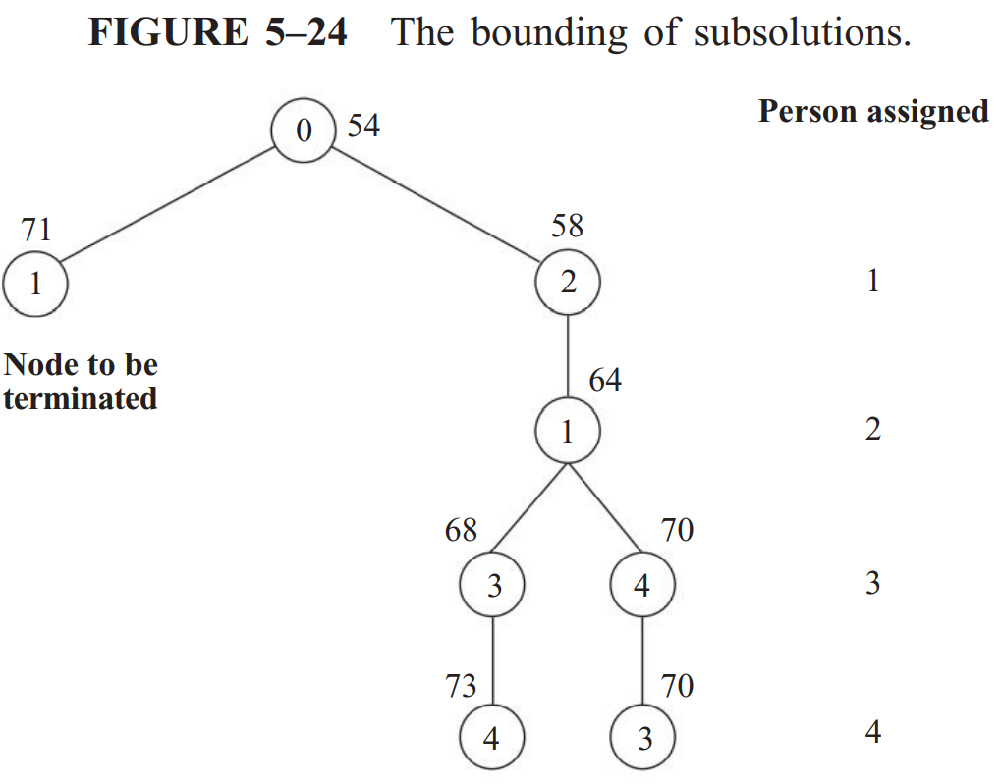

## 5.7 The Travelling Salesperson Optimization Problem(Branch-and-Bound) 
起点任意

过程有点类似，也是对cost matrix做文章

首先我们简化一下问题，假设没有节点自己有闭环，且任意两点之间是联通的

最开始，我们的cost matrix：

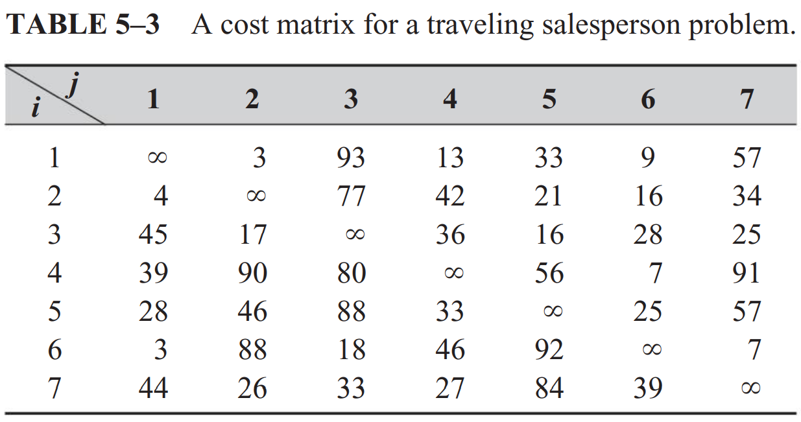

为了构建tree，我们每次人为地创造分叉节点，把solution分成两个分支:
- 一个==包含特定的边==
- 另一个则==不包含==。

至于这个特定的边到底是谁呢？我们故技重施，把上面的矩阵每行分别减去3,4,16,7,25,3,26，而第3,4,7列减去7,1,4：

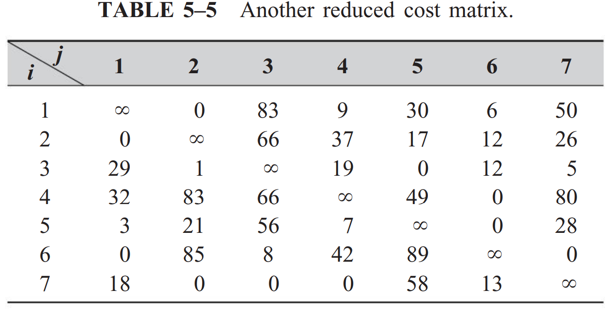

所以我们得到了起始的lower bound的值，是
$$
3+4+16+7+25+3+26+7+1+4=96
$$
我们挑一个值是$0$的格子，作为我们的幸运的“特定的边”，我们选择4-6这个边。至于为啥是他我们等会再说。

于是乎，solution分为了两种：
- ==包含==4-6这条边的解

    鉴于4-6的cost是0，即便算上了它，lower bound也还是$$96$$
- ==不包含==4-6

    事情就变得复杂了一点。为了和另一个分支保持一致性，我们需要保证的是，==包含一个从4出发的边==，和一个==到达6的边==。这俩边之间倒不一定需要连在一起。从图中可以看到，从4出发的边中，除了4-6之外，最小的为4-1(cost 32)；而到达6的边之中，最小的为5-6(cost 0)。所以，我们的lower bound变成了
    $$
    96+32+0=128
    $$

所以，我们成功构建出了一个分支点：

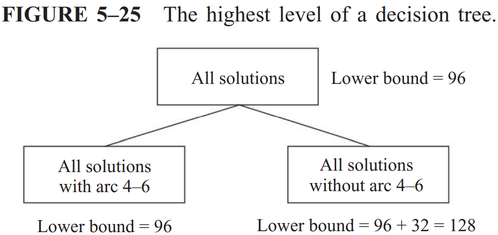

我们现在可以来解释一下为什么选择4-6了：it will cause the ==largest increase of lower bound==。比方说，假如我们选择的特殊边是3-5的话，那么lower bound仅仅会提升$1+17=18$(1来自3-2，17来自2-5)

好的，我们接着来考虑如今左边的子树。由于4-6被选择过了，所以我们直接==删除掉第四行和第六列==。并且，6-4这条路也不能走了，于是==把6-4的格子设为$\infty$==。这时候我们发现，==第五行不存在0==，所以必须在第五行减去3。同时，==别忘了给lower bound加上3==。于是左边的权重矩阵变成了：

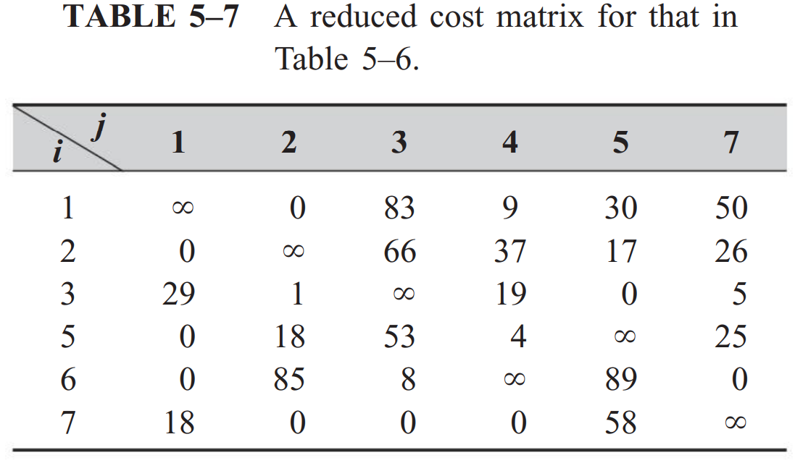

而右边的子树很好处理。我们只需要把4-6改为$\infty$就行了

至此，我们详细描述了创造节点的前后过程。假如我们不断重复这样的步骤，就可以得到一个作为==upper bound==的可行解：

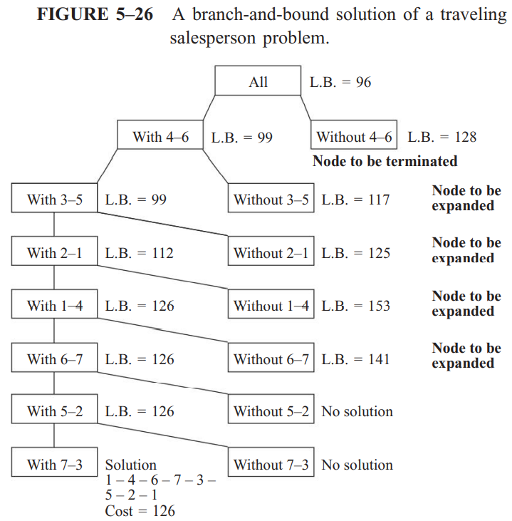

可以看到这个upper bound是126。于是任何cost大于126的分支都可以直接提前终止

需要注意的是，在上述过程中，我们必须要确保==不能形成闭环==，严谨点说就是：
> if paths $i_1-i_2-...-i_m$ and $j_1-j_2-...-j_n$ have already been included and a path from $i_m$ to $j_1$ is to be added, then path from $j_n$ to $i_1$ must be prevented

## 5.8 The 0/1 Knapsack Problem(Branch-and-Bound) 
鉴于branch and bound没办法解决原本的maximization problem，我们将原问题转换一下，变成minimization problem:
> Given positive integers $P_1,P_2,...,P_n$, $W_1,W_2,...,W_n$ and $M$, find $X_1,X_2,...,X_n$, $X_i=0$ or $1$, $i=1,...,n$, such that:
> $$-\sum_{i=1}^{n}P_iX_i$$is minimized subject to:
> $$\sum_{i=1}^nW_iX_i\le M$$

其实就是加了个负号而已

e.g.

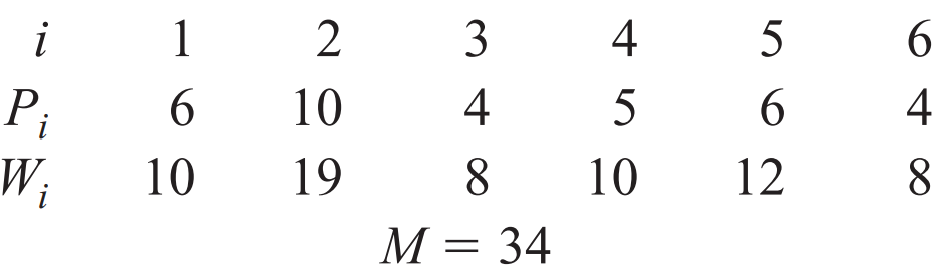

例子的数值如上。需要注意的是，这里的数值排序是满足$P_i/W_i\ge P_{i+1}W_{i+1}$的关系的

这道题用如下的方法来分叉：

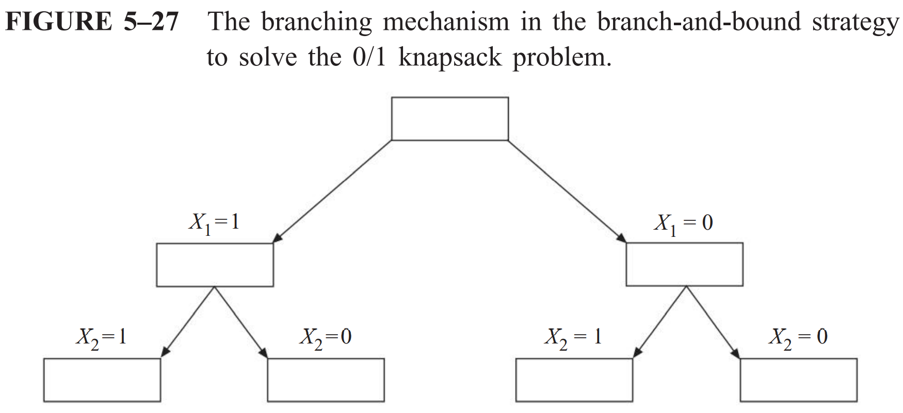

就是每次是否把物品放进背包里面

每一个节点处，我们都需要找到一个upper bound和一个lower bound。至于这俩到底指代的具体是什么：
- **upper bound**

    就是在当前节点已经有的选择的前提之下，用==贪心算法==，找到一个==可行解==。要求非常低，只要可行且贪心且整数就行了

    e.g.

    假设我们在当前节点之前已经进行了如下选择：
    $$
    X_1=1,X_2=0,X_3=0,X_4=0
    $$
    鉴于我们希望数值的绝对值越大越好，在不超过重量限制的情况下(10+12+8<34)，我们把5,6都塞进背包里面：
    $$
     X_1=1,X_2=0,X_3=0,X_4=0,X_5=1,X_6=1
    $$
- **lower bound**

    我们把问题扩展到物品可以取==浮点==的情况，计算一下当前选择的前提之下，可以达到的==绝对值最大==的解。非常巧的是，浮点的情况下，贪心能得到全局最优解，而并非整数情况下的可行解

    相信不需要例子你也明白浮点的情况下该咋用贪心

在以下情况发生时，我们停止展开该节点：
- The node itself represents an ==infeasible== solution
- The ==lower bound== of this node is ==higher== than or equal to the presently found ==lowest upper bound==
- The ==lower bound== of this node is ==equal== to the ==upper bound== of this node

所以搞了半天，我们的决策树如下：

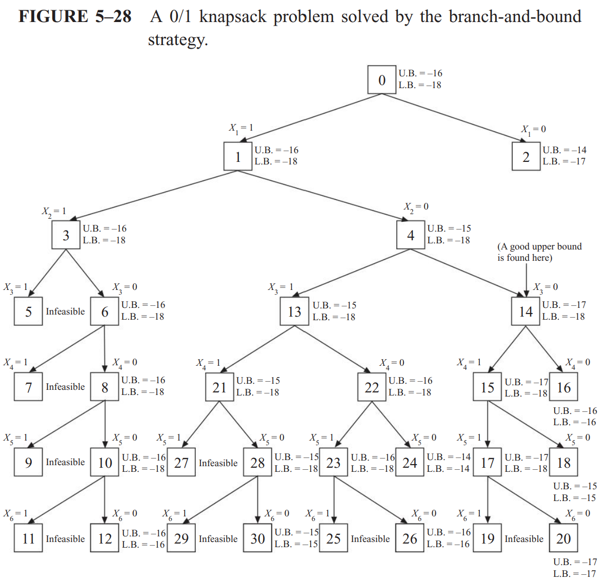

至于图中的每一个节点是怎么terminate的：
- Node 2 is terminated because its lower bound is equal to the upper bound of node 14
- All other nodes are terminated because the local lower bound is equal to the local upper bound(已经得到了最终解)

## 5.10 $A^*$ Algorithm
用来解决one-to-one的最短路径问题

用的是==best-first strategy==，但是在那个基础上加入了==heuristic function==，也就是顺带考虑了下一步的cost的预测值

cost function由两部分组成：
$$
f(n)=g(n)+h(n)
$$
其中：
- $g(n)$

    从起点到达当前节点$n$已经使用的cost
- $h(n)$

    这个就是heuristic function，表示从当前节点出发，迈出下一步的话，可能增加的cost的最小值

作为对比：
- best-first search中，我们只考虑了$g(n)$，而没有考虑$h(n)$
- Dijkstra中，我们虽然也记录了$g(n)$，然而我们作决策的时候压根没考虑$g(n)$，而是比较谁的$h(n)$更小。这样导致的结果是：
    - Dijkstra能够顺带得到到达==所有其他节点==的最短路径

        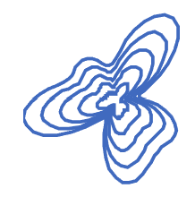
    - $A^*$只得到==终点==的最短路径，所以更具有==方向性==

        

至于啥时候停止：只要我们下一个要==展开==的节点是goal node，那么就游戏结束了

## 5.11 A Channel Routing Problem($A^*$ Algorithm)
和正经的$A^*$不太一样，这道题使用的是特别版本：只要我们找到了goal node，我们就已经得到了最优解，不需要展开

不得不说我没看懂这诡异的问题。。。得再看一遍才行

