据说非常适合解优化问题

## 6.1 The General Method
先分析一波时间复杂度

算法包含了多个iteration

在每个iteration里面，==它会"prune away"(裁剪)一部分($f$)的input data==，接着==递归地==调用裁剪

$p$个iteration之后，input data的大小被缩减成了$q$，此时$q$已经是非常小的数据量了，我们甚至可以直接在常数时间$c'$的时间里解决问题

假设每个iteration进行prune-and-search需要花费的时间是$O(n^k)$（$k$是常数），整个算法在最坏的情况下需要的时间是$T(n)$：
$$
T(n)=T((1-f)n)+O(n^k)
$$
反正经过一番推理，我们可以推出：
$$
T(n)=O(n^k)
$$
整个算法需要花费的时间居然和每个iteration需要的时间一样
## 6.2 The Selection Problem
这节要解决的问题是，找到$n$个element里面的$k$th smallest element

正经来讲，我们需要先给所有数排个序，才能找到$k$th，即时间复杂度是$O(\log n)$。然而prune-and-search可以偷懒，让时间复杂度降到线性

显然我们需要首先决定一下每次iteration里面，哪些数据被裁切掉：

Let $S$ be the set of input data. Let $p$ be an element of $S$ and we can partition $S$ into three subsets:
- $S_1$(all elements less than $p$)
- $S_2$(equal)
- $S_3$(greater)

Then we will be faced with three possible conditions:
- The size of $S_1$ is greater than $k$

    then we can be sure that the $k$th smallest element of $S$ is located in $S_1$

    Thus we can ==prune away $S_2$, $S_3$==
- Else if the number of elements in $S_1$ and $S_2$ is greater than $k$, then ==$p$ is the target==
- Else, the $k$th element must be greater than $p$

    Thus, we ==discard $S_1$, $S_2$==

    Then select the $(k-|S_1|-|S_2|)$-th smallest element from $S_3$

我们此时还差一个关键问题：如何找一个合适的$p$：
- Firstly, we divide the $n$ elements into $\lceil n/5 \rceil$ subsets of 5 elements each(假设最后一组不足五个，就随便塞几个$\infty$来补到5个)
- Sort each of the 5-element subsets.
- The Medium of each subset is selected to form a new sequence $M=\{m_1,m_2,...,m_{\lceil n/5\rceil}\}$
- $p$ will be the medium of $M$

至于为啥要这么选$p$:

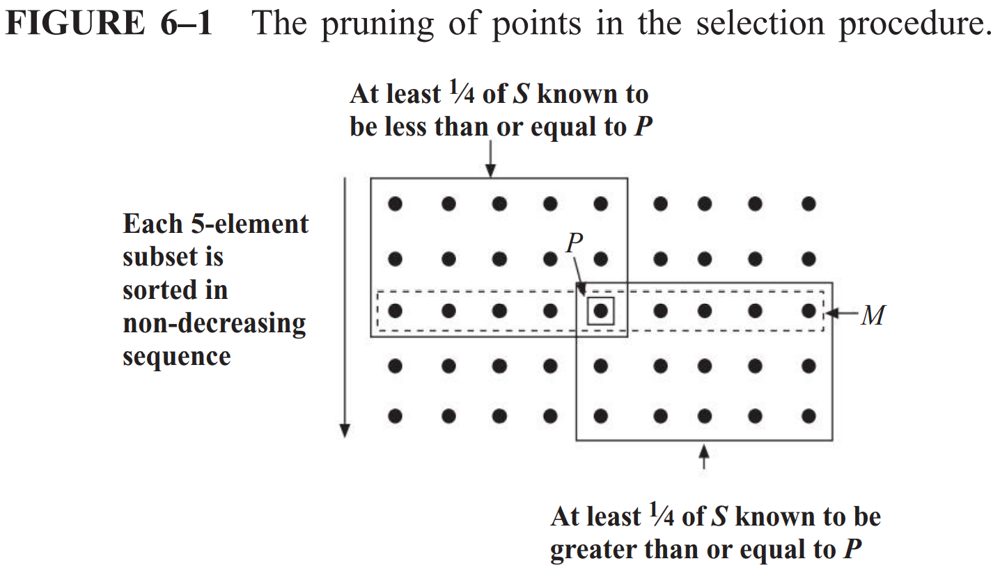

分的看起来比较均衡

时间复杂度经过一番推理可以得到是：
$$
T(n)=O(n)
$$

## 6.3 Linear Programming with Two Variables
这次考虑的问题是：

Minimize $Z=ax+by$

Subject to $a_ix+b_iy\ge c_i(i=1,2,...,n)$

对于prune-and-search来说，这次需要裁剪掉的则是这$n$个restriction里面那些没用的

至于什么情况下会裁切，大致思路如下：

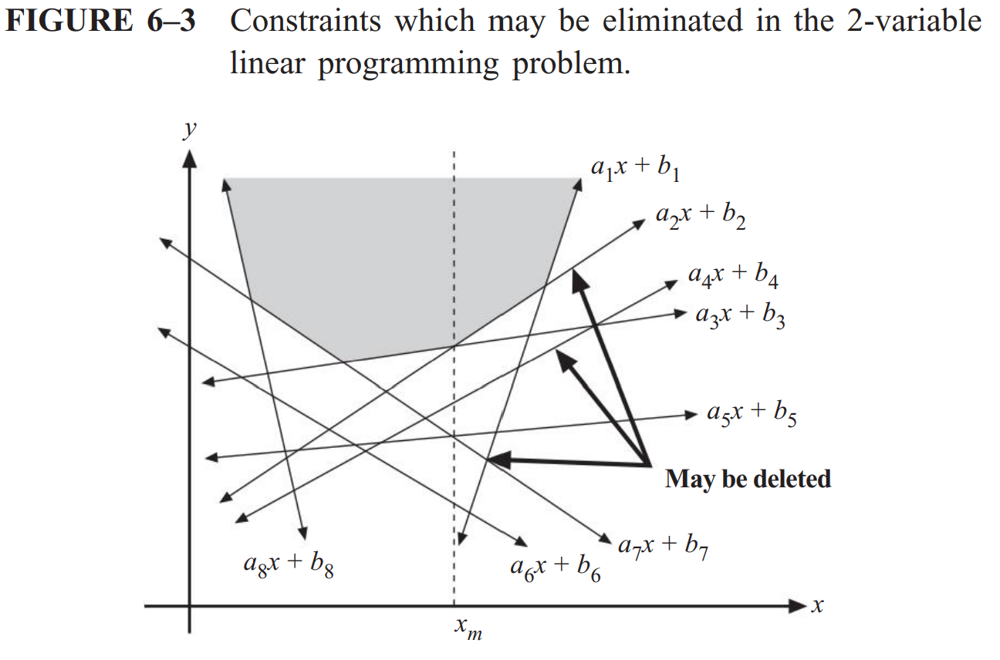

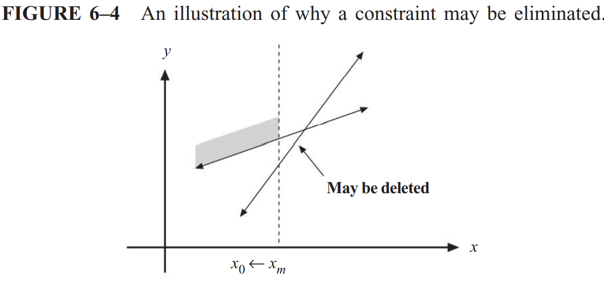

显然我们要寻找的最小值的横坐标$x_0$在左边，而此时的点$x_m>x_0$，且两个constrain的交点出现在了$x_m$的右边，则此时位于下面的那条线必定不在boundary上，可以被忽略

算法如下：

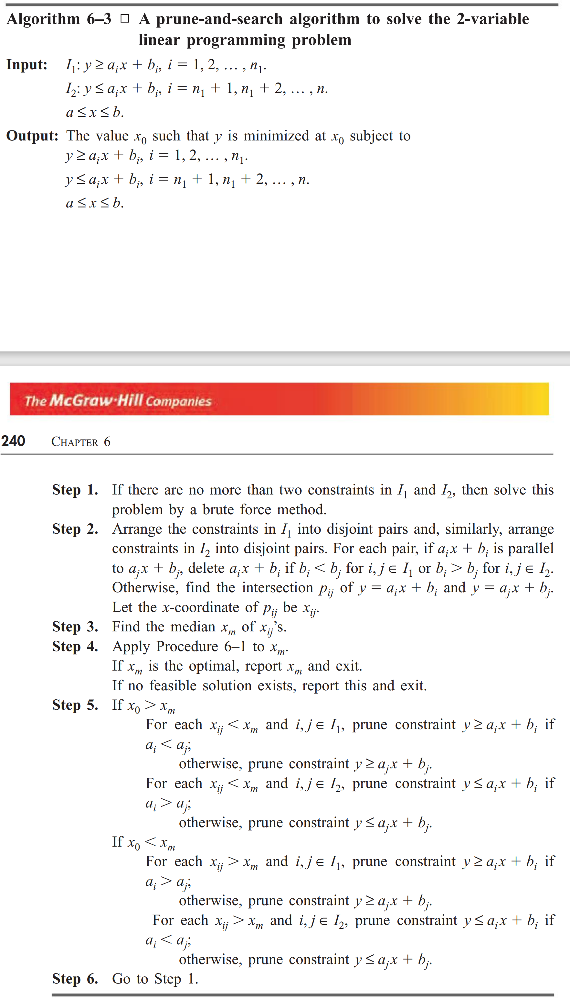

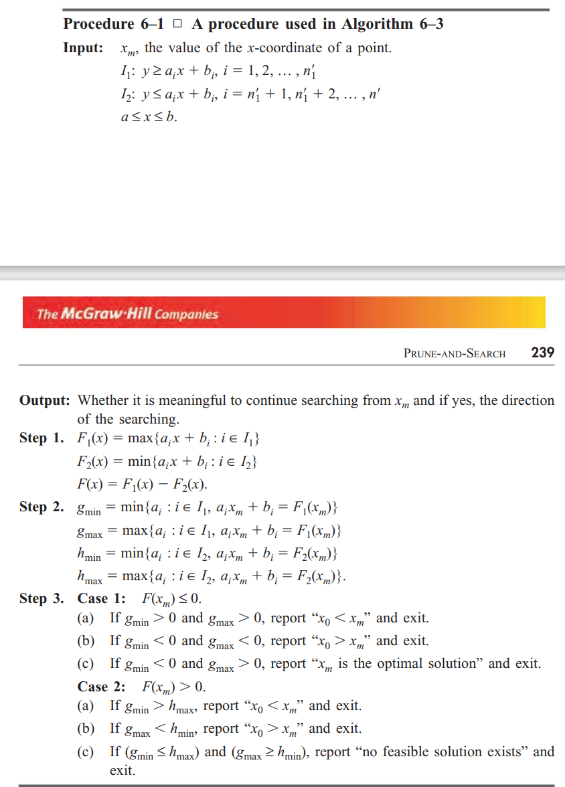

## 6.4 The 1-Center Problem
问题描述如下：

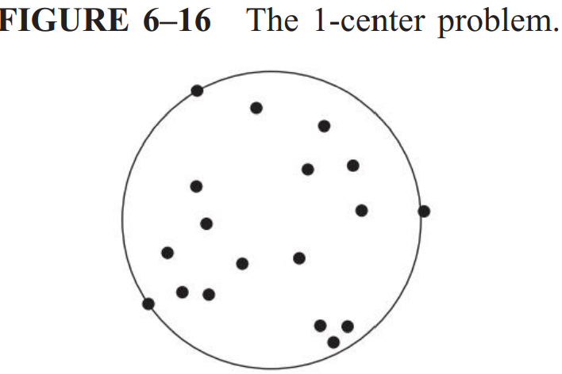

二维平面上有这么一些点。我们的目标就是找一个最小的圆，把他们都盖住

显然，我们需要找到那些长在最外圈的点就行了，里面的点不需要管

我们先说明一下prune-and-search是怎么在这里使用的：

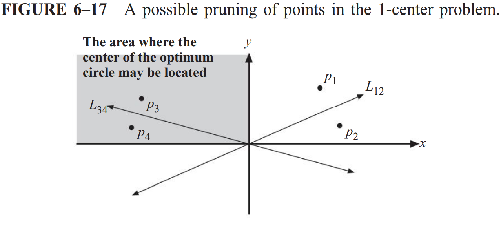

我们假设就考虑这四个点，其中两条斜线分别是两组点的平分线。出于神秘的原因，我们知道了圆心肯定在第二象限。于是，此时我们就可以开始考虑prune了：左边的点因为圆心位置还没确定，所以还是没法删除；而右边的点中，$P_1$==离圆心更近==，所以，我们可以==prune掉$P_1$==

在解决真正的1-center problem之前，我们需要先考虑一个更简单的子问题: the constrained 1-center problem where the center is restricted to lying on a ==straight line==

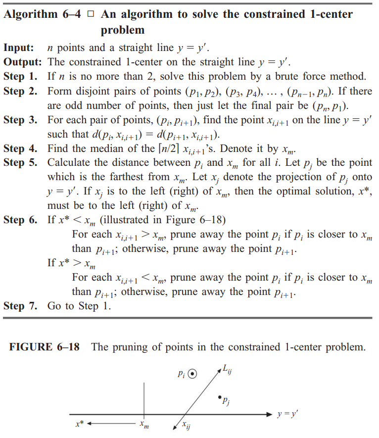

我们假设了，圆心只可能出现在$y=y'$($y'$是常数)的水平直线上。

算法大致上先是两两分组，然后每组画平分线。找到平分线和$y=y'$的交点，找到这些交点之中的中间那个$(x_m,0)$。接着计算所有点到$(x_m,0)$的距离，同时找到最远的那个点$p_j$到$y=y'$的投影$(x_j,0)$。$x_j$和$x_m$之间的相对位置关系即是最优解$x^*$和$x_m$之间的位置关系。我们由此以$x_m$为分界线，把所有点分为四个象限，且确定了圆心所在的象限。剩下的就和之前一样了

我们每次进行该算法，都可以prune掉$\lfloor n/4 \rceil$的点

是时候来看一看general的1-center problem了！

我们首先考虑一下如何将之前简化的问题的解，迁移到general的情况。对于那些离圆心最远的点，有以下几种情况：
- 只有一个点离圆心最远

    这种情况下，该点的==横坐标必定和圆心一样==

    且，我们可以肯定，在general的问题中，在最终的坐标系中，==真正最优的圆心和这个最远的点有相同正负值的y==

    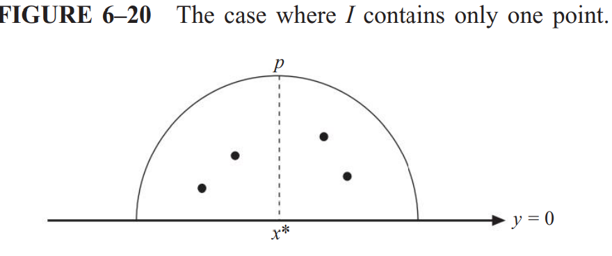

    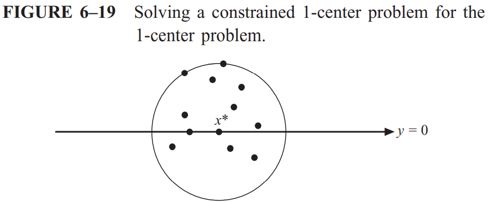

    比如这个图中，我们可以肯定==最优的圆心其实在当前圆心的上方==
- 有多个点离当前圆心最远

    这之中又分为两种情况：

    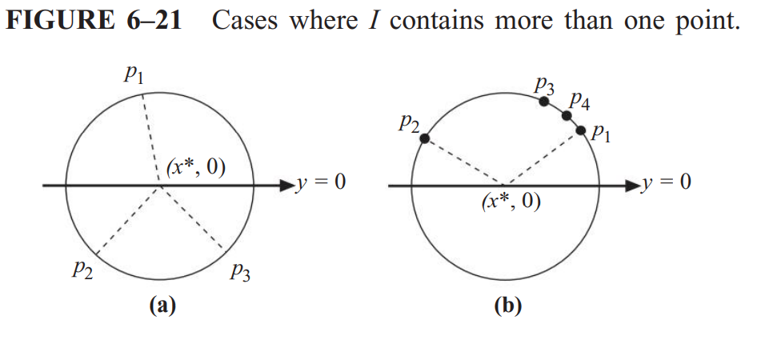

    - 对于第一种情况，最远的点有正有负。我们此时可以肯定，==当前的圆心即是general问题中的最优圆心==

    - 对于第二种情况，图中的圆心肯定可以上移（圆的下半部分太空了）

上述过程的正式的算法描述如下：

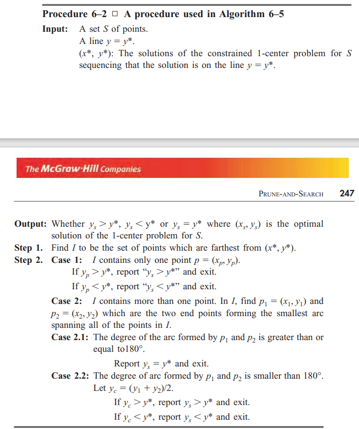

而在上面两个预备知识之后，我们终于可以一睹general问题的最终算法长啥样了:

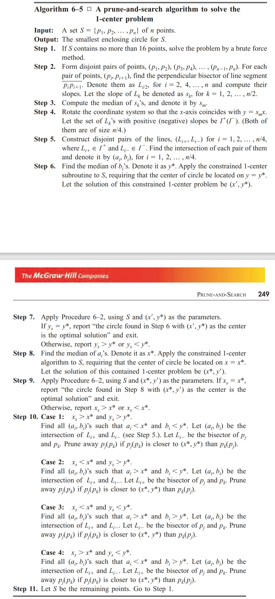

总之最终算法的时间复杂度是：
$$
O(n)
$$

