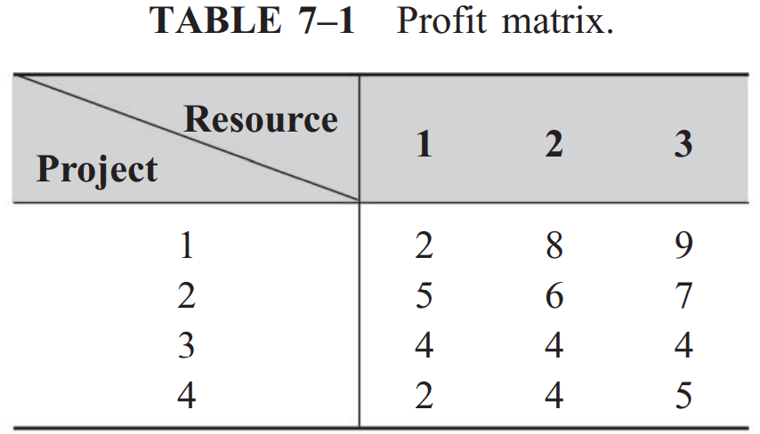
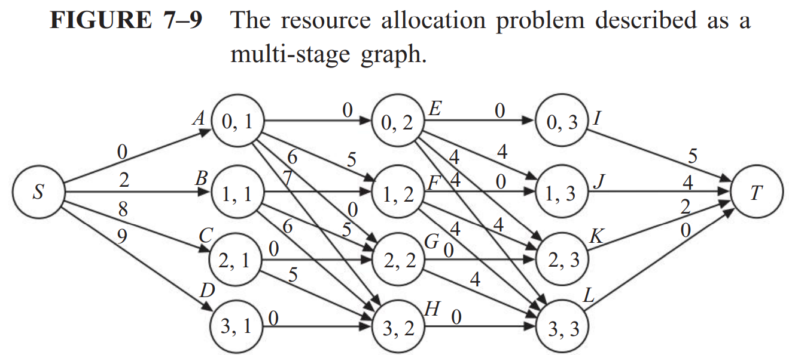
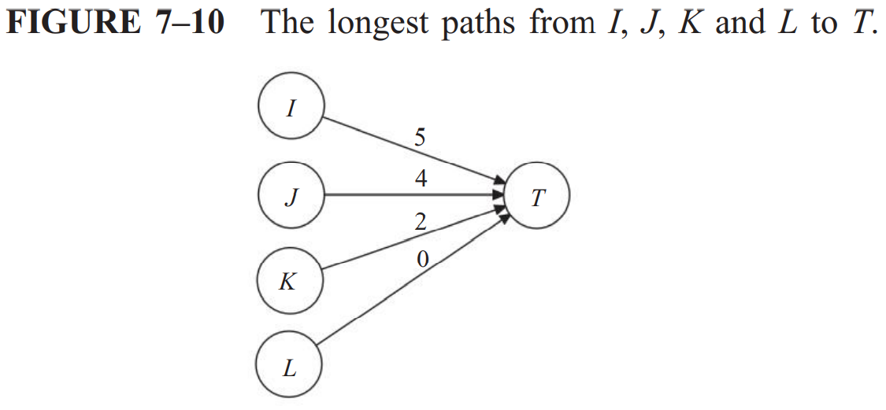
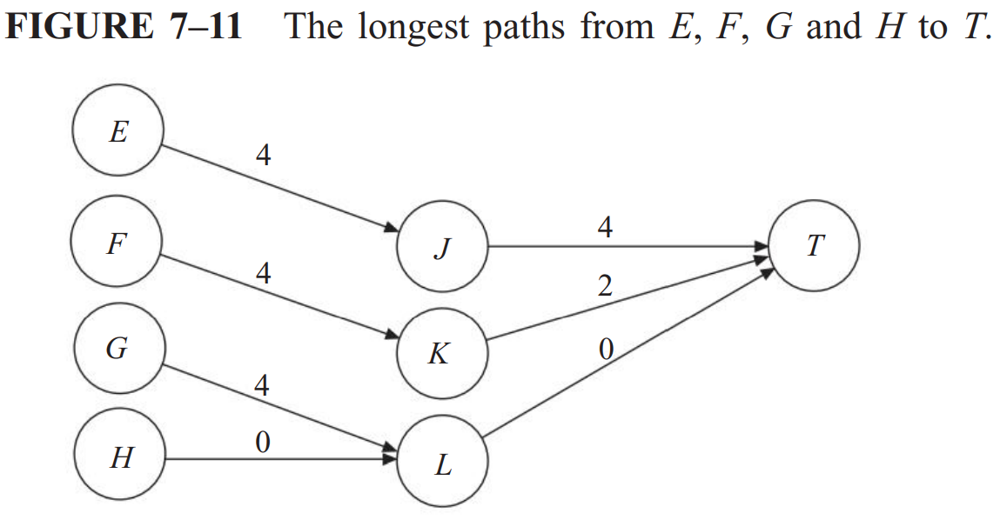
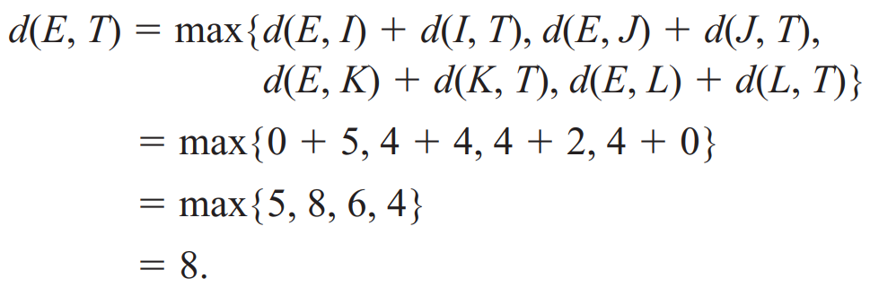
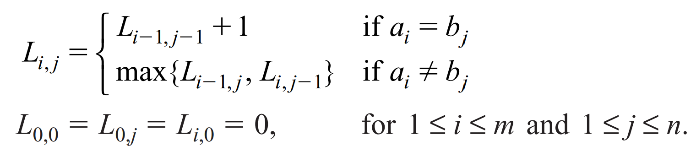
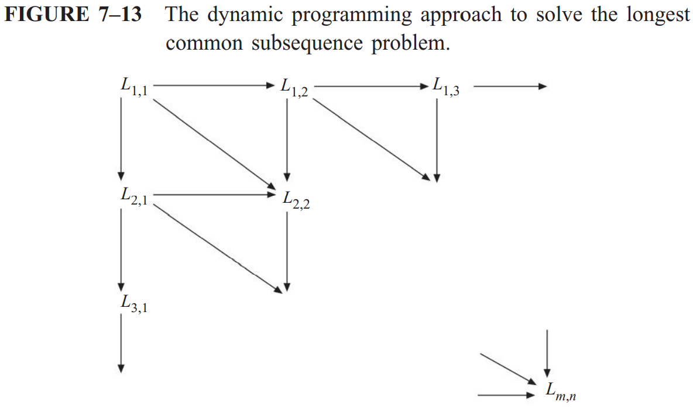
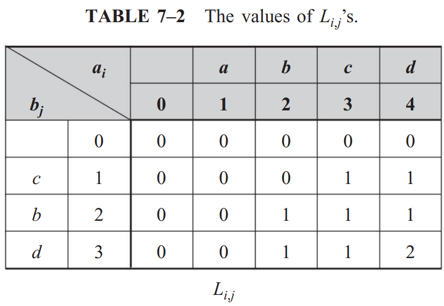

## 7.0 前言
显然我们在数模课上学过，这里就复习一下

分为两种解题方向：
- forward reasoning

    就是从起点到终点的顺序，记住一路上子问题的最优解
- backward reasoning

    从终点往回推，最终计算时也会需要子问题的解来重新回到终点

## 7.1 The Resource Allocation Problem
假设总共有3个单位的resource，我们需要将其分配给4个不同的project，每个project得到不同数量的resource的时候会产生不同的利润值：

目标当然是最大化利润

我们可以把问题分成多个decision states，也就是对每个project，决定其应该分配多少的资源

decision tree如下：

上图中，节点内的数字$i,j$代表已经分配了$i$个单位的resource，当前状态决策到了第$j$个project，而边上的权重则是代表利润

显然，问题被转换成了，求解上述状态图的最长路径。我们可以用backward reasoning approach（从终点反推回起点）:
- 第一层:

    
- 第二层：

    

    对应的计算过程才是重点：

    

etc. 反正可以最终得到最长路径是:
$$
S\rightarrow C\rightarrow H\rightarrow L\rightarrow T
$$

也就是1~4project分别被分配了2, 1, 0, 0个resource

## 7.2 The Longest Common Subsequence Problem(LCS)
> A **subsequence** of $A$ is obtained by ==deleting 0 or more== (not necessarily consecutive) symbols from $A$

我们的目标就是要找到两个sequence的longest common subsequence

我们不妨来考虑一下两个string: $A=a_1a_2...a_m$和$B=b_1b_2...b_n$。考虑两个string的最后一位$a_m$和$b_n$之间的关系：
- $a_m=b_n$

    此时LCS里必定包含$a_m$，我们新的目标就是找到$a_1a_2...a_{m-1}$和$b_1b_2...b_{n-1}$的LCS
- $a_m\neq b_n$

    此时需要比较两种情况下的LCS，取更大的那个：
    - $a_1a_2...a_m$和$b_1b_2..b_{n-1}$
    - $a_1a_2...a_{m-1}$和$b_1b_2...b_n$

记$L_{i,j}$是$a_1a_2...a_i$和$b_1b_2...b_j$的LSC的长度，我们可以得到如下递归表达式：

也就是说，我们可以从$L_{1,1}$开始，层层forward，直到找到$L_{m,n}$:

表现在图中的时候，两种case分别是：
- 当前字符相等，则取当前格==左上角==的数字+1填入
- 当前字符不等，则取当前格==左边和上边==两个，取更大的填入

e.g.

对于$A=abcd$和$B=cbd$来说：

鉴于计算$L_{i,j}$需要的时间是常数，算法的时间复杂度是$O(mn)$

## 7.? 0/1 Knapsack Problem
想必问题是干啥的不需要复述一遍

这个问题可以通过挨个考虑是否要将物品放进背包里，变成一个个的state来决策

假设当前已经在背包里的物品的重量是$Q$，当前正在决策的物品$i$的价值是$P_i$，那么递归的表达式就是：
$$
f_i(Q)=max\{f_{i-1}(Q),f_{i-1}(Q-w_i)+P_i\}
$$

e.g.

三个物品的重量分别是：
$$
1,2,3
$$
价值分别是：
$$
10,15,40
$$
背包的重量上限是6

那么整个决策的表格就是：
|$i$th object|0|1|2|3|4|5|6|
|---|---|---|---|---|---|---|---|
|0|0|0|0|0|0|0|0
|1|0|10|10|10|10|10|10
|2|0|10|15|25|25|25|25
|3|0|10|15|40|50|55|65

横坐标表示有总计多少重量的物品在背包里

比如说我们考虑第2个物品的3那一列，此时说明背包里面放入了3重量的物品，那么需要比较的就有两个：
- 不放入第二个物品，于是乎和第一个物品的重量3的情况一致，为10
- 放入第二个物品。此时是第二个物品的利润15加上第一个物品重量是3-2(物品2的重量恰好为2)的那一列的利润10，也就是和为25

对比上述两个情况，显然是取25的情况，即在当前情况下放入物品2能得到局部最优解

反正最终答案是65，即右下角那格

## 7.?? Matrix Chain Multiplication
又是个书上没有的问题，[教程在这](https://www.tutorialcup.com/interview/matrix/matrix-chain-multiplication-using-dynamic-programming.htm)

众所周知，矩阵的乘法是满足交换律的($A*B=B*A$)，而不同的顺序会带来不同的需要计算乘法的次数。我们的目标就是减少这个计算次数

e.g.

我们需要考虑的6个矩阵的大小分别是：
$$
\begin{align}
  30*35\\
  35*15\\
  15*5\\
  5*10\\
  10*20\\
  20*25
\end{align}
$$

核心的递归公式如下：

$$
M[i,j]=
\begin{cases}
0&\text{if}\ i=j\\
min_{i\le k< j}\{M[i,k]+M[k+1,j]+P_{i-1}P_kP_j\}&\text{if}\ i<j
\end{cases}
$$
$M[i,j]$代表的是计算从矩阵$i$一直乘到矩阵$j$需要的最小cost。第二个case的意思是：我们需要比较$k$取不同的值的时候，拆分目标的矩阵成$M[i,k]$和$M[k+1,j]$两个子矩阵，两个子矩阵自身已经包含的cost相加再加上两个矩阵相乘的cost

至于$P$是啥，我们通过例子来说：

$$
P_0=30\\
P_1=35\\
P_2=15\\
P_3=5\\
P_4=10\\
P_5=20\\
P_6=25
$$
需要注意的是$P_6$，其它$P$都是矩阵大小的==前面的数字==，只有$P_6$是最后一个矩阵大小的==后面的数字==。以及，==数字是从0开始的==

我们入乡随俗，按照ppt上的格式来写：
- Step 1

    |$m_{11}=0$|$m_{22}=0$|$m_{33}=0$|$m_{44}=0$|$m_{55}=0$|$m_{66}=0$|
    |---|---|---|---|---|---|

    显然自己不需要乘
- Step 2

    |$m_{11}=0$|$m_{22}=0$|$m_{33}=0$|$m_{44}=0$|$m_{55}=0$|$m_{66}=0$|
    |---|---|---|---|---|---|
    |$m_{12}=15750$|$m_{23}=2625$|$m_{34}=750$|$m_{45}=1000$|$m_{56}=5000$|

    其中：
    $$
    m_{12}=m_{11}+m_{22}+P_0*P_1*P_2=30*35*15=15750\\
    m_{23}=m_{22}+m_{33}+P_1*P_2*P_3=35*15*5=2625\\
    ...
    $$
    反正$k$只有一种可能取值，也没法比较最小值
    
- Step 3

    |$m_{11}=0$|$m_{22}=0$|$m_{33}=0$|$m_{44}=0$|$m_{55}=0$|$m_{66}=0$|
    |---|---|---|---|---|---|
    |$m_{12}=15750$|$m_{23}=2625$|$m_{34}=750$|$m_{45}=1000$|$m_{56}=5000$|
    |$m_{13}=7875$|$m_{24}=4374$|$m_{35}=2500$|$m_{46}=3500$|

    其中：
    $$
    m_{13}\\
    =min((m_{11}+m_{23}+P_0P_1P_3),(m_{12}+m_{33}+P_0P_2P_3))\\
    =min((2625+30*35*5), (15750+35*15*5))\\
    =7875\\
    ...
    $$

以此类推，反正就可以得到最终结果是15125

其实也不用太纠结下标到底是多少，知道原理后自然就知道咋乘

