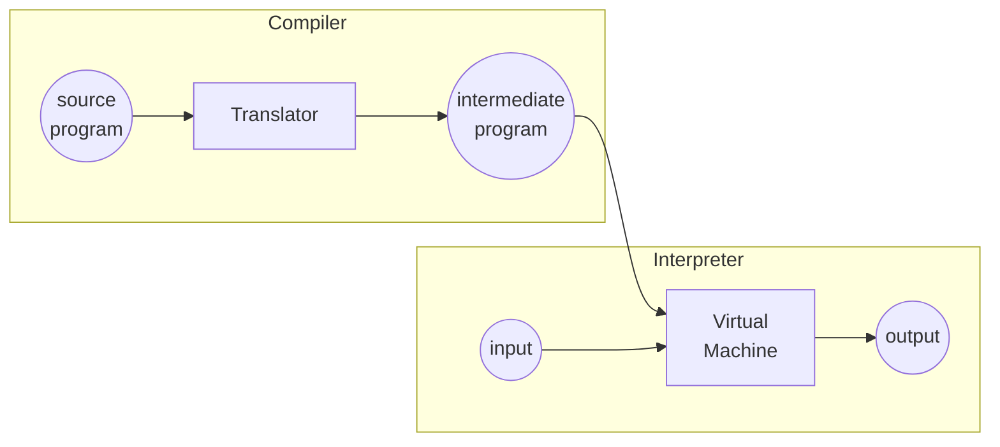
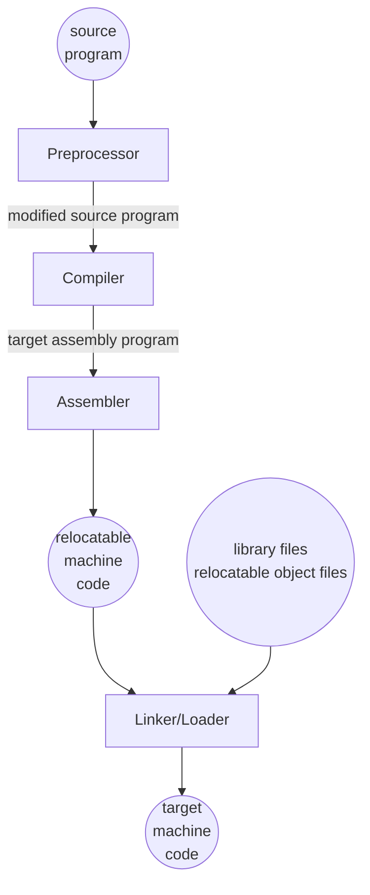
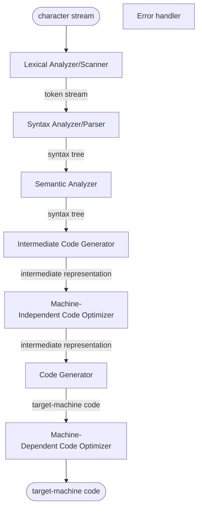

## 1.1 Language Processors
- **Compiler**

    ```mermaid
    flowchart LR
    a((source<br>&nbspprogram))-->Compiler-->b((target<br>program))
    ```
    显然编译完之后还得另外运行一下:
    ```mermaid
    flowchart LR
    a((input))-->Target&nbspProgram-->b((output))
    ```
- **Interpreter**

    ```mermaid
    flowchart LR
    a((source<br>program))-->b[Interpreter]
    c((input))-->b
    b-->d((output))

特别地，Java的处理器结合了这两种玩意：

### 1.1.1 Language Processing System
就是镜头拉远一点，看一眼Compiler在整个系统中的作用

大型的程序经常是分开编译的，所以Linker/Loader就把文件联系到一起，并放入内存之中进行运行
## 1.2 The Structure of a Compiler

可以把所有过程分成两个部分：
- **analysis**

    应该是开头一直到semantic analysis(包括)，也被称为**front end**
- **synthesis**

    从中间码一直到target code的过程，被称为**back end**

### 1.2.1 Lexical Analysis(Scanner)
输入源代码（字符流），把它分割成lexemes之后，输出每个lexemes对应的token

token的形式为：
<p style="text-align:center;font-style:italic">
&lttoken-name, attribute-value&gt
</p>

- *token-name*

    抽象符号

    一般来说有以下类型：
    - Identifier
    - Keyword
    - Number
    - Operator
    - Special symbol

        比如`'(', ';'`
- *attribute-value*

    指向symbol table的一个entry

eg.

对于下面这句代码:

$$
position = initial + rate * 60
$$

- `position`对应token`<id,1>`，`id`代表*identifier*, `1`则指向symbol table中position所在的entry
- `=`对应`<=>`，并不需要attribute-value
- `initial`对应`<id,2>`
- `60`对应`<60>`

这个句子完整一点的流程图是：


Scanner其实还干点别的小事情:
- 把identifiers放进symbol table
- 把literal放进literal table,比如：
    - Numeric constants(eg. 3.14)
    - Quoted string of text(eg. "hello")

### 1.2.2 Syntax Analysis(Parser)
输入token，输出syntax tree

语法树的规则是：
- interior node：存储operator
- children of operator：operator对应的arguments

例子:


### 1.2.3 Semantic Analysis
一个程序的semantic是程序的meaning

semantic也是分为两种的:
- **Static semantic**

    能在执行前被检查

    只有这部分是semantic analyzer负责的，利用syntax tree和symbol table的信息，来检查是否和语言的规范相符。
    
    检查包括：
    - **Declarations**
    - **Type checking**

    

    
- **Dynamic semantic**

    只有执行后才能够确定

    analyzer显然管不了

### 1.2.5 Code Optimization
玄学部分

eg.

表达式`a[index]=2+4`的右边可以合并成`6`

- **IR(Intermediate Representation)**

    任何被编译器使用的源代码的表示形式都叫IR

    比如syntax tree和intermediate code

### 1.2.6 Code Generation
一般来说会使用==汇编语言==作为target code
