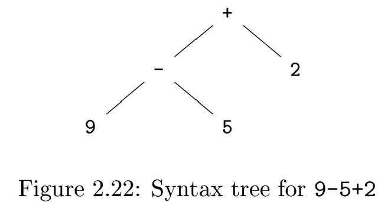

## 2.3 Syntax-Directed Translation
### 2.3.2 Synthesized Attributes
我们可以将**attributes**附加到==nonterminal或者terminal==上，然后我们可以==给productions附加==一些关于这些attribute的**attribute equations**(也叫**semantic rules**)。这样一来，在parse tree的节点上，我们就可以根据被使用的production和对应的附加rule，来得到这些属性的表达式的计算结果

我们用如下记号来表达attribute:
> suppose a node $N$ in a parse tree is labeled by the grammar symbol $X$. We ==write $X.a$== to denote the value of attribute $a$ of $X$ at that node 

听起来还是很抽象，*attribute*有如下的例子：
- ==data type== of a variable
- ==value== of an expression

## 2.5 A Translator for simple Expressions
### 2.5.1 Abstract and Concrete Syntax

把中间变量全部省略了，可以以节省空间

## 2.7 Symbol Tables
它存储了：
- Data type
- variable scope
- eventual location in memory

一般来说，==declaration==会被塞进symbol table，以供后续查阅
