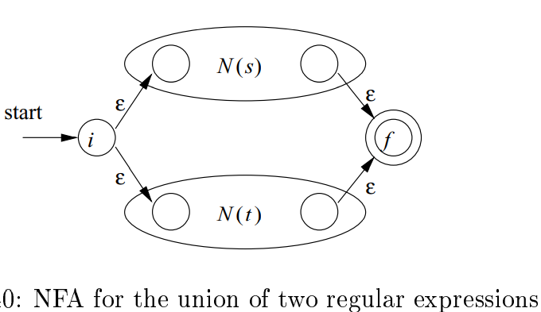
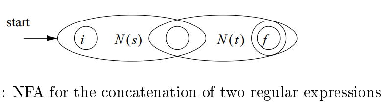
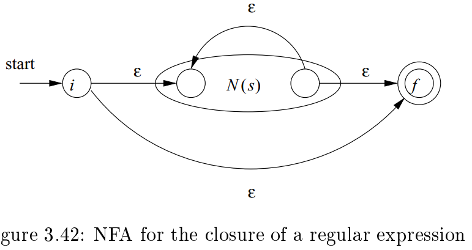
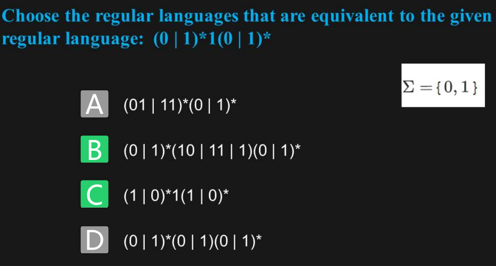
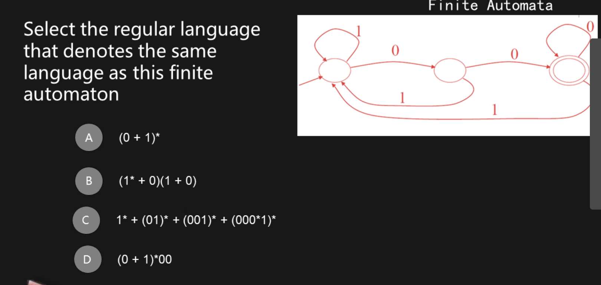

## 3.1 The Role of the Lexical Analyzer
词法分析
### 3.1.2 Tokens, Patterns and Lexemes
- **Token**

    以下例子在1.2.1也介绍过

    eg.
    - **Keywords**

        `if`, `then`...
    - **Identifiers**

        标识符
    - **Literals**

        数字或字符常量
    - **Special symbols**

        `+`, `-`, ...

## 3.3 Specification of Tokens
实际是正则表达式的学习
### 3.3.1 Strings and Languages
- **Alphabet**

    > Any finite set of symbols

    eg. $\Sigma = \{0,1\}$
- **String**

    > A string over some alphabet is a finite sequence of symbols drawn from that alphabet.

    - **The empty string**

        denoted by $\epsilon$

        注意$\{\epsilon\}$和空集不一样
    - **Operation**

        - Concatenation

            就是把字符直接拼起来
        - Exponentiation

            $a^n=aaaaaa...aa$
- **Language**

    > Any set of strings over some fixed alphabet

    eg. $\phi$空集, $\{\epsilon\}$, 一句话

### 3.3.2 Operations on Languages

### 3.3.3 Regular Expressions
正则表达式$r$用来描述*language* $L(r)$. 对于*alphabet*$\Sigma$, 正则表达式是如下递归定义的:
- $\epsilon$ is a regular expression, and $L(\epsilon)$ is $\{\epsilon\}$, that is, the language whose sole member is the empty string
- If $a$ is a symbol in $\Sigma$, then **a** is a regular expression, an $L($**a**$)={a}$, that is , the language with one string, of length one, with $a$ in its one position. Note that by convention, we use *italics* for symbols, and **boldface** for their corresponding regular expression

有如下推论：
- $(r)|(s)$ is a regular expression denoting the language $L(r)\cup L(s)$
- $(r)(s)$ is a regular expression denoting the language $L(r)L(s)$
- $(r)^*$ is a regular expression denoting $(L(r))^*$
- $(r)$ is a regular expression denoting $L(r)$

    This last rule says that we can add ==additional pairs== of parentheses around expressions without changing the language they denote

我们定义如下运算符来减少括号的使用：
- The unary operator `*`(表示0到任意多) has **highest** precedence and is left associative
- Concatenation `.` has **second** hightest precedence and is left associative
- "or"`|` has **lowest** precedence and is left associative

比如：
$$
L(a|bc^*)=\{a\}\cup(\{b\}\{\epsilon,c,cc,...\})\\
=\{a\}\cup\{b,bc,bcc,...\}\\
=\{a,b,bc,bcc,...\}
$$
有一个比较特殊的是
$$
(a|b)^*=\{\epsilon,a,b,aa,ab,...\}
$$
### 3.3.5 Extension of Regular Expressions
- *One or more instances*

    $r^+=rr^*$
- *Zero or one instances*

    $r?=r|\epsilon$
- *Character classes*

    $[a_1a_2...a_n]=a_1|a_2|...|a_n$

    $[a\operatorname{-}z]=a|b|...|z$

    特别地，$[\land abc]$指的是匹配除了a, b, c之外的字符

## 3.4 Recognition of Tokens
就是给常见的正则表达式起个名字

eg. $(0|1|...|9)=digit$

注:
- 同一个*language*可能可以被不同的正则表达式表达
- 并非所有*string*都可以用正则表达式表示

### 3.4.? Regular Expression for Programming Language Tokens
#### 3.4.?.1 Typical regular  expression for tokens
let 
$$l=a|b|...|z\\
d=0|1|...|9$$
- **Identifier**

    $l(l|d)^*$
- **Unsigned integer**

    $dd^*$
- **Real number**

    $dd^*(.dd^*|\varepsilon)$
- **Reserved word**

    `if|while|do|...`

#### 3.4.?.2 Issues related to the recognition of tokens
- **Ambiguity**

    因为有些string可以被多个不同的正则表达式匹配。这就要求语言的定义不能出现歧义，且有如下附加要求：

    - 当一个string可以被解读成identifier或者keyword时，倾向于解读成keyword
    - 当一个string可以被单个token或者是多个token解读时，倾向于用单个token来解读

- **Token delimiters**

    > Characters that are unambiguously part of other tokens are delimiters

    eg. in string `xtemp = ytemp`, `=` is a delimiter

    常见的分隔符有:
    - 空格
    - 新行
    - 制表符(tab)
    - 注释

    Scanner 会扔掉这些分隔符
- **Lookahead**

    比如说，扫描的时候遇到了`:`，然而这个时候scanner必须lookahead来判断这个token是`:`还是`:=`j

## 3.6 Finite Automata
数学上描述算法的一种方式

这里他们被用来描述识别正则表达式的模式的过程，以构建scanner（==一句RE规则就对应了一个FA==）

有穷自动机看起来非常像图表，但有如下区别:
- 有穷自动机是*recognizer*，他们只会对可能的输入string说yes或no
- 有穷自动机分为两类:

    - **Nondeterministic finite automata**(NFA)

        - 对于每个状态，一个输入==没有唯一==输出
        - 吃$\epsilon$可以状态转移
    - **Deterministic Finite Automata**(DFA)

        和NFA上述特性反过来

eg.

### 3.6.2 Transition Tables
我们可以用transition table来表示NFA
- *rows*: states
- *columns*: input symbols and $\epsilon$
- *entry*: 转移到的下一个状态

### 3.6.4 Deterministic Finite Automata
*Deterministic*的含义是，可以根据当前state和当前的字符输入两个条件，来==唯一地==确定下一个state
> 特别地，输入$\epsilon$的时候并不会进行状态转移

比较绕的字符定义如下：

$$
M=(S,\Sigma,T,S_0,A)
$$
其中
- $S$是state的集合
- $\Sigma$是alphabet
- $T$是transition function

    比如$T(S_i, a)=S_j$表示当前状态为$S_i$, 当前输入字符为$a$的时候，下一个状态就是$S_j$
- $S_0\in S$是初始状态
- $A\subset S$是*accepting states*

$L(M)$表示该language被有穷自动机$M$接受了
- eg.

    

#### 3.6.4.1 Transition Diagram
*transition diagram*的例子：

图像的含义为:
- 每个*state*对应一个节点
- 初始状态有一个空的箭头指向它
- accepting states用==双线边框==
- 线上的字符表示状态转移需要吃的字符

注:
- 线上的字符可以用名字来表达，比如*letter*, *digit*
- 会导致错误状态的transition一般来说不会画在图中
#### 3.6.4.2 Transition Table

默认第一个state就是初始state，Accepting代表是否是终止状态

## 3.7 From Regular Expressions to Automata
至于为啥要引入NFA，因为有时候想要系统地直接构建好DFA整个结构会比较困难，我们就需要先写NFA再转DFA
### 3.7.1 Conversion of an NFA to a DFA
DFA里的一个state对应于NFA里面的多个state，可以理解成多个输入输出相似的节点合并了

**Algorithm**: The *subset construction* of a DFA from an NFA 
**Input**: An NFA $N$ 
**Output**: A DFA $D$ accepting the same language as $N$ 
**Method**: Construct a transition table $Dtran$ for $D$。第一件事情就是处理NFA中的$\epsilon$-transitions。定义以下操作，其中$s$是单个state，$T$是多个states的集合:
- $\epsilon\operatorname{-}closure(s)$

    能够从state $s$出发，只通过$\epsilon$-transitions 到达的states的集合(相当于是一个==等价节点==的集合)
- $\epsilon\operatorname{-}closure(T)$

    就一点点区别，$T$是集合而已
- $move(T,a)$

    从当前节点集合$T$之中出发，吃掉输入$a$之后能到达的节点的集合（注意，不包含这些新节点的$\epsilon\operatorname{-}closure$）

这时候我们就可以写出转换函数的定义:
$$Dtran[T,a]=\epsilon\operatorname{-}closure(move(T,a))
$$
你已经学会了基本语法，让我们来举个例子吧！

见书P179的example 3.21。大概意思是从起点的对应$\epsilon\operatorname{-}closure$开始，每一次循环，都算一下所有可能的输入对应的$Dtran$的结果，并把每个结果标为新的DFA的state。直到没有新的节点被创造出来

### 3.7.4 Construction of an NFA from a Regular Expression
一个递归的算法:

**Algorithm**: The McNaughton-Yamada-Thompson algorithm to convert a regular expression to an NFA 
**Input**: A regular expression $r$ over alphabet $\Sigma$ 
**Output**: An NFA $N$ accepting $L(r)$ 
**Method:**
- **Basis**:

    $i$代表initial, 初始状态；$f$代表final, 终止状态
    - 吃到$\epsilon$时

        
    - 吃到subexpression $a$ in $\Sigma$

        
- **Induction**

    假设$N(s)$和$N(t)$分别是正则表达式$s$和$t$的NFA，面对不同的$r$会得到不同的NFA:
    - $r=s|t$

        这时候$r$作为$s$和$t$的union，对应的NFA长成如下样子:

        

        有些地方会用`+`来代替`|`
    - $r=st$

        

        既然是排列组合，似乎也很有道理
    - $r=s^*$

        
    - $r=(s)$

        假如只是加了一对括号的话，那么NFA就和$s$的一模一样

至此这个转换算法就描述完了。

## 3.9 Optimizations of DFA-based Pattern Matchers
### 3.9.6 Minimizing the Number of States of a DFA
在讲正式的算法之前，先提出概念:
- *Equivalent States*

    state $s$和$t$是*equivalent states*有两个要求:
    - $s$和$t$都是accepting states或者都是non-accepting states
    - 对于alphabet $\Sigma$中的每一个字符$a$，$s$和$t$吃到$a$之后的新的state是*equivalent states*的关系

接下来就开始说明*Minimizing Algorithm*是咋整的:

算法的终极目标是，把所有的states分成一堆*equivalent states*，这样每一堆*equivalent states*就只需要派一个代表出来参与到DFA中就可以了，其他都可以被约掉。
- 首先，把所有states分成两大堆subsets，一堆全是accepting states，另一堆全是non-accepting states（这么做是为了满足*equivalent states*的第一个条件）
- 接着，对每个subsets里面的元素，测试一下alphabet中的每一个输入，是否都有等效的输出（就是测试*equivalent states*的第二个条件），假如有不同的结果，那就分家。

    > 在测试之中，会发现有时候特定的state没有对应输入字符串的transition，这时候也表明它和那些有对应transition的state不同。
## 附录：课堂提问
- 

    第一眼可能觉得B压根就不对，其实只要保证两个表达式==能够表示的字符串完全相同==就可以了

- 

    答案是D，真的无语，把D化简成min-DFA就是如图了。

    以及，所谓的`+`指代的是`|`或的逻辑

    