## 4.1 Introduction
语法分析

需要注意的是[syntax tree(全称abstract syntax tree)和parse tree(别名concrete syntax tree)是不同的两个东西](https://stackoverflow.com/questions/1888854/what-is-the-difference-between-an-abstract-syntax-tree-and-a-concrete-syntax-tre?noredirect=1&lq=1)。概括一下就是：parse tree里面会出现代码中使用的各种中间变量，但实际上我们并不关心这些中间的东西，所以可以简化成AST

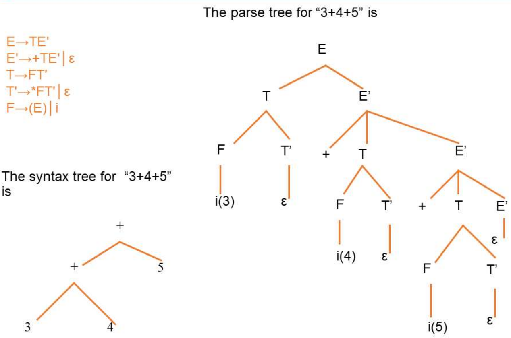

图中这个语法并没有指定左右结合性，AST想要左结合和右结合都行

### 4.1.1 The Role of the Parser
parser的任务:
- determine the ==syntactic(句法) structure== of a program from the tokens produced by the scanner
- Either explicitly or implicitly, ==construct a parse tree== or syntax tree that represent this structure

有几种parser:
- universal
- top-down
- bottom-up

### 4.1.4 Error-Recovery Strategies
- **Error Recover**

    就是报错
- **Error Repair**

    给出可能的解决方案

## 4.2 Context-Free Grammars
A context-free grammar is a specification for the ==syntactic structure== of a programming language

It is similar to regular expressions except that a context-free grammar involves ==recursive rules==

维基百科的解释是：
> ==No matter which symbols surround it==, the single nonterminal on the left hand side can always be replaced by the right hand side. This is what distinguishes it from a context-sensitive grammar 


### 4.2.1 The Formal Definition of a Context-Free Grammars
给一个例子:

$$
stmt \rightarrow \text{\bf if}\ (expr)\ stmt \ \text{\bf else}\ stmt
$$

包含了几种不同的元素：
- **Terminals**

    就是*token name*的另一种叫法。在例子之中就是`if`, `else`, `(`, `)`
- **Nonterminals**

    syntactic(句法的) variables that denote ==set of strings==。例子之中就是$stmt,expr$

    是用来帮助构建语法树的

    - **Start symbol**

        其中一个*nonterminal*会被认为是*start symbol*，比如例子之中最左边的$stmt$

    - **Productions**

        specify the manner in which the terminals and nonterminals can be combined to form strings. 

        每个*production*包括:
        - a *nonterminal* called the ==head== or ==left side== of the production(比如最左边的$stmt$)
        - a symbol ==$\rightarrow$==. 有时候也会用$::=$代替
        - a ==body== or ==right side== consists of zero or more terminals and nonterminals

所以我们一般会在定义一个context-free grammar的时候使用如下形式:
$$
G=(V_T,V_N,P,S)
$$
其中:
- $V_T$ is a set of *terminals*
- $V_N$ is a set of *nonterminals*
- $P$ is a set of *productions*(grammar rules)
- $S$ is the *start symbol*. $S\in V_N$
### 4.2.2 Notational Conventions
以下是这本书的一些符号上的规矩:
- **Terminals**

    - Lower case letters(`a`,`b`,`c`)
    - Operator symbols(`+`,`*`)
    - Punctuation symbols(`()`,`,`)
    - Digits(`0`,`1`)
    - Boldface strings(**id**,**if**)
- **Nonterminals**

    - Uppercase letters(`A`,`B`)

        `E,T,F`一般分别代表expressions,terms,factors
    - `S`一般代表*start symbol*
    - Lowercase italic names($expr,stmt$)

    
### 4.2.3 Derivation
体现的是==top down==的思维，从特殊规则一步步替换到特定的*derivation*

把每一个production看作是新的规则

比如这么一个规则:
$$
E\rightarrow-E
$$
那么我们在推导过程之中，就可以写出:
$$
E\rArr -E
$$

关于这个推导符号，有时候我们希望偷懒一点，于是有了如下符号:
- $\overset{*}{\rArr}$

    表明derives in ==zero or more steps== 

    比如$\alpha\overset{*}{\rArr}\alpha$
- $\overset{+}{\rArr}$

    很相似，derives in ==one or more steps==

注意$\rightarrow$表示规则，$\rArr$表示推导中的一步

- **sentential form**

    If $S\overset{*}{\rArr}\alpha$, where $S$ is the start symbol of a grammar $G$, we say that $\alpha$ is a sentential form of $G$

    注意*sentential form*可以==同时包含*terminal*和*nonterminal*==
- **sentence**

    *sentential form* with ==no nonterminals==
- **language**

    the ==set of sentences== generate by a grammar

    - **context-free language**

        a language that ==can be generated by a grammar==
    - **equivalent grammars**

        two grammars generate the ==same language==

### 4.2.4 Parse Trees and Derivations

### 4.2.5 Ambiguity
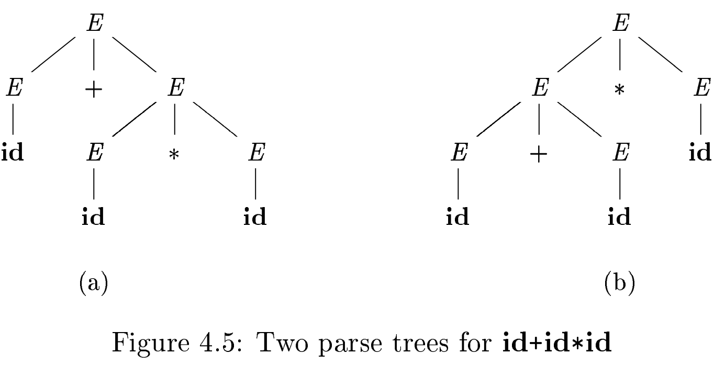

比如你现在可以定义出两个不同的语法树。这显然看着很扯。

我们就需要定义哪个树被保留，或者是更改语法来只保留一个树
### 4.2.7 Context-Free Grammar Versus Regular Expressions
*context-free grammar*是比RE更加强大的东西，RE能够表示的东西他都能表示

## 4.? RE to regular grammar
意义不明的插入知识

||RE|regular grammar|
|:--:|:--:|:--:|
|rule1|$A\rightarrow xy$|$A\rightarrow xB$, $B\rightarrow y$|
|rule2|$A\rightarrow x^*y$|$A\rightarrow xA$, $A\rightarrow y$|
|rule3|$A\rightarrow x\|y$|$A\rightarrow x$, $A\rightarrow y$|
反过来转换也是一样的
## 4.3 Writing a Grammar
### 4.3.? Non LL(1) grammar to LL(1) grammar
假设一个语法有==left factor==或者是==left recursion==，那么它绝对就不会是LL(1) grammar

所以要用
- **Left recursion removal**(4.3.3)
- **Left factoring**(4.3.4)

来去掉这俩玩意

> 需要注意的是，这俩方法并==不能保证==一定能转成功
### 4.3.3 Elimination of Left Recursion
- **left recursive**

    > a grammar is *left recursive* if it has a nonterminal $A$ such that there is a derivation $A\overset{+}{\rArr}A\alpha$ for some string $\alpha$

    还可以分的更细致一点：
    - **immediate left recursion**

        e.g.
        $$A\rightarrow A\beta$$
    - **indirect left recursion**

        e.g.
        $$A\rightarrow B\beta\\B\rightarrow A\alpha$$

Removal的做法是：
$$A\rightarrow A\alpha_1|A\alpha_2|...|A\alpha_m|\beta_1|\beta_2...|\beta_n\\
\rArr\\
A\rightarrow\beta_1A'|\beta_2A'|..|\beta_nA'\\
A'\rightarrow\alpha_1 A'|\alpha_2 A'|...|\alpha_m A'|\varepsilon
$$    
似乎就是把左递归变成了右递归？？？
### 4.3.4 Left Factoring
- **left factor**

    > two or more grammar rule choices sharing a ==common prefix string==

    e.g.
    $$A\rightarrow\alpha\beta|\alpha r$$

Removal的做法是:
$$
A\rightarrow\alpha\beta_1|\alpha\beta_2|...|\alpha\beta_n\\
\rArr\\
A\rightarrow\alpha A'\\
A'\rightarrow\beta_1|\beta_2|...|\beta_n
$$
## 4.4 Top-Down Parsing
starting from the root and creating the nodes in ==preorder(depth-first).==(从抽象到具体)

Top-down parsing can be viewed as finding a ==leftmost derivation== for an input string

从宏观一点的角度上来讲，我们可以把所有的parsing方法分成和两种：
- **Backtracking Parsing**

    比如一个left hand side有多种可能的转换规则，问题就是选哪个规则呢？backtracking的做法就是==全都试一遍==，每次试完一个分支就回溯回去，试下一个分支
- **Predictive Parsing**

    假如我们能够根据当前的输入唯一的确定用哪个规则，那么就是predictive。

    这要求语法必须是LL(1) grammar

这一节会介绍两种不同的predictive parsing方法
### 4.4.1 Recursive-Descent Parsing
伪代码如下：
```cpp
void A(){
    Choose an A-production, A->X1X2...Xk
    for (i = 1 to k){
        if (Xi is a nonterminal)
            call procedure Xi();
        else if (Xi equals the current input symbol a)
            advance the input to the next symbol;
        else /*an error has occurred*/
    }
```
需要注意的是，假如我们先对语法进行了Left factoring，可能会导致生成的parse tree变的更加的复杂

上面是最通用的方法，然而我们也有一些投机一点的方法：**EBNF**(Extended Backus-Naur Form)

先说明一下符号：
- `{}`

    表示==repetition==

    e.g.

    $$A\rightarrow A\alpha|\beta\\\rArr\\A\rightarrow\beta\{\alpha\}$$

    变成程序时，`{}`会被翻译成一个`while`语句
- `[]`

    ==surround options==

    e.g.

    if-stmt$\rightarrow$if(exp)stmt | if(exp)stmt else stmt

    被改写成：

    if-stmt$\rightarrow$if(exp) stmt [else stmt]

    变成程序时，`[]`会被翻译成一个`if`测试

最后来总结下*recursive-descent parsing*的优缺点：
- **优点**

    - versatile, powerful
    - flexible
    - suitable for hand-generated parsers
- **缺点**

    - care must be taken in scheduling the actions within the code
    - recursive calls result in ==slowness== and much more ==space==
### 4.4.2 First and Follow
- **First:**
    > Define $\text{FIRST}(\alpha)$, where $\alpha$ is any string of grammar symbols, to be the set of ==terminals== that begin strings derived from $\alpha$. if $\alpha\overset{*}{\rArr}\epsilon$, then $\epsilon$ is also in $\text{FIRST}(\alpha)$

    e.g.

    $A\overset{*}{\rArr}c\gamma$, 所以$c$就在$\text{FIRST}(A)$里面($c$比$A$==低一个==level)

    那这到底有啥用呢？

    比如我们现在知道$A\rightarrow \alpha|\beta$，且$\text{FIRST}(\alpha)\cap\text{FIRST}(\beta)=\emptyset$。那么我们就可以==唯一的确定==下一个输入走哪个分支了

    > 在考研的时候，还会出现一个$\text{SELECT}$的概念：e.g. $\text{SELECT}(S\rightarrow a)=\text{FIRST}(a)=a$。可以看出，就是什么时候会选择这个分支的意思
- **Follow:**
    > Define $\text{FOLLOW}(A)$, for ==nonterminal== $A$, to be the set of ==terminals== $a$ that can appear immediately to the right of $A$ in some sentential form. If $A$ can be the ==rightmost== symbol in some sentential form, then ==\$== is in $\text{FOLLOW}(A)$(\$ is a special endmarker symbol that is assumed not to be a symbol of any grammar)

    e.g.

    $S\rArr Aa$，所以$a$属于$\text{FOLLOW}(A)$（$a$和$A$在==同一个==level上）

    有一个非常恶心的例子：

    $$
    S\rightarrow a|\wedge|(T)\\
    T\rightarrow ST'
    $$
    问你$\text{FOLLOW}(T')$是啥

    答案是$\{)\}$，没有\$，因为$\text{FOLLOW}(T')=\text{FOLLOW}(T)$


### 4.4.3 LL(1) Grammars
==Predictive parsers==, that is, recursive-descent parsers needing no backtracking, can be constructed for a class of grammars called **LL(1)**. 
- **L**

    scanning the input from **l**eft to right
- **L**

    producing a **l**eftmost derivation
- **1**

    using **one** input symbol of lookahead at each step to make parsing action decisions.

要求如下：
> A grammar $G$ is **LL(1)** if and only if whenever $A\rightarrow\alpha|\beta$ are two distinct productions of $G$, the following conditions hold:
> - $\text{FIRST}(\alpha)\cap\text{FIRST}(\beta)=\emptyset$
> - At most one of $\alpha$ and $\beta$ can derive the empty string $\epsilon$
> - If $\epsilon$ is in $\text{FIRST}(\beta)$, then $\text{FIRST}(\alpha)\cap\text{FOLLOW}(A)=\emptyset$, and likewise if $\epsilon$ is in $\text{FIRST}(\alpha)$
>     - 这段话也等价于: If $\text{FIRST}(A)$ contains $\epsilon$, then $\text{FIRST}(A)\cap\text{FOLLOW}(A)=\emptyset$

鉴于以上的定义，我们鉴别LL(1) grammar的步骤包含了很多前戏：
- **Compute the set of nullable nonterminals**

    - **nullable**

        > a nonterminal $A$ is nullable if there exists a derivation $A\overset{*}{\rArr}\varepsilon$

        具体算法如下：

        Let $S$ be the set of nullable nonterminals:
        - Initially, $S=\{A_j|\text{satisfying }A_j\rightarrow\varepsilon\}$
        - For each production $p:A_p\rightarrow X_1...X_n$, if $X_1...X_n\in S$, then $S=S\cup\{A_p\}$
        - Repeat step 2 until there is no change to $S$

        e.g.

        $G[S]:\\
        S\rightarrow AB|bC\\
        A\rightarrow b|\varepsilon\\
        B\rightarrow aD|\varepsilon\\
        C\rightarrow AD|b\\
        D\rightarrow aS|c$

        那么*nullable nonterminals*就是$\{A,B,S\}$
- **Compute $\text{FIRST}(\alpha)$ for the right-hand side string $\alpha$ of each production**
    - **Algorithm for computing $\text{First}(A)$ for each ==grammar symbol== $A$($A\in V_T\cup V_N$)**

        - For all $a\in V_T$, do $$\text{FIRST}(a)=\{a\}$$
        - For all $A\in V_N$, if $A\overset{*}{\rArr}\varepsilon$, then $$\text{FIRST}(A)=\{\varepsilon\}$$
        - For each production $A\rightarrow X_1...X_n$, 
            $$\text{FIRST}(A)=\text{FIRST}(A)\cup\text{SectionFirst}(X_1...X_n)$$

            其中：
            - $\text{SectionFirst}(X_1...X_j...X_n)=(\text{FIRST}(X_1)-\{\varepsilon\})\cup(\text{FIRST}(X_2)-\{\varepsilon\})\cup...\cup(\text{FIRST}(X_j)-\{\varepsilon\})\cup\text{FIRST}(X_{j+1})$

                And $X_{j+1}$ is the first symbol that is ==not nullable== in the right-hand of production

                假设事情极端一点：
                - If $X_1$ is not nullable, then:$\text{SectionFirst}(X_1...X_n)=\text{FIRST}(X_1)$
                - If $X_1...X_n$ are all nullable, then $\text{SectionFirst}(X_1...X_n)=(\text{FIRST}(X_1)-\{\varepsilon\})...\cup\{\varepsilon\}$
        - Repeat step 3 until there is no change to any First set

        e.g.
        
        还是同一个语法:

        $G[S]:\\
        S\rightarrow AB|bC\\
        A\rightarrow b|\varepsilon\\
        B\rightarrow aD|\varepsilon\\
        C\rightarrow AD|b\\
        D\rightarrow aS|c$

        最终结果是:
        ||$\text{FIRST}()$|
        |---|---|
        |$S$|$\varepsilon\ b\ a$
        |$A$|$\varepsilon\ b$
        |$B$|$\varepsilon\ a$
        |$C$|$b\ a\ c$
        |$D$|$a\ c$
        |$a$|$a$
        |$b$|$b$

    - **Algorithm for computing $\text{First}(\alpha)$ for a ==string== $\alpha$**

        和计算$\text{SectionFirst}(\alpha)$的方法一模一样

        e.g.

        还是同样的例子：

        $G[S]:\\
        S\rightarrow AB|bC\\
        A\rightarrow b|\varepsilon\\
        B\rightarrow aD|\varepsilon\\
        C\rightarrow AD|b\\
        D\rightarrow aS|c$

        最终结果是:
        ||$\text{SectionFirst}()$|
        |---|---|
        |$AB$|$(\text{FIRST}(A)-\{\varepsilon\})\cup (\text{FIRST}(B)-\{\varepsilon\})\cup\{\epsilon\}=\{\varepsilon\ b\ a\}$
        |$bC$|$b$
        |$\varepsilon$|$\varepsilon$
        |$b$|$b$
        |$AD$|$(\text{FIRST}(A)-\{\varepsilon\})\cup \text{FIRST}(D)=\{b,a,c\}$
        |$aS$|$a$
- **Compute $\text{FOLLOW}(A)$ for each nonterminal $A$**

    - If $S$ is the start symbol, $$\text{FOLLOW}(S)=\{\$\}$$ If $A\in V_N$ and $A\neq S$, $$\text{FOLLOW}(A)=\{\}$$

        ==很重要！别忘了start symbol的follow set有$!!!==
    - For each production $B\rightarrow \alpha Ay$, for each $A$ that is a nonterminal, do:$$\text{FOLLOW}(A)=\text{FOLLOW}(A)\cup(\text{FIRST}(y)-\{\varepsilon\})$$

        if $\varepsilon\in \text{FIRST}(y)$, then add $\text{FOLLOW}(B)$ to $\text{FOLLOW}(A)$

    e.g.

    还是同一个例子:

    $G[S]:\\
        S\rightarrow AB|bC\\
        A\rightarrow b|\varepsilon\\
        B\rightarrow aD|\varepsilon\\
        C\rightarrow AD|b\\
        D\rightarrow aS|c$

    最终结果是:
    ||$\text{FOLLOW}()$|
    |---|---|
    |$S$|$\$$
    |$A$|$a\ \$\ c$
    |$B$|$\$$
    |$C$|$\$$
    |$D$|$\$$
- **Recognize basing on the definition of LL(1)**

识别完之后，我们就要开始搞**LL(1) parsing table**了:

$M[A, a]$ is a production choice of nonterminal $A$ to use, based on the current input token $a$

构建的几步：
- For each terminal $a$ in $\text{FIRST}(\alpha)$, add $A\rightarrow \alpha$ to $M[A,a]$
- if $\varepsilon$ is in $\text{FIRST}(\alpha)$, then for each terminal $b$ in $\text{FOLLOW}(A)$, add $A\rightarrow \varepsilon$ to $M[A,b]$.(当$b=\$$也一样)
- 假如上述构建完之后，存在$M[A,a]$为空的情况，那就把那格设为error

e.g.

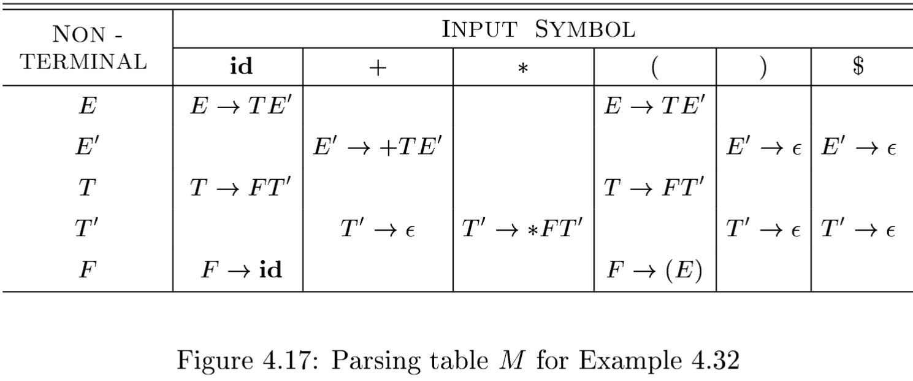


### 4.4.4 Nonrecursive Predictive Parsing (LL(1) Parsing)
it can be built by maintaining a ==stack== explicitly, rather than implicitly via recursive calls. It mimics a ==leftmost derivation==

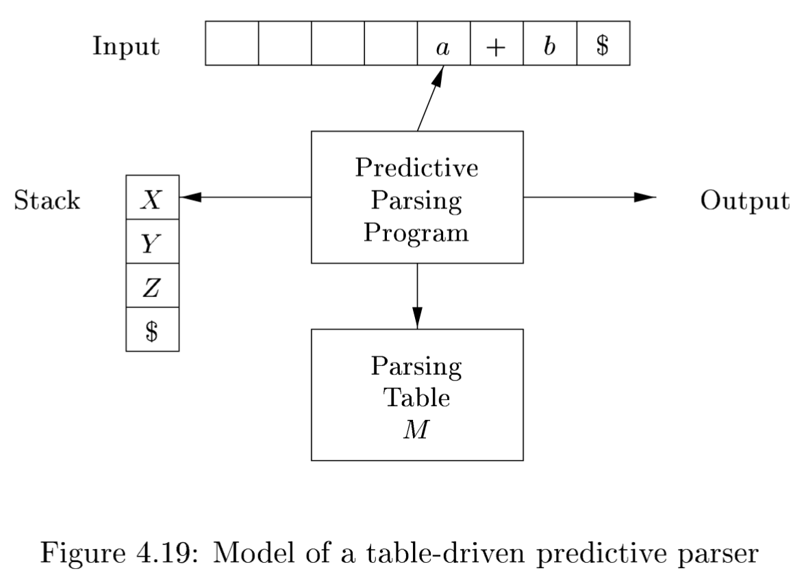

如图，这东西有stack, input buffer, parsing table, output stream

e.g.

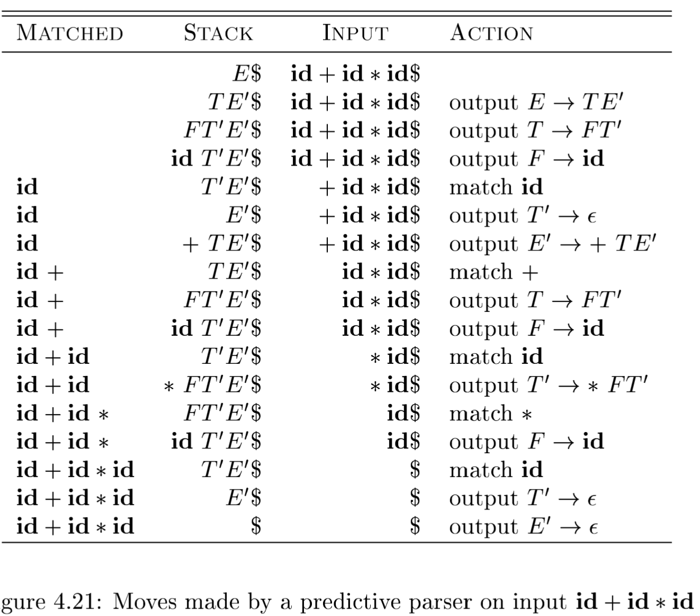

需要注意的是，由于我们的栈顶在==左边==，所以压入栈的东西都是正序；假设题目中的栈是顶部在右，那么就要反序入栈了
## 4.5 Bottom-Up Parsing
和top-down相反，这是==从具体到抽象==:

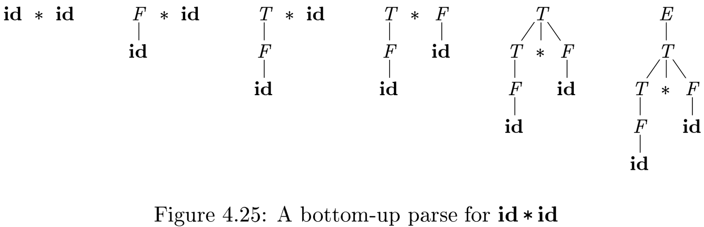

### 4.5.1 Reductions
就是*derivation*的==逆过程==

难点在于怎么确定哪一部分substring要被替换掉


### 4.5.2 Handle Pruning
非正式定义：
> a **handle** is a substring that matches the ==body== of a production

不如直接来看例子：

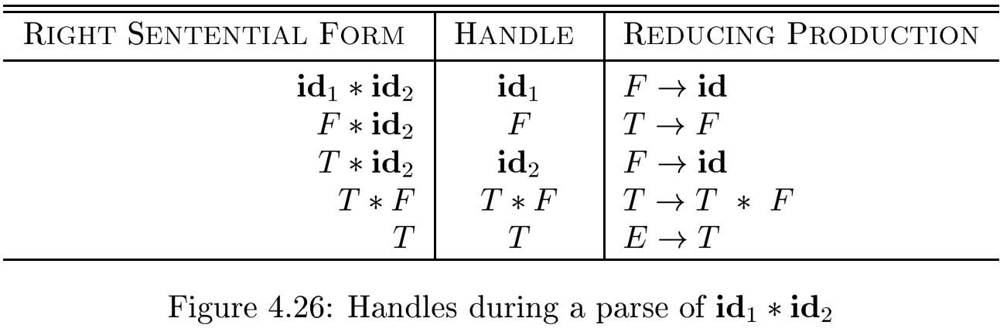

### 4.5.3 Shift-Reduce Parsing
bottom-up parsing的其中一种实现形式。

需要俩东西来辅助：
- **stack**

    holds ==grammar symbols==

    stack的底部会放一个\$

    在bottom-up parsing里面，我们习惯让stack的顶部在右边，和top-down反过来
- **input buffer**

    holds the ==rest of the string to be parsed==

    buffer的最右边会放一个\$

具体过程是：
- **Shift**

    During a left-to-right scan of the input string, the parser ==shifts== zero or more input symbols onto the stack, until it is ready to ==reduce== a string $\beta$ of grammar symbols on top of the stack.
- **Reduce**

    It then reduces $\beta$ to the head of the appropriate production
- The parser repeats this cycle until:
    - **Error**

        an ==error== has been detected
    - **Accept**

        the stack contains the ==start symbol== and the input is ==empty==

e.g.

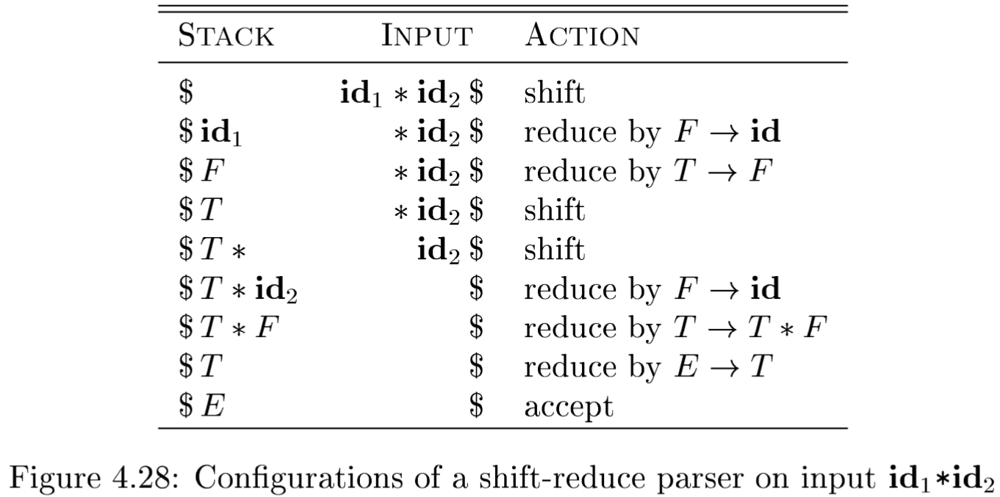

可以看出来，我们非常自信的地认为，handle必定会出现在stack的顶部。证明懒得看

补充个没用的概念：
- **viable prefix**

    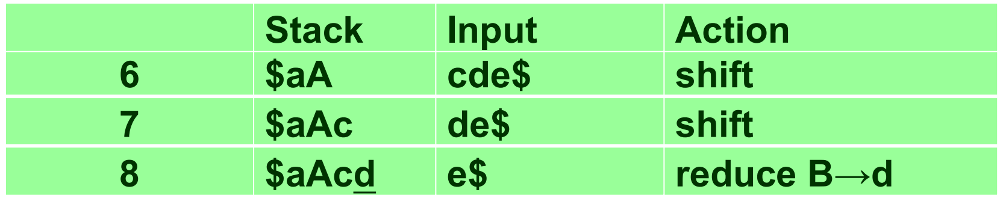

    aA, aAc, aAcd都是aAcde的*viable prefix*

## 4.6 Introduction to LR Parsing: Simple LR
最普遍的bottom-up parser的实现形式是$\text{LR}(k)$ parsing:
- **L**

    left-to-right scanning of the input
- **R**

    constructing a rightmost derivation in reverse
- **k**

    the number of input symbols of lookahead that are used in making parsing decisions

    一般来说最常用的是0 / 1
### 4.6.2 Items and the LR(0) Automation
既然$k=0$，也就表明了这种parser压根不管输入是啥

一个shift-reduce parser咋知道啥时候要shift而啥时候要reduce呢？这就需要parser在stack里维护一堆==states==。

States represent sets of "**items**":
> An **LR(0) item** (*item* for short) of a grammar $G$ is a production of $G$ with a ==dot== at some position of the body

e.g.

production $A\rightarrow XYZ$ 对应了以下四种items:
$$
\begin{align}
    A&\rightarrow \cdot XYZ\\
    A&\rightarrow X\cdot YZ\\
    A&\rightarrow XY\cdot Z\\
    A&\rightarrow XYZ\cdot
\end{align}
$$
其中(1)是**initial item** of recognizing $XYZ$，(4)是**complete item** of recognizing $XYZ$。还有个奇怪的概念叫做**shift item**，大概就是读取下一个字符之后会进入下一个state(initial item 可能是shift item)

> 特别地，$A\rightarrow\varepsilon$==只对应一个==item$A\rightarrow\cdot$

直觉上理解的话，其实dot就是一个==parse进行到了哪里==的标记符，dot前面的元素必定在stack的顶部，而dot后面的元素就是parser期待的下一个输入

One collection of sets of LR(0) items, called the **canonical** LR(0) collection, provides the basis for constructing a ==DFA==(called **LR(0) automaton**) that is used to make parsing decisions

In particular, each state of the LR(0) automaton represents a set of items in the canonical LR(0) collection

为了构建canonical LR(0) collection，我们先要定义一下**augmented grammar**:
> If $G$ is a grammar with start symbol $S$, then $G'$, the *augmented grammar* for $G$, is $G$ with a new start symbol $S'$ and production $S'\rightarrow S$

至于为啥需要一个新的start symbol，是想表明当需要进行$S'\rightarrow S$这一步reduce的时候，我们就应该要accept了

#### 4.6.2.1 Closure of Item Sets
定义$\text{CLOSURE}(I)$如下：
- Initially, $$\text{CLOSURE}(I)=I$$
- If $A\rightarrow \alpha\cdot B\beta$ is in $\text{CLOSURE}(I)$ and $B\rightarrow\gamma$ is a production, then add the item $$B\rightarrow \cdot\gamma$$ to $\text{CLOSURE}(I)$, if it is not already there.

    Apply this rule until no more new items can be added to $\text{CLOSURE}(I)$

e.g.

*augmented grammar*如下：
$$
\begin{aligned}
    E'&\rightarrow E\\
    E&\rightarrow E+T|T\\
    T&\rightarrow T*F|F\\
    F&\rightarrow (E)|id
\end{aligned}
$$
假设 $I$ 是$$\{[E'\rightarrow\cdot E]\}$$那么$\text{CLOSURE}(I)$就是:
$$
\begin{aligned}
    E'&\rightarrow\cdot E\\
    E&\rightarrow\cdot E+T\\
    E&\rightarrow \cdot T\\
    T&\rightarrow \cdot T*F\\
    T&\rightarrow \cdot F\\
    F&\rightarrow \cdot (E)\\
    F&\rightarrow \cdot id
\end{aligned}
$$

了解了closure之后，我们又要来给所有item分个类：
- **Kernel items**

    the initial item $S'\rightarrow \cdot S$, and all items whose dots are ==not at the left end==
- **Nonkernel items**

    all items with their dots at the ==left end==, except for $S'\rightarrow \cdot S$

这样分类有啥用呢？实际上，我们==只需要存储==*kernel items*，因为*nonkernel items*都可以通过对*kernel items*取closure得到
#### 4.6.2.2 The Function $\text{GOTO}$
直观上来说，这是用作==状态转移==的

严谨定义：
> $\text{GOTO}(I,X)$ is defined to be the closure of the set of all items $[A\rightarrow \alpha X\cdot\beta]$ such that $[A\rightarrow\alpha\cdot X\beta]$ is in $I$

反正4.6.2.1中的语法最终构建出来的自动机长这样：

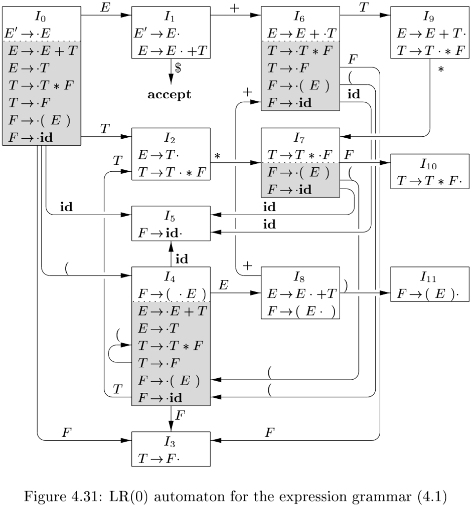

其中白色代表*kernel items*，灰色代表*nonkernel items*
#### 4.6.2.3 Use of the LR(0) Automaton
其实和使用parsing table一个道理，只不过是个图片而已

e.g.

一个parse过程：

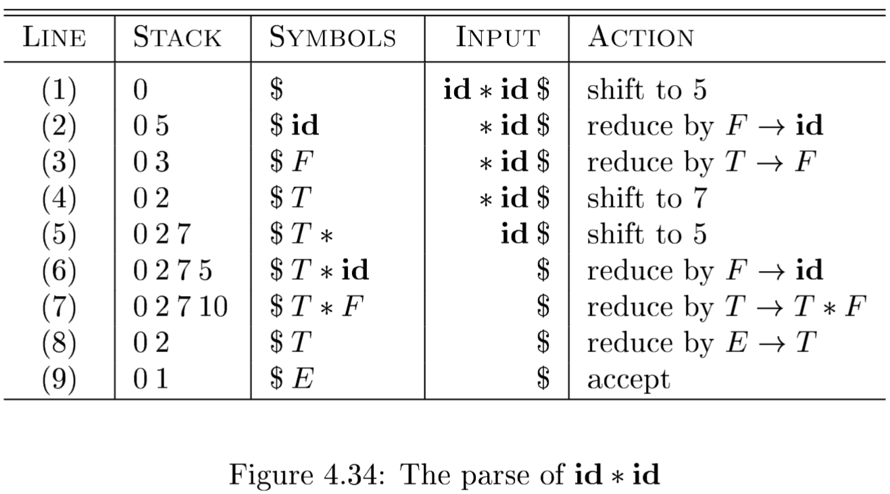

- 状态0对应于$I_0$的方块。
- 当输入的字符==存在==$\text{GOTO}$的出边的时候，我们就==shift==一下
- 当输入字符==不存在==$\text{GOTO}$的出边的时候，我们就==reduce==，利用当前状态里的item来归约handle

### 4.6.3 The LR-Parsing Algorithm
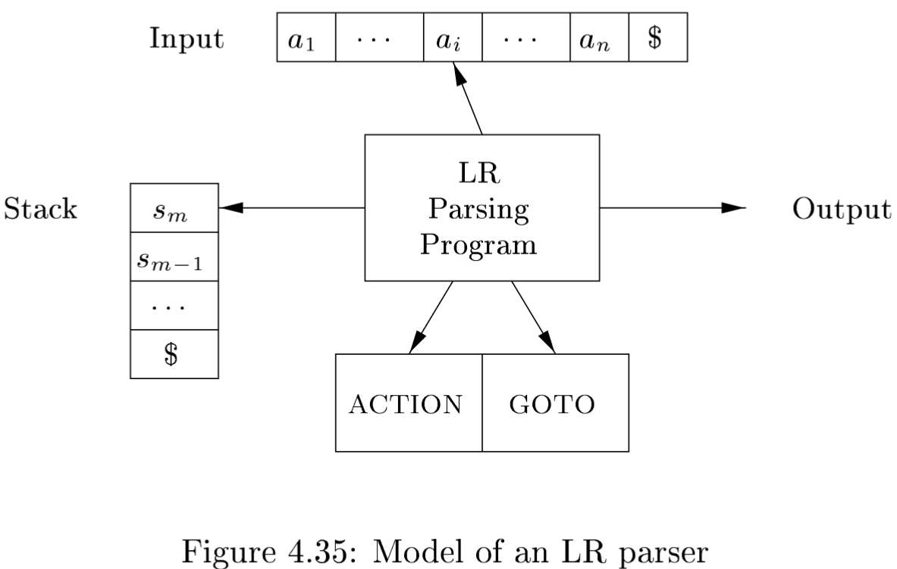

比较特别的是，stack里面装的是a sequence of ==states==。bottom-up parsing相比于top-down增加了记录states的需求

#### 4.6.3.1 Structure of the LR Parsing Table
包括两部分：
- **Parsing-action function $\text{ACTION}[i, a]$**
    - **Shift** $j$

        where $j$ is a state. It shifts input $a$ to the stack, but uses state $j$ to represent $a$
    - **Reduce $A\rightarrow\beta$**

        reduces $\beta$ on the top of the stack to head $A$
    - **Accept**

        accepts the input and finishes parsing

    - **Error**

        discovers an error in its input and takes some corrective action.

- $\text{GOTO}$

    we extend the $\text{GOTO}$ function, defined on sets of ==items==, to ==states==: if $\text{GOTO}[I_i,A]=I_j$, then $\text{GOTO}$ also maps a state $i$ and a nonterminal $A$ to state $j$

e.g.

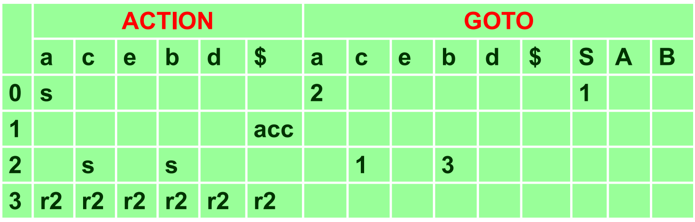

为了节省空间，我们会把表格简化一下：

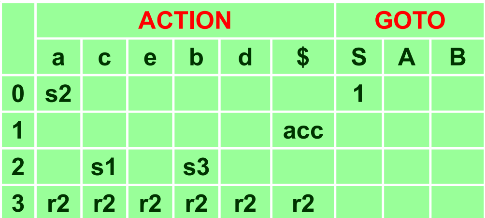

表格中的标记的意思：
- $si$ means ==shift and stack state $i$==
- $rj$ means ==reduce== by the production numbered $j$
- $acc$ means ==accept==
- blank means ==error==
- 第一列的数字代表不同的state

我们暂时不讲这个table是怎么样生成的

e.g.

$$
\begin{aligned}
    (1)&E\rightarrow E+T\\
    (2)&E\rightarrow T\\
    (3)&T\rightarrow T*F\\
    (4)&T\rightarrow F\\
    (5)&F\rightarrow (E)\\
    (6)&F\rightarrow id
\end{aligned}
$$
这语法对应的parsing table就是：

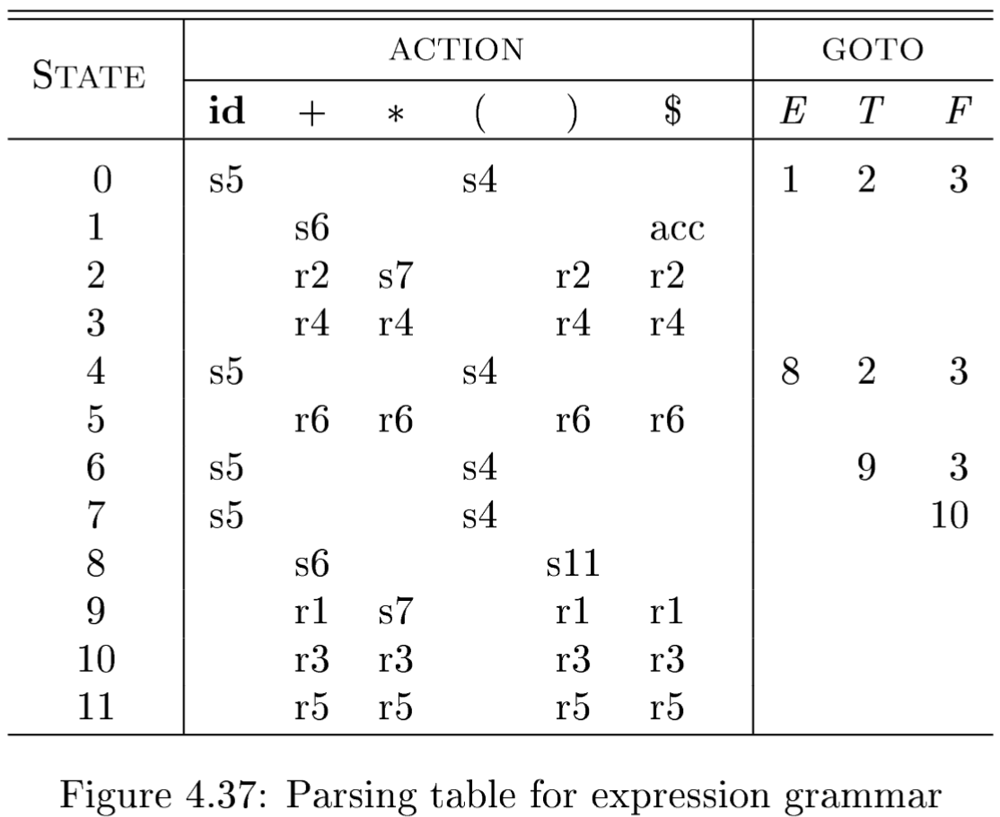

假设输入是$id*id+id$，每一步的情况如下：

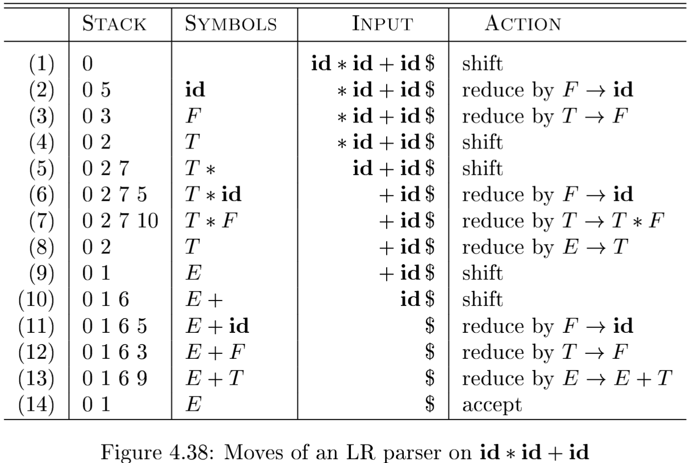

来解释一下每一步究竟在干什么：
- 每一步，我们要做的第一件事，就是看一下stack顶部的state，和input的最左字符，组合起来到底对应了parsing table的哪一格的action(e.g. 第一步中，0和$id$对应了$s5$的action)
    - 假如action是$sj$，那就先把input的最左字符==shift==入栈，再把$j$压入栈。此时我们身处的状态就变成了状态$j$(e.g. $s5$就是5入栈)
    - 假如action是$rj$，就先弹出handle，并测量一下==handle的长度==(即将被替换掉的字符的长度)，然后从栈里面pop出同长度数量的state，然后将handle对应的left hand side给入栈，最后用当前栈顶部的状态和字符，检查是否有$\text{GOTO}$操作，有的话就把$\text{GOTO}$的结果状态也入栈

        e.g. 第二步中，5和$*$对应了$r6$的action，于是弹出$i$并测量一下$i$的长度为1，于是弹出一个state，即弹出state 5。接着将$F$入栈，并查看0和$F$对应了$\text{GOTO}$的结果为state 3，于是将3压入栈

    - 假如此时stack中的字符只剩start symbol $E$，且input也已经没有了，那么就accept

### 4.6.4 Constructing SLR-Parsing Tables
**S**imple **LR**

实际上我们这里要介绍的是如何构建**SLR(1)**。顾名思义，这家伙会根据1位输入来决定下一个状态，来解决一些奇怪的conflict。只有LR(0)不存在以下两种conflict:
- **Shift-Reduce Conflict**

    到底应该shift还是应该reduce

    e.g.

    $$
    S\rightarrow rD\cdot\\
    D\rightarrow D\cdot,i
    $$
    遇到这种情况你就不知到应该用第一个来reduce还是第二个来shift了
    > ==$S\rightarrow S'\cdot$是非常特殊的==，只有吃到\$才会acc，所以不会导致shift-reduce conflict
- **Reduce-Reduce Conflict**

    到底应该利用哪个规则来reduce

其它语法从语法定义上没法解决这种conflict，而是通过lookahead一些输入字符来决定使用哪个规则

而对于SLR(1)来说，我们需要使用$$\text{FOLLOW}(A)$$来辅助决定使用的规则($A$是nonterminal)(为啥我感觉这家伙解决不了reduce-reduce conflict)

我们通过以下步骤来构建**SLR(1) Parsing Table**:
- Construct $C=\{I_0,I_1,...I_n\}$, the collection of sets of LR(0) items for augmented grammar $G'$
- State $i$ is constructed from $I_i$. The parsing action for state $i$ are determined as follows:
    - If $[A\rightarrow \alpha\cdot a\beta]$ is in $I_i$ and $\text{GOTO}(I_i,a)=I_j$, then set $\text{ACTION}[i,a]$ to "shift $j$." Here $a$ must be a terminal
    - If $[A\rightarrow \alpha\cdot]$ is in $I_i$, then set $\text{ACTION}[i,a]$ to "reduce $A\rightarrow \alpha$" for all $a$ in $\text{FOLLOW}(A)$; here $A$ may not be $S'$
    - If $[S'\rightarrow S\cdot]$ is in $I_i$, then set $\text{ACTION}[i,\$]$ to "accept"

    > 需要注意的是，$\text{FOLLOW}(\alpha)$和$a$==不能有交集==，不然的话SLR(1)就傻了
    > 
    > 在面对shift-reduce conflict的时候，假设==lookahead在follow set里面==，我们就==reduce==，否则shift
- The goto transitions for state $i$ are constructed for all nonterminals $A$ using the rule: If $\text{GOTO}(I_i,A)=I_j$, then $\text{GOTO}[i,A]=j$
- All entries not defined by rules (2) and (3) are made "error"
- The initial state of the parser is the one constructed from the set of items containing $[S'\rightarrow S]$

核心步骤在第二点的三个小点里

> SLR(1)相比于LR(0)来说，就是在原来的状态机的基础上添加条件：==lookahead到$A$的Follow set的字符才会进行reduce操作==，而不是无条件的reduce

### 4.6.5 Viable Prefixes
见前面的笔记

## 4.7 More Powerful LR Parsers
我们终于要学习普遍意义上的LR parser了，会更加强大

有了两种不同的方法：
- **Canonical-LR**

    就是general的**LR** method
- **LALR**

    lookahead-LR

### 4.7.1 Canonical LR(1) Items
主要的idea如下：

对于具有不同viable prefix的右边包含$A$的production:
$$
...\alpha A\cdot a...\\
...\beta A\cdot b...\\
...\gamma A\cdot c...
$$
虽然当前的字符都是$A$，但是根据不同的输入字符，我们可以选择viable prefix不同的production

说了半天似乎和SLR(1)没什么不同，他俩的区别在于：SLR(1)的lookahead并不是出现在item里面的，而是利用LR(0)的item，在这个的基础上进行；而LR(1)的lookahead则会==重新构建==item，如下：

### 4.7.2 Constructing LR(1) Sets of Items
LR(1) item的构造如下：
$$
[A\rightarrow \alpha \cdot \beta, a]
$$
可以看到$A\rightarrow \alpha \cdot \beta$就是个LR(0) item，而$a$则是lookahead token

至于怎么构建$\text{CLOSURE}(I)$和$\text{GOTO}(I,X)$:

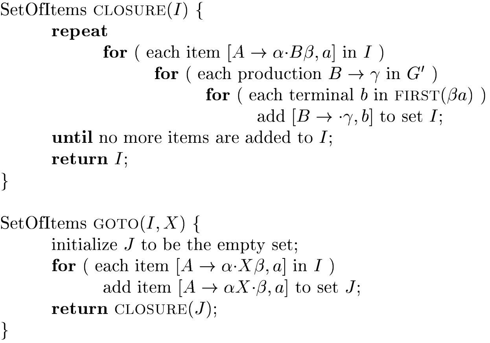

需要注意的是\$是比较特殊的情况，$S'\rightarrow \cdot S,\ \$$是可以的，只有这家伙的lookahead是自己决定的，其他人的都是上一级决定，毕竟只有上一级能知道未来会看到什么

e.g.

对于语法：
$$
S'\rightarrow S\\
S\rightarrow CC\\
C\rightarrow cC\ |\ d
$$
构建出来的DFA长这样：

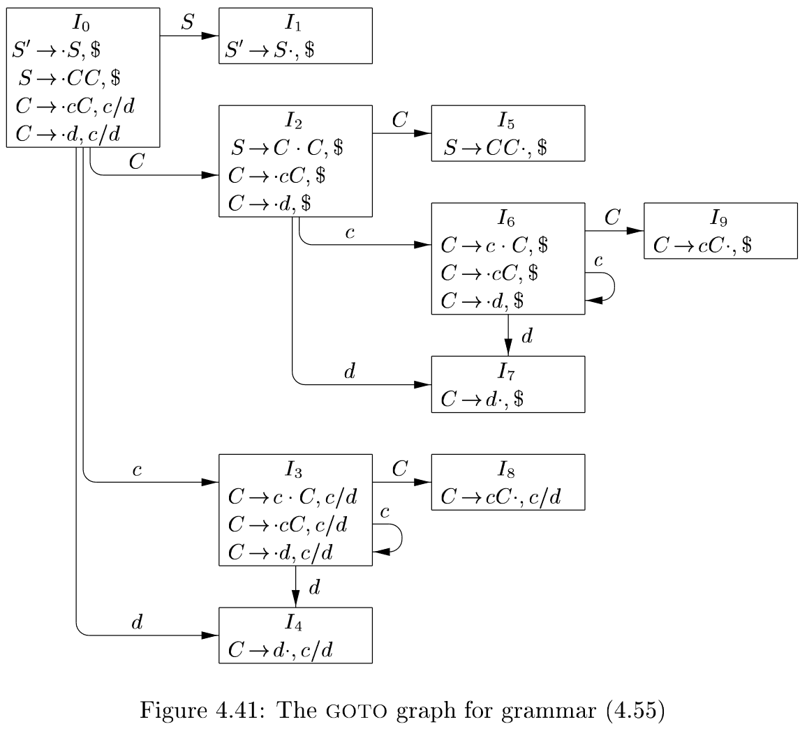

不可否认这家伙非常强大，但是有时候过于复杂，以至于我们懒得用

### 4.7.4 Constructing LALR Parsing Tables
修改了下LR(1)，使得比LR(1)更加简单，但是性质还算是比较优良

怎么偷懒呢？对于LR(1)来说，我们总有一些LR(1) items，其中包含的==LR(0) items是相同的==，只有lookahead token不同。这就启发我们，把这些项合并一下：

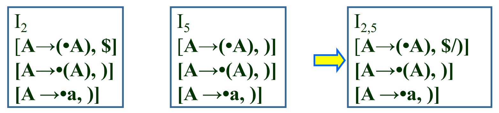

也就是说，LALR相比于LR(1)来说多了一步的操作是==状态的合并==，和LR(1)中可以把一个状态里的lookahead合简写并一下是有区别的

这种合并是可能出现冲突的。假设两个要合并的states，他们==没有完全一致的transition==，就会出现conflict。也就是说，只要一个存在某种transition，那么另一个也必须要有


