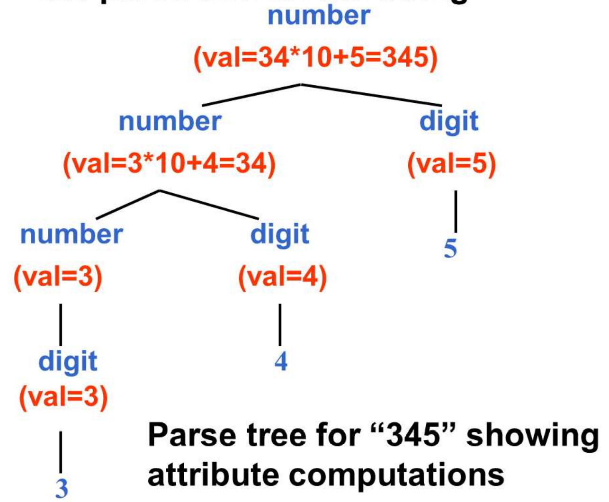
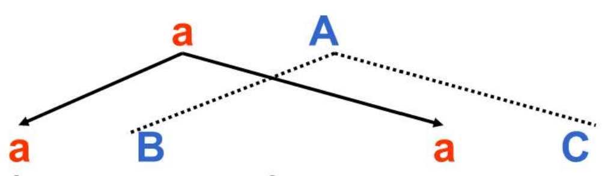
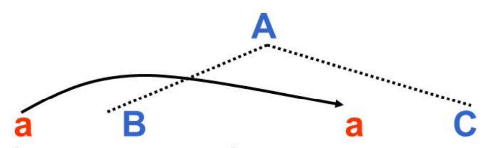
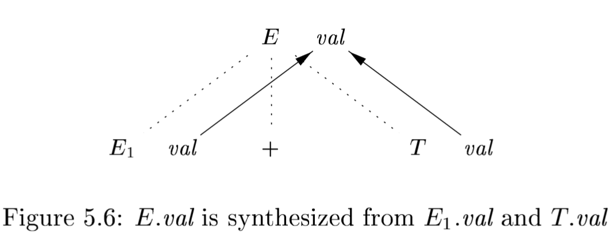
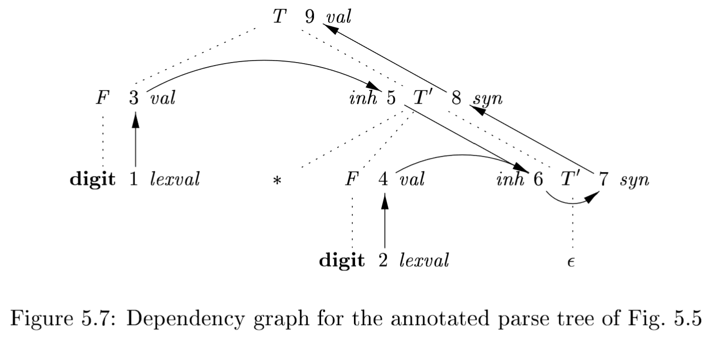
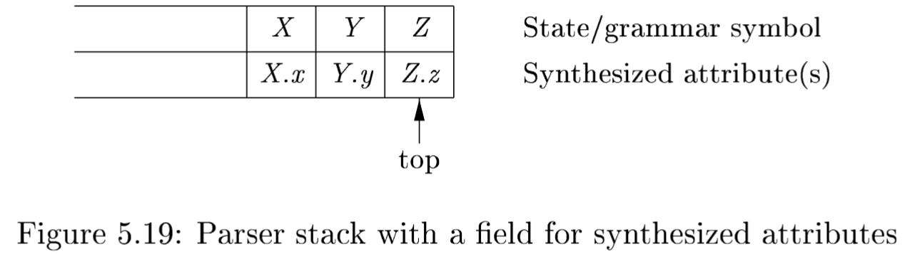
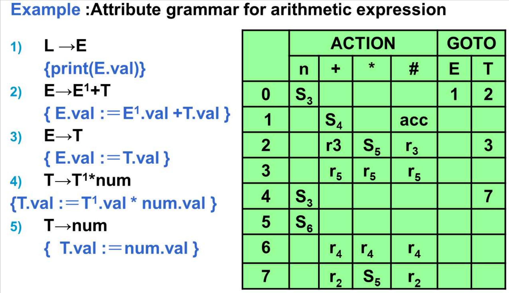
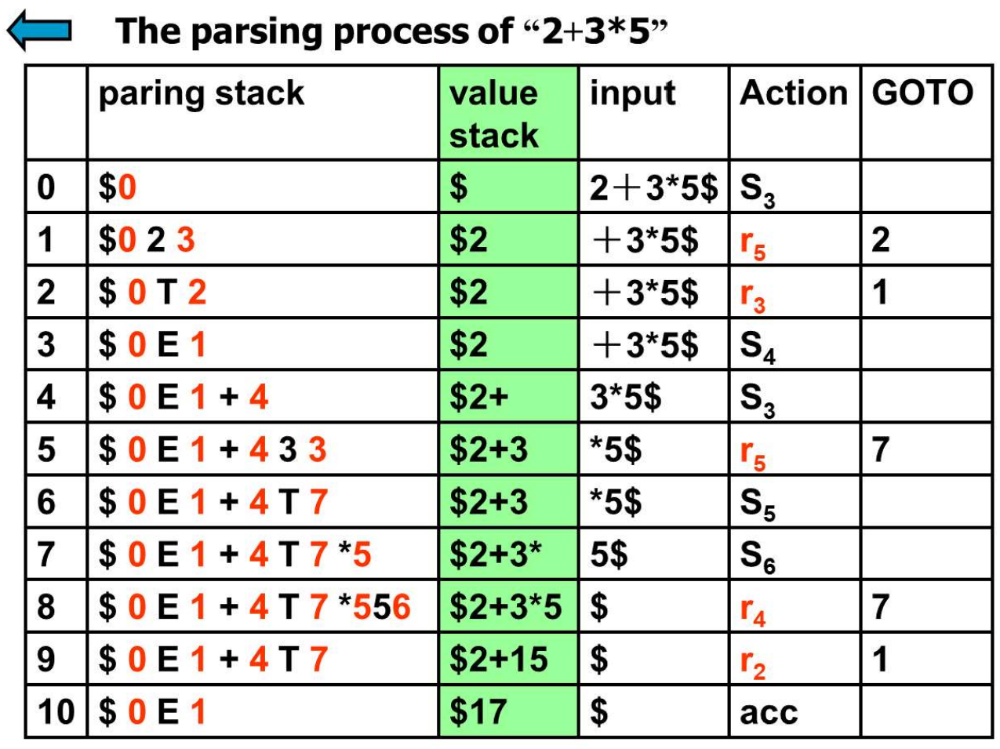

## 5.0 前情概要

理论上来说，我们这章要学习semantic analysis语义分析

语义分析包含两大类:

- **static semantic**

  compiler需要管的就只有静态语义分析
- **dynamic semantic**

  动态语法分析只有真的跑起来了才能决定

实现静态语义分析有很多种方式，这章介绍的是利用**attribute grammar**实现的**syntax-directed semantic analysis**

关于*attribute*的一些事情详见[2.3.2](ch2-a-simple-syntax-directed-translator.md)

至于*attribute equation*(semantic rule) 的例子：


| grammar rule         | semantic rule                           |
| ---------------------- | ----------------------------------------- |
| $E\rightarrow E_1+T$ | $E.code=E_1.code\ \| \ T.code\ \|\ '+'$ |

显然是描述每一个production对应的semantic rule

e.g.



我们还可以把==代码==附加到production上：
$$
E\rightarrow E_1+T\ \ \ \ \{\text{print}\ '+'\}
$$
可以看到我们用==花括号==括起来了代码

代码做的事情有两类：
- 构建语法树(AST)

    这是比较阳间的做法，不需要操心计算的事情，构建完之后再利用树来计算
- 直接计算表达式的结果(不建树)

    就是SDT

    正常来说都不会这么干
## 5.1 Syntax-Directed Definitions
简称为**SDD**:
> **SDD** is a ==context-free grammar== together with attributes and rules

### 5.1.1 Inherited and Synthesized Attributes
- **synthesized attribute**

    > A **synthesized attribute** at node $N$ is defined only in terms of attribute values at the ==children== of $N$ and at ==$N$ itself==

    注意parent和children是由grammar rule来定义的，dependency是由semantic rule来定义的

    e.g.

    |grammar rule|semantic rule
    |---|---|
    $\text{number}\rightarrow \text{digit}$|$\text{number}.val=\text{digit}.val$

    可以看到number是digit的爸爸，而semantic rule里面val是由val自己定义的。所以$val$是*synthesized attribute*

- **inherited attribute**

    > An **inherited attribute** at node $N$ is defined only in terms of attribute values at ==$N$'s parent, $N$ itself, and $N$'s siblings==

    说白了其实只要不是synthesized，就会是inherited

    也就是说有两种情况：
    - from parent to children:

        

    - from sibling to sibling:

        


## 5.2 Evaluation Orders for SDD's
### 5.2.1 Dependency Graphs
定义如下：
- each grammar rule as an associated dependency graph
- each attribute $X_i.a_j$ of each symbol corresponds to a node
- For each attribute equation:

    $$
    X_i.a_j = f_{ij}(...,X_m.a_k,...)
    $$
    there's an edge from each node $X_m.a_k$ in the right-hand side to the node $X_i.a_j$

    说人话就是表明左边的$X_i.a_j$依赖于右边的$X_m,a_k$等
  
最简单的例子：
| grammar rule         | semantic rule                           |
| ---------------------- | ----------------------------------------- |
| $E\rightarrow E_1+T$ | $E.val=E_1.val+T.val$

这玩意对应的节点的dependency graph是：



一般来说，我们用==虚线==表示parse tree，用==实线==表示dependency graph

一个更加复杂的例子：
| grammar rule         | semantic rule                           |
| ---------------------- | ----------------------------------------- |
| $T\rightarrow FT'$ | $T'.inh=F.val\\T.val=T'.syn$
|$T'\rightarrow *FT_1'$|$T_1'.inh=T'.inh\times F.val\\T'.syn=T_1'.syn$
|$T'\rightarrow \epsilon$|$T'.syn=T'.inh$
|$F\rightarrow \text{digit}$|$F.val=\text{digit}.lexval$



dependency graph看着就有点离谱，仔细看是对的

### 5.2.2 Ordering the Evaluation of Attributes
dependency graph展现了attribute之间的依赖关系，被依赖的attribute必须要先被evaluate。也就是说，这是一种*topological sort*的关系

然而假设这种依赖关系形成了==闭环==，那么就不存在拓扑排序了，也就没有办法evaluate the SDD on the parse tree

### 5.2.3 S-Attributed Definitions
> An SDD is **S-attributed** if ==every== attribute is ==synthesized==

拥有这样的性质的话，我们可以用：
- bottom-up order
- postorder

    访问所有子节点后访问该节点

来很轻松地遍历parse tree

其实postorder traversal的顺序和bottom-up parsing的顺序是完全一致的

不难想象inherited attributes可以用preorder或者inorder来遍历

### 5.2.4 L-Attributed Definitions
> dependency graph edges can go from ==left to right==, but not from right to left

为啥要这么干呢？主要是为了能够parse一部分包含inherited attribute的parse tree。因为我们一般从左到右parse，而inherited attribute之间的依赖关系可能是从右向左的，即被依赖的attribute没有先被parse，那就没法完成parse了

至于synthesized attribute，它的children的遍历按什么顺序都可以，就可以不管

细心想想你会发现S-attributed 是 L-attributed 的一种特例
## 5.3 Applications of Syntax-Directed Translation
这一节主要展示如何利用SDD来构建abstract syntax tree(也缩写成syntax tree / AST)


## 5.4 Syntax-Directed Translation Schemes
### 5.4.2 Parser-Stack Implementation of Postfix SDT's
Postfix SDT's can be implemented during LR parsing by executing the actions when ==reductions== occur



这个value stack就是用来辅助记录每个attribute的值的

e.g.





可以看到就是同步计算value stack里面的值，可以减少内存占用

## 5.5 Implementing L-Attribute SDD's
### 5.5.1 Translation During Recursive-Descent Parsing
[4.4.1](ch4-syntax-analysis.md)介绍的recursive-descent parser 对于每一个nonterminal $A$，都有一个对应的function $A$。我们可以改造一下这个parser让它变成translator:
- the ==arguments== of function $A$ are the ==inherited attributes== of nonterminal $A$
- the ==return-value== of function $A$ is the collection of ==synthesized attributes== of nonterminal $A$

理论上我们需要一边parse一边计算attribute。function $A$的body需要做如下事情:
- Decide upon the production used to expand $A$
- Check that each terminal appears on the input when it is required.
- Preserve, in local variables, the values of all attributes needed to compute inherited attributes for nonterminals in the body or synthesized attributes for the head nonterminal
- Call functions corresponding to nonterminals in the body of the selected production, providing them with the proper arguments

### 5.5.4 Bottom-Up Parsing of L-Attributed SDD's
我们可以通过一些小技巧，来处理好==inherited attributes==的计算问题

一个语法定义如下：
$$
T\rightarrow F\{T'.in=F.val\}T'\{T.val=T'.sy\}\\
T'\rightarrow *F\{T_1'.in=T'.in*F.val\}T_1'\{T'.sy=T_1'.sy\}\\
T'\rightarrow \varepsilon\{T'.sy=T'.in\}\\
F\rightarrow digit\{F.val=digit.lexval\}
$$
其中有很多$.in$和$.sy$，代表inherited和synthesis，实际上这里想要传递的意思是，把$T'$这个nonterminal看成是一个函数：
```cpp
T'.sy T'(token, T'.in){
    ...
}
```
以inherited attribute为输入，以synthesis attribute为输出。比如在这个文法里，规则1和规则2实际上是消除了左递归的：
$$
T\rightarrow T*\ |\ F
$$
就是连乘。不难看出来两个operand应该是位于规则1里的$F$和位于规则2里的$F$，也就是说，规则2其实是一个==残缺==的表达式，需要一个左边的operand才能构成一个完整的表达式。这就好比函数需要一个参数以返回值

回到正题，想要LR能够处理这个文法的话，其实需要改成：
$$
T\rightarrow FMT'\{T.val=T'.sy\}\\
M\rightarrow \varepsilon\{M.in=F.val;M.sy=M.in\}\\
T'\rightarrow *FNT_1'\{T'.sy=T_1'.sy\}\\
N\rightarrow \varepsilon\{N.in_1=T'.in;N.in_2=F.val;N.s=N.in_1*N.in_2\}\\
T'\rightarrow \varepsilon\{T'sy=T'.in\}\\
F\rightarrow digit\{F.val=digit.lexval\}
$$
添加了==两个$\varepsilon$-transition==，也就是这一节处理inherited attribute的技巧，因为$T'$实际上就是包含inherited attribute的。

一般来说，LR parser==只会在reduce的时候执行代码，而新加的两个规则就是为了让中置的代码强行放到末尾==

作为对比，LL(1)的top-down parsing就不需要搞这种操作

