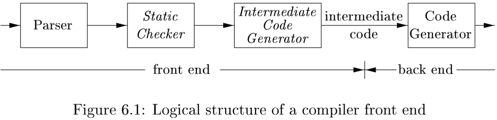
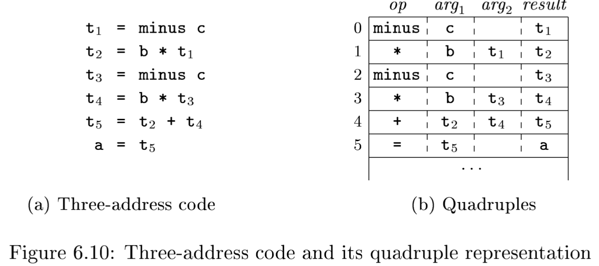
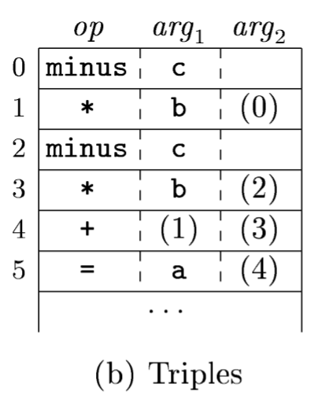
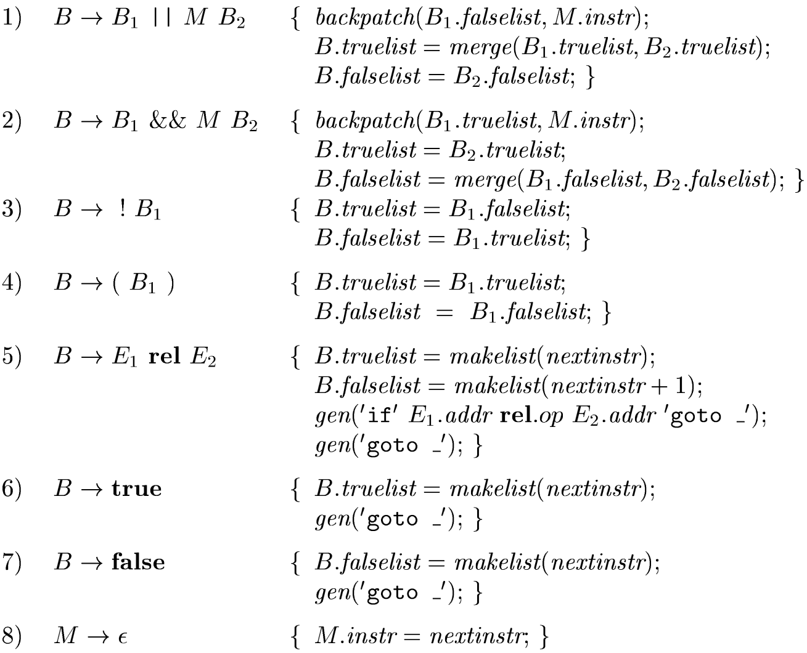
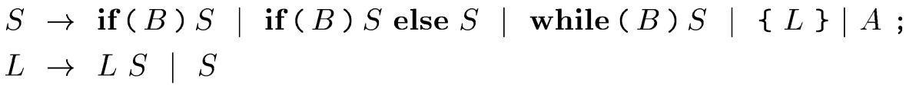
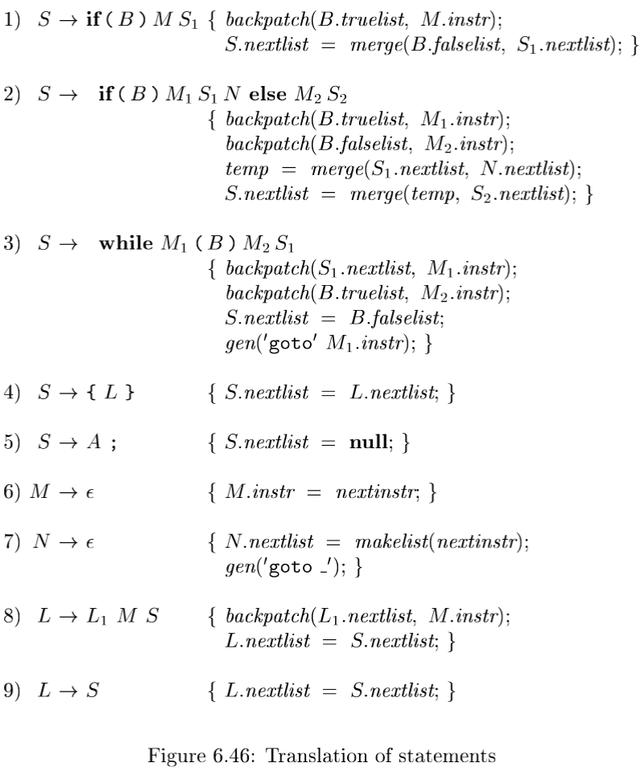

## 6.0 前言


intermediate code可以帮助实现前后端分离，且很多优化操作会比较容易在intermediate code上实现

intermediate code是abstract syntax tree(ast)的一种==线性==表达方式

## 6.1 Variants of Syntax Trees
## 6.2 Three-Address Code
众多intermediate code中的一种

特征是右手边==至多有一个operator==

e.g.

$$
2*a+(b-3)
$$
可以拆分成三个three-address code:
- $t_1=2*a$
- $t_2=b-3$
- $t_3=t_1+t_2$

其中$t_1,t_2,t_3$是compiler-generated temporary names

### 6.2.1 Addresses and Instructions
three-address code包含两个概念：
- addresses

    可以包含下列的一种：
    - name
    - constant
    - compiler-generated temporary

- instructions

    常见的instruction有以下：
    - $x=y\ op\ z$

        Assignment instructions, $op$ is a binary operator
    - $x=op\ y$

        Assignment instructions, $op$ is a unary operation
    - $x=y$

        copy instructions
    - $\text{goto}\ L$

        unconditional jump
    - $\text{if}\ x\ \text{goto}\ L$ / $\text{ifFalse}\ x\ \text{goto}\ L$

        Conditional jumps
    - $\text{if}\ x\ relop\ y\ \text{goto}\ L$

        Conditional jumps, $relop$ is the relational operator (<, ==, >=, etc)
    - read x
    - write x
    - halt

        mark the end of the code
    - etc.

### 6.2.2 Quadruples
Quadruples和6.2.3的Triples都是three address code的实现方式的一种



我觉得这种对应关系应该不需要解释吧

### 6.2.3 Triples
就是相比于Quadruples来说少存储了中间变量：



用序号代替

## 6.3 Types and Declarations

## 6.6 Control Flow
### 6.6.1 Boolean Expressions
这里考虑的是通过以下语法生成的boolean expression:
$$
B\rightarrow B\ \|\ B\ |\ B\&\&B\ |\ !B\ |\ (B)\ |\ E\textbf{rel}E\ |\ \textbf{true}\ |\ \textbf{false}
$$
其中$\textbf{rel}.op$代表的是如下relational operator的其中一个：
$$
<,\ <=,\ =,\ !=,\ >,\ >=
$$
三种不同类型的operator的优先级顺序是：
$$
\text{arithmetic operator}\\
\ge\text{relational operator}\\
\ge\text{boolean operator}
$$
而boolean operator里的三种运算符的优先级是：
$$
\text{not}>\text{and}>\text{or}
$$

### 6.6.2 Short-Circuit Code
也叫做**jumping code**，因为条件语句会被翻译成各种goto组成的指令

e.g.

```cpp
if (x < 100 || x > 200 && x != y)
    x = 0;
```
会被翻译成：
```cpp
if x < 100 goto L2
ifFalse x > 200 goto L1
ifFalse x != y goto L1
L2: x = 0
L1:
```

## 6.7 Backpatching
之前的在6.6里，当我们需要goto的时候，由于是one-pass translation，导致了我们是将label当作inherited attribute传递

这节的backpatching，则是将==list of jumps==当作synthesized attribute来传递，同一个list里面的jump拥有同样的目的地，找到label的时候就可以一起填了

### 6.7.1 One-Pass Code Generation Using Backpatching
这小节产生的translation看起来会和6.6一样，只不过我们管理label的方式改变了

假设：
```cpp
if (B)
    S;
```

synthesized attribute **truelist** and **falselist** of nonterminal $B$ are used:
- $B.truelist$

    > a list of jump or conditional jump instructions into which we must insert the label to which control goes if $B$ is true
- $B.falselist$

    > the list of instructions that eventually get the label to which control goes when $B$ is false

好废话，就是对应true和false而已

类似地，$S$也有synthesized attribute $S.nextlist$，表明a list of jumps to the instruction immediately following the code for $S$

我们用三个function来实现：
- $makelist(i)$

    creates a new list containing only $i$, an index into the array of instructions; $makelist$ returns a pointer to the newly created list
- $merge(p_1,p_2)$ 

    concatenates the lists pointed to by $p_1$ and $p_2$, and returns a pointer to the concatenated list
- $backpatch(p,i)$

    inserts $i$ as the target label for each of the instructions on the list pointed to by $p$

### 6.7.2 Backpatching for Boolean Expressions
boolean expression的translation scheme如下：



我只能说长得非常吓人。书上P412这里有一个非常复杂的例子example 6.24，我觉得过于复杂还是看书好了

### 6.7.3 Flow-of-Control Statements
现在我们用backpatching来translate flow-of-control in one pass

示例语法如下：



这玩意的translation更加麻烦：




