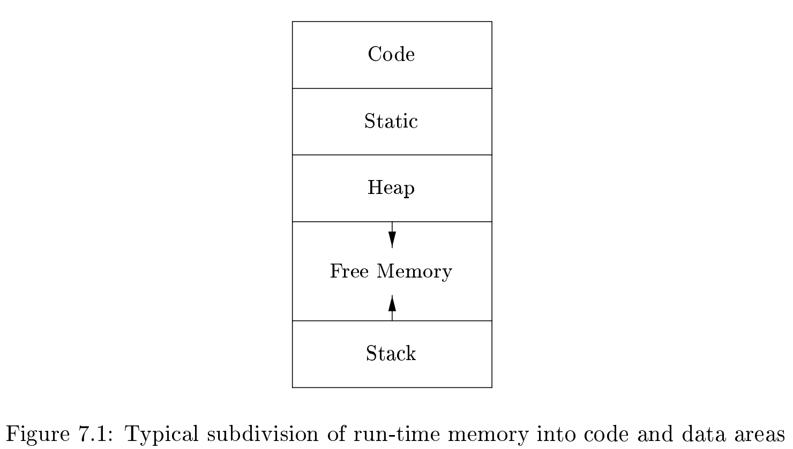
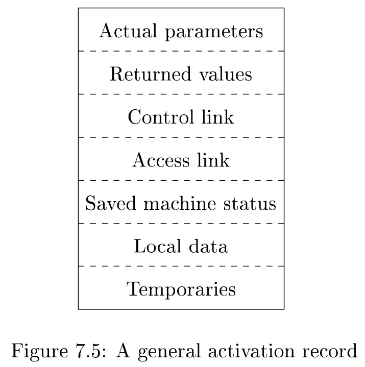

## 7.0 Preface
The compiler creates and manages a **run-time environment** in which it assumes its target programs are being executed. 

run-time environment用来做一系列的事情，比如内存分配、参数传递的机制、不同步骤之间的联系、etc

这一章主要介绍allocation of storage locations和access to variables and data

## 7.1 Storage Organization

一个object在logical address中的run-time representation如上图

其中：
- **Code**

    鉴于生成的**target code**的大小在编译的时候就已经可以确定，这个大小就是statically determined的
- **Static**

    部分的program data objects，比如**global constants**，可以在编译的时候就知道。这些数据可以存进同样是statically determined的本区域

    一些奇葩语言可以做到fully static，比如FORTRAN77
- **Stack**

    存储在procedure calls之中产生的一种数据结构，叫**activation records**

    下一节就可以知道，activation record是来存储一些和machine status相关的量的，比如program counter的大小，machine registers的数值啥的。

    虽然一般来说stack是从下(higher addresses)向着上(lower addresses)增长的，但是本章中为了方便用positive offsets表示，我们暂时假设它是从上往下增长的
- **Heap**

    可以看到和stack是反向摆放的，以提高空间利率

    用来存储long-lived data，比如**new出来的变量**啥的

## 7.2 Stack Allocation of Space
C, Pascal都是Stack-based的语言。

局部变量啥的就会在stack顶部分配，出作用域就弹出

支持递归调用

### 7.2.2 Activation Records
包含以下信息

### 7.2.? Parameter Passing Mechanisms
- **pass by value**
- **pass by reference**
- **pass by value-result**

    比较诡异，最终效果看起来和pass by reference似乎是一样的，但是实际上的实现方式是先copy参数的值，最后把结果copy回去(这到底有啥性能优势啊？？？)
- **pass by name**

    也叫做delayed evaluation

    不提前计算值，直到要使用了才计算。

    可以被理解为直接复制被call的代码到caller的位置(C++ include直呼内行)

## 7.4 Heap Management
尽管局部作用域里面平时就是local variable，这种情况会放在stack里，我们还是可以通过new等方式，让变量被存储到heap里，实现长久访问

在fully dynamic environment里面，heap必须被全自动化管理(garbage collection得做好)

## 7.? Java的类初始化机制
这一节的知识来源于[这个链接](https://blog.csdn.net/w1196726224/article/details/56529615)