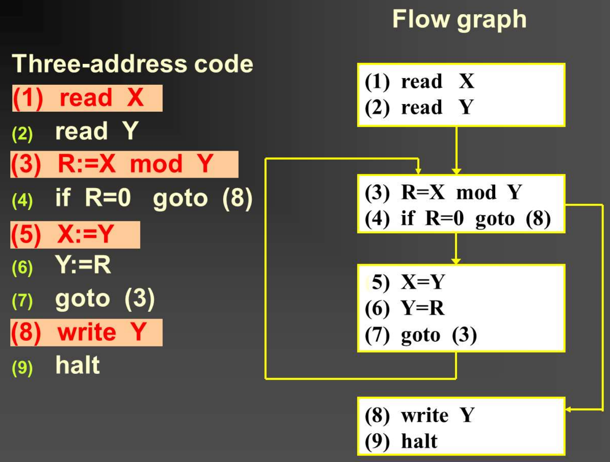
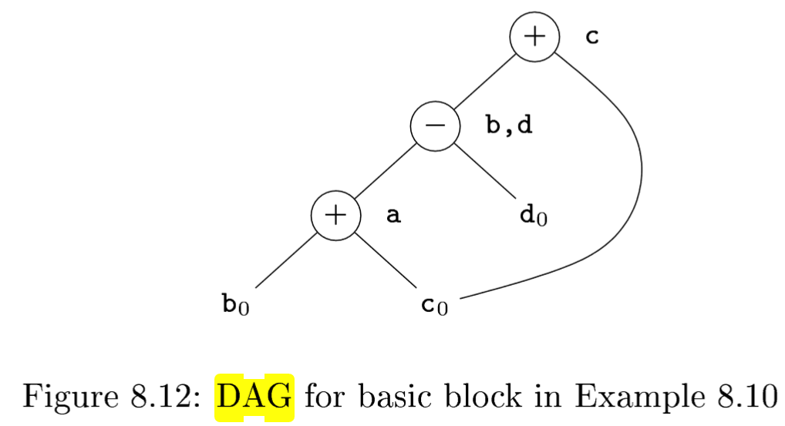

## 8.4 Basic Blocks and Flow Graphs
Flow graph可以帮助我们实现中间代码生成。

大致是如下的概念：
- Partition the IR into **basic blocks**, which are maximal sequences of consecutive three-address instructions with the properties that:
    
    - The flow of control can only enter the basic block through the first instruction in the block. That is, there are no jumps into the middle of the block
    - Control will leave the block without halting or branching, except possibly at the last instruction in the block
- The basic blocks become the nodes of a **flow graph**, whose edges indicate which blocks can follow which other blocks

    至于edge要怎么构建，那就是靠jump了

可以看出来，basic block的划分方式是：
- jump的目的地会开始一个新的block
- conditional jump的后面会开始一个新的block

## 8.5 Optimization of Basic Blocks
常量折叠其实就是其中一种优化（提前算好常量的值）

### 8.5.1 The DAG (directed acyclic graph) Representation of Basic Blocks
懒得念定义，干脆来看例子：
### 8.5.2 Finding Local Common Subexpressions
e.g.

basic block里面包含的语句如下：
$$
a=b+c\\
b=a-d\\
c=b+c\\
d=a-d
$$
对应于如下DAG:

可以看到第二句和第四句实际上是同样的计算，所以对应到了同一个节点上

也就是说，假设变量$b$只是个局部变量，我们就可以直接扔掉第二个语句，需要访问这个值的时候就直接通过$d$访问。不过假如是个全局变量的话那就不能删掉了

