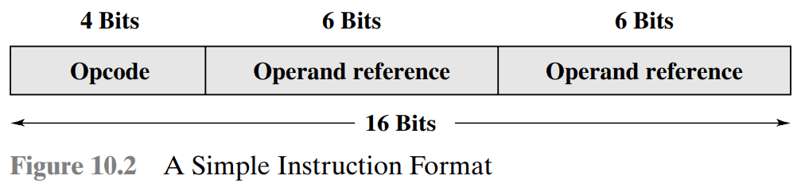
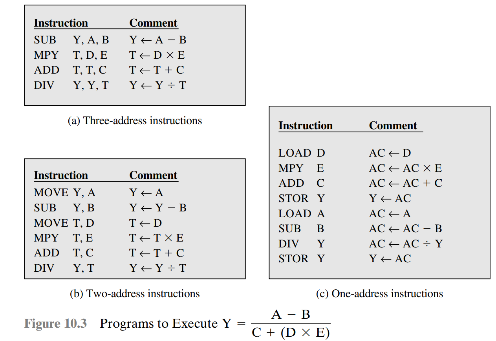
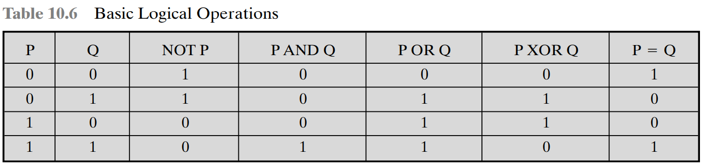
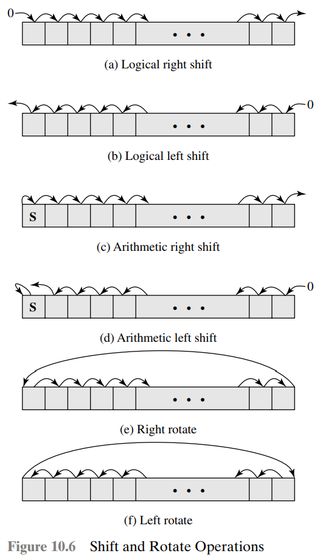

## 10.1 Machine Instruction Characteristic
> The collection of different instructions that the processor can execute is referred to as the processor's **instruction set**

### 10.1.1 Elements of a Machine Instruction
- **Operation code**

    what to do(add, I/O)
- **Source operand reference**

    what to operate on(one or more source operands)
- **Result operand reference**

    where to put the answer
- **Next instruction reference**

    where to go next

Source and result operands can be in one of four areas:
- **Main or virtual memory**
- **Processor register**
- **Immediate**

    The value of the operand is contained in a field in the instruction being executed
- **I/O device**

### 10.1.2 Instruction Representation
Within the computer, each instruction is represented by a sequence of bits

The instruction is divided into fields:

直接写这些二进制语言肯定不是人干的事情，我们可以用**symbolic representation**:
- Opcodes are represented by abbreviations

    e.g.

    - ADD
    - SUB
    - LOAD
- Operands can also be represented symbolically

    e.g.

    ADD R, Y

    R是特定的寄存器，Y是一个地址

e.g.

$$
X=513\\
Y=514
$$
两个数字代表的是operand的地址。我们现在需要计算$X+Y$:
- Load the content in location 513 to a register
- Add the content in 514 to the register
- Store the content of the register to location 513

寄存器就是个用来实现加法的临时存储器

### 10.1.3 Instruction Types
- **Data processing**

    Arithmetic and logic instructions
- **Data storage**

    Movement of data into or out of register and or memory locations
- **Data movement**

    I/O instructions
- **Control**

    Test and branch instructions

跟[1.2.1](ch1-introduction.md#121-function)当中的图似乎是一个东西

### 10.1.4 Number of Addresses

虽然说正常来讲，我们每个指令需要四个field:
- 2 source operands
- 1 destination operand
- 1 address of the next instruction

但是这样的话每个指令都太长了。上图说明了三种不同instruction的对比
- **Three-address**

    不存下一个指令
- **Two-address**

    不存其中一个source operand(一个operand同时作为operand和result)
- **One-address**

    借助AC(accumulator)，只存destination operand

我们可以更极端点，用stack实现**Zero-address**

address数量越多：
- more complex instructions
- more registers such that inter-register operations are quicker
- fewer instructions per program
- slower fetch/execution of instructions

### 10.1.5 Instruction Set Design
设计指令集最基本的问题如下：
- **Operation repertoire**

    How many and which operations to provide, and how complex operations should be
- **Data types**

    The various types of data upon which operations are performed
- **Instruction format**

    Instruction length (in bits), number of addresses, size of various fields, and so on
- **Registers**

    Number of processor registers that can be referenced by instructions, and their use
- **Addressing**

    The mode or modes by which the address of an operand is specified

## 10.2 Types of Operands
最重要的四类data分别是：
- **Addresses**
- **Numbers**
- **Characters**

    用ASCII之类的玩意转换成数字表示
- **Logical data**

    01序列

## 10.3 Intel x86 and ARM Data Types
这真的需要知道吗

## 10.4 Types of Operations
### 10.4.1 Data Transfer
Specify the following things:
- Source location
- Destination location
- Amount of data

有以下几种情况：
- If both source and destination are registers

    simply transfer from one to the other
- If one or both operands are in memory

    - Calculate the memory address based on address mode
    - If the address refers to virtual memory, transfer from virtual to actual memory
    - Determine whether the addressed item is in cache
    - If not, issue a command to the memory module

### 10.4.2 Arithmetic
支持对于整数、浮点的加减乘除

除此之外还可能有：
- Absolute
- Negate
- Increment
- Decrement

### 10.4.3 Logical

上表就是最基本的按位运算

除此之外还可以有shift and rotate operations:
- **Shift**

    - **Logical shift**

        最正常的，扔掉一位然后补0
    - **Arithmetic shift**

        右移时，会复制sign bit，相当于==除以2==

        左移时，除了sign bit以外的都shift，然后补0，相当于==乘2==
- **Rotate**

    不如直接看图

### 10.4.4 Input/Output
[Ch7](ch7-input-and-output.md)的内容

### 10.4.? Instructions
Typical instructions:
- Arithmetic
- Logical
- Shift
- Character
- Stack

Memory access instructions:
- Load
- Store
- MOV

Control Instructions:
- Conditional Branch
- Unconditional Branch

