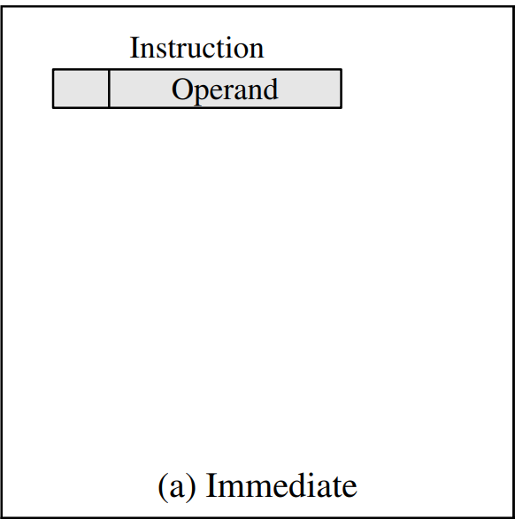
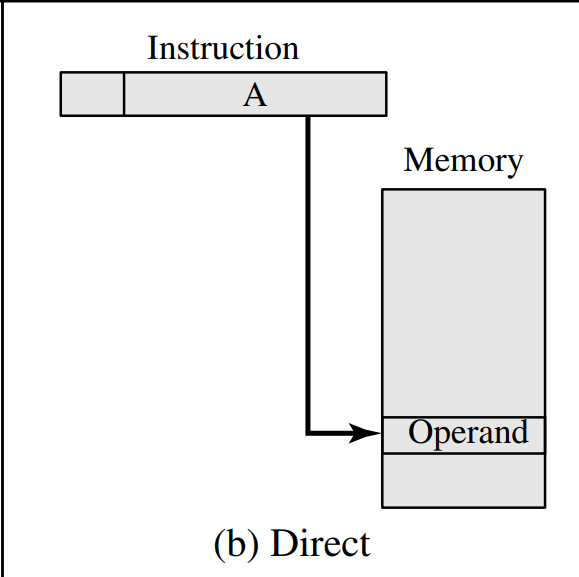
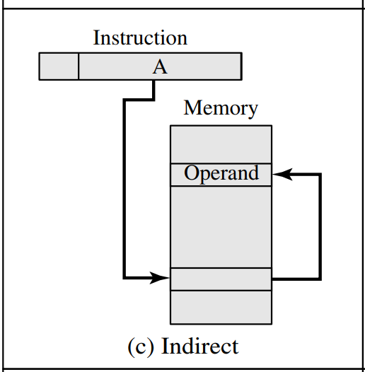
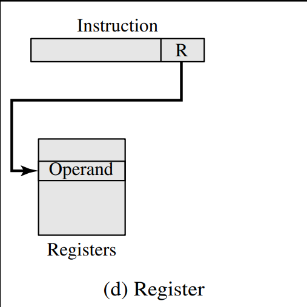
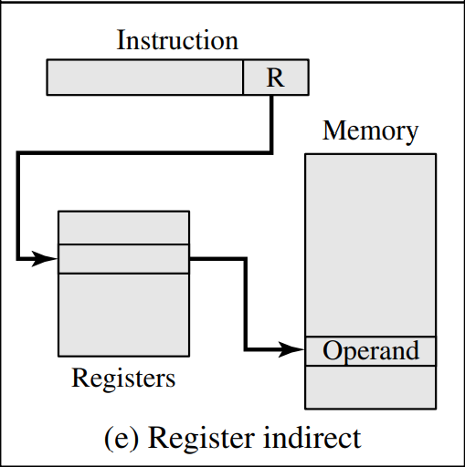
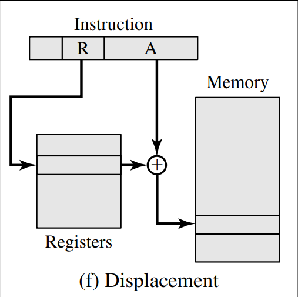
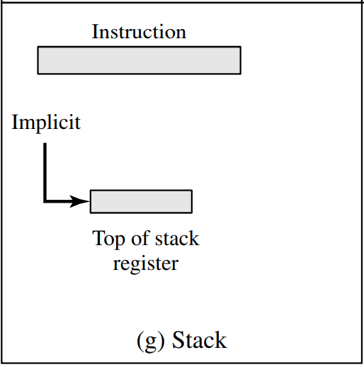
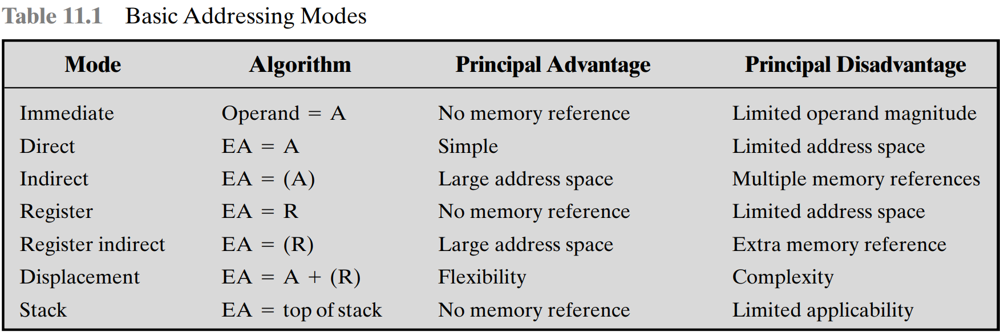

## 11.0 Preface
In Ch10, we focused on ==what== an instruction set does. Specifically, we examined the types of operands and operations that may be specified by machine instructions

This chapter turns to the question of ==how== to specify the operands and operations of instructions

Two issues arises:
- how is the address of an operand specified
- how are the bits of an instruction organized to define the operand addresses and operation of that instruction

## 11.1 Addressing
相对来说，instruction里面的address field其实算很少的。而我们希望通过这点空间来reference大范围内的location

这是一个关于address range和addressing complexity的trade off

最常用的**addressing techniques**有如下：
- Immediate
- Direct
- Indirect
- Register
- Register indirect
- Displacement
- Stack

等会就会详细介绍的

在开始详细介绍之前，我们需要解释两个事情：

首先，CPU咋知道一条instruction采用了哪种address mode呢？我们一可以对于不同的opcode使用不同的addressing mode，二可以在instruction中使用一些个bits来表示自己使用的addressing mode

其次是关于**effective address**(EA)在不同系统中是如何定义的：在没有virtual memory的系统里，EA是main memory或者register；在有virtual memory的系统里，EA则是一个virtual address或者register。

### 11.1.1 Immediate Addressing
最简单的addressing方式

==operand value直接出现在instruction中==

e.g.

$$
\text{ADD}\ 5
$$
- **advantage**:

    - ==no memory reference== other than the instruction fetch is required to obtain the operand
    - thus saving one memory or cache cycle in the instruction cycle
- **disadvantage**

    - the size of the number is ==restricted==

### 11.1.2 Direct Addressing

没有直接存operand，而是存了指向operand的指针
### 11.1.3 Indirect Addressing

又多了一层指针（搁着套娃呢）

用记号表示的话是：
$$
\text{EA=(A)}
$$
其中EA是effective address，括号代表取A里面的值

假设address field $A$的长度是$k$，那么能表示的不同的effective address的数量就是$2^k$；假设pointer to operand的长度（好像就是effective address的长度？）是$n$，那么addressable space就是$2^n$

这种方法可能会导致[page fault](ch8-os-support.md#8341-demand-paging) (virtual memory中的effective address location会被放在page 0(也就是指针)，而真正执行process的时候，page 0就经常会出现在memory里，导致需要swap其他的page进来以获得operand)

### 11.1.4 Register Addressing

非常类似于direct addressing，唯一的不同是pointer指向的是==哪一个register==，而非main memory中的哪个地址

该register中的所有东西就是需要的operand

- Advantages

    - very small address field needed
    - no time-consuming memory access
- Disadvantages

    - very limited address space

一般来说，我们会把需要==多个操作==会被用到的operand放到register里面来提高速度

### 11.1.5 Register Indirect Addressing

类似于indirect addressing，区别是中间一层换成了register

### 11.1.6 Displacement Addressing

结合了direct addressing和register indirect addressing

$$
\text{EA=A+(R)}
$$
其中：
- $A$

    base value
- $(R)$

    the register's contents are added to $A$ to produce the effective address

有三种最常用的displacement addressing:
#### 11.1.6.1 Relative Addressing
使用的register是program counter (PC)

PC指向了相邻的下一个instruction的地址，$A$就是与这个地址相加

体现了locality of reference的思想

#### 11.1.6.2 Base-Register Addressing
the referenced register $R$ contains a ==main memory address==, and the address field $A$ contains a displacement

the register reference may be explicit or implicit

#### 11.1.6.3 Indexed Addressing
$A$是main memory address，$R$是positive displacement

一般用来做iterative operation: $A, A+1,A+2,...$

可以实现**autoindexing**: $\text{EA=A+R}$, $\text{R++}$

我们可以将*indirect addressing*和*indexed addressing*一起使用，而这样会出现两种情况：
- **postindexing**

    indexing is performed after the indirection:
    $$
    \text{EA=(A)+(R)}
    $$
- **preindexing**

    indexing is performed before the indirection:
    $$
    \text{EA=(A+(R))}
    $$

### 11.1.7 Stack Addressing
operand在stack的顶部

每次弹出对应数量的operand进行操作

鉴于stack pointer是存在register里面的(pointer指向main memory中栈顶的address)，所以对于stack locations的reference==实际上就是register indirect addressing==

总结一下这么多mode：

## 11.3 Instruction Formats
指令的格式，一个指令集里一般都会有不同种类的format

### 11.3.1 Instruction Length
Trade off between powerful instruction repertoire and saving space

More opcodes and operand is possible to write short program and more flexibility, but longer instruction may be wasteful

Instruction length should be equal to the memory transfer length.

Shorter instruction is a solution to the bottleneck of memory transfer rate

### 11.3.2 Allocation of Bits
A trade-off between the number of opcodes and the power of addressing capability

More bits in the opcode means few bits for addressing

One interesting refinement is use of variable-length opcode

A minimum code length, additional operations be specified using additional bits 

下列决定了addressing bit的使用：
- Number of addressing modes
- Number of operands
- Register versus memory
- Number of register sets
- Address range
- Address granularity

