## 12.1 Processor Organization
To understand the organization of the processor, let us consider the things that it must do:
- **Fetch instruction**

    The processor reads an instruction from memory (register, cache, main memory)
- **Interpret instruction**

    The instruction is decoded to determine what action is required.
- **Fetch data**

    The execution of an instruction may require reading data from memory or an I/O module.
- **Process data**

    The execution of an instruction may require performing some arithmetic or logical operation on data.
- **Write data**

    The results of an execution may require writing data to memory or an I/O module

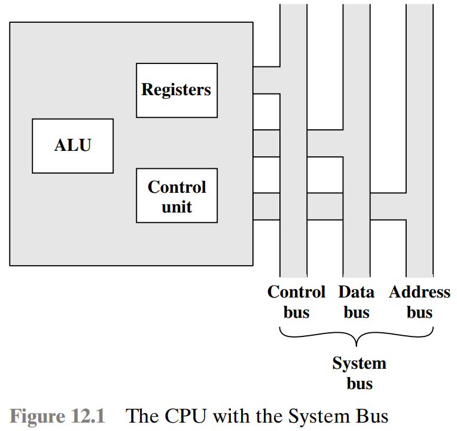

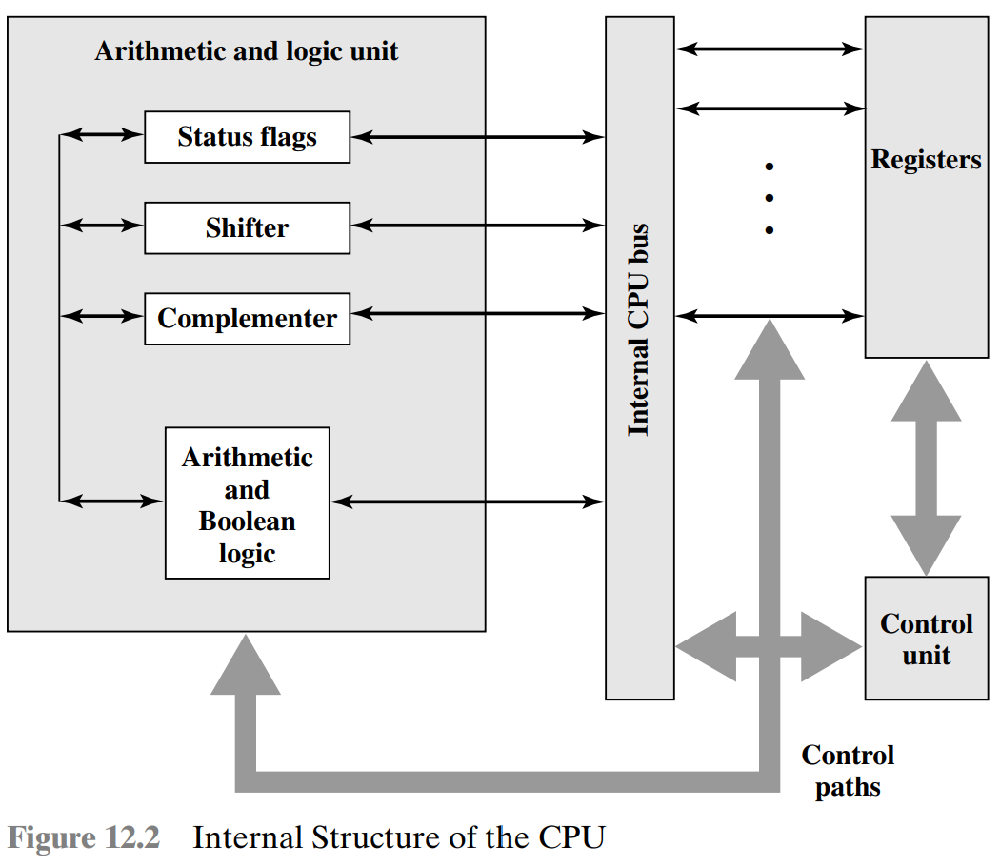

## 12.2 Register Organization
有两种不同作用的register:
- **User-visible registers**

    Enable the ==machine or assembly language programmer== to minimize main memory references by optimizing use of registers.
- **Control and status registers**

    Used by the ==control unit== to control the operation of the processor and by privileged, operating system programs to control the execution of programs.

其实两者并没有明显的分界线，比如x86上program counter甚至是user visible的

为了方便讨论我们暂时还是分成这两类

### 12.2.1 User-Visible Registers
可以分成几类：
- **General-purpose registers**

    e.g.

    Data, address, index, PC, condition...

    有可能是真的可以为opcode装任意类型的operand，有可能只能装特定类型的，比如floating-point
- **Data registers**

    只能装data
- **Address registers**

    有可能被用来general purpose，也有可能真的是用来服务某种addressing mode，例子包括：
    - Segment pointers

        hold the base address of segment
    - Index registers

        used for indexing addressing
    - Stack pointer

        point to the top of the stack
- **Condition codes registers**

    > **condition codes** are bits set by the processor hardware as the result of operations

    比如数学运算的结果可能是positive / negative / zero / overflow。它就是存这些状态的

    usually, they form part of a ==control register==

    Generally, machine instructions allow these bits to be read by implicit reference, but the ==programmer cannot alter== them

### 12.2.2 Control and Status Registers
They control the operation of the processor, and are ==not visible to the user==, but may be visible to machine instructions

有四种registers:
- **Program counter (PC)**

    Contains the ==address== of an instruction ==to be fetched==

    a ==branch or skip== instruction will modify the content of PC
- **Instruction register (IR)**

    Contains the ==instruction most recently fetched==

    the opcode and operand are ==analyzed==
- **Memory address register (MAR)**

    Contains the ==address== of a location in memory

    connected to the ==address bus==
- **Memory buffer register (MBR)**

    Contains a ==word== of data to be ==written== to memory or the word most recently ==read==

    connected to the ==data bus==

上述的四种register是用来在CPU和memory之间移动状态的。一般来说，还会有一种**program status word (PSW)** register来包含condition codes and other status information

PSW一般来说包含以下fields / flags:
- **Sign**

    sign bit of the result of the last arithmetic operation
- **Zero**

    when result is 0
- **Carry**

    就是进位、退位的carry bit
- **Equal**

    when logical compare result is equality
- **Overflow**

    indicate arithmetic overflow
- **Interrupt Enable / Disable**

    used to enable or disable interrupts
- **Supervisor**

    indicate if the CPU is executing in supervisor or user mode

除了上述五种register以外，可能还有装了以下东西的register:
- A pointer to a block of memory
- Interrupt vectors
- Stack pointer
- page table pointer in virtual memory

设计control and status register organization需要考虑许多因素：
- OS support

    CPU设计者对于OS的理解够好的话，设计出来的就会足够贴合OS
- allocation of control information between registers and memory

对比general和specialized的register，其实就是flexibility和instruction size的trade off

一般来说会用8-32个register，数量越少，需要的memory reference越多

至于大小的话，只需要装得下最长的address和多数的data types就行，那些long, double啥的可以用==两个register来装==

## 12.3 Instruction Cycle
在[3.1.2.1](ch3-a-top-level-view-of-computer-function-and-interconnection.md#3121-interrupts-and-the-instruction-cycle)的时候，我们介绍过CPU的instruction cycle。实际上那个图并不完整，我们这里介绍一个额外的**indirect cycle**

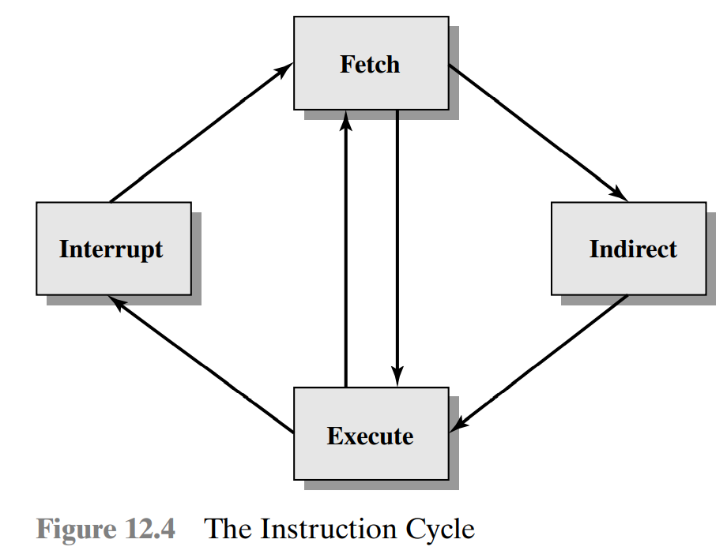

### 12.3.1 The Indirect Cycle
其实就是当指令需要使用==indirect addressing==来获取operand的时候，走indirect cycle，纯粹是单独列出来了而已

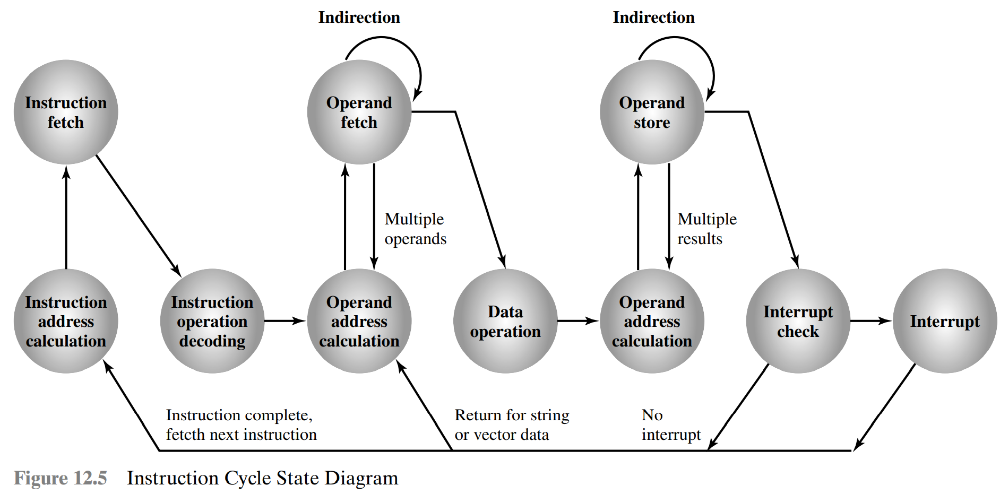

这个又臭又长的图也得到了更新，就是多了两个indirection的自循环箭头而已

### 12.3.2 Data Flow
- **fetch cycle**

    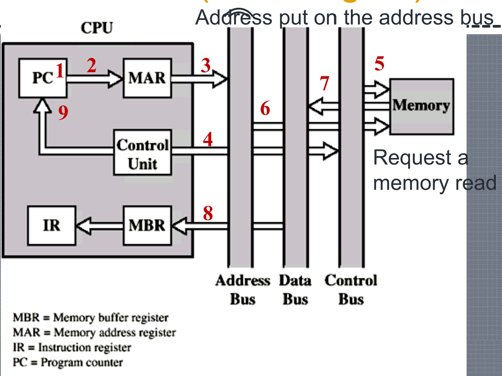

    - PC contains address of next instruction
    - Address moved to MAR
    - Placed on address bus
    - Control unit requests memory read
    - Result placed on data bus, copied to MBR, then to IR
    - Meanwhile PC incremented by 1
- **indirect cycle**

    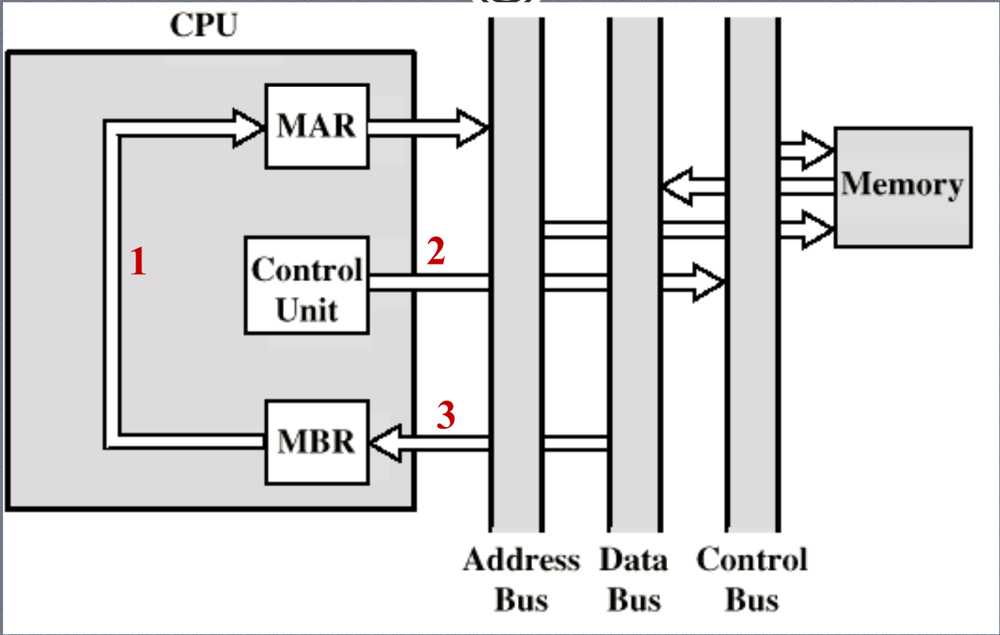

    fetch cycle一结束，control unit就要检验IR里面的operand是不是使用了==indirect addressing==，是的话直接把MBR的右边$N$ bits扔到MAR里，读取operand的实际值
- **execute cycle**

    会干的事情取决于IR里的machine instruction

     may involve transferring data among registers, read or write from memory or I/O, and/or the invocation of the ALU
- **interrupt cycle**

    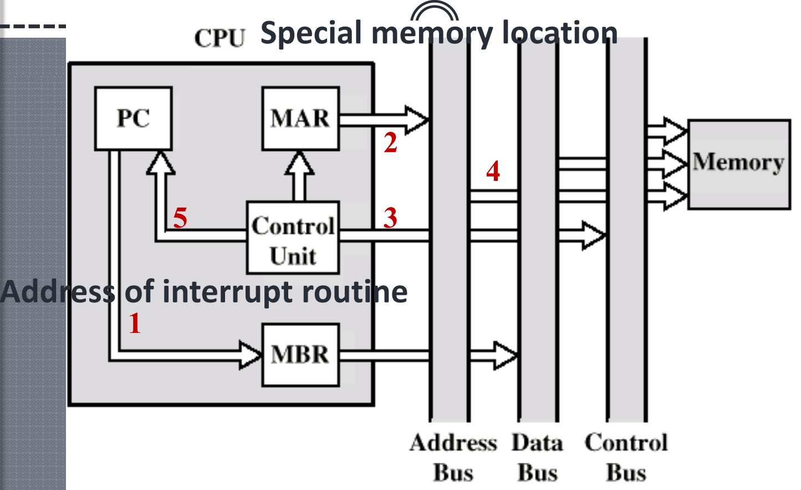

    主要说了开始执行interrupt需要的准备工作

    the ==contents of the PC== are transferred to the ==MBR== to be written into ==memory==.
    
    The special ==memory location== reserved for this purpose is loaded into the ==MAR== from the ==control unit==.

    Then the PC is loaded with the ==address== of the interrupt routine

## 12.4 Instruction Pipelining
### 12.4.1 Pipelining Strategy
考虑一个最简单的例子：

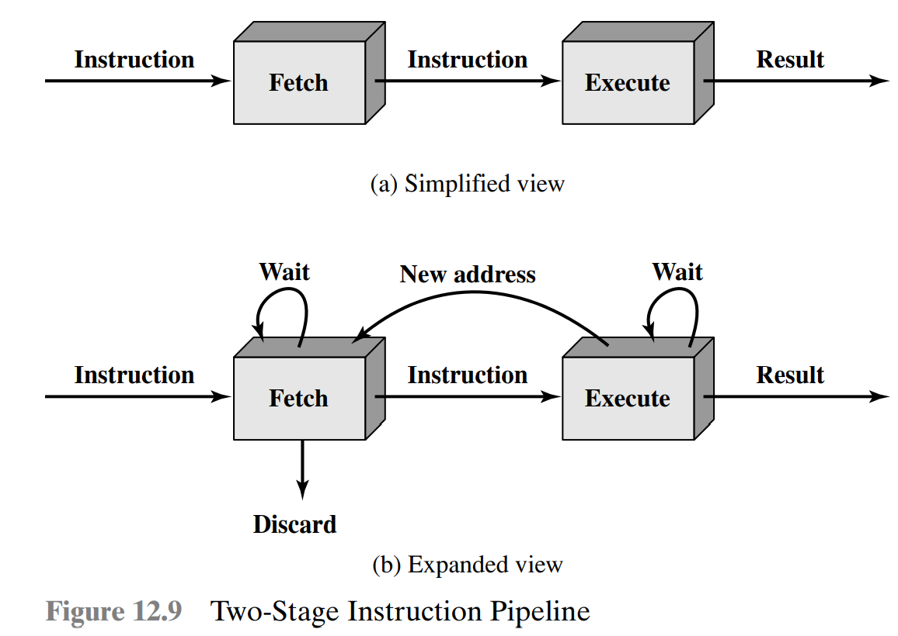

只有fetch 和 execute两个state。我们可以用**instruction prefetch**来提高程序执行速度：Execute正在忙活的时候，Fetch可以提前把下一个指令给读取进来

然而这并不意味着执行速度就能翻倍，因为：
- execution time > fetch time

    fetch stage只能干等execution stage
- conditional branch

    条件控制指令让下一个抓哪个指令变得不确定

第一个问题显然没办法；第二个问题可以通过==猜==来得到部分解决：先随便prefetch一个分支的指令，假设猜对了那就血赚，猜错了就丢了重新加载

为了进一步提高速度，pipeline必须有更多的stage。我们这里把instruction processing拆分成：
- **Fetch instruction (FI)**

    Read the next expected instruction into a buffer
- **Decode instruction (DI)**

    Determine the opcode and the operand specifiers
- **Calculate operands (CO)**

    Calculate the effective address of each source operand. 
- **Fetch operands (FO)**

    Fetch each operand from memory. Operands in ==registers need not be fetched==
- **Execute instruction (EI)**

    Perform the indicated operation and store the result.
- **Write operand (WO)**

    Store the result in memory

接下来做一点理想化的假设，假设每一个stage的时间一致。下面的例子展示了一个有6个stage的pipeline处理9个instruction的过程，可以将处理时间从54减小至14:

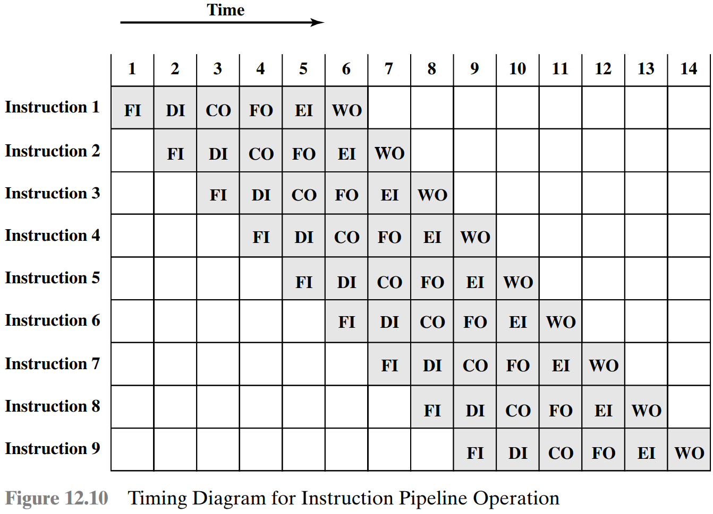

上面的图还是过于理想了。假设我们考虑**conditional branch**的发生，事情就会变得复杂一点。假设instruction 3有一个指向instruction 15的branch。直到instruction 3执行完毕之前，我们都不会知道下一个要执行的指令到底是哪个。这里，我们选择在instruction 3执行的同时继续处理紧随其后的指令4,5,6,7：

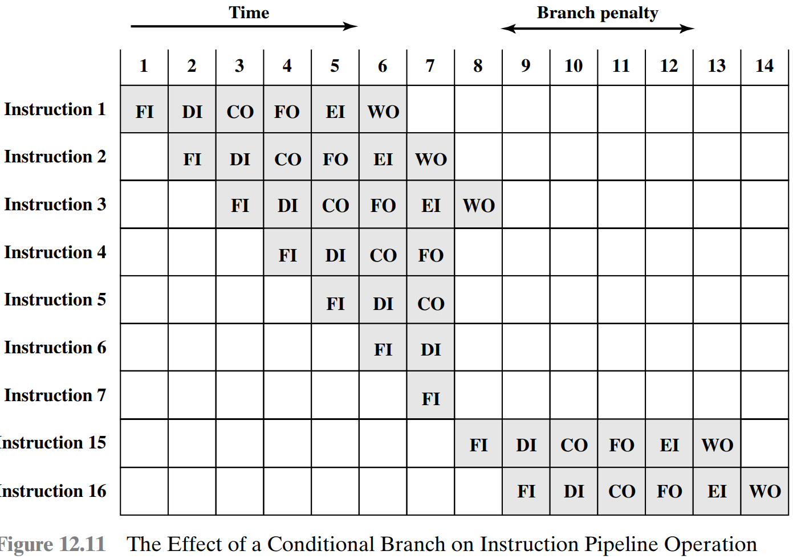

可以看到执行的结果是跳转到instruction 15，结果这样一来instruction 4~7全部都不需要执行，预处理的工作全部木大

上面两张图的另一种展现形式如下：

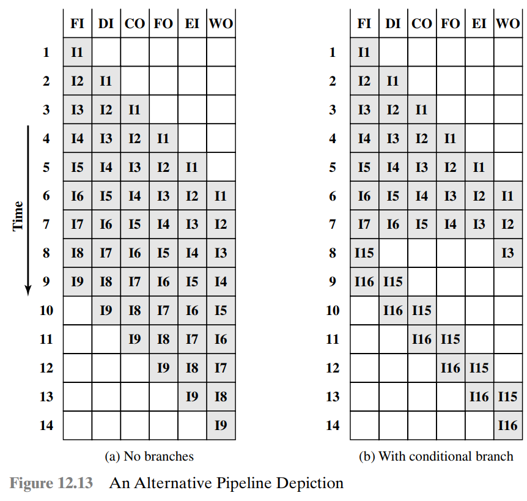

其实并不是stage越多越好，太多了会带来下列问题：
- ==Overhead== involved in moving data from buffer to buffer
- Data needed by current instruction may depend on a previous instruction that is still in pipeline

### 12.4.2 Pipeline Performance
令cycle time为$\tau$（就是图中的一个单元格），那么一个instruction的每个stage的cycle time就定义如下:
$$
\tau=\text{max}[\tau_i]+d=\tau_m+d \qquad i \le i\le k
$$
where:
- $\tau_i$

    time delay of the circuitry in the $i$th stage of the pipeline
- $\tau_m$

    maximum stage delay
- $k$

    number of stages in the instruction pipeline
- $d$

    time delay of a ==latch==, needed to advance signals and data from one stage to the next

总的来说，$\tau_m\gg d$，所以一般直接忽略$d$。定义$T_{k,n}$是$k$ stages和$n$ instructions所需要的总时间，那么：
$$
T_{k,n}=[k+(n-1)]\tau
$$
由此，我们将这个时间和没有利用pipeline技术的时间做商，得到**speedup factor**:
$$
S_k=\frac{T_{1,n} }{T_{k,n} }=\frac{nk\tau}{[k+(n-1)]\tau}=\frac{nk}{k+(n-1)}
$$

赠送speedup factor关于$n$和$k$的关系图：

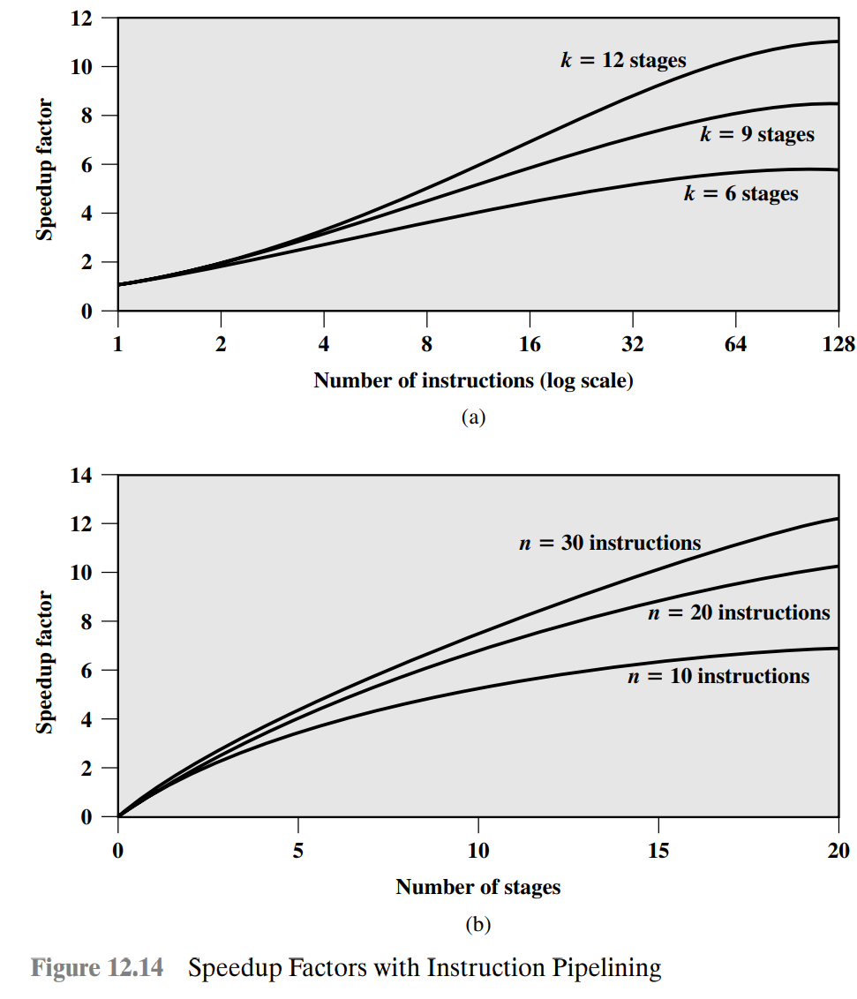

### 12.4.3 Dealing with Branches
有一大堆的方法来处理conditional branch:
#### 12.4.3.1 Multiple Streams
小孩子才做选择，我两个都要

同时把所有可能的下一个指令全部fetch进来有俩问题：
- Contention delays for access to the registers and to memory

    多个指令都需要访问memory的话，谁先呢？
- 可能的分支太多了

#### 12.4.3.2 Prefetch Branch Target
When a conditional branch is recognized, the ==target of the branch== is prefetched, in addition to the instruction following the branch.

原来先加载branch target和先加载下一个instruction不同
#### 12.4.3.3 Loop Buffer
一小块高速内存，装着$n$个最近fetch到的instruction

假如branch要被执行了，硬件会先检查branch target是否在buffer里，否则才从memory里拿

怎么感觉就是我全都要的另一种形式
#### 12.4.3.4 Branch Prediction
合理猜测到底branch会不会被执行

常用技巧如下：
- Static
    - Predict never taken
    - Predict always taken
    - Predict by opcode

        比如有些指令很容易jump
- Dynamic

    depending on the ==execution history==
    - Taken/not taken switch

        For example, ==one or more bits== can be associated with each conditional branch instruction that ==reflect the recent history== of the instruction.

        directs the processor to make a particular decision the ==next time== the instruction is encountered
    - Branch history table

        maintain a small table for ==recently executed branch instructions== with one or more history bits in each entry. 

