## 15.0
之前在Ch3~Ch14的时候，我们关心的都是下列东西具体**是些啥**:
- Operations (opcodes)
- Addressing modes
- Registers
- I/O module interface
- Memory module interface
- Interrupts

现在开始，我们来研究这些东西是**怎么被实现**的

## 15.1 Micro-Operations

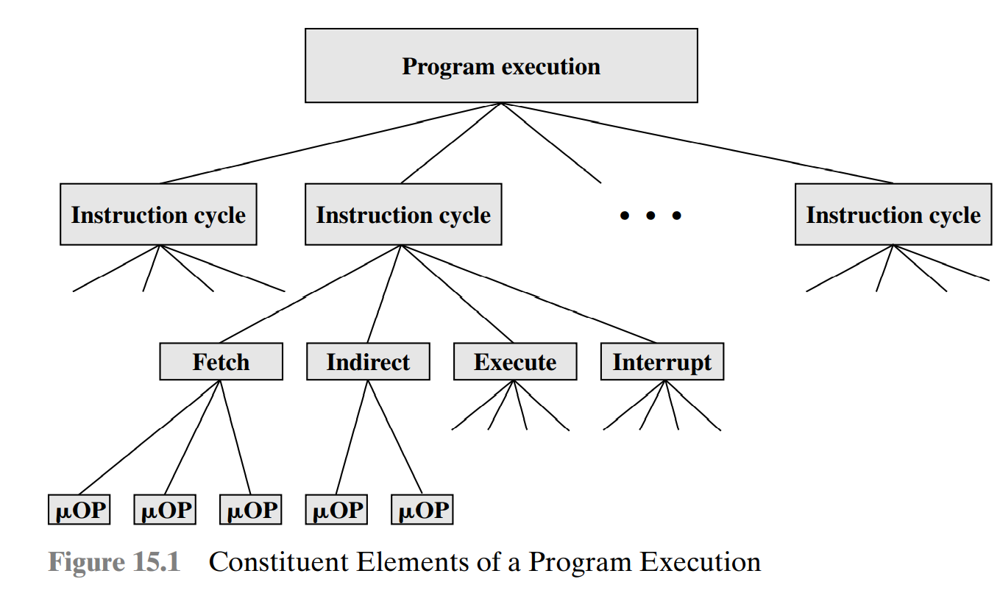

最下面的一层就是**micro-operation**，是比fetch/execute之类的更加细分的存在

每一步非常小，做的事情也很少

### 15.1.1 Fetch Cycle
我们还是假设结构是我们熟悉的老样子:
- **Memory address register (MAR)**

    Is connected to the address lines of the system bus. It specifies the address in memory for a read or write operation.
- **Memory buffer register (MBR)**

    Is connected to the data lines of the system bus. It contains the value to be stored in memory or the last value read from memory.
- **Program counter (PC)**

    Holds the address of the next instruction to be fetched.
- **Instruction register (IR)**

    Holds the last instruction fetched

fetch cycle里面发生的事情如下：

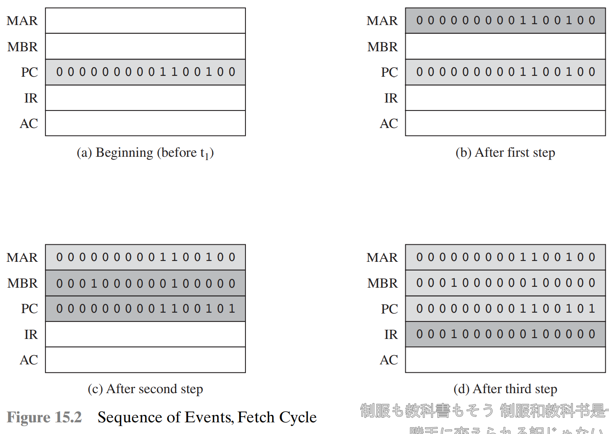

具体发生的micro operation如下：

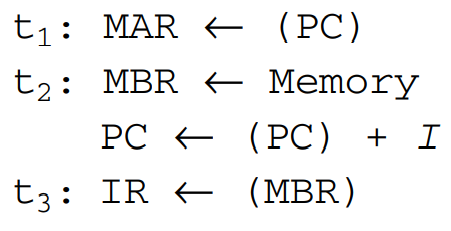

I表示指令有I个，箭头表示数据的转移。(PC装的是下一个指令的地址，IR装的是指令本身)

其实PC + I的操作既可以发生在t2也可以在t3，反正是可以并发的指令

micro operation的分组必须遵守:
- The proper sequence of events must be followed

    比如MAR的指令必须早于MBR
- Conflicts must be avoided.

    不能同时读写同一个register。比如(MBR<-memory)和(IR<-MBR)不能同时发生

- PC = PC + I involves addition, and we can use ALU to avoid duplication of circuitry

### 15.1.2 Indirect Cycle
当instruction是indirect address mode的时候，我们就需要额外再fetch一遍实际的instruction地址

包含了以下三个步骤：

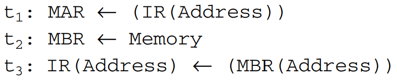

经历了这仨步骤，indirect address就会变成direct address

### 15.1.3 Interrupt Cycle
实际上interrupt会做的事情每个机器不尽相同，所以我们只是选择其中一个比较简单的来看一看：

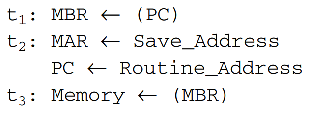

整个流程在做的事情就是保存当前的工作指令，并加载新的。MBR负责暂存PC中的指令，MAR暂存PC中的指令将要被放置的地址

### 15.1.4 Execution Cycle
可以执行的命令太多了，我们只选择其中几种来介绍

先看看add instruction:

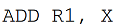

至少对应于以下的micro-operations:

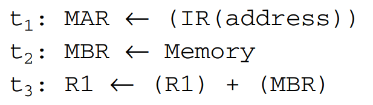

再有一个奇怪的instruction，效果是 **I**ncrement and **S**kip if **Z**ero:

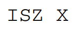

对应于以下micro operation:

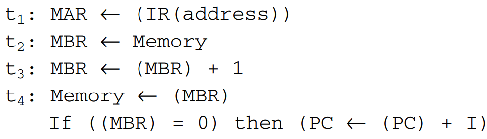

### 15.1.5 Instruction Cycle
之前提到的四种cycle其实都是隶属于instruction cycle里面的，四个cycle都可以继续被拆分成一系列的micro operations。

我们这时候需要把这些涉及到的micro operations全部有序整合到一起执行。这就需要一个新的2-bit register:

> **instruction cycle code (ICC)**: ICC designates the state of the processor in terms of which portion of the cycle it is in:
> - 00: Fetch
> - 01: Indirect
> - 10: Execute
> - 11: Interrupt

反正最终的flowchart长这样子：

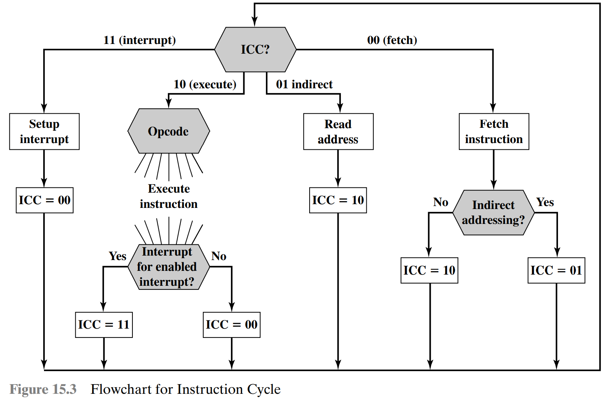

## 15.2 Control of The Processor
### 15.2.1 Functional Requirements

鉴于在15.1当中，我们已经把CPU的行为拆分的足够细了，我们现在可以来考虑一下control unit如何控制这些operation的执行

其实这么多的micro operations都可以被归为以下这几种：
- Transfer data from one register to another
- Transfer data from a register to an external interface (e.g., system bus)
- Transfer data from an external interface to a register
- Perform an arithmetic or logic operation, using registers for input and output

control unit则是执行如下两种基本任务：
- **Sequencing**: 

    The control unit causes the processor to step through a series of micro-operations in the proper sequence, based on the program being executed
- **Execution**

    The control unit causes each micro-operation to be performed

上述两个功能则是通过接下来学习的**control signal**实现的

### 15.2.2 Control Signals
为了让control unit发挥作用，它得有：
- **External specifications**

    - inputs:

        allow it to determine the state of the system
    - outputs:

        allow it to control the behavior of the system
- **Internal logic**

    must have the logic required to perform its sequencing and execution functions

internal logic的部分会留到15.3再讨论，这节讨论external的部分

control unit的模型如下：

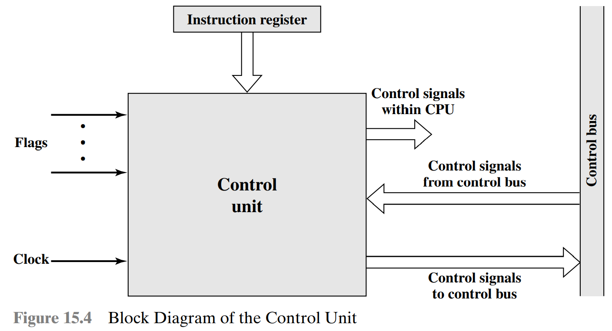

图中涉及到的东西具体是：
- Inputs:

    - **Clock**

        This is how the control unit "keeps time." 

        ==Perform one micro-operation per clock pulse==
    - **Instruction register**

        The opcode and addressing mode of the current instruction are used to determine which micro-operations to perform during the execute cycle
    - **Flags**

        determine the status of the CPU and the outcome of previous ALU operations.

        e.g.

        for the increment-and-skip-if-zero (ISZ) instruction, the control unit will increment the PC if the zero flag is set
    - **Control signals from control bus**

        The control bus portion of the system bus provides signals to the control unit
- Outputs:

    - **Control signals within the processor**

        - cause data to be moved from one register to another
        - activate specific ALU functions
    - **Control signals to control bus**

        - to memory
        - to I/O modules
    
这些个信号最终都会作为二进制信号喂给logic gates

### 15.2.3 A Control Signals Example

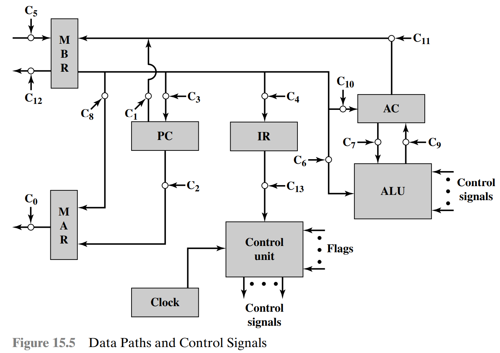

一个拥有单个AC (Accumulator)的简单CPU

$C_i$表示control signals，圆形表示一个类似开关的节点，收到信号后会开启

- Inputs:

    - clock
    - instruction register
    - flags
- Signal output destinations:

    - **Data paths**

        就是图中的那些圆形的节点，signal可以控制这些节点的开关，进而控制data在不同元件之间的流动
    - **ALU**

        activate various logic circuits and gates within the ALU
    - **System bus**

        sends control signals out onto the control lines of the system bus (e.g., memory READ)

按照图中的的结构的话，之前提到的micro-operations对应的control signals就可以确定：

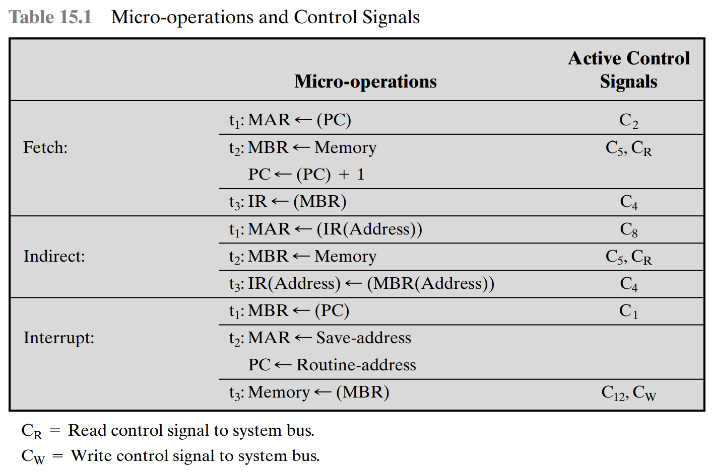

对应着图看还是很好理解的

### 15.2.4 Internal Processor Organization
图15.5的结构还是有点复杂，我们可以加入一个**internal bus**，来让布局更加有条理：

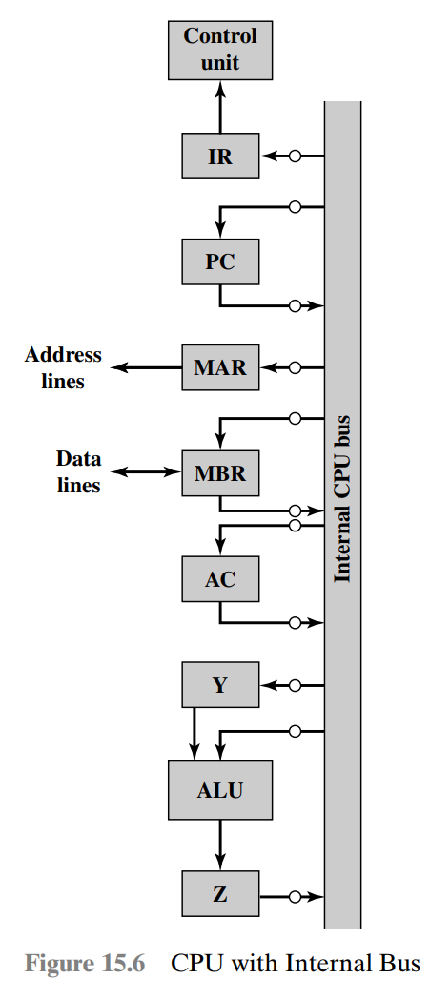

可以看到，每个register和bus之间都有由control signal控制的gate。

至于新增的两个register Y, Z，则是作为临时寄存器，辅助ALU的运算用的

## 15.3 Hardwired Implementation
之前我们已经讨论过了control unit的input, output, function，我们现在来讨论一下control unit的implementation

一般有很多实现技巧，大部分分成这两类：
- Hardwired implementation

    control unit这时候就是state machine circuit

    吃logic signal，输出logic signal (control signal)
- Microprogrammed implementation

Ch16会介绍microprogrammed implementation

### 15.3.1 Control Unit Inputs
- Flags

    each bit has some meaning, such as overflow
- Instruction register

    opcode causes different control signals for each different instruction. To simplify the control unit logic, there should be a unique logic input for each opcode. 
    
    This function can be performed by a **decoder** ($n$ inputs and $2^n$ outputs)
- Clock

    useful for measuring the duration of micro-operations

    需要一个counter来在不同的时间节点用不同的control signal，最后执行完后回归到开始状态

多了decoder之后：

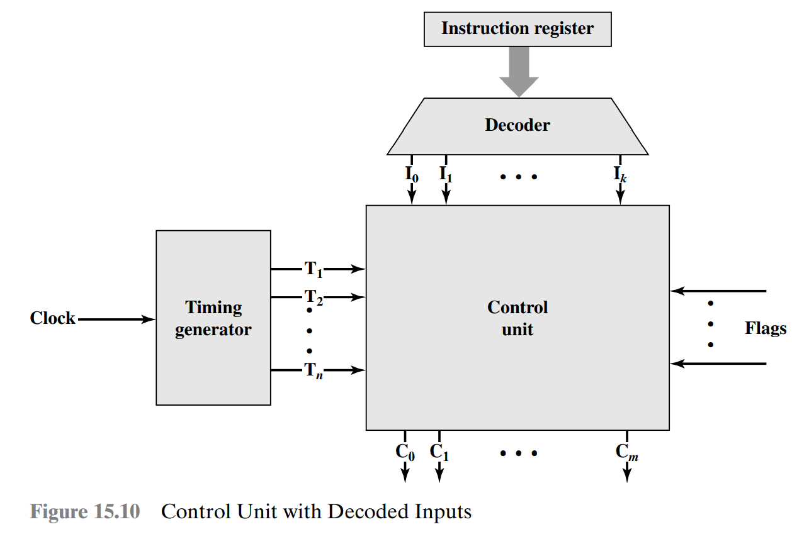

缺点有：
- Complex sequencing and micro-operation logic
- Difficult to design and test
- Inflexible design
- Difficult to add new instructions

