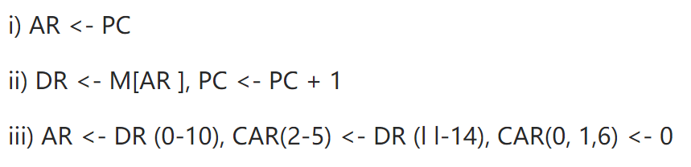
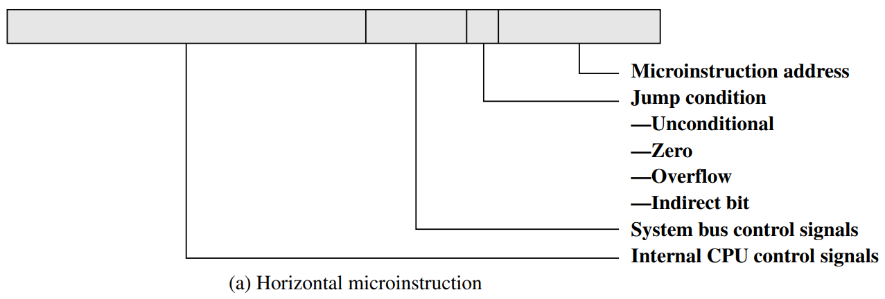
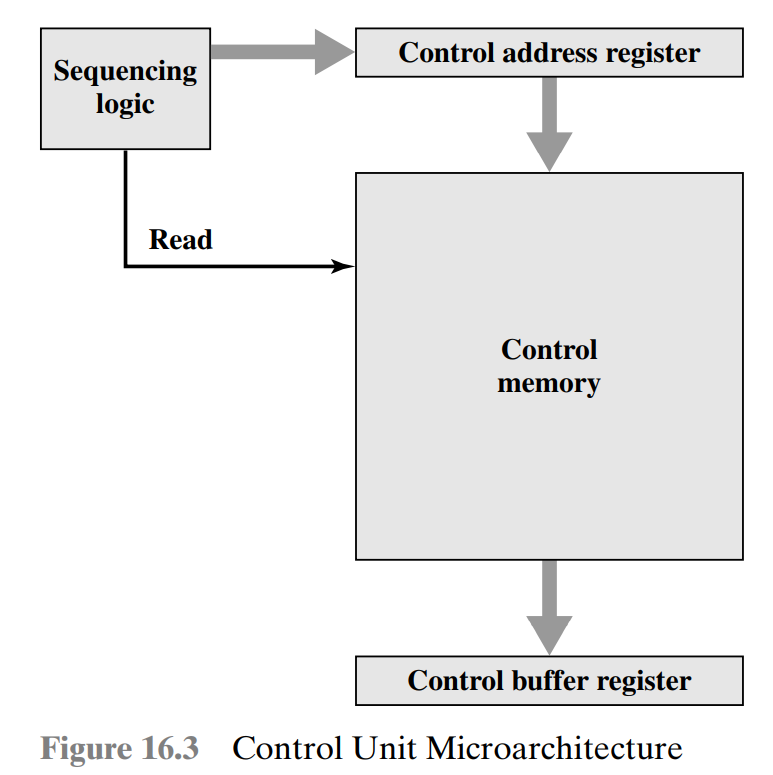
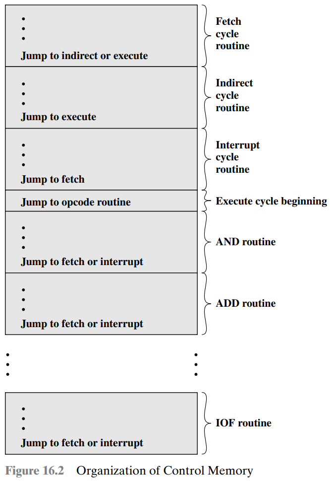
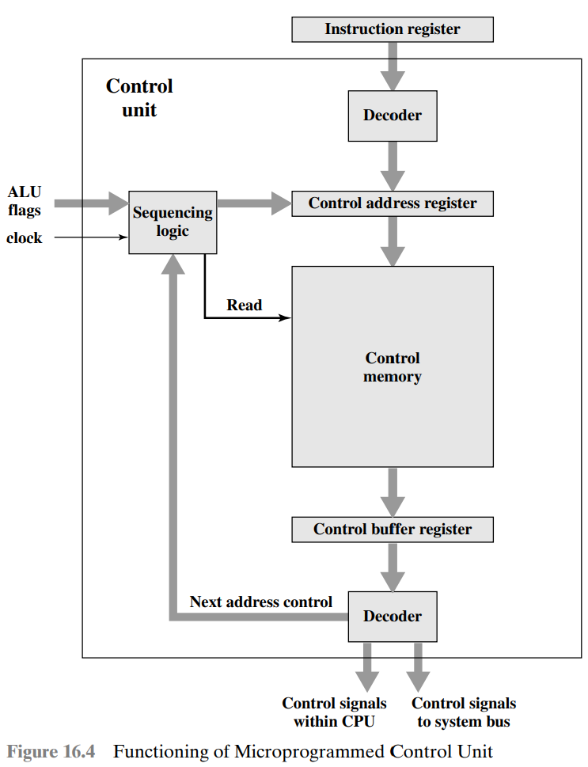
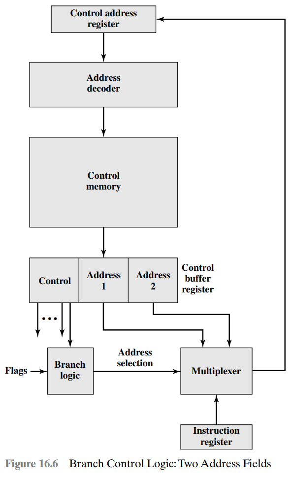

## 16.0 Preface
因为control unit的hardwired implementation实在是太复杂了，microprogram就诞生了

优点有：
- simple to design
- flexible
- very powerful instruction sets

    use bigger control memory if needed

    easy to have complex instruction sets
- compatibility

    easy to be backward compatible in one family

    many organizations with the same instruction set

RISC指令集在执行的时候是不使用microprogramming的

## 16.1 Basic Concepts
### 16.1.1 Microinstructions
关于microgram, microinstruction, micro-operation三者之间的关系，举个例子比较容易讲清楚：

- 程序使用的语言，叫做**microprogramming language**
- 写出来的程序(比如本程序)就是**microprogram**(firmware)

    a midway between hardware and software

    easier to design in firmware than hardware

    more difficult to write a firmware program than a software program
- 这个microprogram里面包含了三行**microinstruction**
- 每行microinstruction包含了数目不尽相同的**micro-operation**

    比如第二行microinstruction包含了两个micro-operation

至于我们怎么样用microprogram的概念来实现control unit呢？实际上对于每一个micro-operation来说，每个control line上的节点只有可能是开或关，即可以对应0/1。我们可以因此构建出**control word**，这个word的每一位对应于一个control line的开关情况。

因此，一个control word就对应于一个micro-operation

control words会被放在内存里，在被添加了不同的附加信息之后，会产生两种不同的microinstruction:

注意一个microinstruction包含了若干个micro-operation(即若干个control words)

- 两个control signals就是control words
- microinstruction address指向的是条件为真时，要执行的microinstruction

    否则按照顺序执行microinstruction

说到这里，我们又需要区分一下machine instruction和microinstruction两个概念了：
- machine instruction更加抽象

    programer-visible

    生成在CPU跑的machine code
- microinstruction更加low-level

    对CPU更底层的控制，控制control line的开关啥的

### 16.1.2 Microprogrammed Control Unit
**control memory**包含了一个描述control unit行为的program. 执行这个程序就实现了control unit的功能

control unit稍抽象的结构图长这样：

反正包含了以下几种元件：
- Control address register
- Control Memory

    被划分成了许多不同的routine：

    

- Control Buffer Register

    contains the current microinstruction
- Sequencing logic

    produce the address of next microinstruction

这个control unit的结构更加完整一点的话，就是下面这样：

比较特别的是，对于microinstruction来说， read操作就相当于execute(反正读出来之后就控制了control line的开关)

control buffer register产生control signal和next address information

## 16.2 Microinstruction Sequencing
microprogrammed control unit做的两件基本的任务是：
- **Microinstruction sequencing**

    get the next microinstruction from the control memory
- **Microinstruction execution**

    generate the control signals needed to execute the microinstruction

### 16.2.1 Design Considerations
下一个要执行的microinstruction可能是下列：
- **Determined by instruction register**

    load ==control address register== based on ==opcode== in ==IR==

    occurs only once per instruction cycle, just after an instruction is fetched
- **Next sequential address**

    Add 1 to ==control address register==

    the most common in most designs
- **Branch**
    
    load ==address field== of ==control buffer register== into ==control address register==

### 16.2.2 Sequencing Techniques
关于下一个address是怎么生成的，也有很多种类的做法：
- Addresses explicitly presented

    意思是address就存在microinstruction里面(control buffer register里)

    分成几类：
    - **Two-field**

        

        实际上也是branch的一种方法。两个address对应的是条件为真或假时的指令。
    - **Conditional branch**

        select one of them

        由下列信息决定：
        - ALU flags
        - Part of the opcode or address mode fields of the machine instruction
        - Parts of a selected register, such as the sign bit
        - Status bits within the control unit
    - **Unconditional branch**

        jump to this one
- Addresses not explicitly presented

    - **Mapping**

        mapping opcode in machine instruction into microinstruction address
    - **Addition**

        combine two portions of an address to form the complete address
    - **Residual control**

        return from microprogram subroutine

### 16.2.3 Address Generation