这一章的主要话题集中于：
- **Function**

    How a program is run?
- **Structure**

    How the component is interconnected?

## 3.1 Computer components

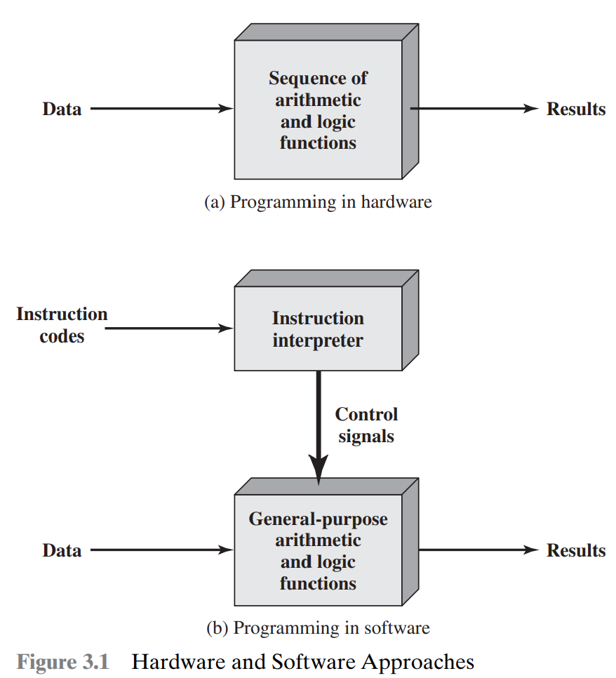

下面是computer component的top-level view:

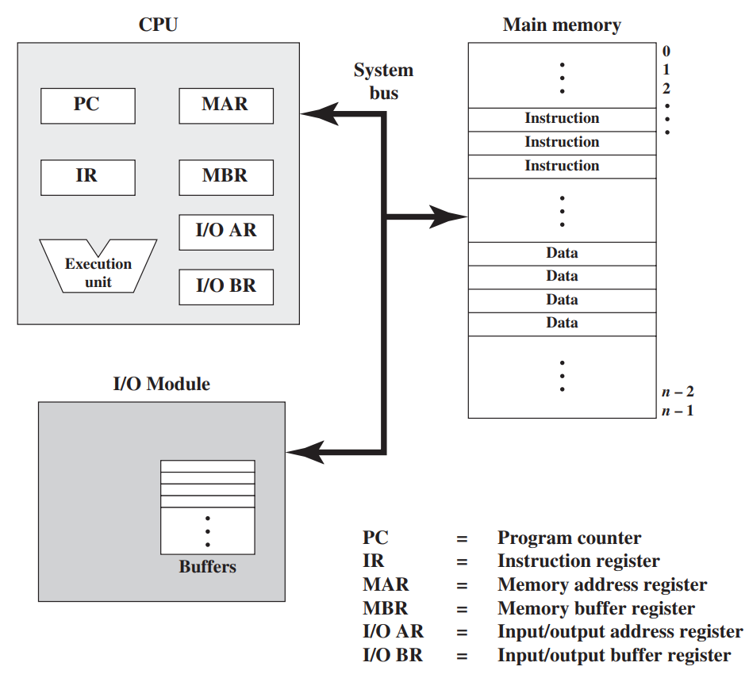

这些乱七八糟的缩写名字还是要稍微记一下的

### 3.1.1 Instruction Fetch and Execute
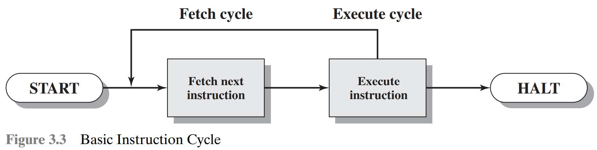

比较简单的处理器执行流程就是上图这样子

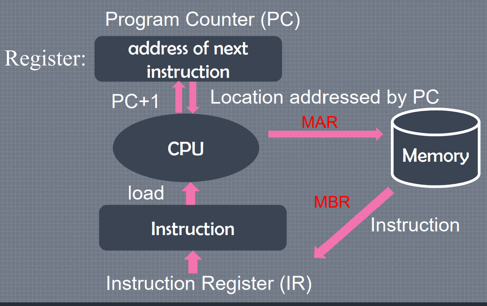

这张图则是体现了**MAR**(memory address register)和**MBR**(memory buffer register)分别都有啥用

一般来说，会执行的行为包括：
- **Processor-memory**

    比如`z=x+y`
- **Processor-IO**

    比如`x=input()`
- **Data processing**

    比如`i++`
- **Control**

    比如`goto`, `break`

来举个例子说明处理器会干什么:

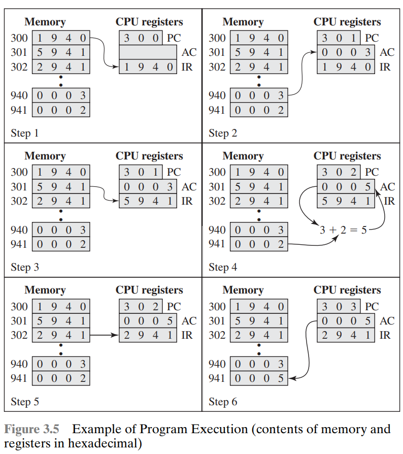

这个例子之中，进行了`3+2=5`的运算

其中:
- **PC(program counter)**

    存储address of information

    比如，300代表第一条执行的命令的地址在300
- **IR(instructor register)**

    存储instruction being executed

    比如，1940就是地址为300的位置对应的指令
- **AC(accumulator)**

    存储temporary storage

    顾名思义可以进行一些运算的地方，比如第四步进行了加法

> 关于那些四位的数字，第一位数字代表的是需要==执行的操作==： 1: load AC from memory;  2: store AC to memory;  5: add to AC from memory； 而后面的三位数字则是需要进行操作的数的==地址==

更加细致的状态转移图如下:

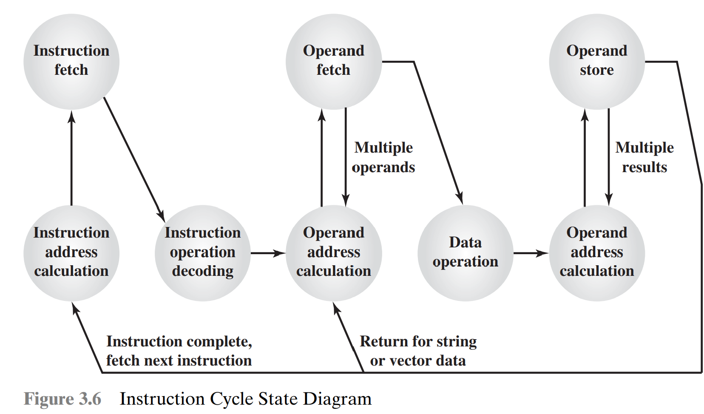
    
### 3.1.2 Interrupts
正常来说CPU的处理速率都要高于其他的组件，那难道就让CPU干等其他组件执行完了再继续运行吗？那必不可能，可以让CPU算点别的东西，提高效率

可以分成几类：
- **Program interrupt**

    反正就是发生了异常情况
- **Timer interrupt**

    处理器内部的计时器，可以让处理器执行一些time-scheduled task
- **I/O interrupt**
- **Hardware failure interrupt**

反正上面的分类一点都不重要，下面的关于程序执行更加高效的例子才是要理解的：

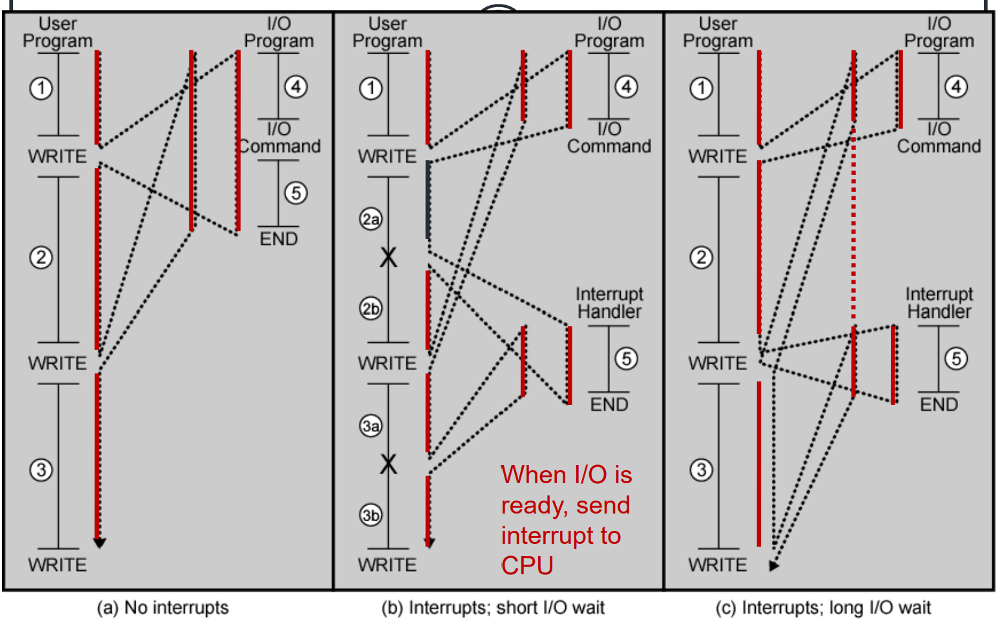

- (a) No interrupts

    在IO程序在进行处理的时候，程序就停了下来等待
- (b) Interrupts with short I/O process time

    IO程序跑的足够快的话，在进行下一次IO操作之前，程序已经处理了2a部分的程序，这时候收到了处理interrupt的指令，就被叫去处理IO了，处理完了之后再继续处理2b部分
- (c) Interrupts with long I/O process

    IO程序跑的太慢，到了执行下一次IO操作的时候还没处理完，那就只能等一等了，等到上一次IO操作完成了，被叫去处理IO，然后才能继续处理下一次IO

所以说，interrupt的实质是transfer of control:

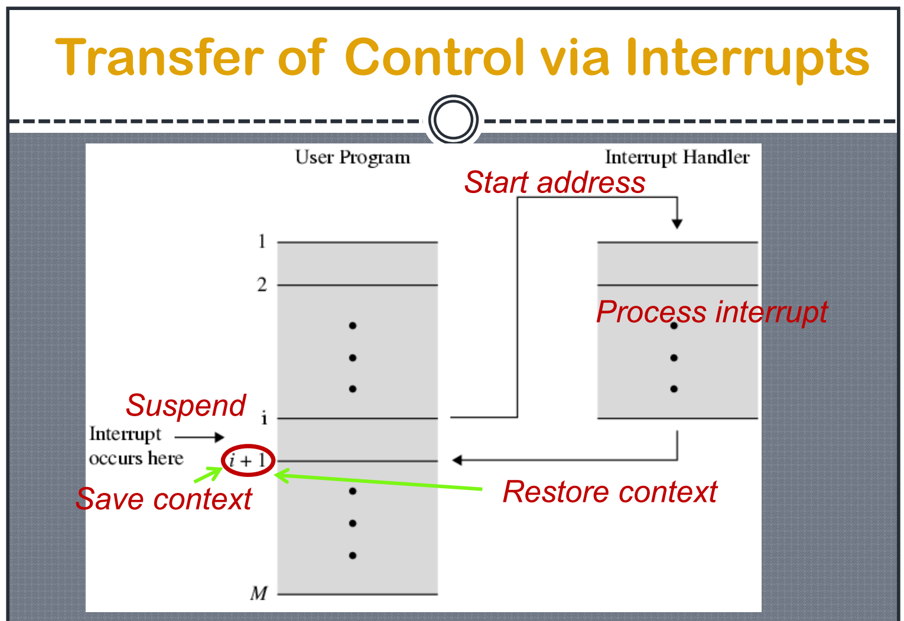

#### 3.1.2.1 Interrupts and the Instruction Cycle
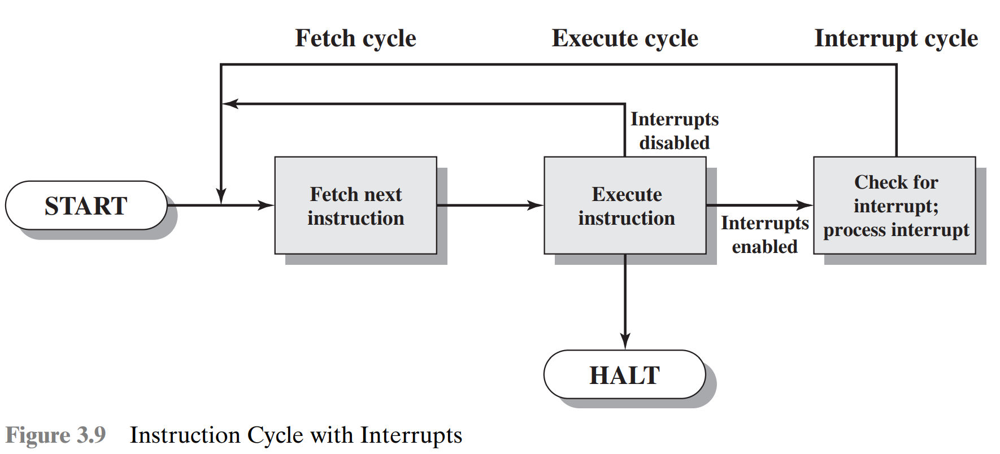

相比于之前的那张图，多了check for interrupt的步骤

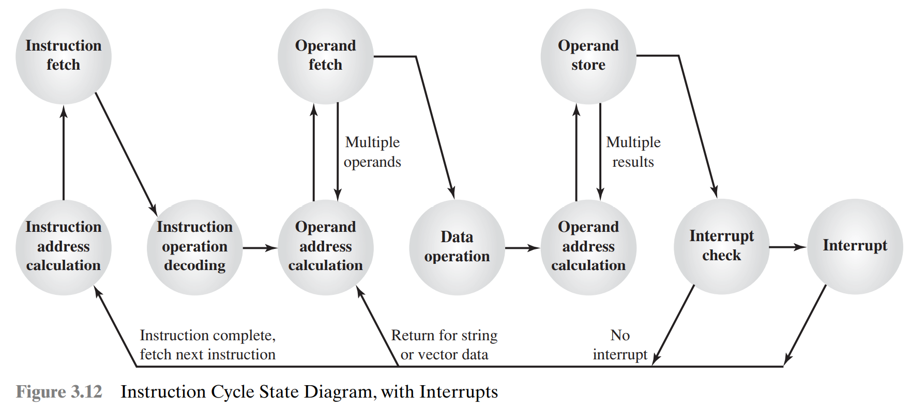

这张图则是多了最右边的两个state

#### 3.1.2.2 Multiple Interrupts
有时候CPU必须要面对超级多的interrupts，那如何解决呢？
- **Disable interrupts**

    大概就是一次搞一个，暂时先搁着后面的interrupts请求，按照先后顺序来一个个执行

    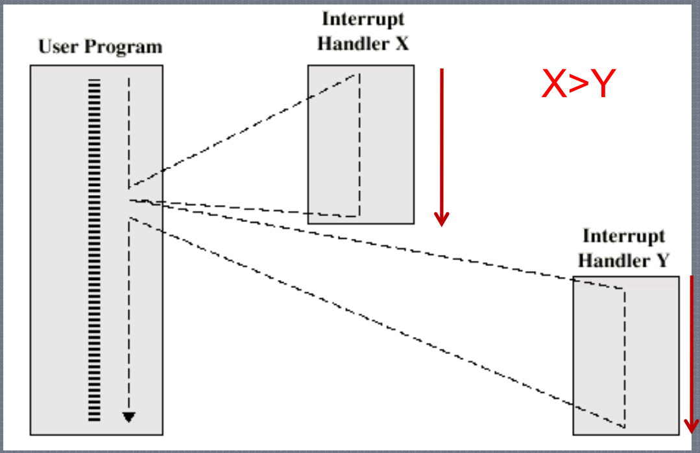
- **Define priorities**

    显然就是定义一个优先级顺序，甚至于低优先级的interrupt可以被高优先级的interrupt打断

    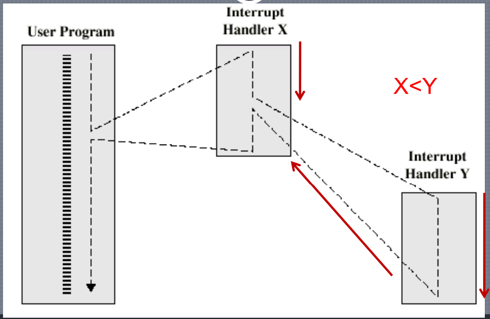

## 3.3 Interconnection Structures
来看看各个部件都需要进行哪些data exchange:
- **Memory**

    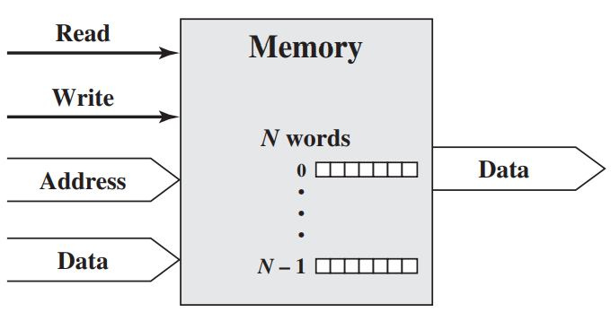

    - consists of N word of equal length
    - each word is assigned with a unique address
    - a word of data can be read from or write into the memory

    至于能够传输哪些data:
    - receives and sends data
    - receives addresses
    - receives control signals
- **I/O module**

    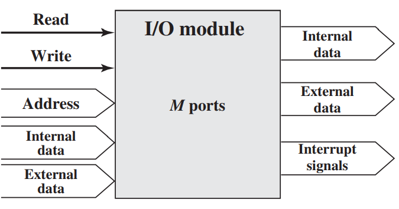

    - control more than one external device
    - the interface to an external device is a port and given unique address

    从功能上来说，IO甚至有点像memory

    input:
    - receive data from peripheral
    - receive addresses from computer
    - receive control signals from computer

    output:
    - send data to peripheral
    - send interrupt signals
- **Processor**

    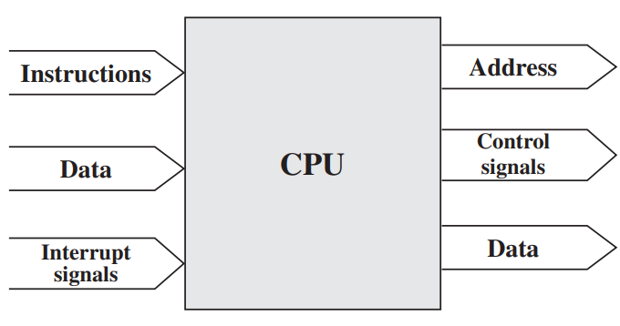

    - read in data and instruction
    - write out data and send control signals
    - receive interrupts

    至于要对付什么数据：
    - reads instruction and data
    - writes out data
    - sends control signals to other units
    - receives interrupts

## 3.4 Bus Interconnection
**Bus**
- a communication pathway connecting two or more devices. And it's a shared transmission medium
- signal usually broadcast, one sends, received by others
- ==only one device== can talk at a time or the message is misunderstood
- each line in a bus contain ==a single binary digit== at one time. 然而因为可以==并行传输==，所以实际上同一时间可以有多个line同时传输多位
- a bus that connects major computer components (processor, memory, I/O) is called a **system bus**

### 3.4.1 Bus Structure
一般bus之中的lines会被分成功能不同的三类:

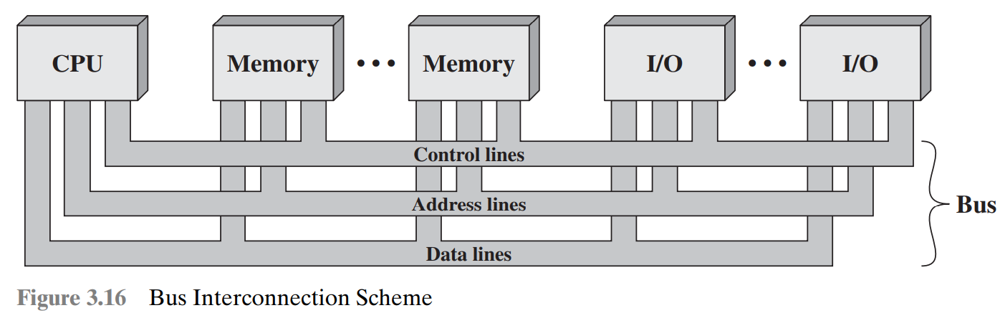

- **data lines**

    - ==move data== between system modules

        由于传输的时候都是二进制，所以这种时候data和instruction就==没啥区别==
    - the ==number of lines== in the bus is referred as **width**
    - width is a ==key determinant== of performance

        比如32, 64bit
- **address lines**

    - designate ==the source or destination of data==
    - bus width determines ==maximum memory capacity of system==
    - also used to address I/O ports

        就是有时候会用最高位数字来指代是哪个module，其中就包含了I/O module
- **control lines**

    - control the ==access to== and the ==use== of ==data and address lines==
    - 有以下几种不同的control lines:
        - memory read/write signal
        - interrupt request
        - clock signals

两种operation:
- **requesting data**

    - obtain the use of the bus
    - transfer the request via the bus
    - wait for other module to send data
    - possible acknowledge

        就是要确认一下对方是不是目标对象，毕竟bus上连接的元件这么多
- **sending data**

    - obtain the use of the bus
    - transfer the data via the bus
    - possible acknowledgement

### 3.4.2 Multiple-Bus Hierarchies
假如只有一个bus的话会遇到很多问题:
- ==physically long== buses
    - 传递延迟更高
- 为了提高传输速率需要更高的位宽，即便这样子也跟不上数据传输量的需求
- 只要有设备太慢，就会堵住整个主线程

所以我们需要多个buses

- 传统实现方法(ISA with cache):

    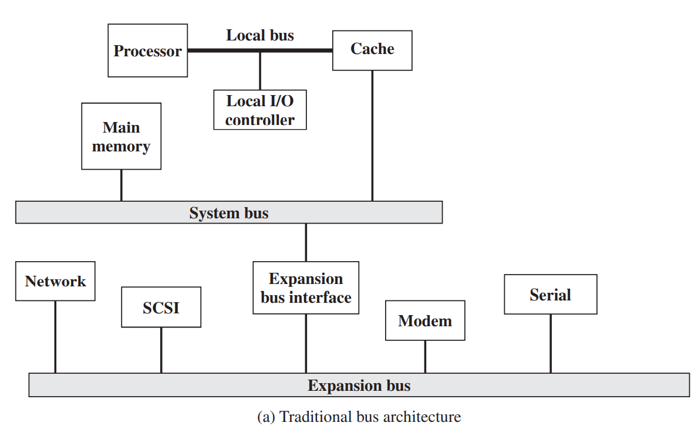
- Mezzanine Approach

    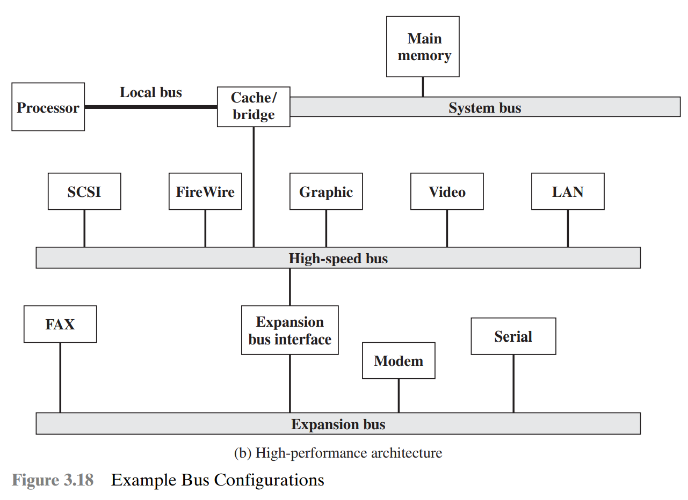

    可以看到多出来一个*high-speed bus*。这样子把更高性能的设备放在一起，可以防止bus轻易被堵住

#### 3.4.2.1 Bus Types
- **Dedicated**

    separate data & address lines
- **Multiplexed**

    shared lines for multiple purpose
    - advantage

        - fewer lines
    - disadvantages
        - more complex control
        - no parallel
#### 3.4.2.2 Bus Arbitration
“仲裁”

鉴于有很多module都可以控制bus，然而一次只能有一个module可以控制bus，所以就要有硬件来“仲裁”一下到底谁来控制

有两种类型的arbitration:
- **Centralized**

    由==单个==硬件来control bus access, allocating the time on bus

    这个硬件甚至有可能就是CPU的一个组成部分
- **Distributed**

    Access control logic is on ==all modules==

    Modules work together to control bus

## 3.5 PCI
**P**eripheral **C**omponent **I**nterconnect

> **PCI** is a popular ==high-bandwidth, processor-independent== bus that can function as a ==mezzanine== or peripheral bus

有如下特征：
- supports single and multi processor
- ==time multiplexed== address and data

    也就是这两种公用一个bus（分时复用）
- synchronous timing
- centralized arbitration

包含以下几种不同的bus lines:
- **System Lines**

    包括clock和reset
- **Address & Data Lines**

    也就是上面提到的time multiplexed分时复用

    细分成interrupt & validate lines
- **Interface Control Lines**

    选择设备，并允许设备发送他们准备好了的信号
- **Arbitration Lines**

    每一个PCI master都有一个自己的

    直接连接着PCI bus arbiter
- **Error Lines**

总之整体的结构看起来像下面这样:

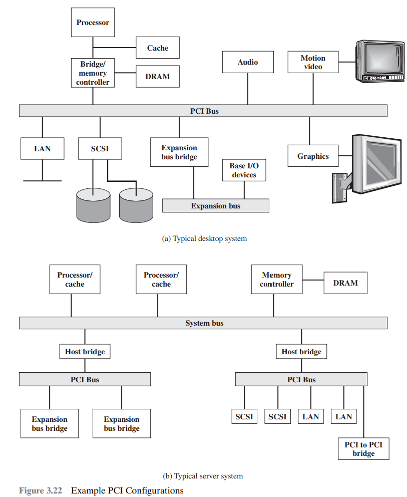

## 3.? Common I/O Bus Types
- IDE
- PATA
- SATA
- COM
- Centronics ports
- SCSI
- IEEE 1394(FIre Wire)
- PS/2
- USB

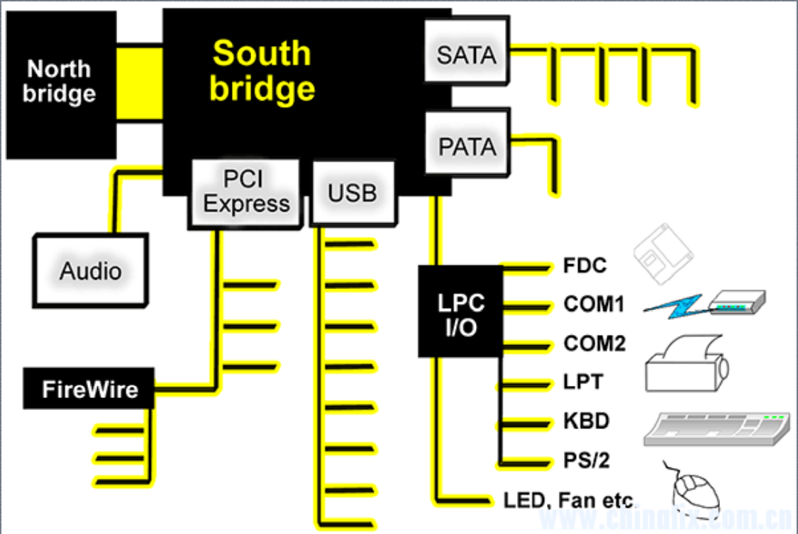
