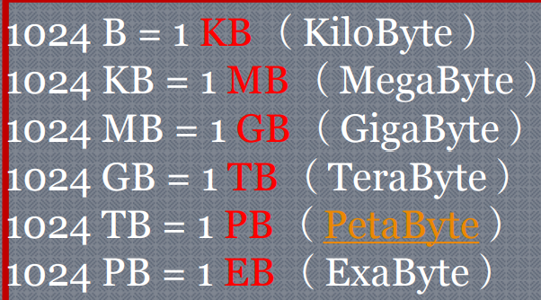
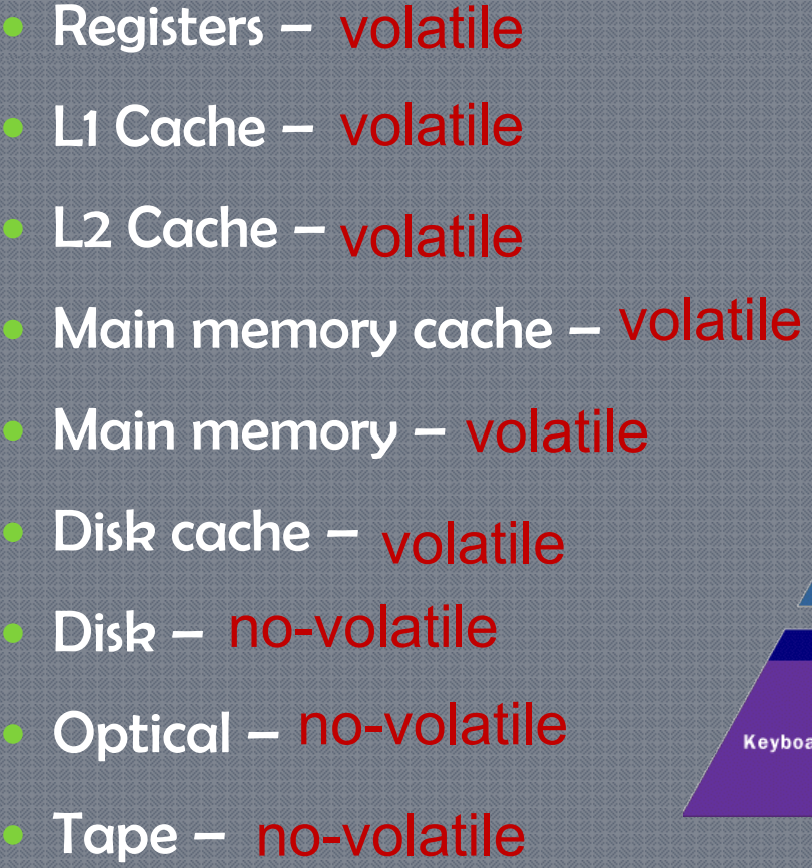
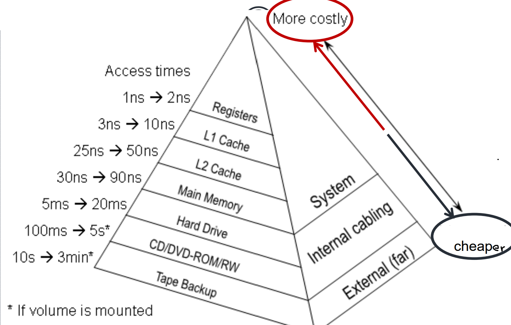
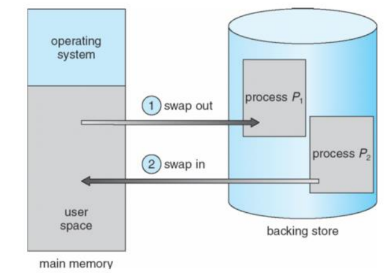
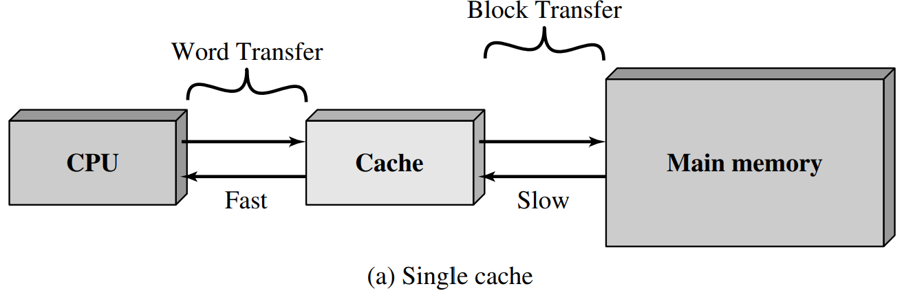
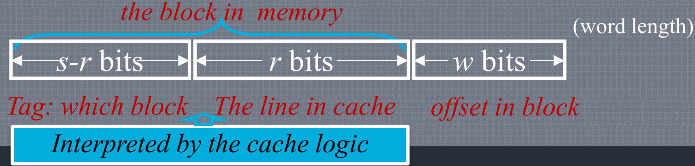
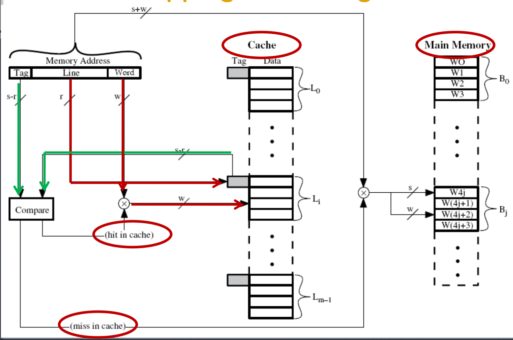
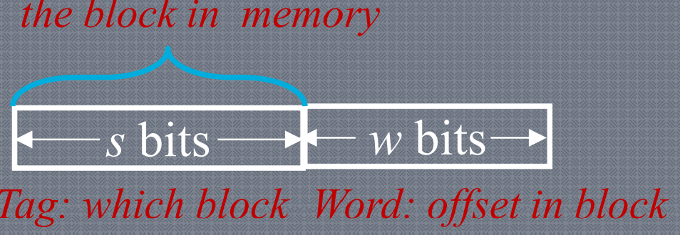
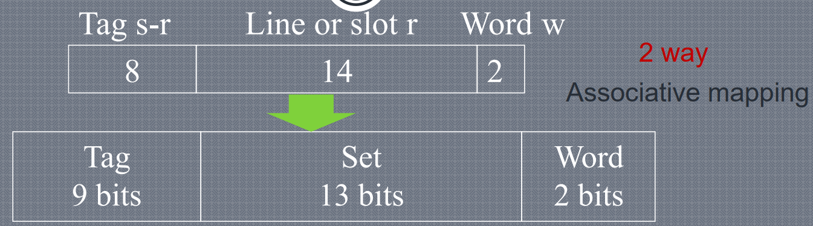

## 4.1 Computer Memory System Overview
### 4.1.1 Characteristics of Memory Systems
- **Location**
    - **Internal memory**

        - inside processor: registers and L1 cache
        - motherboard: L2 cache
        - main memory: DRAM and L3 cache
    - **External memory**

        peripherals: disk, tape, and networked memory devices
- **Capacity**

    容量用byte来衡量(8bit)

    
    
    - **word**

        the natural unit of memory

        Equal to the number of bits used to represent an integer/instruction(16/32/64bits)
- **Address Unit**

    the smallest location which can be uniquely addressed

    varies based on the system's ability:
    - some use word unit
    - many use at bit level

    At motherboard level, this is a word; On disks, it is a cluster

    the length in bits $A$ of an address and the number $N$ of addressable units is $2^A=N$
- **Unit of transfer**

    ==The number of bits== read out of or written into memory at a time

    - internal

        usually governed by ==data bus width==(e.g. a word)
    - external

        usually ==a block== which is much larger than a word
- **Method of accessing**

    - **Sequential access**

        Access time depends on ==location of data== and ==previous location==

        比如磁带
    - **Direct access**

        memory被分成一个个==block==，每一个block都有唯一的地址

        Access time depends on ==location of data within "block"== and ==previous location==

        比如硬盘
    - **Random access**

        Access is at ==random and direct==

        每一个的地址都不同

        Access time is ==consistent== across all locations and is ==independent of previous access==

        比如RAM

    - **Associative**

        A word is retrieved based on ==a portion of its content== rather than its address

        Access time is ==independent of location or previous access==

        比如cache
- **Performance**

    - **Access time / Latency**

        time between requesting data and getting it

        只有RAM的access time是可预测的
    - **Memory cycle time**

         consists of the access time plus any additional time required before a second access can commence.
    - **Transfer rate**

        bits per second

        - RAM: $$1/(\text{cycle time})$$

        - others: $$T_N=T_A+\frac{n}{R}$$

            其中：

            $T_N$: Average time to read or write $N$ bits

            $T_A$: Average access time

            $n$: Number of bits

            $R$: Transfer rate, in bits per second(bps)
- **Physical types**

    - **Semiconductor**

        RAM, ROM
    - **Magnetic**

        Disk, Tape
    - **Optical**

        CD, DVD

- **Physical characteristics**

    - **Volatile memory**

        “不稳定的”

        意思是电源切断之后，data就丢失了
    - **Nonvolatile memory**

    

### 4.1.2 The Memory Hierarchy
memory的设计就是和三个因素作斗争：
- **Capacity**
- **Access time**
- **Cost**

为了平衡这仨，我们使用**memory hierarchy**来解决:

当我们从顶部向下走的时候:
- Decrease cost per bit
- Increasing capacity
- Increasing access time
- Decreasing frequency of access of the memory by processor

    为了实现这个特点，我们需要点小技巧：
    - **Locality of Reference**

        During execution of programming, memory reference for instructions and data tend to ==cluster together== (loops, subroutines, and data structures)

        就是有关联的指令和数据会扎堆在一起

        短时间内，cluster是会保持不变；但是长时间后，cluster就会改变

    - **Breaking Memory into Levels**

        

        Level 2 contain all instructions and data

        Level 1 contain current cluster, which will swap back to Level 2 to make room for new cluster in Level1

        不光是这个例子中两个层级的结构适用这种设计，所有分层结构都适用。

        比如把速度最快的register塞进processor

## 4.2 Cache Memory Principles
> a **cache** is a small amount of fast memory

cache contains a ==copy of portions== of main memory

当processor需要读取一个word的时候，会先检查cache。假设不在cache里的话，就只能从main memory里面读取了

- **Cache Structure**

    - Each word in main memory has a unique $n$-bit address(二进制整数表示一个地址)
    - address的数量(行数): $2^n$
    - block size: $K$ words(block包含了几行word)
        - 所以我们可以计算出block的数量：

          $M=2^n/K$
    - 在cache里面，**line**相当于main memory里面*block*的概念，每一个*line*有对应的唯一的tag

## 4.3 Elements of Cache Design
### 4.3.1 Cache Size
- **Cost**

    It is expensive. So it is small enough such that the ==average cost per bit== is close to that of main memory
- **Speed**

    It is fast. So it is large enough such that the ==average access time== is close to the cache alone

the chip and board limit the cache size

### 4.3.2 Mapping Function
used to ==locate a memory address== within cache, since cache lines $\ll$ main memory block

有三种不同的mapping functions:
- Direct
- Associative
- Set Associative

#### 4.3.2.1 Direct Mapping
$$
i=j \text{ modulo } m
$$
where:

$
i=\text{cache line number}\\
j=\text{main memory block number}\\
m=\text{number of lines in the cache}
$

看着就很。。。无脑。单纯的取余

address的组成:

可以分成三个部分:
- offset in block: $w$ bits
- the line in cache: $r$ bits
- the block within the line loaded from main memory(tag): $s-r$ bits

区分：$r$是cache中line的identifier，而$s-r$是memory中block的identifier。因为一个block会被load进一个line里面，所以有对应的关系

总的来说可以推导出以下：
- address length: $s+w$ bits
- number of addressable units: $2^{s+w}$ words or bytes
- number of blocks in main memory: $\frac{2^{s+w} }{2^w}=2^s$
- number of lines in cache: $2^r$

该function优缺点如下：
- advantage:

    - simple
    - inexpensive
- disadvantage

    - fixed location for given block

        所以多个block都会挤在一个line

#### 4.3.2.2 Associative Mapping
这玩意就允许了main memory被加载到任何一个line里面

从上图可以看到，address被解析成了两个field:
- word fields:

    word position within the block
- tag field:

    identify a block of the main memory

可以看到没有line的identifier，证明确实没有指定要被load到哪个line里面

优缺点如下:
- advantage:

    Flexible to replace the block in the cache when reading new block
- disadvantage:

    Complex circuit to examine the tags of ==all== the cache lines

#### 4.3.2.3 Set-Associative Mapping
一种折中的做法

- **set**

    > cache is divided into a number of sets, each contains ==a number of lines==

    main memory中的block只能映射到==指定的set==，但是可以映射到该==set中的任意一个line==

address被分成了三个fields:

映射函数关系如下:
$$
m=v\times k\\
i=j\text{ modulo }v
$$
其中:

$
m=\text{number of lines in the cache}\\
i = \text{cache set number}\\
j = \text{main memory block number}\\
k=\text{number of lines in the set}\\
v=\text{number of sets in cache}
$

被称作$k\operatorname{-}way$ set associative mapping(也就是一个set里面有$k$个line)。其中$2\operatorname{-}way$最常见

> word在三种mapping里面指的都是==offset in the block==，别被名字误导了

同样可以根据地址推导出一大堆乱七八糟的信息:
- address length: $s+w$ bits
- number of addressable units in main memory: $2^{s+w}$ words or bytes
- block size(height): $2^w$ words or bytes
- number of blocks in main memory: $2^{s+w}/2^{w}=2^s$
- number of sets: $v=2^d$

至于为什么*set associative mapping*是*direct mapping*和*associative mapping*的结合体:
- $k=1$时，就是*direct mapping*
- $v=1$时，就是*associative mapping*

至于对比一下$2\operatorname{-}way$ *set associative mapping*和*direct mapping*的地址的话:

可以看到*set associative mapping*的地址set部分少了一位，因为set的数量正好是line的一半。

### 4.3.3 Replacement Algorithms
当没有空间给新的line的时候，我们就需要决定一下，选择哪个line来做replacement

对于direct mapping来说，就没必要抉择替换哪个，毕竟每个block都只对应一个line

对于其他的mapping则有以下方法：
- **Least recently used(LRU)**

    > replace the block that ==hasn't been touched== in the longest period of time
- **First in first out(FIFO)**

    > replace the block that ==has been in cache longest==
- **Least frequently used(LFU)**

    > replace the block which has experienced the ==fewest references==
- **Random**

    只比上述算法的性能低一点

### 4.3.4 Write Policy
关于写入，主要有俩问题:
- ==More than one device== may have access to main memory
- ==Multiple CPUs== attached to the same bus and have individual caches; Once one cache is altered, all caches are invalid

所以我们有了以下几种不同的*write policy*:
- **Write through**

    > all write operations are made to ==main memory as well as to the cache==, ensuring that main memory is always valid

    any other processor-cache module can ==monitor traffic to main memory== to maintain consistency within its own cache

    主要的缺点是：
    - it generates substantial memory traffic and may create a bottleneck
- **Write back**

    Initially, updates are made ==in cache only==.

    **Update bit** for cache slot is set when update occurs

    If cache block is to be replaced, write to main memory only if update bit is set

    Other caches stop synchronizing

    I/O must access main memory through cache

上述的方法对多个CPU的情况下并不适用，毕竟每个CPU自己有一个cache

解决方法是使用**cache coherency**
- **Bus watching with write through**

    each cache watches the bus to see if data they contain is being written to the main memory by another processor. 
    
    All processors must be using the write through policy
- **Hardware transparency**

    a ==big brother==(additional hardware) watches all caches, and upon seeing an update to any processor's cache, it updates main memory and all of the caches
