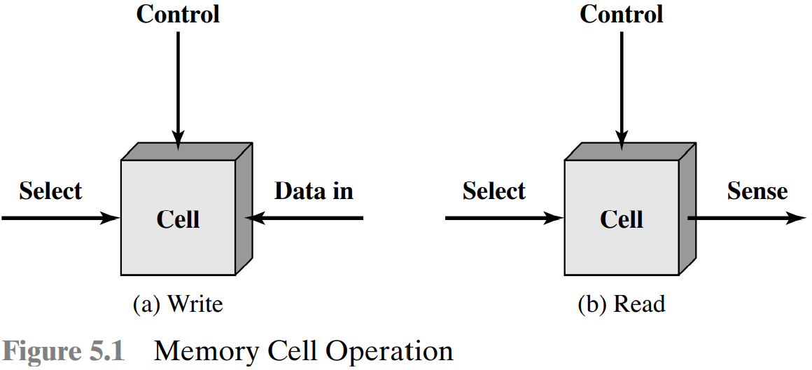
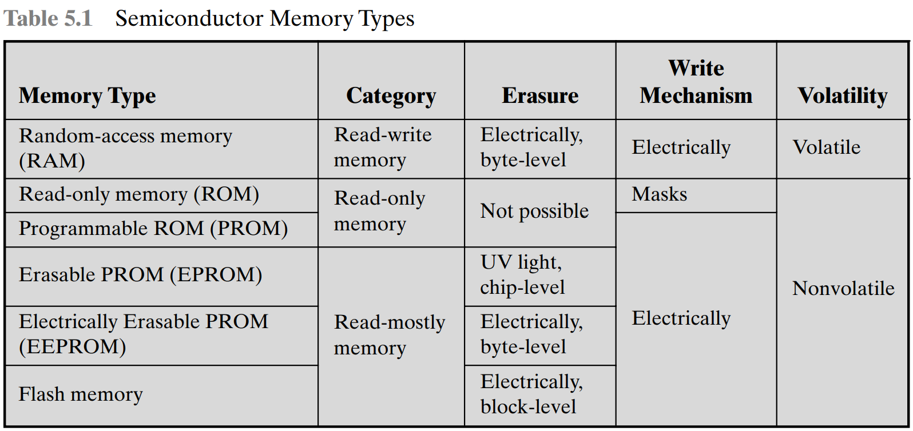
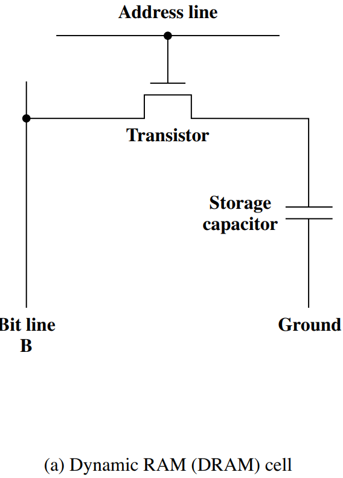
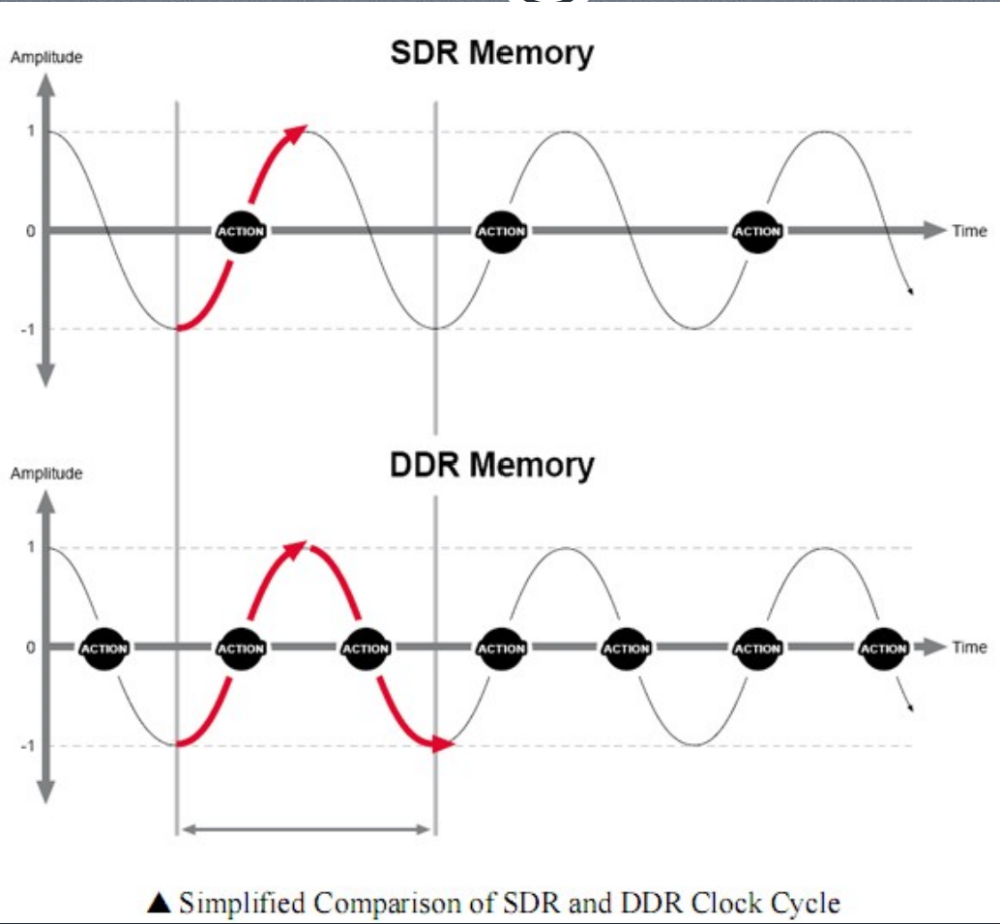
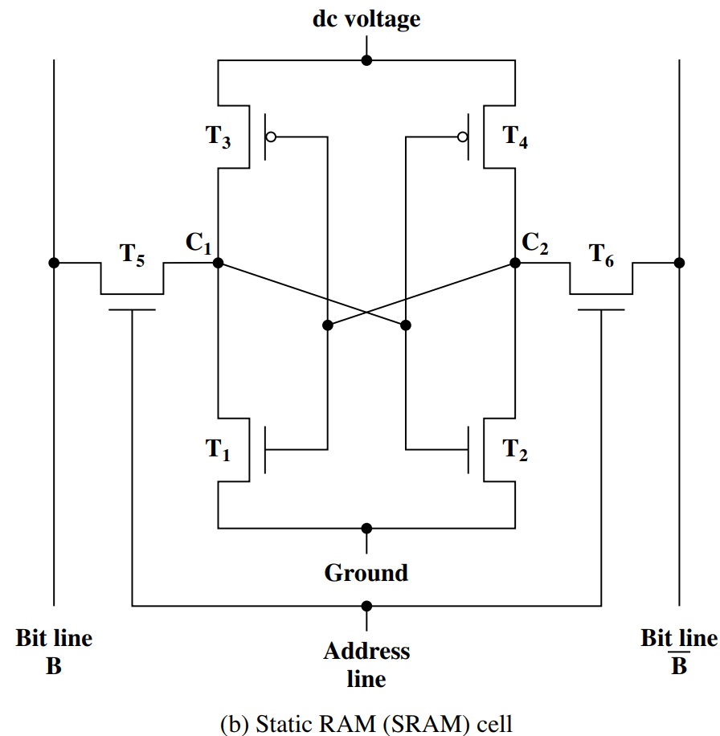
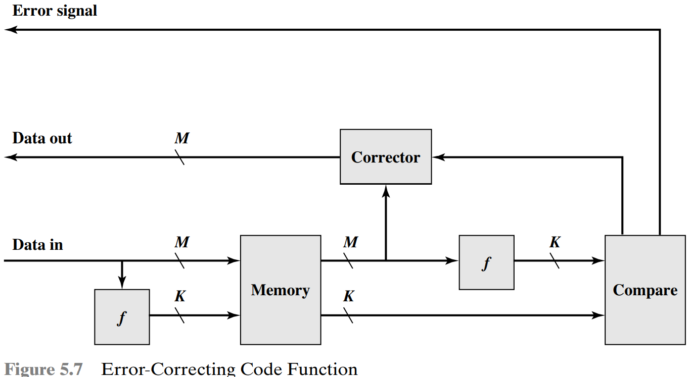
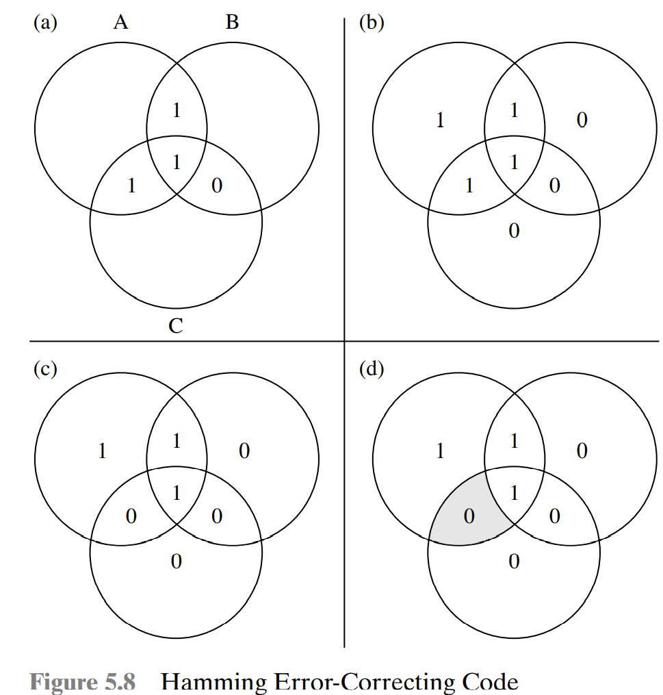
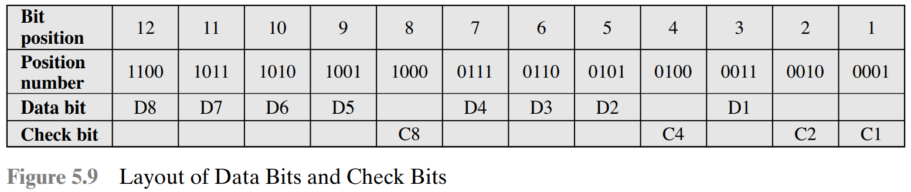
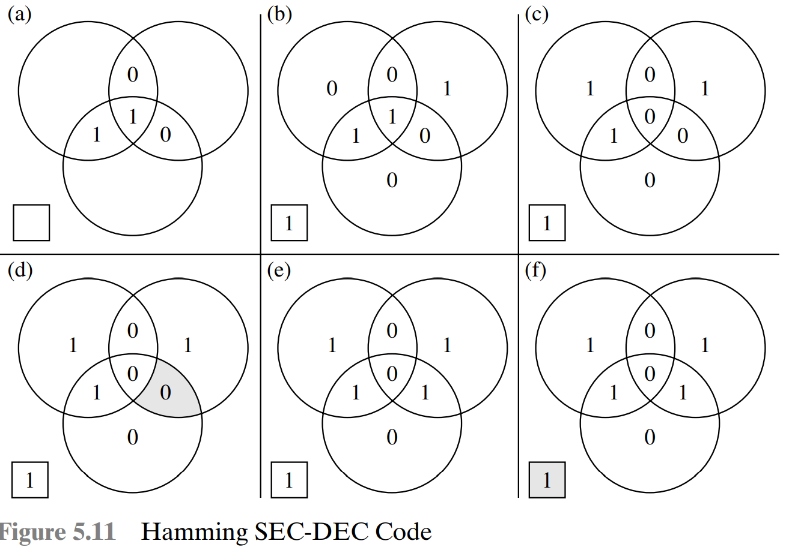

## 5.1 Semiconductor Main Memory
### 5.1.1 Organization

可以看到有三个terminal控制着

### 5.1.2 DRAM and SRAM

RAM用的最多，分为DRAM和SRAM两种
#### 5.1.2.1 Dynamic RAM

用电容存储电荷。有电和没电分别对应1和0

鉴于电容特性，我们需要每隔一段时间就充一下电

DRAM还有一些变种:
- **Synchronous DRAM(SDRAM)**

    传统的DRAM是异步的，而我们给他加了个额外的时钟，这样子的好处是，CPU就知道这家伙啥时候ready了，就没必要一直干等着，可以先去干点别的事情
- **DDR-SDRAM**

    **D**ouble **D**ata **R**ate can send data twice per clock cycle

    也就是我们常说的DDR4/5

    

#### 5.1.2.2 Static RAM

使用flip-flop来存储，只要电源不断，信息就可以存储住

#### 5.1.2.3 SRAM Versus DRAM
两者都是==volatile==的，也就是断了电数据就没了

SRAM速度比DRAM更快，DRAM更适合大容量一点的存储，所以SRAM一般做cache，DRAM一般做main memory

有时候会在DRAM里面塞一点SRAM来提高性能

### 5.1.3 Types of ROM
**R**ead **O**nly **M**emory

看名字就知道是只能读不能写的东西

ROM是nonvolatile的，也就是说断电之后照样可以保存信息

有一些重要的应用：
- microprogramming
- library subroutines
- system programs(BIOS)
- function tables

制造的时候进行的写入操作，非常的昂贵

有以下几种不同类型:
- **Programmable ROM(PROM)**

    > small number of ROM with a particular memory content

    虽然也是只能写入一次，但是并不要求必须制造的时候写入，可以由购买的人来写

以下三种则是read ==mostly== memory
- **Erasable Programmable ROM(EPROM)**

    > before a write operation, ==all== the storage cells must be ==erased==

    用UV(ultraviolet radiation) 来进行erasure，可以多次擦除
- **Electrically erasable programmable memory(EEPROM)**

    > can be written ==without erasing== prior content
    
    takes much longer time to write than read
- **Flash memory**

    intermediate between EPROM and EEPROM in both cost and functionality

    can be ==erased quickly==, so called "flash"

## 5.2 Error Correction
两种错误：
- **Hard Failure**

    > a permanent physical defect

    软件不可纠正
- **Soft Error**

    可纠正，不会造成啥永久损伤

至于要怎么检测并矫正错误：

- when $M$ bits of data are stored, a function $f$ is performed on the data to produce a ==$K$ bits code==. both the data and the code are stored($M+K$).
- when the word in read out, it runs through the function $f$ on $M$ bits ==again==, and the resulting $K$ bits code is compared with the stored $K$ bits of code. The comparison yields one of the three results:
    - No errors are detected. The fetched data bits are sent out
    - An error is detected, and it is ==possible== to correct the error. The data bits plus error correction bits are fed into a corrector, which produces a corrected set of $M$ bits to be sent out. 
    - An error is detected, but it is ==not possible== to correct it. This condition is reported

这种code运作方式叫做**error-correcting codes**

其中最简单的*error-correcting codes*是**Hamming code**：

上图是一个对$4$-bit words($M=4$)使用*Hamming code*的例子。对于7个不同的区域来说，我们先在中间的4个区域里填上这$4$-bit。至于剩下的外围的3个区域，则需要填入**parity bits**，取值是，保证各自的圆形里有==偶数个1==，对应的取值（图(b)展示了填好后的结果）。
> *parity bits*的取值其实就是取了圆内除了自己以外的bit的==XOR==

这样一来，假如我们现在改变$4$-bit当中的一个的值（如图(c)），我们就会发现，包含该数字的圆形对应的*parity bit*这下子就错误了，于是我们可以==很快地定位==到发生错误的位置（图(d)）

上面的$4$-bit的例子还只是过家家的简单理解，我们接下来用一个$8$-bit的例子正经介绍这之中的算法是如何实现的:

- 首先我们需要确定一下，这个code的$K$-bit具体在不同的$M$-bit word的情况下，到底要取值多少。

    鉴于我们要达到的目的是，对前后的$K$-bit code按位进行XOR运算之后，得到的结果$K$-bit的**syndrome word**，能够直接==指示出错的位的地址==。而错误可能出现在存储起来的$M+K$ bit的任何一位上，所以我们需要满足：

    $$
    2^K-1\ge M+K
    $$

    也就是*syndrome word*的$K$-bit二进制，能够最多表示$2^K-1$种错误的位的地址(0代表正常所以减了一)

    在$M=8$的情况下，我们发现$K=4$就可以满足条件($2^4-1\ge 8+4$)

- 然后，我们需要将这$8+4$个bit按照如上的特殊方法交叉排列，来满足以下条件：
    - 假如*syndrome word*全是0，那么没有发生错误
    - 假如*syndrome word*存在==唯一的1==，那么说明错误只发生在了==存储的$4$个check bit上==，所以我们可以直接忽视
    - 假如*syndrome word*存在==多个1==，那么它的数值大小就是==发生错误的位的地址==

    根据以上三点，我们发现$4$个*check bit*被分配到了0001, 0010, 0100, 1000四个只包含一个1的地址

    顺带一提，在外文教材中，我们都会==从右往左==编号，也就是倒着写我们的数据
- 至于怎么样确定哪几个位置上的data bit归哪个check bit管理：
    - $C1$的地址是0001，1出现在坐标第一位，而坐标第一位也包含1的data bit分别是$D1,D2,D4,D5,D7$
    - 以此类推

    根据上述的分组规则，我们就可以对每一组内==取XOR==，来得到每一组内的*check bit*的取值：
    $$
    C1=1\oplus0\oplus1\oplus1\oplus0=1\\
    C2=1\oplus0\oplus1\oplus1\oplus0=1\\
    C4=0\oplus0\oplus1\oplus0=1\\
    C8=1\oplus1\oplus0\oplus0=0
    $$
    也就是说我们的*check bit*组合起来就是0111(注意我们组合在一起的时候，是==从$C8$读到$C1$==，不要反了！)

    这时候假设$D3$发生了错误，值从0变成了1，我们这时候重新计算一下*check bit*：
    $$
    C1=1\oplus0\oplus1\oplus1\oplus0=1\\
    C2=1\oplus1\oplus1\oplus1\oplus0=0\\
    C4=0\oplus1\oplus1\oplus0=0\\
    C8=1\oplus1\oplus0\oplus0=0
    $$
    也就是说*check bit*组合起来变成了0001

    这时候我们来计算一下*syndrome word*：
    $$
    0111\oplus0001=0110
    $$
    而0110恰好就是发生错误的$D3$所在的地址！

上述介绍的是single-error-correcting(**SEC**) code, 然而我们更加常用的是**double-error-detecting (SED-DED)** code：

可以看到，我们会在左下角多存储一位，这一位是对7位全部取XOR得到的(也就是保证1的总数为偶数)。

- 假设有两位发生了变化(图(C))，那么根据SEC的机制，我们还会修改第三个数字(图(d)到(e))。

- 这个时候，我们最终需要检查一下左下角的数字。假设和当前的XOR结果冲突，那么就说明有两位数字发生了变化。

