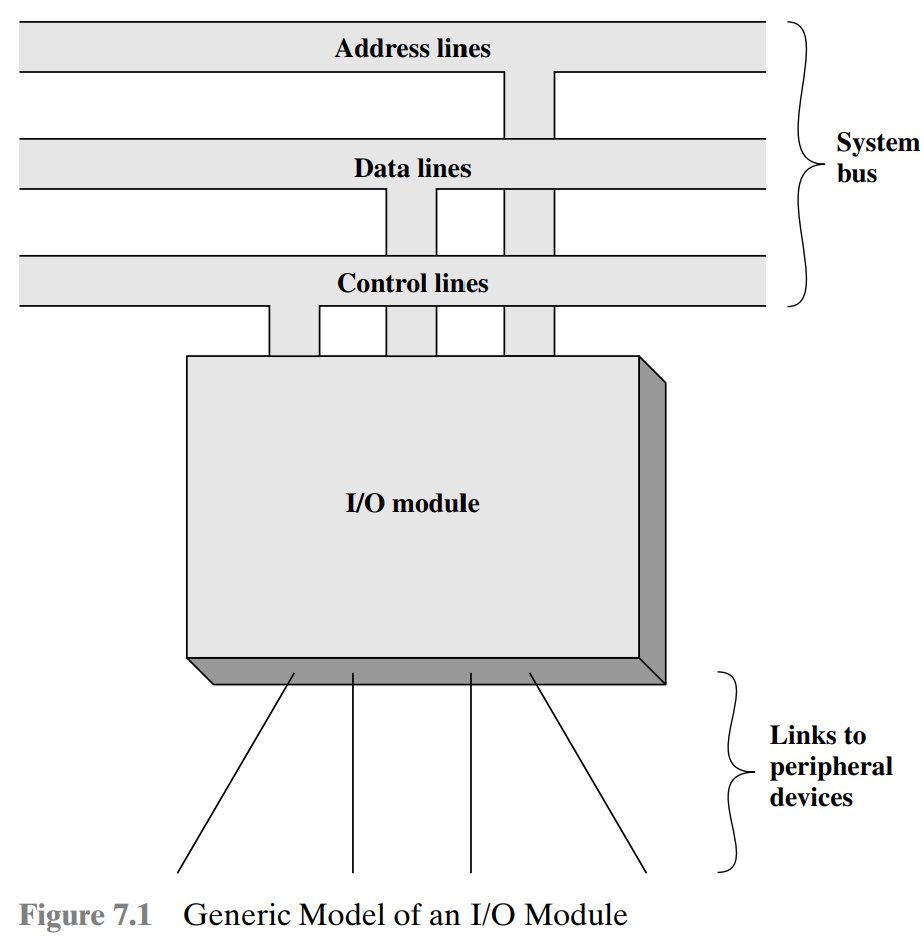
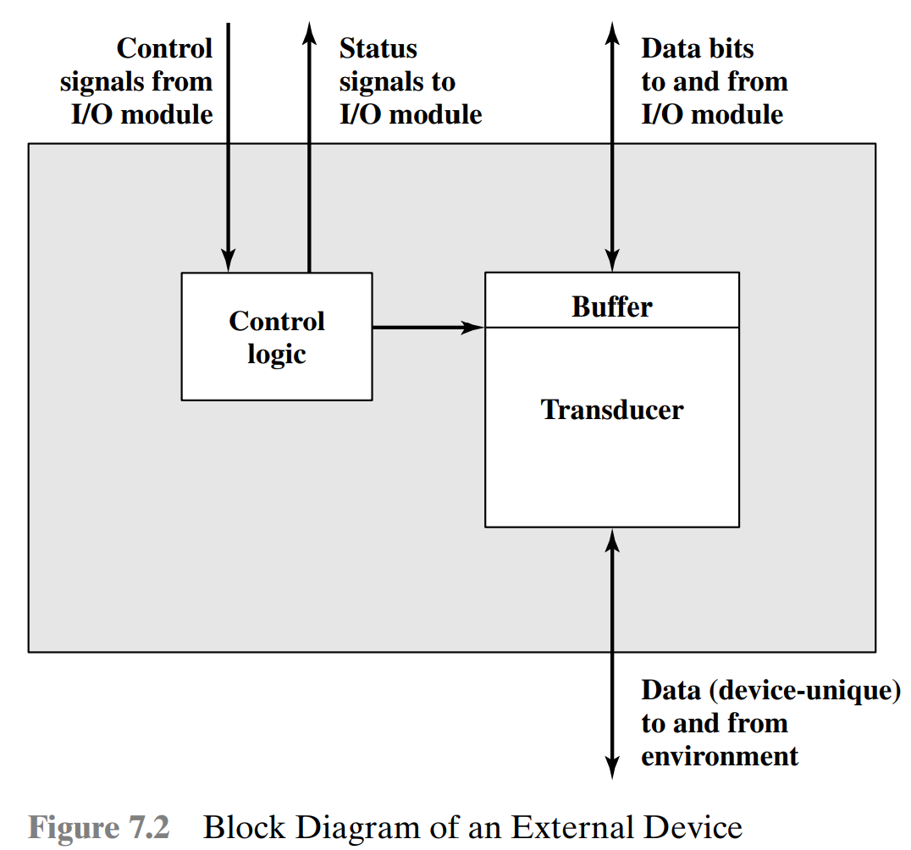
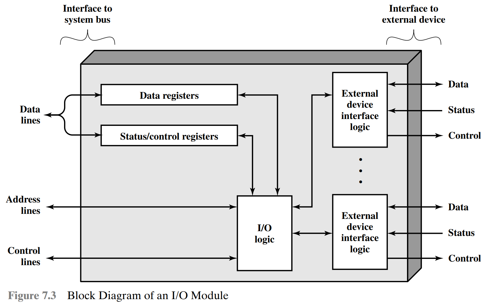
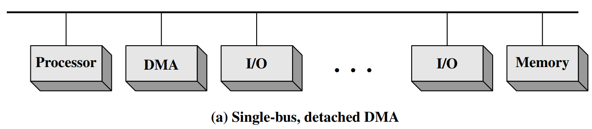
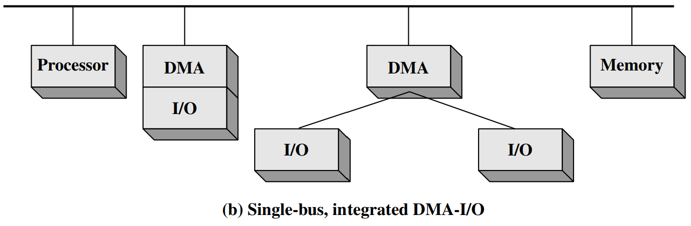
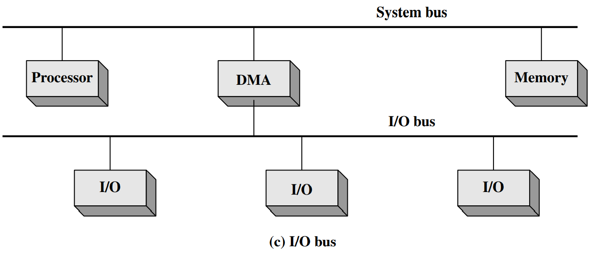
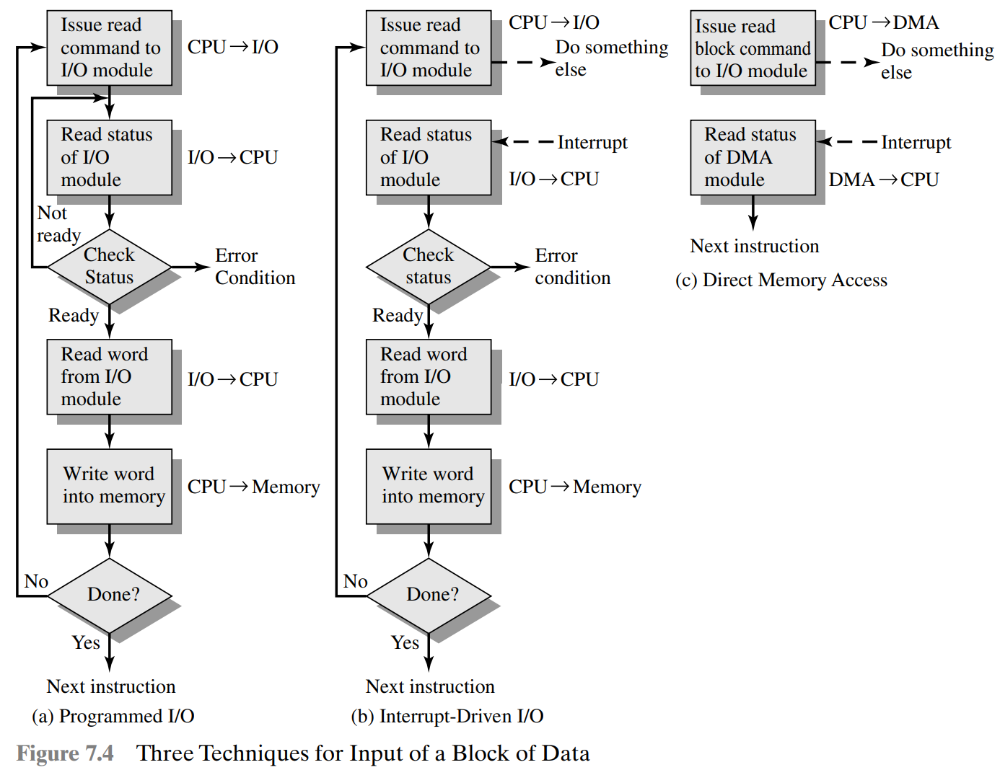
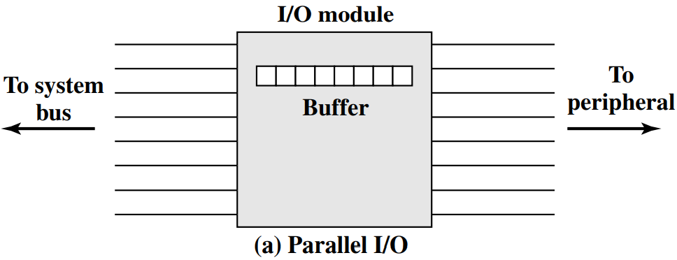
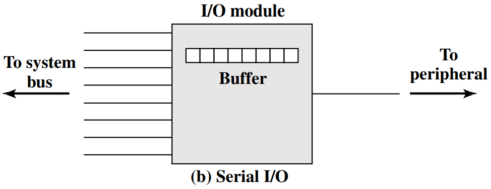

因为peripheral的种类数量多，用的数据格式又和CPU的不一样，运行速度又有很大差别，我们就需要**I/O module**来作为==桥梁==

## 7.1 External Devices
可以分为几类：
- **Human readable**

    > suitable for communicating with the computer user

    monitor, printer...
- **Machine readable**

    > suitable for communicating with equipment

    tape, CDROM...
- **Communication**

    > suitable for communicating with remote devices

    network interface...

上图包括了：
- **Control logic**

    > controls the device’s operation in response to direction from the I/O module
- **Data channel**

    > passes the collected data from or out to the device.
- **Transducer**

    > converter between the digital data and the signals of the outside world.
    
    e.g.

    keyboard converts motion of key into data

## 7.2 I/O Modules
### 7.2.1 Module Function
有以下几类：
- **control and timing**

    多个设备会在同一个channels上通信，所以需要coordinate
- **processor communication**

    - **commands decoding**

        accept the command and sent signals on the control bus. Such as READ SECTOR, WRITE SECTOR
    - **data exchange**

         between the processor and I/O module over the data bus
    - **status reporting**

        the processor needs know the I/O Module's status: BUSY and READY
    - **address recognition**

        I/O module must recognize the unique address for each peripheral
- **device communication**

    command, status information, and data
- **data buffering**

    Device is usually orders of magnitude ==slower== than processor or main memory

    The I/O module needs to buffer data to operate at both device and memory speeds
- **error detection**

    Malfunctions by device (paper jam)

    Data errors (parity checking at the device level)

    Internal errors to the I/O module such as buffer overruns

### 7.2.2 I/O Module Structure

I/O的步骤是：
- CPU checks I/O module for the device status
- I/O module returns the device status
- If ready, CPU requests data transfer
- I/O module gets data from device
- I/O module transfers data to CPU

## 7.3 Programmed I/O
I/O operation有三种techniques:
- **programmed I/O**(7.3)
- **interrupt driven**(7.4)
- **direct memory access(DMA)**(7.5)

### 7.3.1 Overview of Programmed I/O
CPU has ==direct control== over I/O:
- Sensing status
- Read/write commands
- Transferring data

CPU ==waits== for I/O module to complete 
operation

### 7.3.2 I/O Commands
There are four types of I/O commands that an I/O module may receive when it is addressed by a processor:
- **Control**

    > telling a peripheral what to do
- **Test**

    > used to check status condition of I/O module
- **Read**

    > obtains data from peripheral and put on the data bus so processor can read it
- **Write**

    > takes the data from bus and send to the peripheral

I/O module performs operation

When completed, I/O module updates its status registers

I/O module does not inform CPU directly

CPU must wait and remain in a status-checking cycle 

Waste CPU time

### 7.3.3 I/O Instruction
Under programmed I/O, data transfer is very like memory access (CPU viewpoint)

Each device given unique address

CPU commands contain the address of the 
device

The processor, main memory and I/O share a common bus

There're two possible addressing: 
- **memory mapped**

    Devices and memory share an address space
    
    The status and data registers treated as memory location

    Use the same machine instructions to access both memory and I/O device
- **isolated**

    Uses the same address lines but different read/write control lines 

    Separate address spaces

    Need I/O or memory select lines

## 7.4 Interrupt-Driven I/O
Overcomes CPU's waiting problem and the problem of repeatedly checking the I/O status

I/O module interrupts when ready

No repeated CPU checking of device

Requires setup command and interrupt service routine

Still requires CPU for moving data between I/O module and main memory

### 7.4.1 Interrupt Processing
- I/O module view

    Receive read command from the processor

    I/O module gets data from peripheral while CPU does other work

    Once data are in the module’s data register, I/O module interrupts CPU

    CPU requests data 

    I/O module places its data on the data bus
- CPU view

    Issue read command, goes off and do other work

    Check for interrupt at end of each instruction cycle (NO CODE IS INVOLVED IN THIS)

    I/O module issues interrupt request

    If interrupted, the processor :

    - Save context on stack
    - Process the interrupt, send data request, get data from the data bus 
    - Send acknowledgement so I/O module can lease request
    - Resume the context and resume execution

## 7.5 Direct Memory Access
### 7.5.1 Drawbacks of Programmed and Interrupt-Driven I/O
Interrupt driven and programmed I/O require active CPU intervention (All data must pass through CPU)

Transfer rate is limited by processor's ability to test and service a device

### 7.5.2 DMA Function
Additional module (hardware) on bus

DMA module takes over controls of CPU 
for I/O:
- DMA module use the bus when the processor doesn't need bus 
- or force the processor to suspend, referred as Cycle stealing – seizing bus from CPU (more common)

When needing read/write data, CPU issue 
command to DMA controller the following information:
- Whether a read or write, use the control line between CPU and DMA module
- The address of device to transfer data
- The starting address of memory block for the data transfer
- The amount of data to be transferred

DMA performs transfer directly with memory while CPU does other processes

DMA sends interrupt when completed

The DMA mechanism can be confirmed in a variety of ways:
- **Single bus, detached DMA**

    

    Each transfer uses bus twice – I/O to DMA then DMA to memory
    
    CPU is suspended twice

    Is inexpensive but inefficient
- **Single bus, integrated DMA-I/O**

    

    DMA Controller may support one or more devices

    Each transfer uses bus once – DMA to memory
    
    CPU is suspended once
- **I/O bus**

    

    Bus supports all DMA enabled devices with single DMA controller

    Each transfer uses bus once – DMA to memory

    No need of system bus for the transfer between DMA and I/O

至此我们已经学完三种不同的techniques了，下面是流程图的比较:

## 7.7 The External Interface: Firewall and Infiniband
### 7.7.1 Types of Interfaces
两种不同的interface:
- **parallel interface**

    
- **serial interface**

    

