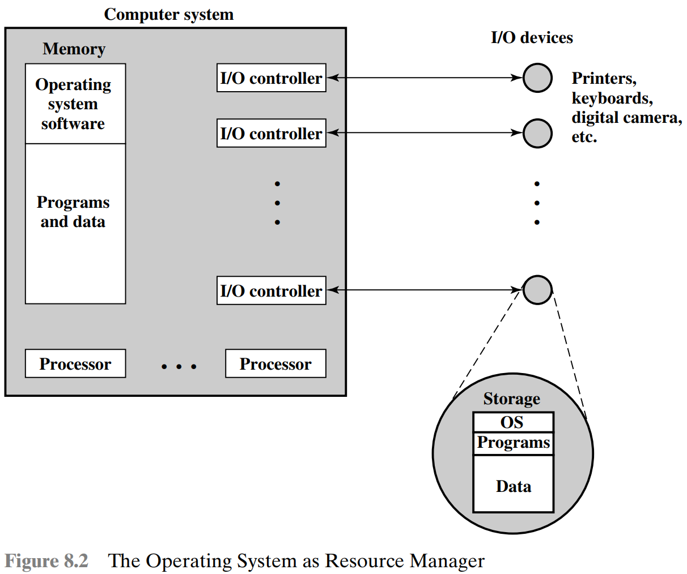
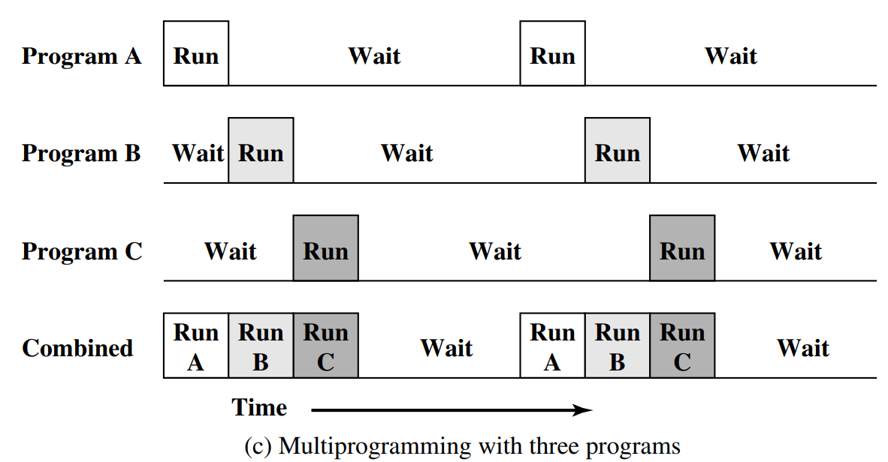
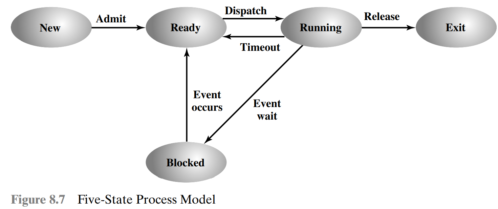
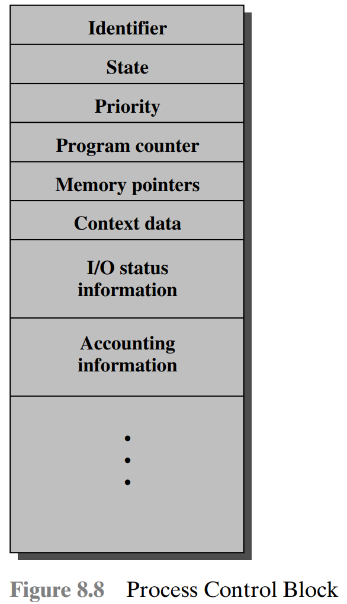
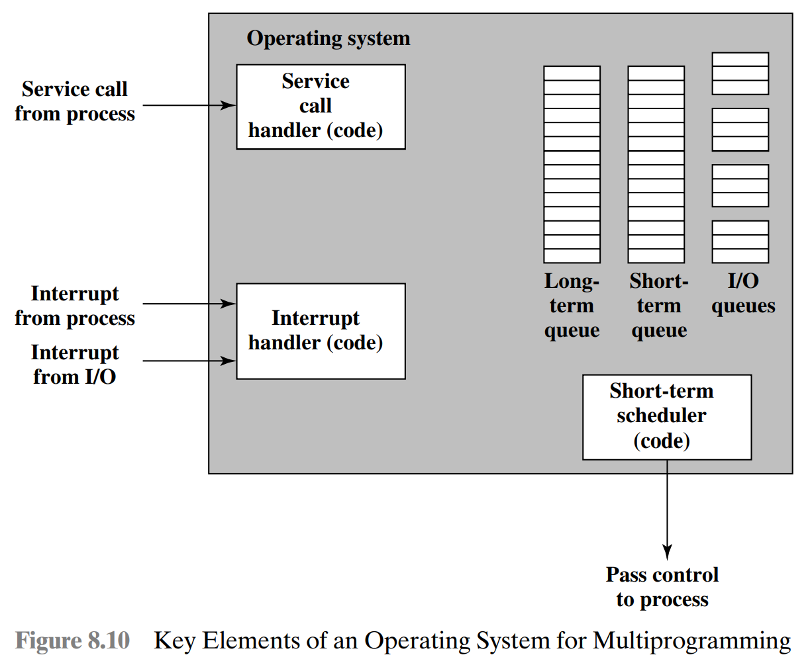
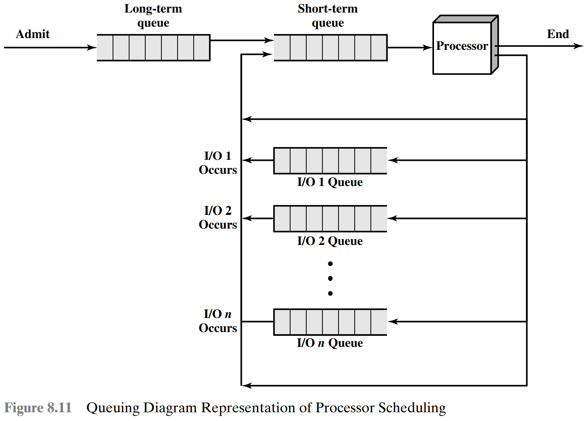
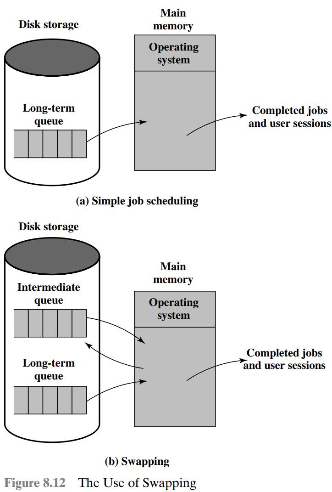
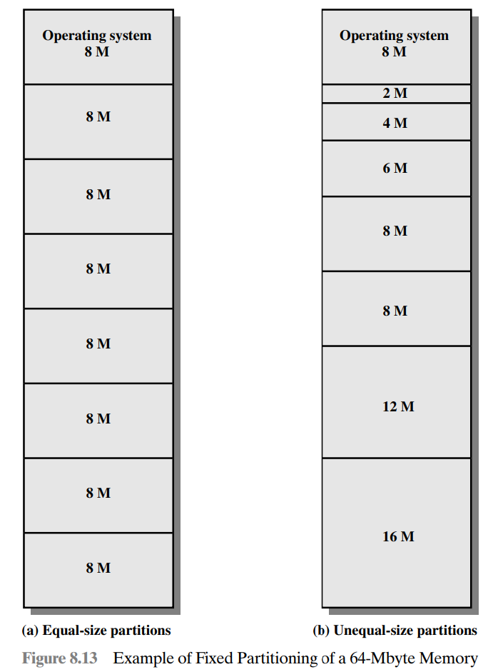
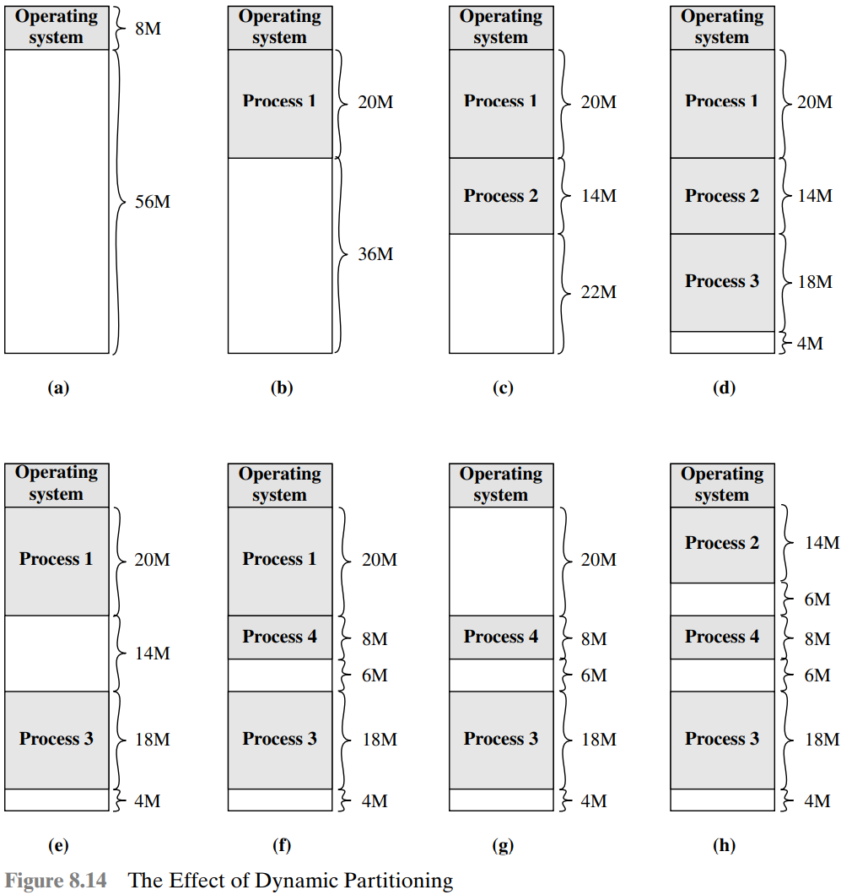
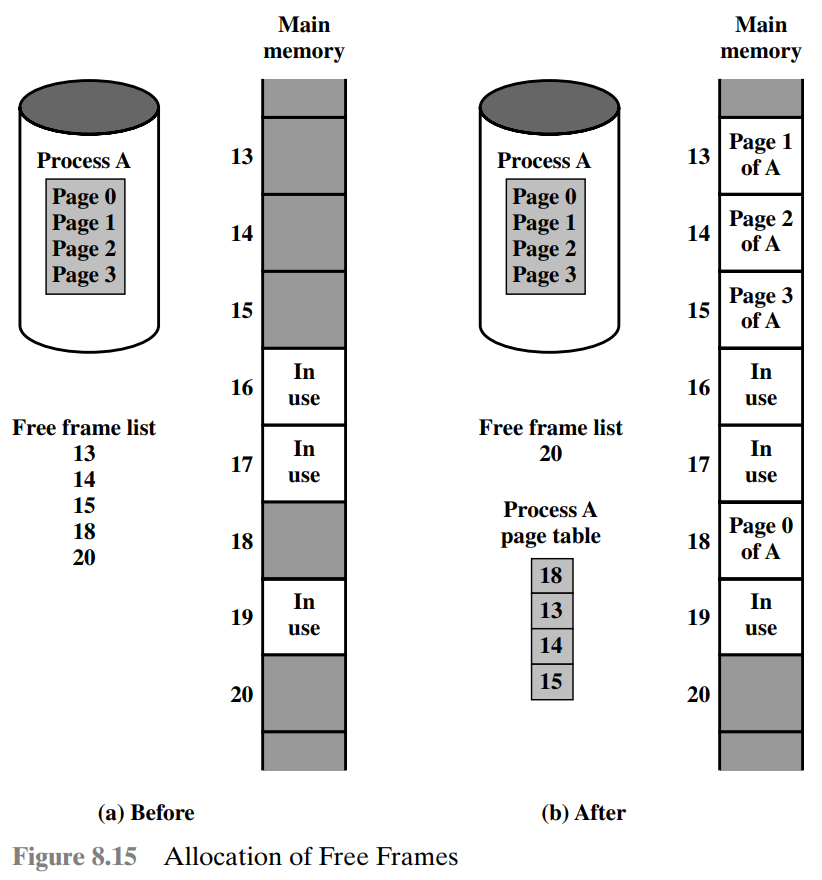

## 8.1 OS Overview
> **OS** is a program that:
> - Manages the computer's resource
> - Schedules the execution of other programs
> - Provide an interface between user and hardware

### 8.1.1 OS Objectives and Functions
#### 8.1.1.1 The OS as a User/Computer Interface
OS typically provides services in the following areas:
- **Program creation**

    The OS provides a variety of facilities and services, such as editors and debuggers, to assist the programmer in creating programs
- **Program execution**

    a number of tasks need to be performed to execute a program
    - Load data & instruction into memory
    - Initialize I/O device
- **Access to I/O devices**

    Each I/O device requires its own specific set of instructions or control signals for operation. 
    
    The OS takes care of the details so that the programmer can think in terms of simple reads and writes.

    说白了就是隐藏实现细节
- **Controlled access to files**

    control must include an understanding of not only the nature of the I/O device (disk drive, tape drive) but also the file format on the storage medium

    说白了还是隐藏细节
- **System access**

    OS control access to specific system resources and resolve conflicts for resource contention
- **Error detection and response**

    OS make response
    
    ending the program, retrying the operation, reporting the error
- **Accounting**

    Collect usage statistics for various resources

#### 8.1.1.2 The OS as Resource Manager
A computer is a set of resources for the movement, storage, and processing of data and for the control of these functions. The OS is responsible for managing these resources.

图中memory中的一部分是OS的，这之中包含了**kernel(nucleus)**:
>  *kernel* contains the most frequently used functions in the OS and, at a given time, other portions of the OS currently in use

Memory是由==OS==和==memory-management hardware in CPU==共同管理的

The OS decides ==when an I/O device can be used== by a program in execution
### 8.1.2 Types of OS
- **Uniprogramming**

    > works only ==one program== at a time
- **Multiprogramming**

    > keep the processor as busy as possible, by having it work on ==more than one program== at a time

    Several programs are loaded into memory, and the processor ==switches rapidly== among them

#### 8.1.2.1 Multiprogrammed Batch Systems
**simple batch systems**有很严重的问题：鉴于CPU的运行速度比I/O device快得多，CPU大部分时间都在等待

这时候我们就可以压榨CPU，让他闲不下来：

这就是**multiprogramming / multitasking**

## 8.2 Scheduling
**process**是这之中重要的概念，我们有多种方式理解这概念：
> - a program in execution
> - the "animated spirit" of a program
> - that entity to which a processor is assigned

有下面四种不同的scheduling(第四个是I/O scheduling):
### 8.2.1 Long-Term Scheduling
>  determines which programs are admitted to the system for processing

it controls the **degree** of multiprogramming (==number of processes== in memory)

Once admitted, a job or user program becomes a ==process== and is added to the ==queue== for the ==short-term== scheduler

sometimes a newly created process begins in a ==swapped-out== condition, in which case it is added to a queue for ==medium-term== scheduler 

### 8.2.2 Medium-Term Scheduling
it is part of the ==swapping function==, and the swapping-in decision is based on the need to manage the degree of multiprogramming

### 8.2.3 Short-Term Scheduling
Also known as **dispatcher**

it executes frequently and makes the fine-grained decision of which job to execute next

#### 8.2.3.1 Process States

- **New**

    A program is admitted by the high-level scheduler but is not yet ready to execute. The OS will initialize the process, moving it to the ready state.
- **Ready**

    The process is ready to execute and is awaiting access to the processor.
- **Running**

    The process is being executed by the processor.
- **Blocked / Waiting**

    The process is suspended from execution ==waiting for some system resource==, such as I/O.
- **Exit / Halted**

    The process has terminated and will be destroyed by the OS.

而对于每个process来说，OS必须维护一些和process相关的信息，这就是**process control block(PCB)**：

也就是包括了：
- **Identifier**
- **State**
- **Priority**
- **Program counter**

    The address of the next instruction in the program to be executed
- **Memory pointers**

    The starting and ending locations of the process in the memory
- **Context data**

    大概就是记录process进行位置的环境，方便中断完resume之后继续工作的
- **I/O status information**

    Includes outstanding I/O requests, I/O devices (e.g., tape drives) assigned to this process, a list of files assigned to the process, and so on.
- **Accounting information**

    May include the amount of processor time and clock time used, time limits, account numbers, and so on

When the scheduler accepts a new job or user request for execution, it creates a ==blank process control block== and places the associated process in the new state. 

After the system has properly filled in the process control block, the process is transferred to the ==ready== state.

#### 8.2.3.2 Scheduling Techniques
the ==major elements== of the OS involved in the multiprogramming and scheduling of processes：

Once the interrupt or service call is handled, the short-term scheduler is invoked to ==select a process== for execution

为了做到上述事情，OS维护了三种queue:
- **long-term queue**

    > a list of jobs waiting to use the system

    As conditions permit, the high-level scheduler will ==allocate memory== and ==create a process== for one of the waiting items
- **short-term queue**

    > consists of all processes in the ready state

    It is up to the short-term scheduler to pick one
- **I/O queue**

    ==More than one== process may request the use of the ==same== I/O device. All processes waiting to use each device are lined up in that device’s queue

总之先后顺序大概是：

## 8.3 Memory Management
- uniprogramming system

    main memory is divided into two parts:
    - OS
    - the program currently being executed
- multiprogramming system

     the “user” part of memory is ==subdivided== to accommodate multiple processes.

     The task of subdivision is carried out dynamically by the OS and is known as **memory management**

### 8.3.1 Swapping
鉴于CPU的速度比I/O快得多，以至于即便有multiprocessing，还是可能出现，main memory之中的所有task都已经处于中间的等待状态了，而CPU此时理论上确实就没事干了。

作为万恶的使用者，我们当然想尽可能压榨性能，所以就有了**swapping**:

大致流程是，CPU *swaps* 一些正在处于等待I/O状态的process回到disk里的**intermediate queue**(专门用来存放这些被踢回来的process的queue)，接着从*long-term queue*里面拿一些process来处理。假设*intermediate queue*里面的process被I/O处理完了(回到ready状态)，就会被*swap*回来

需要注意的是，*swap*本身也是I/O操作，也就是说，这是有风险的操作，它有可能会让情况变得更加糟糕。但是鉴于disk也不是最慢的I/O，所以一般来说也没啥问题

### 8.3.2 Partitioning
也就是对memory进行分块的操作

最简单的方案是：
- **fixed-size partitions**

    可以同样大小，也可以不同，但两者都是==大小不会变化的==:

    

    显然这样子的空间利用率不高

一个更加理智的做法当然是动态长度：
- **variable-size partitions**

    每个程序都只会被分配恰好大小的空间

    

然而这样也会带来新的问题：出现了很多==holes==，这些空隙都太小了没法利用

其中一种解决方法是**compaction**:
> From time to time, the OS ==shifts== the processes in memory to place all the free memory together in one block

然而缺点很明显，就是非常花时间

在我们介绍更好的解决方法之前，我们需要先解决一点小问题。

我们知道，每个process都包含了instructions，其中包含了data和其它instruction的==address==。这些address会随着每次==swap==操作的进行而改变，这就非常难以定位了

为此，我们区分两种不同的address概念：
- **logical address**

    > expressed as a location ==relative== to the ==beginning of the program==

    instruction里面只存*logical address*
- **physical address**

    > actual location in the memory

    When the processor executes a process, it automatically ==converts from logical to physical address== by adding the current starting location of the process, called its base address, to each logical address.

### 8.3.3 Paging
partition实在是太逊了，paging才是解决方法

memory is partitioned into equal ==fixed-size== chunks that are relatively small (**frames**), and each process is also divided into ==fixed-size== chunks of some size (**pages**)

鉴于两者都很小，我们可以相对精确地分配合适数量的*frames*给process的*pages*。浪费的memory顶多是最后一个*page*所在的*frame*的一部分

鉴于一个process被分配到的*frame*们可能并不连续，我们可以继续使用*logical address*的思想，给每一个process都维护一个**page table**，来记录这个process到底被分配到了哪几个*frame*里面:

### 8.3.4 Virtual Memory
#### 8.3.4.1 Demand Paging
- **demand paging**

    > each page of a process is brought in ==only when it on demand==

    按需加载process里面的部分pages

    好处是可以容纳更多的process，不需要的page不加载也节省时间

- **page fault**

    > required page is ==not in memory==

    OS swap in the required page
- **page replacement**

    顾名思义，扔掉一些page并加载一些page
- **Thrashing**

    > the processor spends most of its time swapping pages rather than executing instructions.

    CPU光顾着swap，都不干正事了

    至于一些可行的解决方法：
    - Good page replacement algorithms
        - Least Recently Used (LRU)
        - First In First Out (FIFO)
    - Reduce number of processes running
    - more memory
