## 9.1 The Arithmetic and Logic Unit
The ALU is that part of the computer that actually performs ==arithmetic== and ==logical== operations on data. 

All of the other elements of the computer system—control unit, registers, memory, I/O—are there mainly to ==bring data into== the ALU for it to process and then to ==take the results back out==

It handles ==integers==, and may handles ==floating point== numbers using **FPU**

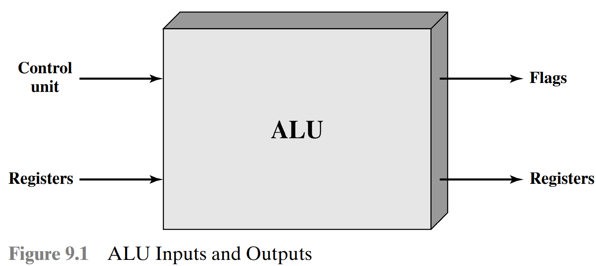

## 9.2 Integer Representation
我们只能使用`0 / 1`来表示数字。然而我们理论上还需要`-`来表示负数，用**period / radix point**来表示浮点

对于表示负数，有两种表示方法：
### 9.2.1 Sign-Magnitude Representation
非常粗暴，二进制的第一个数字就是**sign bit**：
- 0表示正数
- 1表示负数

这也会带来比较诡异的问题，比如会出现`-0`和`+0`这种东西

实际上ALU一般不用这种表示方式

### 9.2.2 Twos Complement Representation
梦回计算机导论

说人话的理解方式是：
- 第一位还是sign bit
- 正数不变
- ==负数则是按位取反(one's complement)，最后+1(two's complement)==

e.g.
$$
-2=11111110
$$
需要注意的是，因为第一位是sign bit，所以能表示的数字的范围是：
$$
-2^{n-1}\sim 2^{n-1}-1
$$
也就是说，第一位数字是==不参与数值大小的表示==的(虽然说它==参与取反运算==)

这种表示方法的优点是：
- Arithmetic works easily
- Negating is fairly easy
- 只有一种0的表示方式

### 9.2.3 Converting between Different Bit Lengths
- **sign-magnitude**

    > move the sign bit and fill in with zero

    e.g.

    $$
    \begin{aligned}
        -18=&10010010\\
        =10000000&00010010
    \end{aligned}
    $$
    简单的移位并添加对应数量的0
- **two's complement**

    - positive number: 和之前一样操作
    - negative number: 区别在于，这次需要填的是==1==

    e.g.
    $$
    \begin{aligned}
        -18=&11101110\\
        =111111111&11101110
    \end{aligned}
    $$

## 9.3 Integer Arithmetic
### 9.3.1 Negation
虽然说一般情况下，对已经使用two's complement表示的负数再进行一次two's complement的操作，会得到相应的正数，这之中==有一个例外是$-2^{n-1}$==：
$$
\begin{aligned}
    -128=&10000000\\
    \text{bitwise not=}&01111111\\
    \text{add 1: }&10000000
\end{aligned}
$$
可以看到，$n=8$的例子下，$-(-2^7)=-2^7$，看着不符合正常的运算规则。但也是有原因的，毕竟$n=8$的情况下能表示的最大正整数是$2^7-1=127=01111111$，再$+1$之后只会发生overflow

另一个特例是0：
$$
\begin{aligned}
    0=&00000000\\
    \text{bitwise complement}=&11111111\\
    \text{add 1: }&100000000=0
\end{aligned}
$$
可以看到most significant bit存在**carry out**，然而这种特殊情况下，我们==忽略了这个1==

### 9.3.2 Addition and Subtraction
下图是addition的几种情况:

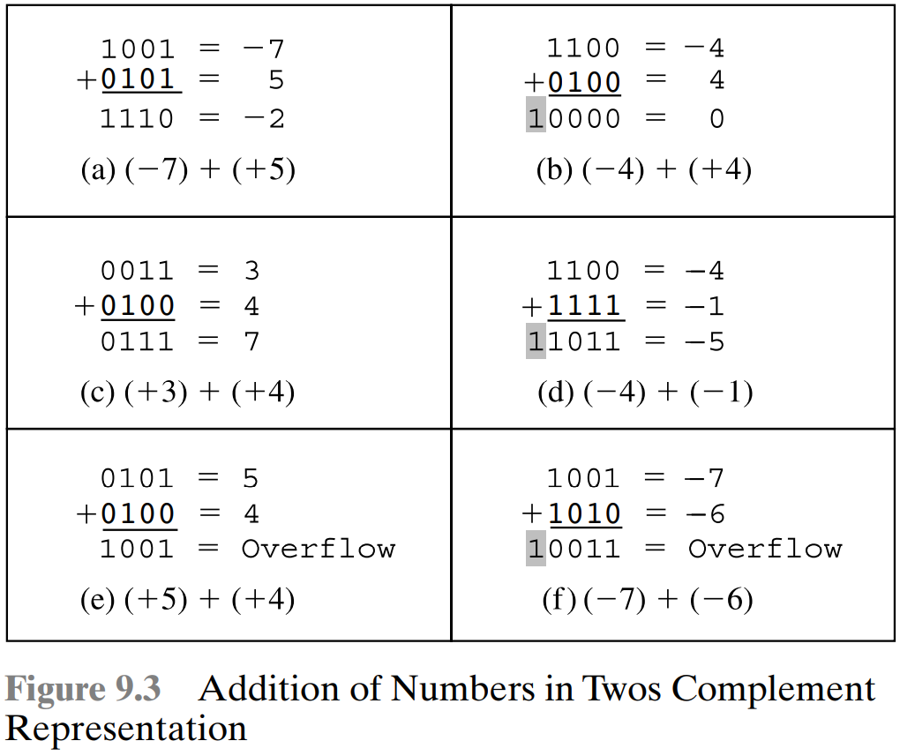

(a)~(d)的结果都是运算没有发生异常的结果。需要注意的是，(b)和(d)之中的结果有5位，而==溢出的那个1需要被忽略(无论overflow发生与否)==

而(e)和(f)则是展示了发生**overflow**的结果。*overflow*的检测机制如下：
> If two numbers are added, and they are ==both positive== or ==both negative==, then overflow occurs if and only if the result has ==the opposite sign==

只要overflow发生了，那么运算的结果就==无法使用==

值得一提的是，overflow并不是只有在多了一位的情况下才能发生，比如(e)

subtraction $M-S$ 如下图：

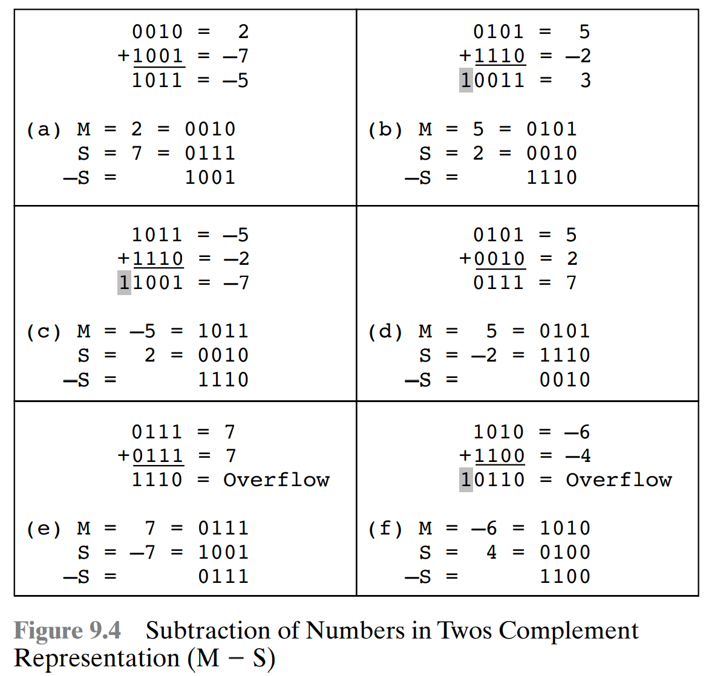

就是转换成加法来算就可以了，overflow的判断也是利用转换后的加法来判断

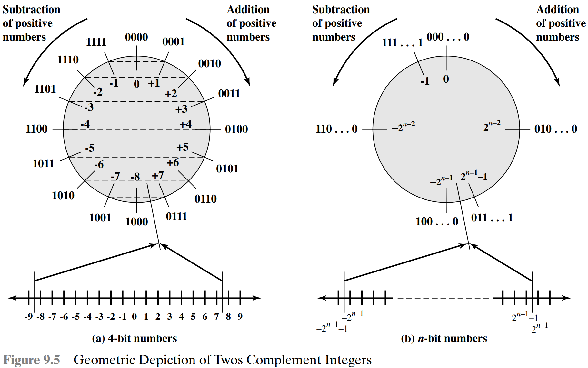

转盘可以辅助理解：加正数就是顺时针转动，减正数就是逆时针

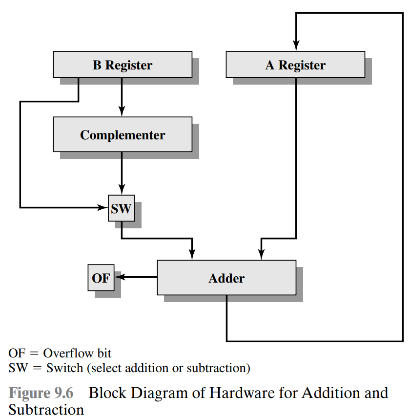

### 9.3.3 Multiplication
#### 9.3.3.1 Unsigned Integers
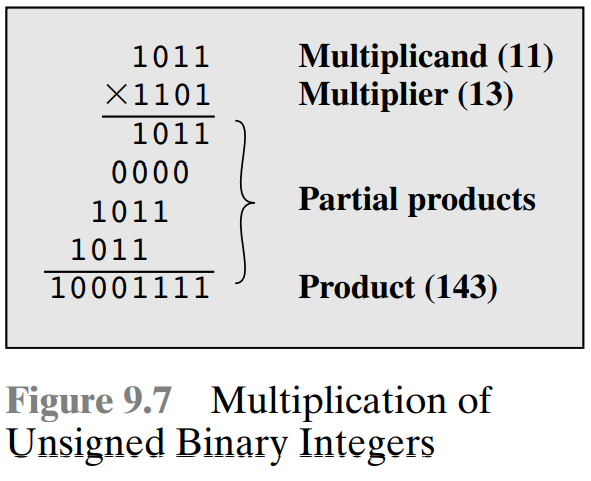

看起来和十进制的手算乘法没啥区别。需要注意的是最终结果的长度最多为$2n$(对于两个长度为$n$的乘数)

为了能够让机器高效地模仿，我们做一点优化：
- running addition

    也就是说，我们每次得到一个新的partial product，都先加起来，这样可以避免最后一大串的partial product需要加起来，register会不够
- saving time on the generation of partial products

    每次遇到1，则需要对partial product进行==add==和==shift==(向左移动)两个操作；而假如遇到的是0的话，我们则只需要==shift==

下图就是其中一种实现方式：

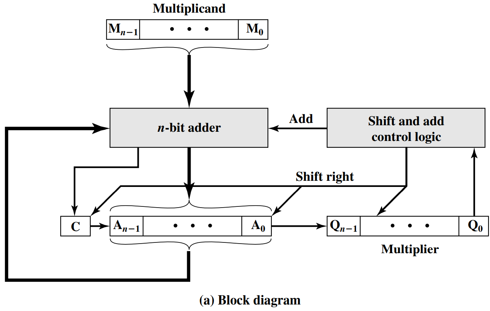

至于上图这东西怎么工作：register M里面存了被乘的数(乘号左边)，Q是乘号右边的数，C用来存carry bit，A最开始是0；每次我们都读取$Q_0$的值：1的话则将M中的数加到A中(add)，接着把C,A,Q中的数集体向右移动一位(shift)，使得C清空，$Q_0$被抛弃；0的话就只进行shift；不难看出最终的结果就是在A,Q两个寄存器里面

#### 9.3.3.2 Twos Complement Multiplication
我们需要特殊的算法：**Booth's algorithm**

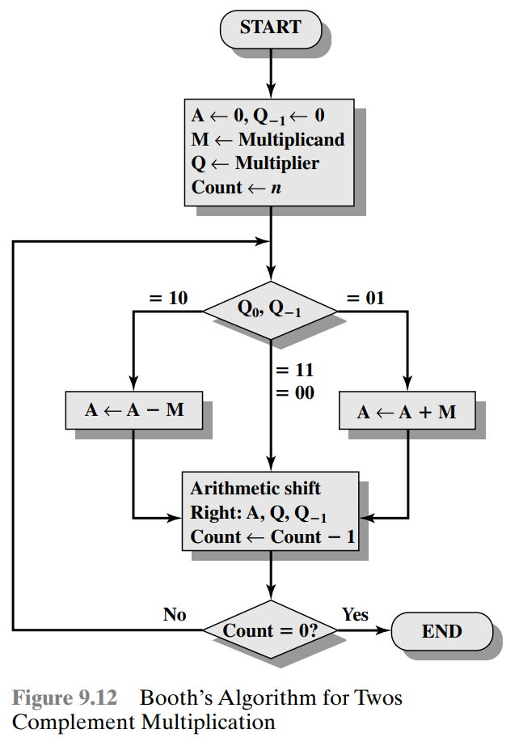

看个例子：

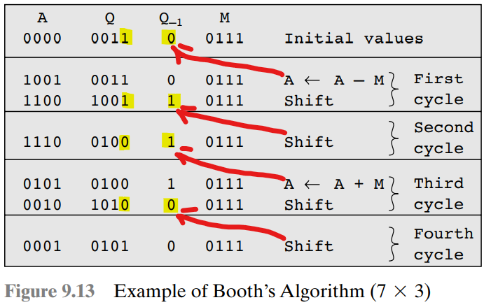

想必你能看懂这个例子在干啥、考试的时候需要写得这么详细才会有分！

### 9.3.4 Division
鉴于课件上只讲了unsigned integer的情况，我们这里也只介绍这种

这种情况下非常简单，就和手算除法一模一样：

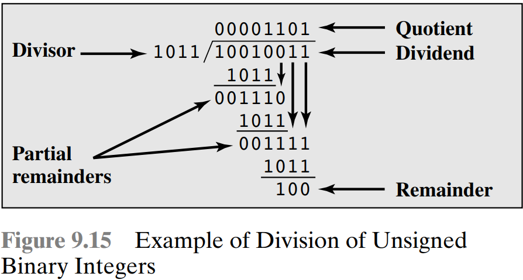

至于算法的实现需要理解一下：

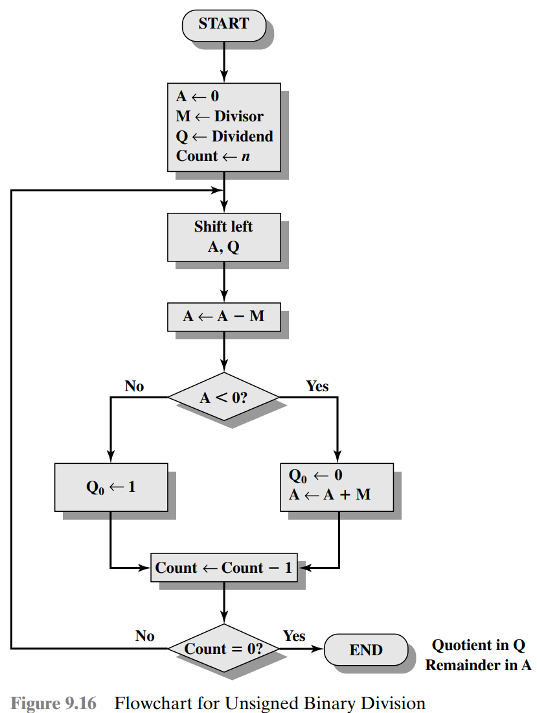

## 9.4 Floating-Point Representation
我们要使用类似于科学计数法的方式来存储：
$$
\plusmn S\times B^{\plusmn E}
$$
我们因此需要存储三类：
- $\plusmn$

    sign
- $S$

    significand 有效数字

    然而我们知道==小数点前面那一位绝对是1==，所以可以不存这个1

- $E$

    exponent

    鉴于exponent也可能是负数，我们需要个方法来表示这些负数。这次我们没有使用一位来直接存储sign，而是选择，给要被存储的==指数都加上$2^{k-1}-1$==($k$是用来存储biased exponent的位数)，使得所有指数变成正数

    也就是说，我们只能==存储范围是$-(2^{k-1}-1)\sim 2^{k-1}$的指数==

e.g.

有很多细节:
- significand小数点前的1确实没有被存储
- significand转换为十进制是：$$1+2^{-1}+2^{-3}+2^{-7}=1.638125$$
- 指数加上了$2^7-1=01111111$

总结一下可以表示的数的范围(以32位为例):
- exponent

    $$-127\sim 128$$
- significand

    $$1.0...0\sim 1.1...1\\\rArr 1\sim 2-2^{-23}$$
- negative numbers

    $$-(2-2^{-23})\times 2^{128}\sim -2^{-127}$$
- positive numbers

    $$2^{-127}\sim (2-2^{-23})\times 2^{128}$$

也就是：

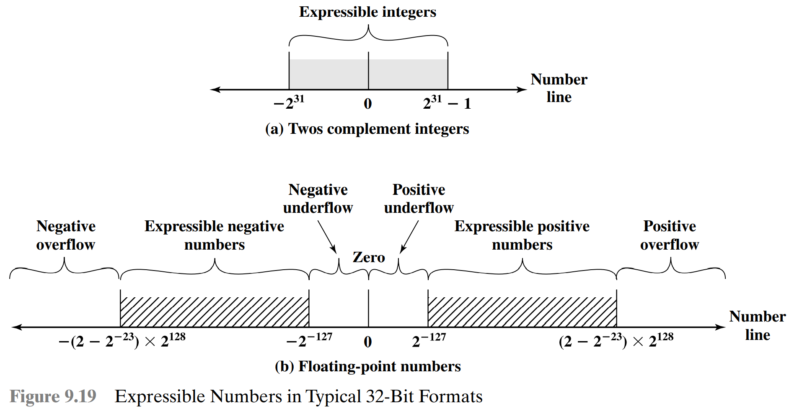